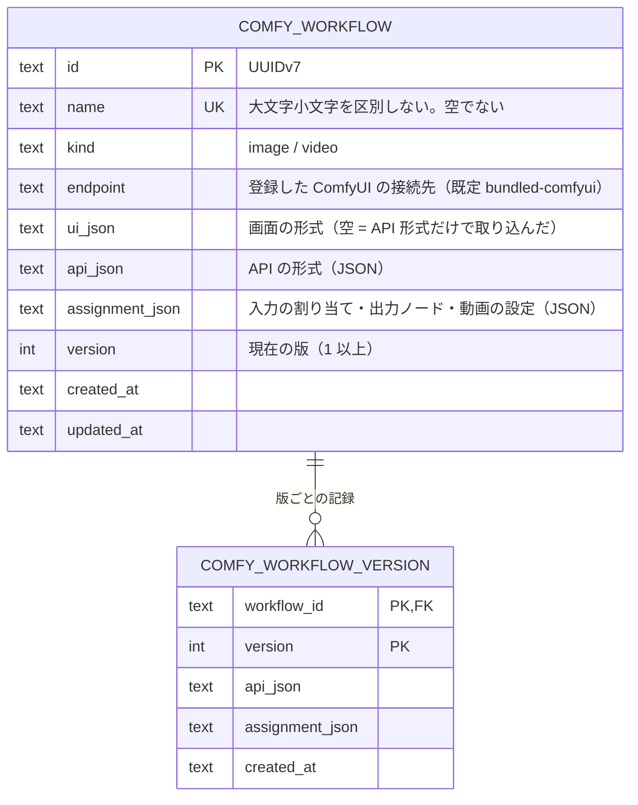

# ER / データモデル: ComfyUI ワークフロー

[er.md](../er.md) の続き（`er.md` が行数上限を超えているため別ファイル）。[comfy-workflows.md](comfy-workflows.md) のテーブル。改訂履歴は [er.changelog.md](../er.changelog.md)。

| テーブル | 内容 |
|---|---|
| `comfy_workflow` | 保存したワークフロー。Project に属さない（全体で 1 つ）。`kind` と `version` は CHECK。`api_json`・`assignment_json` は有効な JSON（CHECK） |
| `comfy_workflow_version` | 各版の `api_json` と `assignment_json`。Take の `model_name`（`comfy:<id>@v<N>`）から「どのワークフローのどの版で作ったか」を追い、古い版を実行するための最小の記録。ワークフローの削除で一緒に消える（`ON DELETE CASCADE`） |

`take.model_name`・`cost_ledger_entry.provider`・Shot の `video_model` の LOCK 値は、外部キーを持たない文字列として識別子を持つ（ワークフローを削除しても Take は残る）。プロジェクトバンドルには含めない（取り込みでは足りない版を警告）。

マイグレーション: `20261025120000_comfy_workflow.sql`（up で 2 テーブルを作成、down で `DROP TABLE`。往復をテストする）。
