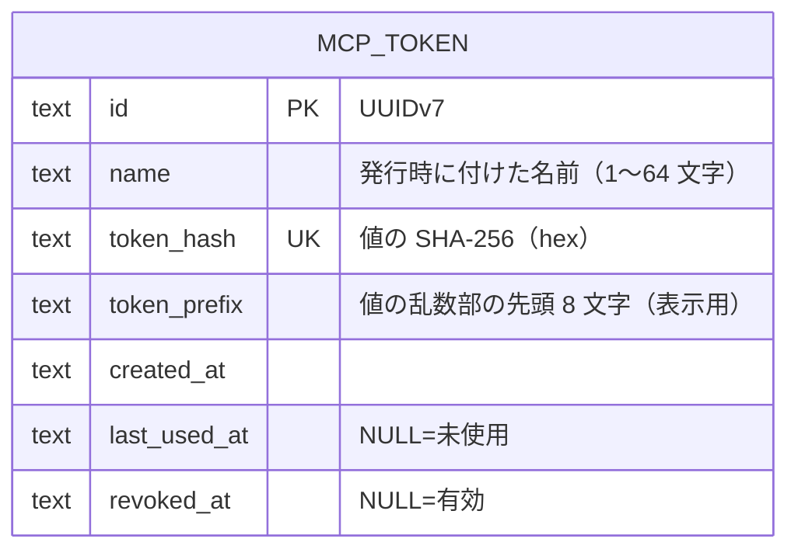

# ER / データモデル: MCP トークン

[er.md](er.md) の続き。MCP サーバー（[mcp.md](mcp.md)）のベアラートークンのテーブル。`er.md` が行数上限を超えているため別ファイルにしている。改訂履歴は [er.changelog.md](er.changelog.md) に足す。

`mcp_token` は他のテーブルと外部キーを持たない（Project に属さない設定）。

| テーブル | 内容 |
|---------|------|
| `mcp_token` | MCP サーバーのベアラートークン。`id` PK。`name` は空でない（CHECK）。`token_hash` は値（`mam_mcp_` ＋ 32 バイト乱数の base64url）の SHA-256 の hex で UNIQUE。**値そのものは保存しない**（発行の応答で一度だけ画面に出る）。`token_prefix` は乱数部の先頭 8 文字で、一覧でトークンを見分けるための表示用。`created_at` は UTC のミリ秒 ISO 8601。`last_used_at` は検証に成功したときにトークンごとに最大 1 分に 1 回更新する（NULL は未使用）。`revoked_at` が NULL でなければ失効済みで、検証は常に失敗する（失効の再実行は最初の時刻を残す）。行は消さない（一覧に「失効済み」として残る） |

マイグレーション: `20261024120000_mcp_token.sql`（up で作成、down で `DROP TABLE`）。
