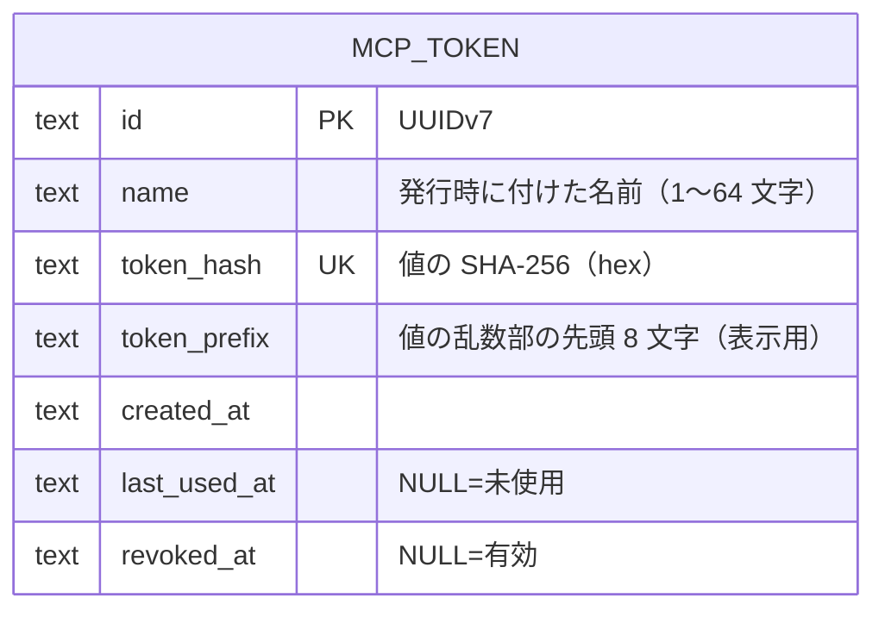
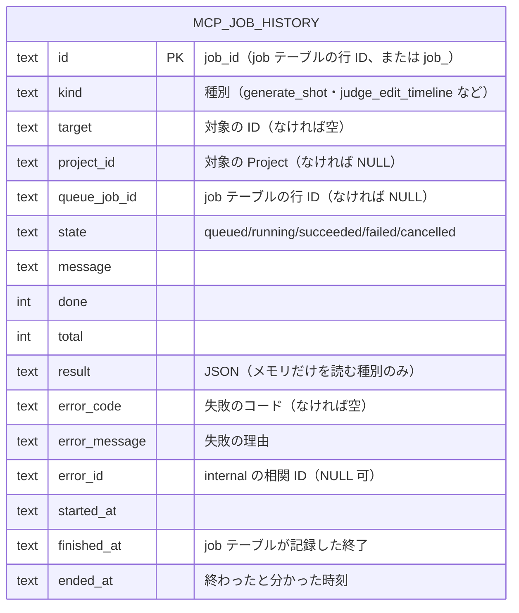

# ER / データモデル: MCP トークン

[er.md](er.md) の続き。MCP サーバー（[mcp.md](mcp.md)）のベアラートークンと、長い操作の履歴のテーブル。`er.md` が行数上限を超えているため別ファイルにしている。改訂履歴は [er.changelog.md](er.changelog.md) に足す。

`mcp_token` は他のテーブルと外部キーを持たない（Project に属さない設定）。

| テーブル | 内容 |
|---------|------|
| `mcp_token` | MCP サーバーのベアラートークン。`id` PK。`name` は空でない（CHECK）。`token_hash` は値（`mam_mcp_` ＋ 32 バイト乱数の base64url）の SHA-256 の hex で UNIQUE。**値そのものは保存しない**（発行の応答で一度だけ画面に出る）。`token_prefix` は乱数部の先頭 8 文字で、一覧でトークンを見分けるための表示用。`created_at` は UTC のミリ秒 ISO 8601。`last_used_at` は検証に成功したときにトークンごとに最大 1 分に 1 回更新する（NULL は未使用）。`revoked_at` が NULL でなければ失効済みで、検証は常に失敗する（失効の再実行は最初の時刻を残す）。行は消さない（一覧に「失効済み」として残る） |

マイグレーション: `20261024120000_mcp_token.sql`（up で作成、down で `DROP TABLE`）。

## ジョブの履歴（`mcp_job_history`）

MCP が `job_id` を返す全種別（`job` テーブルの行を持たないものを含む）の履歴。他のテーブルと外部キーを持たない（Project を消しても履歴は残るので `project_id` は参照にしない。書き出しにも含めない）。

| テーブル | 内容 |
|---------|------|
| `mcp_job_history` | `id` PK は `get_job` に渡す `job_id`。`queue_job_id` があれば `job.id` と同じ。`kind` は空でない（CHECK）。`state` は `mcpkit.JobState` の 5 値（CHECK）。`project_id` は開始時に `target`（Project・Shot・Take・Edit Timeline の ID）から引く。`message`・`done`・`total`・`state`・失敗の列は `get_job` / `list_jobs` が状態を確かめるたびに書き戻す（状態の決め方は `job` テーブルの行と Probe のまま）。`result` は Probe がメモリだけを読む種別の結果の JSON（`json_valid`）で、他の種別は NULL（Probe が永続化済みの状態から導き直す）。`error_code` は失敗の `<code>: <message>` の `<code>`、`error_message` は理由、`error_id` は `internal` の失敗の相関 ID（ログの `error_id` と同じ値。[mcp.md](mcp.md) §6）。`started_at`・`finished_at`・`ended_at` は UTC のミリ秒 ISO 8601。**保存期間 30 日・10,000 行**で、超えたぶんは `started_at` の古い順に、行の追加と mam の起動時に消す。索引: `idx_mcp_job_history_started (started_at DESC, id DESC)`（一覧・削除）、`idx_mcp_job_history_open (started_at) WHERE state IN ('queued','running')`（終わっていないものの再確認） |

マイグレーション: `20261031120000_mcp_job_history.sql`（up で作成、down で索引とテーブルを削除）。
