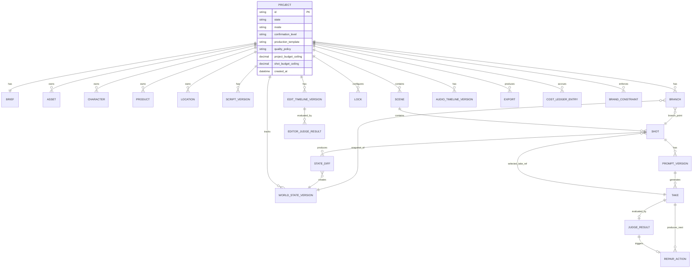
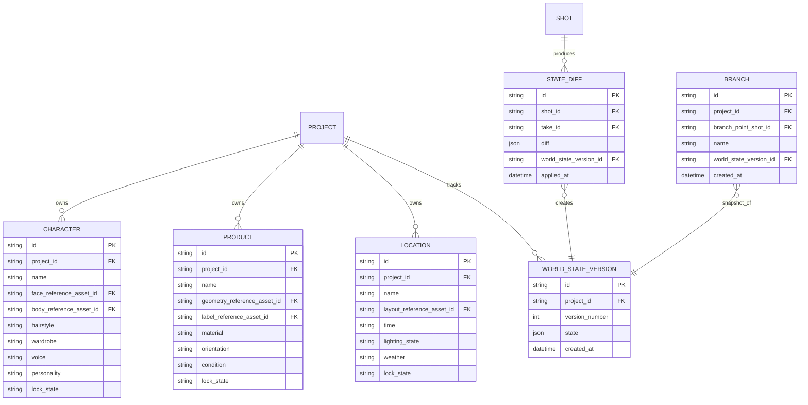
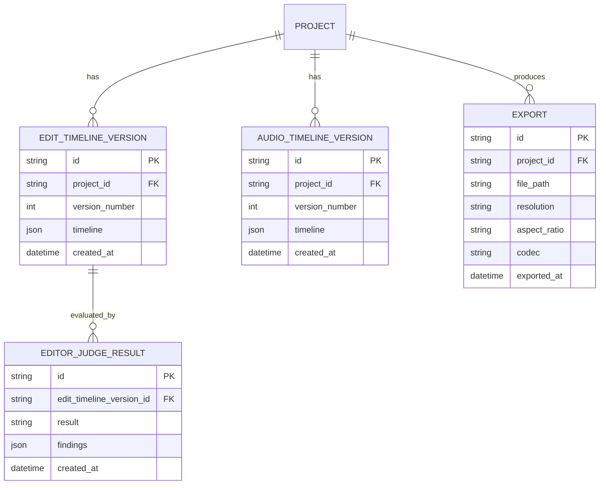
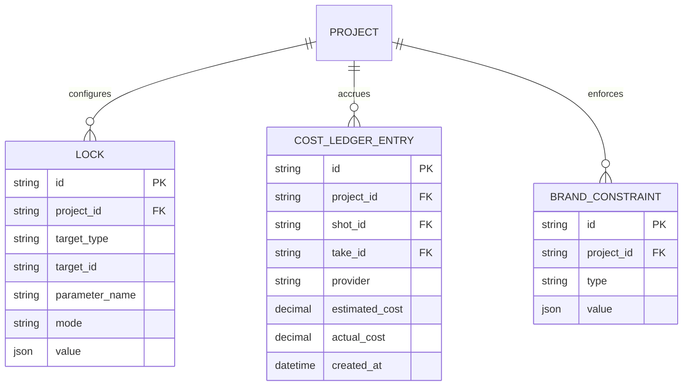

# ER / データモデル

`spec/spec.md` §9（World State Schema）・§12（Judge Output）・§13（Repair/Retake）・§14（Take System）・§21（Project Data Model）・§22（Core State Machine）を SQLite テーブル設計へ落とし込む。永続化先は `spec/architecture/overview.md` の SQLite（WAL mode）。

## 1. 全体 ER 図

## 2. ドメイン別 ER 図

### 2.1 制作進行（Scene / Shot / Take / Judge / Repair）

```mermaid
erDiagram
    SCENE ||--o{ SHOT : contains
    SHOT ||--o{ PROMPT_VERSION : has
    PROMPT_VERSION ||--o{ TAKE : generates
    TAKE ||--o| JUDGE_RESULT : evaluated_by
    JUDGE_RESULT ||--o| REPAIR_ACTION : triggers

    SCENE {
        string id PK
        string project_id FK
        int order_index
        string title
        string location_id FK
        string time
        string objective
        string state
    }
    SHOT {
        string id PK
        string scene_id FK
        int order_index
        string objective
        float duration_seconds
        json shot_spec
        string state
        string selected_take_id FK
    }
    PROMPT_VERSION {
        string id PK
        string shot_id FK
        int version_number
        json shot_spec_snapshot
        json model_adapter_output
        datetime created_at
    }
    TAKE {
        string id PK
        string prompt_version_id FK
        string model_name
        json model_parameters
        string file_path
        string status
        json scores
        datetime created_at
    }
    JUDGE_RESULT {
        string id PK
        string take_id FK
        string result
        float overall_confidence
        json issues
        json preserve
        datetime created_at
    }
    REPAIR_ACTION {
        string id PK
        string judge_result_id FK
        string action_type
        json instructions
        string resulting_take_id FK
        datetime created_at
    }
```

### 2.2 World State / Continuity

### 2.3 編集・音声・書き出し

### 2.4 制御・コスト・ブランド制約

## 3. テーブル定義・制約・インデックス

| テーブル | 主要制約 | インデックス |
|---------|---------|------------|
| `project` | `id` PK。`state` は Core State Machine（§22）の値のみ許可（CHECK制約）。`mode` は `auto/director`、`confirmation_level` は `full_auto/key_check/custom_check`、`production_template` は `product_cm/drama/anime/sns_short`、`quality_policy` は `fast/balanced/max_quality` のいずれか（各CHECK制約） | `idx_project_state (state)` |
| `brief` | `project_id` UNIQUE FK（1:1） | - |
| `asset` | `project_id` FK。`type` は `image/video/reference` のいずれか | `idx_asset_project (project_id)` |
| `character` / `product` / `location` | `project_id` FK。`lock_state` は `auto/manual/lock` のいずれか（CHECK制約） | `idx_character_project (project_id)` 等 |
| `script_version` | `project_id` FK。`(project_id, version_number)` UNIQUE | - |
| `scene` | `project_id` FK。`(project_id, order_index)` UNIQUE | `idx_scene_project_order (project_id, order_index)` |
| `shot` | `scene_id` FK。`selected_take_id` は `take.id` への FK（NULL許容）。`state` は Core State Machine のサブ状態のみ許可 | `idx_shot_scene_order (scene_id, order_index)` |
| `prompt_version` | `shot_id` FK。`(shot_id, version_number)` UNIQUE | `idx_prompt_version_shot (shot_id)` |
| `take` | `prompt_version_id` FK。`status` は `candidate/ai_pick/selected/rejected` のいずれか | `idx_take_prompt_version (prompt_version_id)`, `idx_take_status (status)` |
| `judge_result` | `take_id` UNIQUE FK（最新判定を1件、履歴は再生成のたびに新規Takeを作るため1:1で十分）。`result` は `pass/fail` | `idx_judge_result_take (take_id)` |
| `repair_action` | `judge_result_id` FK。`resulting_take_id` は次に生成された `take.id`（NULL許容 = 未生成） | `idx_repair_action_judge_result (judge_result_id)` |
| `world_state_version` | `project_id` FK。`(project_id, version_number)` UNIQUE、`version_number` は単調増加 | `idx_world_state_version_project (project_id, version_number)` |
| `state_diff` | `shot_id` FK、`take_id` FK、`world_state_version_id` FK | `idx_state_diff_shot (shot_id)` |
| `branch` | `project_id` FK、`branch_point_shot_id` FK、`world_state_version_id` FK（Snapshot） | `idx_branch_project (project_id)` |
| `edit_timeline_version` / `audio_timeline_version` | `project_id` FK。`(project_id, version_number)` UNIQUE | `idx_edit_timeline_project (project_id, version_number)` |
| `editor_judge_result` | `edit_timeline_version_id` FK。`result` は `pass/re_edit/need_shot` | `idx_editor_judge_result_timeline (edit_timeline_version_id)` |
| `export` | `project_id` FK | `idx_export_project (project_id)` |
| `lock` | `project_id` FK。`(project_id, target_type, target_id, parameter_name)` UNIQUE。`mode` は `auto/manual/lock` | `idx_lock_project_target (project_id, target_type, target_id)` |
| `cost_ledger_entry` | `project_id` FK。`shot_id`/`take_id` は NULL 許容（プロジェクト全体コストの場合） | `idx_cost_ledger_project (project_id)` |
| `brand_constraint` | `project_id` FK。`type` は `forbidden_expression/required_disclaimer/product_claim/logo_rule/character_restriction/asset_rights/platform_rule` のいずれか | `idx_brand_constraint_project (project_id)` |

## 4. 設計メモ

- **Shot Spec の格納**: `shot.shot_spec` および `prompt_version.shot_spec_snapshot` は `spec/spec.md` §7.1 の YAML 構造を JSON にシリアライズして格納する（モデル非依存の Canonical Shot Spec を Source of Truth とする、`spec/architecture/overview.md` §1 の設計原則に対応）
- **Take と再生成の関係**: Repair/Retake により再生成された結果は新しい `take` 行として追加する（既存 Take は不変・Traceability保持）。`repair_action.resulting_take_id` で追跡する
- **World State のバージョニング**: Shot完了ごとに `state_diff` を生成し、新しい `world_state_version` を追加する（追記のみ、上書きしない）。ユーザーが LOCK した項目は State Extractor（Agent側ロジック）が diff 対象から除外する
- **Branch の Snapshot**: Branch作成時点の `world_state_version_id` を参照するのみで、Branch自体は新しい `world_state_version` 系列を独立して持つ（Branch以降の変更は元系列に影響しない）
- **JSON カラム**: SQLite の `JSON` 型（TEXT + `json_valid` CHECK制約）を用いる。将来的な検索要件が増えた場合は生成列（generated column）でインデックスを追加する

## 改訂履歴

| 版 | 日付 | 変更内容 | 変更理由 |
|----|------|---------|---------|
| 1.0 | 2026-09-28 | 新規作成 | `spec/spec.md` §9,12,13,14,21 の概念モデルを SQLite テーブル設計として具体化 |
| 1.1 | 2026-09-28 | 全体ER図で `SHOT` から自分自身への誤った自己参照になっていた `selected_take_ref` の関係定義を `SHOT` → `TAKE` へ修正 | `shot.selected_take_id` が `take.id` への FK である実際のテーブル定義と図の関係定義が矛盾していたための表記修正 |
| 1.2 | 2026-09-28 | 全体ER図の `PROJECT` エンティティに `mode`/`confirmation_level`/`production_template`/`quality_policy`/`project_budget_ceiling`/`shot_budget_ceiling` 属性を追加し、`project` テーブル定義の制約説明を更新 | F-02/F-03/F-21/F-22 に対応する `PUT /projects/:id/mode` 等のAPIエンドポイントの書き込み先カラムが仕様上存在しなかったため（整合性レビュー指摘） |
