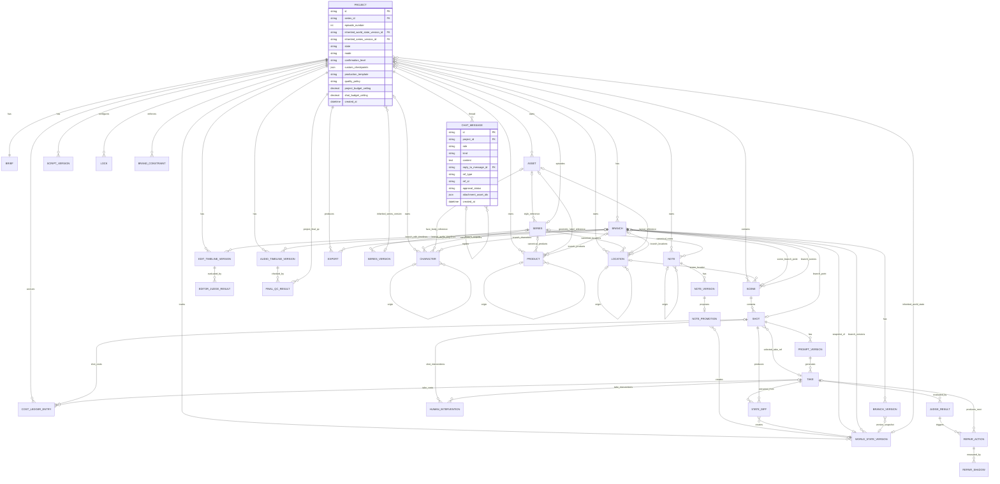
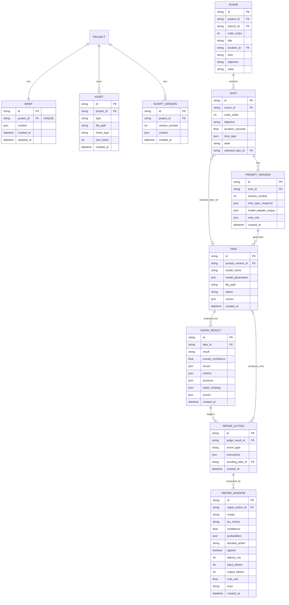
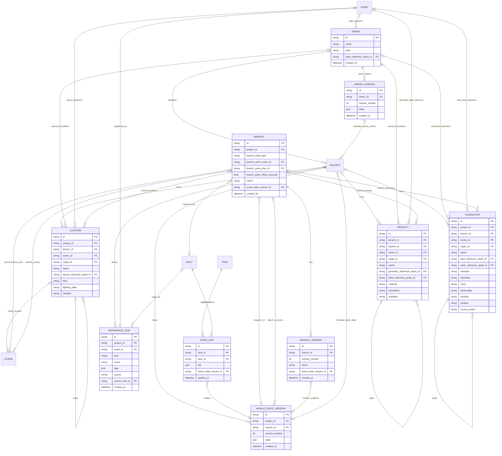
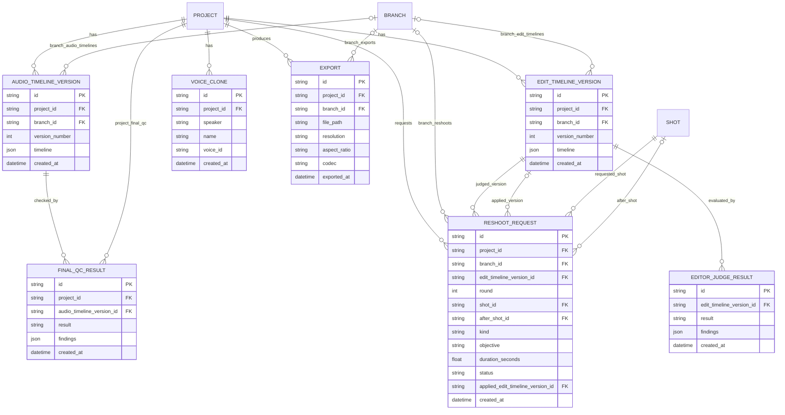
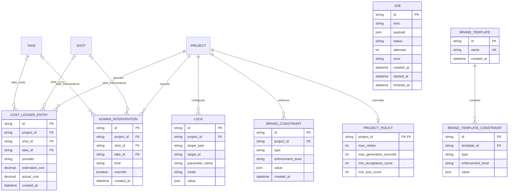
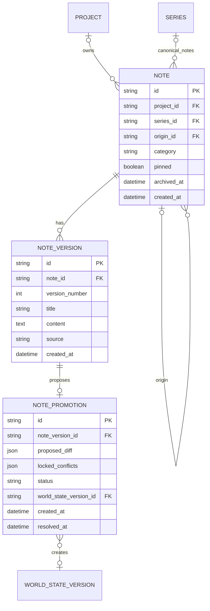
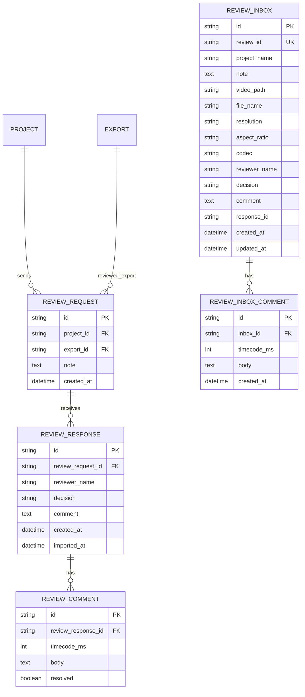

# ER / データモデル

`spec/spec.md` §9（World State Schema）・§12（Judge Output）・§13（Repair/Retake）・§14（Take System）・§21（Project Data Model）・§22（Core State Machine）を SQLite テーブル設計へ落とし込む。永続化先は `spec/architecture/overview.md` の SQLite（WAL mode）。

## 1. 全体 ER 図

## 2. ドメイン別 ER 図

### 2.1 制作進行（Brief / Script / Scene / Shot / Take / Judge / Repair）

### 2.2 World State / Continuity

### 2.3 編集・音声・書き出し

### 2.4 制御・コスト・ブランド制約

### 2.5 Notes（M2）

### 2.6 Team Collaboration（M3）

`REVIEW_REQUEST` 以下の 3 表はオーナー側（Project に属しバンドルに含む）、`REVIEW_INBOX` 以下の 2 表はレビュアー側（どの Project にも属さない）。

## 3. テーブル定義・制約・インデックス

| テーブル | 主要制約 | インデックス |
|---------|---------|------------|
| `project` | `id` PK。`state` は Core State Machine（§22）の値のみ許可（CHECK制約）。`mode` は `auto/director`、`confirmation_level` は `full_auto/key_check/custom_check`（`custom_check` の確認ポイントは `custom_checkpoints`＝`domain.Checkpoint` 名の JSON 配列。`domain.Checkpoint` の全値は `script/character_design/main_visual/product_key_visual/scene_complete/rough_cut/final` だが、承認カードを出すのは `script/rough_cut/final` のみで、API・画面で選べるのもこの 3 つ）、`production_template` は `product_cm/drama/anime/sns_short`、`quality_policy` は `fast/balanced/max_quality` のいずれか（各CHECK制約）。`series_id` FK（NULL許容、NULL=単発プロジェクト）、`episode_number`（`series_id` 非NULL時のみ使用）。`(series_id, episode_number)` UNIQUE。`inherited_world_state_version_id` FK（NULL許容、前 Episode の最終 `world_state_version` を開始状態として継承する場合に設定）、`inherited_series_version_id` FK（NULL許容、Episode 開始時に継承した `series_version`。Series 作成元の Project は作成時の版） | `idx_project_state (state)`, `idx_project_series (series_id, episode_number)` |
| `series` | `id` PK。Series（複数 Episode を束ねる単位、F-29）。Character/Product/Location の正本と Reference Pack（正本行が指す参照画像）を保持する。`name` は 1〜100 文字。**Style の正本**は Series 自体の 2 カラムで持つ: `style`（テキスト。絵柄・色調・質感など、既定 `''`、500 文字以内）と `style_reference_asset_id`（FK、NULL許容、Style の参照画像）。Style は World State の対象ではなく（Shot で変化しない）、行を増やすほどの構造も持たないため、`character` 等とは別のテーブルにせず Series の属性とする | - |
| `series_version` | `series_id` FK。`(series_id, version_number)` UNIQUE。`state` は Series 正本の全体スナップショット（JSON。`name`、`style`、`style_reference`、`characters`/`products`/`locations` の正本フィールド）。正本を変えるたび（Series 作成、Character 更新、Style 更新）に新しい行を追記し、更新・削除しない（`world_state_version` と同じ追記専用）。最新の `version_number` が「現在の正本」で、Episode 開始時に継承する版として `project.inherited_series_version_id` が指す | - |
| `brief` | `project_id` UNIQUE FK（1:1） | - |
| `asset` | `project_id` FK。`type` は `image/video/reference` のいずれか | `idx_asset_project (project_id)` |
| `chat_message` | `project_id` FK、`reply_to_message_id` FK（NULL許容、返信先メッセージ）。`role` は `user/assistant`、`kind` は `text/question/approval/keyframe/take/progress/escalation`（各CHECK制約。`role=user` は `text` のみ）。`ref_type`/`ref_id` はカードが指す実体（`script_version`/`asset`/`take`/`edit_timeline_version`/`export`/`note_promotion`/`job`（Progress カード。`ref_id` は job ID）/`shot`（Escalation カード。`ref_id` は Shot ID で、Shot に紐づくときだけ）/`brief_field`・`continue`（質問カード。下記「チャットの追記と応答」）/`settings`（`kind=text` の AI 発言。ディスク容量警告で、`ref_id` は NULL。描画側が設定画面へのリンクを作る）等、NULL許容。`export` は `kind` で `ref_id` の指す先が違う: Final の Approval カード（`kind=approval`）は Export が Final QC PASS の後に作られるため `ref_id` は `final_qc_result.id`、書き出し完了の AI 発言（`kind=text`）は `ref_id` が Export ID で、描画側が `GET /projects/:id/exports/:exportId/video` のダウンロードリンクを作る）。`approval_status` は `kind=approval` のときのみ `pending/approved/changes_requested`、それ以外は NULL（CHECK制約）。`ref_type=note_promotion` の Approval カードは非ブロッキング（Project を AWAITING_APPROVAL に遷移させない）。`attachment_asset_ids` は添付 `asset.id` の JSON 配列。追記のみで更新しない（`approval_status` のみ応答時に更新可） | `idx_chat_message_project (project_id, created_at)`, `idx_chat_message_reply (reply_to_message_id)`, `idx_chat_message_ref (ref_type, ref_id)`（`ListByRef` = ジョブの状態変化・Judge 保存のたびの検索用） |
| `character` / `product` / `location` | `project_id` FK（NULL許容）と `series_id` FK（NULL許容）のちょうど一方が非NULL（CHECK制約）。`project_id` 非NULL=Project（Episode）内の行、`series_id` 非NULL=Series 正本。Episode 開始時に Series 正本から project 側の行へコピーし、`origin_id`（Series 正本行への FK、NULL許容）で由来を保持する。`branch_id` FK（NULL許容、NULL=主系列、非NULL=当該BranchのWorld State固有値。Series 正本は常にNULL） | `idx_character_project (project_id, branch_id)`, `idx_character_series (series_id)`, `idx_character_origin (origin_id)` 等 |
| `script_version` | `project_id` FK。`(project_id, version_number)` UNIQUE。`content` は JSON `{"concept": Producer の Concept/Structure, "script": Writer の Script}`（Approval カードの `ref_type=script_version`、`ref_id`=`script_version.id`）。修正依頼のたびに新しいバージョンを追記し、上書きしない | - |
| `scene` | `project_id` FK。`branch_id` FK（NULL許容、NULL=主系列/トランク、非NULL=当該Branchの派生ツリーに属するScene）。`(project_id, COALESCE(branch_id, ''), order_index)` の式 UNIQUE INDEX（SQLite の UNIQUE は NULL 同士を別扱いにするため、`COALESCE` でトランクの `branch_id IS NULL` も一意にする） | `idx_scene_project_branch_order (project_id, COALESCE(branch_id, ''), order_index)`（UNIQUE） |
| `shot` | `scene_id` FK。`selected_take_id` は `take.id` への FK（NULL許容）。`state` は Core State Machine のサブ状態のみ許可 | `idx_shot_scene_order (scene_id, order_index)` |
| `prompt_version` | `shot_id` FK。`(shot_id, version_number)` UNIQUE。`note_refs` は Shot Spec 生成時に Prompt Planner へ渡した制作メモのバージョンの JSON 配列（`[{note_id, version_number}]`、M2。メモを使わなかった場合は空配列） | `idx_prompt_version_shot (shot_id)` |
| `take` | `prompt_version_id` FK。`model_parameters` は Model 名以外の生成パラメータ（`quality_policy`・`resolution`・`duration_seconds`・`aspect_ratio`・`prompt` 等）に加え、Generation Traceability（F-27）の `world_state_version`（Take 生成時点の最新 World State バージョン番号。未完了で無ければ 0）と `references`（モデルへ渡した Reference Pack。`domain.Reference` の配列）を保持する。`status` は `candidate/ai_pick/selected/rejected` のいずれか | `idx_take_prompt_version (prompt_version_id)`, `idx_take_status (status)` |
| `judge_result` | `take_id` FK（UNIQUEではない、同一Takeへの複数回Judge実行履歴を保持）。`result` は `pass/fail`。`metrics` は Face Identity Similarity 等の数値指標（JSON、`spec/spec.md` §12.4。`face_identity_status`（`measured/not_applicable/unavailable`）と Character 別の `face_identity`）。`issues` は JSON 配列（`type`/`severity`/`dimension`/`time_range`/`frames`/`character_id`/`lock_violation` 等）、`preserve` は JSON 配列（`Save` は常に配列を書く。列の DDL 既定は `'{}'` で、行を直接 INSERT して既定になった場合も読み出しで空の配列として扱う。SQLite は列の既定値を変えるにはテーブルの作り直しが必要で、`judge_result` は他表から参照されるため既定値は変えない）、`repair_strategy` は JSON（`action` + `instructions`、NULL許容 = 推奨なし）、`scores` は Production Template の評価軸ごとの 0〜100 の点数の JSON（例 `{"acting": 82.5}`、Judge が点数を付けなかったとき NULL。Minimum acceptance score（総合・軸別）はこの点数に適用する） | `idx_judge_result_take (take_id, created_at)` |
| `repair_action` | `judge_result_id` FK（1 つの Judge 結果に複数行ありうる: 上限を引き上げてからの再実行）。`action_type` は §13 の 6 種（`prompt_repair/partial_regeneration/full_retake/different_model/reference_reinforcement/edit_level_repair`）。`instructions` は JSON `{"instructions": [snake_case の修復指示], "reason", "decided_by": "rule"または"llm", "source_take_id": 修復元の Take}`。`resulting_take_id` は次に生成された `take.id`（NULL許容 = 未生成。Edit-Level Repair は Take を作らないため常に NULL）。Retry Policy の Max retries は「`resulting_take_id` が非NULLの再生成系 Repair の数」に、Prompt Candidate Generation が作った Take の数（最初の 1 本を除く。`repair_action` に行を持たない）を足して数える（`domain.RetriesDone` + `domain.CandidateRetries`） | `idx_repair_action_judge_result (judge_result_id)` |
| `repair_shadow` | Jev のシャドー実行の記録（`spec/architecture/model-adapters.md` §11）。`repair_action_id` FK。Repair Agent（LLM）が戦略を選んだときだけ 1 行追加し、Repair の結果には影響しない。`model` は使った Jev の固定バージョン、`jev_choice` は Jev の選択、`decided_action` は Repair Agent の選択、`agreed`（0/1）は一致、`confidence`/`probabilities`（JSON）は Jev の確信度、`latency_ms`/`input_tokens`/`output_tokens`/`cost_usd` は遅延とコスト。呼び出しが失敗したときは `error` に理由を入れ、他の結果列は空 | `idx_repair_shadow_action (repair_action_id)` |
| `world_state_version` | `project_id` FK。`branch_id` FK（NULL許容、NULL=主系列、非NULL=当該Branchが独立して持つバージョン系列）。`(project_id, COALESCE(branch_id, ''), version_number)` の式 UNIQUE INDEX（トランクも同じ式で一意。トランク専用の部分ユニークインデックスは持たない）、Branch単位で`version_number`は独立して単調増加 | `idx_world_state_version_project (project_id, COALESCE(branch_id, ''), version_number)`（UNIQUE） |
| `state_diff` | `shot_id` FK、`take_id` FK、`world_state_version_id` FK | `idx_state_diff_shot (shot_id)` |
| `branch` | `project_id` FK。`branch_point_type` は `scene/shot/frame` のいずれか（CHECK制約）。`branch_point_scene_id`（type=scene時）/`branch_point_shot_id`（type=shot/frame時）はいずれかNULL許容。`branch_point_offset_seconds`（type=frame時のみ使用、他はNULL）。`world_state_version_id` FK（Snapshot、NULL許容。行の挿入後に設定し、参照先が消えると NULL になる＝ON DELETE SET NULL） | `idx_branch_project (project_id)` |
| `branch_version` | `branch_id` FK。`(branch_id, version_number)` UNIQUE、`version_number` は単調増加。Branch自体の主要変更（名称変更・World State参照更新等）を追記のみで履歴化する | `idx_branch_version_branch (branch_id, version_number)` |
| `reshoot_request` | Editor → Reshoot Loop（F-19）が Director に求めた追加 Shot。`project_id` FK、`branch_id` FK（NULL許容、NULL=主系列トランク）、`edit_timeline_version_id` FK（判定した版）、`round`（`(project_id, branch_id)` ごとの要求ラウンド。Retry Policy が数える）、`shot_id` FK（作らせた Shot）、`after_shot_id` FK（クリップを足す位置の Shot）、`kind`（`insert/reaction`）、`objective`、`duration_seconds`、`status`（`requested/applied`）、`applied_edit_timeline_version_id` FK（足した版） | `idx_reshoot_request_project (project_id, branch_id, round)`, `idx_reshoot_request_status (status)` |
| `edit_timeline_version` / `audio_timeline_version` | `project_id` FK。`branch_id` FK（NULL許容、NULL=主系列トランク、非NULL=当該BranchのTimeline）。`(project_id, COALESCE(branch_id, ''), version_number)` の式 UNIQUE INDEX（トランクでも一意） | `idx_edit_timeline_project (project_id, COALESCE(branch_id, ''), version_number)`（UNIQUE）。`audio_timeline_version` は `idx_audio_timeline_project`（同じ式） |
| `editor_judge_result` | `edit_timeline_version_id` FK。`result` は `pass/re_edit/need_shot`。`findings` は `[{"clip_index","issue","action","need_shot"?:{"kind":"reaction|insert","after_clip","objective","duration_seconds"}}]`（`clip_index` は 1 始まりで 0 は全体、`need_shot` は編集では直せない素材不足の指摘にだけ付き、`after_clip` は新しい Shot が続くクリップ（1 始まり）。`need_shot` は 1 回の判定で最大 3 件で、`duration_seconds` は未指定（0）なら 2 秒、1 秒未満は 1 秒、8 秒超は `need_shot` として扱わない。`domain.EditorFinding`） | `idx_editor_judge_result_timeline (edit_timeline_version_id)` |
| `voice_clone` | Audio Director（F-20、M3）の音声クローン。`project_id` FK（ON DELETE CASCADE）、`speaker`（脚本の話者名）、`name`、`voice_id`（ElevenLabs の声）。`(project_id, speaker)` UNIQUE（話者ごとに 1 件。再クローンは置き換え） | - |
| `final_qc_result` | `project_id` FK。`audio_timeline_version_id` FK（チェックした Audio Timeline の版）。`result` は `pass/fail`（CHECK制約）。`findings`（JSON 配列。`check`/`message`/`stage`（差し戻し先の Project 状態）/`advisory`（true は Brand 制約の警告で FAIL にしない。省略=false））。実行のたびに 1 行追加し履歴を残す（Final QC の M1、F-26） | `idx_final_qc_result_project (project_id, created_at)` |
| `export` | `project_id` FK。`branch_id` FK（NULL許容、NULL=主系列トランクからの書き出し） | `idx_export_project (project_id, branch_id)` |
| `lock` | `project_id` FK。`(project_id, target_type, target_id, parameter_name)` UNIQUE。`mode` は `auto/manual/lock`。`target_type` は `story/music/character/product/location/shot` 等、`parameter_name` は `wardrobe`/`orientation`/`lighting_state` 等の属性単位。Character/Product/LocationのLOCK判定は本テーブルに一元化し、エンティティ側に専用カラムは持たない | `idx_lock_project_target (project_id, target_type, target_id)` |
| `cost_ledger_entry` | `project_id` FK。`shot_id`/`take_id` は NULL 許容（プロジェクト全体コストの場合）。`estimated_cost` は生成時の見積り、`actual_cost` はベンダーが報告した金額（USD、報告が無い呼び出しは NULL）。動画 Take と Reference Pack の画像で 1 呼び出し 1 行。音声（TTS / Music / SFX / Lip Sync）は Audio Director の呼び出しごとに 1 行で、`shot_id`/`take_id` と `actual_cost` は NULL | `idx_cost_ledger_project (project_id)`, `idx_cost_ledger_shot (shot_id)`, `idx_cost_ledger_take (take_id)`（Shot 予算集計と、Shot・Take 削除時の `ON DELETE SET NULL` 処理用） |
| `human_intervention` | Production Analytics（M3、`spec/spec.md` §28）が使う、ユーザーの手操作の記録（1 操作 1 行、追記のみ）。`project_id` FK（CASCADE）。`shot_id`/`take_id` は NULL 許容で、Shot/Take の削除で NULL になる（行は残る）。`kind` は CHECK で `generate` / `regenerate` / `repair` / `select_take` / `reject_take` / `partial_take` / `edit_shot_spec` / `lock_change` / `edit_timeline` / `request_changes` / `switch_to_director`。`override`（0/1）は AI の判断に反した操作（判定は §28.3）。プロジェクトバンドルに含める。集計はこのテーブルと Take / Judge Result / Repair Action / Cost Ledger / Export / Edit Timeline から行い、外部へ送信しない | `idx_human_intervention_project (project_id, created_at)`, `idx_human_intervention_shot (shot_id)` |
| `project_policy` | `project_id` PK・FK（1:1、行が無い Project は上書き無し）。Quality Policy の既定値への個別上書き: `max_retries`（0〜10、1 Shot あたりの再試行回数）、`max_generation_seconds`（10〜3600、Take あたり）、`min_acceptance_score`（0〜100、総合）、`min_axis_score`（0〜100、Production Template の各軸）。NULL=Quality Policy の既定値（`domain.ProjectPolicy.Effective`）。Quality Policy・予算上限は `project` の列を使う | - |
| `job` | バックグラウンドジョブ（生成・Judge・Repair、`spec/requirements/non-functional.md` §2, §3）。`id` PK。`kind` は `generate/judge/repair/plan`（`plan` は AUTO パイプラインの企画〜Shot 計画。`payload` は `{"project_id": ...}`、再開可能）、`status` は `queued/running/succeeded/failed`（各CHECK制約）。`payload` は JSON、`attempts` は実行開始ごとに加算、`error` は失敗理由、`started_at`/`finished_at` は NULL 許容。異常終了後の再起動時に `running` のまま残ったジョブを検出し、再開可能な種別は `queued` へ戻し、それ以外と再開回数上限超過は `failed`（`error`=`interrupted by abnormal termination`）にする。`queued` のまま残ったジョブも、その種別のハンドラが登録されていなければ起動時に `failed`（`error`=`no handler registered for "<kind>"`）にする。`failed` にしたジョブの Shot（`GENERATING` / `REPAIRING` / `JUDGING` のまま残るもの）は、他に動くジョブが無ければ `PLANNING` へ戻して解放する。終端状態（`succeeded`/`failed`）は変更しない | `idx_job_status (status, created_at)` |
| `brand_constraint` | `project_id` FK。`type` は `brand_guideline/forbidden_expression/required_disclaimer/product_claim/logo_rule/character_restriction/asset_rights/platform_rule` のいずれか。`enforcement_level` は `lock/advisory` のいずれか（CHECK制約、既定 `lock`。`lock` はスコアに関係なく違反時FAIL）。`value` は JSON `{"text": "..."}`（制約の内容。`forbidden_expression` は 1 行 1 表現）。`created_at`。Project の削除で行も消え（ON DELETE CASCADE）、Project バンドルに含める | `idx_brand_constraint_project (project_id)` |
| `brand_template` | Brand Template（M3、F-23 / UC-9 拡張）。Project にも Series にも属さない（Organization が無いため全 Project で共有）。`name`（UNIQUE、1〜100 文字。列の `COLLATE NOCASE` は ASCII の大文字小文字しか畳まないため、大文字小文字を区別しない一意性は保存時にリポジトリが Unicode の単純な大文字小文字の畳み込み（Go の `strings.EqualFold`。アクセント付き文字・キリル文字・ギリシャ文字も同じ名前になる。Reference Library の `q` / `tag` と同じ）で調べて `ErrConflict` にする。`COLLATE NOCASE` は最後の砦として残る）、`created_at`。Project 単位の Export バンドルには含めない（適用済みの制約は Project の `brand_constraint` 行として含まれる） | `name` の UNIQUE |
| `brand_template_constraint` | `template_id` FK（ON DELETE CASCADE）。`type` / `enforcement_level` / `value` は `brand_constraint` と同じ形式と CHECK 制約。`project_id` を持たない。挿入順（`rowid`）が表示順。保存時に Project の `brand_constraint` 行を **コピー**して作り、以後 Project の制約とはリンクしない（元の Project の制約を変えてもテンプレートは変わらない）。Project / Episode への適用も `brand_constraint` 行のコピーで、`origin_id` のような参照は残さない（同じ `type`・`enforcement_level`・`text` を既に持つ制約はコピーしない）。テンプレートを削除しても適用済みの Project には影響しない（Series 正本と同じ「更新は自動伝播しない」方針） | `idx_brand_template_constraint_template (template_id)` |
| `note` | `project_id` FK（NULL許容）と `series_id` FK（NULL許容）のちょうど一方が非NULL（CHECK制約、`character` 等と同じ規則）。`project_id` 非NULL=Project 内のメモ、`series_id` 非NULL=Series 正本。Episode 開始時に Series 正本から project 側の行へコピーし（最新バージョンを `version_number`=1 として複製。アーカイブ済みは除く）、`origin_id`（Series 正本行への FK、NULL許容）で由来を保持する。`category` は `character/product/location/world/tone/other`（CHECK制約）。`pinned` は既定 false。`archived_at`（NULL許容、NULL=有効。`DELETE` はアーカイブであり行を削除しない）。タイトル・本文は `note_version` が持つ | `idx_note_project (project_id, archived_at)`, `idx_note_series (series_id, archived_at)`, `idx_note_origin (origin_id)` |
| `note_version` | `note_id` FK。`(note_id, version_number)` UNIQUE、`version_number` は単調増加。`title`、`content`（自由記述テキスト）、`source` は `manual/chat`（CHECK制約）。追記のみで更新しない | `idx_note_version_note (note_id, version_number)` |
| `note_promotion` | `note_version_id` FK（UNIQUE。同じメモバージョンから再提案しない。対象は Project スコープの `note` のバージョンのみで、アプリケーション層で検証）。`proposed_diff` は World State へ適用する差分の JSON（対象 Character/Product/Location・フィールド・値）、`locked_conflicts` は LOCK のため除外した項目の JSON。`status` は `pending/applied/rejected`（CHECK制約）。`world_state_version_id` FK（NULL許容、`applied` のときのみ設定）。`resolved_at`（NULL許容）。Approval カードは `chat_message.ref_type=note_promotion` と `ref_id` でこの行を指す | `idx_note_promotion_status (status)` |
| `reference_item` | Reference Library（`spec/spec.md` §10.1、M2）。`project_id` FK、`asset_id` FK（UNIQUE、`asset.type=reference` の画像。Asset の削除で行も消える）。`kind` は `character/product/location/style/lighting`（CHECK制約。Keyframe は Shot 固有のため登録しない）、`name`（100文字以内、アプリケーション層で検証）、`tags`（JSON 配列、最大10個）、`source` は `generated/uploaded`（CHECK制約）、`source_shot_id` FK（NULL許容、`generated` の由来の Shot。Shot 削除で NULL）。マイグレーションは `20260930001500_reference_library` | `idx_reference_item_project (project_id, kind)` |
| `review_request` | Team Collaboration（`spec/spec.md` §27.1、M3）のオーナー側。`project_id` FK、`export_id` FK（レビュー対象の Final Export。書き出しの削除で行も消える）、`note`（レビュアーへのメモ、1000文字以内はアプリケーション層で検証）。Review Package の `review_id` はこの `id`。マイグレーションは `20260930130800_team_collaboration` | `idx_review_request_project (project_id, created_at)` |
| `review_response` | 取り込んだ Review Response 1 件。`id` はレビュアーが付けた `response_id`（PK。同じファイルを二重に取り込まない）、`review_request_id` FK、`reviewer_name`（自己申告で未検証）、`decision` は `approved/changes_requested`（CHECK制約）、`comment`、`created_at`（応答の作成時刻）、`imported_at` | `idx_review_response_request (review_request_id)` |
| `review_comment` | 応答のコメント。`review_response_id` FK、`timecode_ms`（NULL許容、0 以上）、`body`、`resolved`（0/1、オーナーの解決済みマーク） | `idx_review_comment_response (review_response_id)` |
| `review_inbox` | レビュアー側で読み込んだ Review Package 1 件（どの Project にも属さない。プロジェクトバンドルには入れない）。`review_id` UNIQUE（同じパッケージを二重に読み込まない）、`project_name`・`note`・`file_name`・`resolution`・`aspect_ratio`・`codec` は manifest 由来、`video_path` はアセットディレクトリからの相対パス（`reviews/<inbox id>/video.mp4|webm`）、`reviewer_name`・`decision`（NULL許容）・`comment` はレビュアーの入力、`response_id` はコメントや判定を変えるたびに新しくなる | - |
| `review_inbox_comment` | レビュアーのコメント。`inbox_id` FK（削除でカスケード）、`timecode_ms`（NULL許容）、`body`。1 件の `review_inbox` に最大 200 件（アプリケーション層で検証） | `idx_review_inbox_comment_inbox (inbox_id)` |

## 4. 設計メモ

- **Shot Spec の格納**: `shot.shot_spec` および `prompt_version.shot_spec_snapshot` は `spec/spec.md` §7.1 の YAML 構造を JSON にシリアライズして格納する（モデル非依存の Canonical Shot Spec を Source of Truth とする、`spec/architecture/overview.md` §1 の設計原則に対応）
- **LOCK の保持形式（M1）**: パラメータ単位の AUTO/MANUAL/LOCK は `lock` の 1 行で表す。Shot のパラメータ（`dialogue/character_identity/acting/camera/lighting/product_geometry/prompt/video_model/take_selection/editing`）は `target_type=shot`・`target_id=Shot ID`・`parameter_name=パラメータ名`、Story と Music は `target_type=story|music`・`target_id=Project ID`・`parameter_name=story|music`。行が無いパラメータは AUTO。`value` は `video_model`（MANUAL/LOCK で固定するモデルの正規識別子）のみ使う。LOCK の判定は書き込む側が行う: `SaveEditedSpec`（Shot Spec の手動編集）は LOCK 中のパラメータの部分（Prompt は Spec 全体）が変わると `ErrLocked`、`ApplyStateDiff` と World State の編集は `readLocks` で判定し、Story の LOCK（`story/story`）は Story の全項目を対象にする。再生成では Prompt Planner の出力に対して LOCK 中の部分と指示で保持する部分を現在の Spec から書き戻す
- **Generation Traceability（F-27）**: Take から次のものを辿れる。Source Shot Spec と Prompt version＝`prompt_version.shot_spec_snapshot`/`version_number`（つなぎ込んだ Take（`model_parameters.kind=partial_take`）は最初の区間の Take の Prompt version を引き継ぎ、区間の由来は `model_parameters.segments`/`regenerated_take_id`）、Model＝`take.model_name`、Model parameters・World State version・References＝`take.model_parameters`、Model Adapter の出力＝`prompt_version.model_adapter_output`、Output＝`take.file_path` の `asset`、Judge result＝`judge_result`、Repair history＝`repair_action`（この Take を対象とする行と `resulting_take_id`=この Take の行）。`model_parameters` に `world_state_version`/`references` が無い古い Take は、World State version を「不明」、References を Prompt version のスナップショットの Reference Pack として表示する（`GET /takes/:id/trace`）
- **バージョン復元（F-28）は追記のみ**: 復元は指定バージョンの内容を系列の末尾へ新しいバージョンとして複製し、現在値にする（既存バージョンは変更・削除しない。復元自体も戻せる）。Shot は `prompt_version`（`shot.shot_spec` のうち Canonical Shot Spec だけを戻し、ピン留め参照・Keyframe・Storyboard は現在のまま残す）、トランクの World State は `world_state_version`（Character/Product/Location 行へフィールド値と参照画像スロット `*_reference_asset_id` を書き戻し（アセットが既に無いスロットは現在値を残す）、Camera/Story はバージョンの値）、Branch の World State は `branch_id` 付きの `world_state_version` 系列で、トランクと同様に Branch 自身の Character/Product/Location 行へ値と参照画像スロットを書き戻して末尾に追記する、Branch 自体は `branch_version`（`branch.name`/`world_state_version_id` を戻す）。LOCK 中のフィールド/部分を変える復元は 423 で何も書かない。`world_state_version` の一意索引は `idx_world_state_version_project (project_id, COALESCE(branch_id, ''), version_number)` の一つだけである（トランクも同じ式で一意。トランク専用の部分ユニークインデックスは持たない。マイグレーションは `20260930030000_branch.sql`）
- **プロジェクトバンドル**: `GET /projects/:id/bundle` は Project に属する全テーブル（`project` から `world_state_version`・`branch*`・`lock`・`cost_ledger_entry` まで。実行時状態の `job` と goose の管理表は除く）の行を `data.json` に、Asset/Take/Export のファイルと、Audio Timeline が指す音声（ミックス・クリップ）・Lip Sync 動画を `assets/<相対パス>` に入れた ZIP。インポートは ID・パスを保ったまま（他の Project のディレクトリにある共有画像（Series の Episode の正本参照画像）はエクスポート時に `<project_id>/<asset_id><拡張子>` へ再配置し、`data.json` の `file_path` もそのパスに書き換える（他のパスは保つ）。インポートはその再配置後のパスのまま）1 トランザクションで挿入し（外部キーは最後にまとめて検査）。Series は複数 Episode で共有され 1 つの Project に属さないので `series`/`series_version` は含めず、Episode は Series から切り離して書き出す（`project.series_id`/`episode_number`/`inherited_series_version_id`/`inherited_world_state_version_id` と `character`/`product`/`location`/`note` の `origin_id` を空にする。Series 正本からコピー済みの行と値はそのまま残る）、テーブルを追加したら `bundleTables` か `unbundledTables`（理由付き）に載せる（テストで強制）
- **Take と再生成の関係**: Repair/Retake により再生成された結果は新しい `take` 行として追加する（既存 Take は不変・Traceability保持）。`repair_action.resulting_take_id` で追跡する
- **World State のバージョニング**: Shot完了ごと（Take の生成直後。通常の生成と Repair の再生成は Judge の判定を待たない。Candidate Generation は Best Take 選定のために Judge を待ち、その後に抽出する）に `state_diff` を生成し、新しい `world_state_version` を追加する（追記のみ、上書きしない）。抽出の入力は Take の映像ではなく Take を生成した Shot Spec のため、Judge で FAIL になり Repair（Spec が変わるもの）で撮り直される Shot では、撮り直しの Take ごとに版が追加される（`state_diff.take_id` は抽出の対象にした Take）。ユーザーが LOCK した項目は State Extractor（Agent側ロジック）が diff 対象から除外する
- **World State の保持形式（M1）**: Character/Product/Location は各テーブルの行が現在値の Source of Truth（`character` には Shot ごとに変わる `emotion`/`position`/`current_action` を持つ。マイグレーション `20260929081500_world_state`）。Camera/Story は Project に1つずつで、専用テーブルを持たず `world_state_version.state` の `camera`/`story` に保持し、最新バージョンが現在値になる。`world_state_version.state` は `spec/spec.md` §9.2 の構造（`characters`/`products`/`locations`/`camera`/`story`）の JSON スナップショット。ユーザー編集（`PUT /projects/:id/characters|products|locations/:id`）も新しいバージョンを追記する（Shot に紐づく `state_diff` は作らない）
- **State Diff（M1）**: `state_diff.diff` は `{"changes":[{"target":"character|product|location|camera|story","id":"…","field":"…","from":…,"to":…}]}`。State Extractor が変更してよい項目は character の `hairstyle/wardrobe/emotion/position/current_action`、product の `orientation/condition`、camera の全項目、story の `scene/character_goal/known_information/previous_event`、location の `time/lighting_state/weather`（M2。下記）に限る（`personality`/`voice`/`material`、location の `layout_reference` は M2・ユーザー専用）。`story.scene` は Shot が属する Scene の番号（1始まり）に追従する。LOCK 項目は Agent が diff から除外するのに加え、`ApplyStateDiff` が書き込む行に対して LOCK を再判定して適用しない（`state_diff.diff` には適用された変更だけが残る）。`take_id` は抽出の対象にした Take（通常生成は最初に完成した Take、Candidate Generation は Best Take、Repair の再生成は撮り直した Take）。Shot の完了は M1 では「生成ジョブで Take が1つ以上できた時点」とし、抽出に失敗しても生成は失敗にせず（Take は課金済みのため）World State はそのまま据え置く
- **Location State・属性 LOCK・Reference Library（M2）**: Location の `time/lighting_state/weather` は State Extractor が更新してよい項目に加わる（`extractableFields`）。`lock` の `parameter_name` に使える属性は、character が `hairstyle/wardrobe/voice/personality/emotion/position/current_action/identity`、product が `material/orientation/condition/geometry/label`、location が `time/lighting_state/weather/layout_reference`、camera が `lens/position/angle/movement`、story が `scene/character_goal/known_information/previous_event`（`target_type` は `character/product/location/camera/story`。`camera` と `story` は `target_id=Project ID`。行が無い属性は AUTO、World State の属性は `auto/lock` のみ）。AI Video Judge の LOCK 違反への対応付けは `spec/spec.md` §9.3。Character/Product/Location の参照画像列（`face_reference_asset_id` 等）はライブラリの画像を割り当てて設定する（対応する LOCK 中は書かない）。Shot の Reference Pack（`shot.shot_spec.references`）の各要素には、ライブラリからピン留めした場合 `library_item`（`reference_item.id`）を記録する
- **Character/Product の登録（M1）**: Reference Pack の保存時に、Art Director が名前を付けた `character`/`product` の参照について、同名の行が Project に無ければ `character`/`product` に追加する（Location は Scene の作成時に追加される）。これにより State Extractor が追跡できる Character/Product が生まれる
- **Branch の Snapshot**: 分岐点の World State（`scene` は直前の Shot、`shot` / `frame` は当該 Shot の `state_diff` が指す版。そこまでに完了した Shot が無ければ、分岐点の Shot が属する系列（主系列、または親 Branch）の現在の状態）から Branch 専用の `world_state_version`（v1）と実体の行を作る。作成時点の最新状態ではなく、分岐点の状態である。Branch は新しい `world_state_version` 系列を独立して持つ（Branch以降の変更は元系列に影響しない）
- **JSON カラム**: SQLite の `JSON` 型（TEXT + `json_valid` CHECK制約）を用いる。ただし `script_version.content` は JSON を書く唯一の入口（`SavePlan`）がアプリ内にあり、SQLite は既存テーブルへ CHECK を足せずテーブルの作り直しが要るため `json_valid` CHECK を持たない（JSON として読めない値は Approval カードの読み出し時に失敗する）。将来的な検索要件が増えた場合は生成列（generated column）でインデックスを追加する
- **Series 正本と Episode の継承**: Series 正本の更新は、コピー済みの既存 Episode 行へ自動伝播しない（各 Episode の再現性・Traceability を保つ）。`origin_id` で由来を辿る。Series 正本自体の更新履歴は `series_version`（追記専用の全体スナップショット）で持つ（設計）。Series の作成・正本 Character の更新（`PUT /series/:id/characters/:characterId`）・Style の更新（`PUT /series/:id/style`）のたびに、その時点の正本全体を新しい版として 1 行追記する。差分ではなく全体を保存するため、任意の版の正本がその 1 行から読める（`world_state_version` と同じ理由）。正本の行（`series_id` 非NULLの `character` 等）は常に最新値を持ち、履歴は `series_version` にだけある
- **正本に入れる項目**: Series 正本の Character は `hairstyle/wardrobe/voice/personality` と `face_reference_asset_id`/`body_reference_asset_id`、Product は `material/condition` と `geometry_reference_asset_id`/`label_reference_asset_id`、Location は `layout_reference_asset_id`（と名前）。Shot が変える状態（Character の `emotion/position/current_action`、Product の `orientation`、Location の `time/lighting_state/weather`）は正本に入れない。`PUT /series/:id/characters/:characterId` が編集できるのは `hairstyle/wardrobe/voice/personality`
- **Series の作成と Episode の開始**: `POST /series` に `from_project_id` を指定すると、その Project の行から正本を作り（`origin_id` を元の Project の行に張る）、Project を Episode 1（`episode_number=1`）にする。`POST /series/:id/episodes` は Episode 番号（最大値+1）の新しい Project を作り、最新の正本を `character`/`product`/`location` の project 側の行へコピーして `origin_id` で由来を残し、正本の参照画像は Project 自身の `asset` 行（ファイルは共有）として複製して `reference_item`（Reference Library）にも登録する。Style は Brief の `style` にコピーし、Style の参照画像は `kind=style` の Library エントリにする。`previous_episode_id`（同じ Series の Episode）を指定すると、前 Episode の同じ `origin_id` の行の状態（上記の状態項目）と最終 `world_state_version` の Camera・Story（`story.scene` は 0 に戻す）を最初の `world_state_version` にし、前 Episode の最新版を `inherited_world_state_version_id` に記録する。Notes（F-31）も同じ操作で Series 正本から project 側の `note` へコピーする（`note` 行を参照: アーカイブ済みを除き、最新バージョンを `version_number`=1 として複製し、`origin_id` で由来を残す）
- **顔同一性の基準**: `readWorld` は Episode の `character` 行を `origin_id` で正本行に結び、正本の `face_reference_asset_id` を `WorldCharacter.SeriesFaceReferenceAssetID` として渡す。Judge の Face Identity Similarity は、この正本の顔・Character 自身の顔・Reference Pack の同名の Character 画像を参照顔にする（同じファイルは 1 枚に数える）。そのため Episode の参照を外しても、全 Episode が同じ正本の顔を基準に計測される（F-29、`model-adapters.md` §10.2）
- **チャットスレッド**: 1 Project に1本のスレッドを `chat_message` で保持し、Project を開くたびに履歴を再表示する（F-30）。カードは実体テーブルへの参照（`ref_type`/`ref_id`）として持ち、実体の複製は持たない。Approval カードに応答するまで Project は AWAITING_APPROVAL（`spec/spec.md` §22）に留まる（`ref_type=note_promotion` のカードを除く）。Branch ごとのスレッド分離は行わない（1 Project 1 スレッド）
- **Notes と World State の関係**: `note` / `note_version` は自由記述の文脈で、Source of Truth ではない（`spec/spec.md` §29.2）。Prompt Planner が Shot Spec を生成する際に参照したメモのバージョンを `prompt_version.note_refs` に記録し、Take 単位の Traceability（F-27）を保つ。メモは Branch スコープを持たない（Branch ごとの差異は World State で表現する）
- **Notes の昇格**: 承認された昇格は、Shot に紐づく `state_diff` を作らず `world_state_version`（主系列、`branch_id`=NULL）を直接追記し、`note_promotion.world_state_version_id` で辿る。LOCK 項目は提案時と適用時の両方で除外する。`status=pending` の間も Project の状態遷移は止めない（`spec/spec.md` §9.4）
- **Brief と Project 名**: `brief.content` は Creative Brief の JSON（`content_type/objective/subject/target/duration/aspect_ratio/mood/additional_instruction/assets/references/delegated`、Episode のみ Series から継承する `style`（必須項目ではない））。`assets` は画像アセット ID、`references` は URL または動画アセット ID、`delegated` は「AIに任せる」を選んだ項目名。`project` に名前カラムは持たず、表示名は Brief の `subject`、無ければ最初のユーザー発言から導出する（`domain.ProjectName`）。どちらも空白・改行を 1 つの空白にまとめた 1 行にし、40 文字（ルーン）を超えたら先頭 40 文字 + `…` に切り詰める。どちらも無ければ `無題のプロジェクト`。Project 一覧・Chat Workspace のヘッダー・`POST /series` の `from_project_id` を省略したときの Series 名・Review Package の Project 名はこの結果を使うので、長い最初の発言から作った Project はすべて 40 文字で切れる
- **チャットの追記と応答**: ユーザー発言と AI の応答・状態遷移・Brief 更新は `repository.ProjectRepository.Apply` の 1 トランザクションで書き込む。質問カード（`kind=question`）の回答済み判定は `reply_to_message_id` で返信が存在するかと Brief 項目の充足で行い、行は更新しない（追記専用）。`ref_type=brief_field` の質問カードの `ref_id` は Brief 項目名、`ref_type=continue` の質問カード（M2 Continue）の `ref_id` は続き元の Shot ID（回答済み判定は `reply_to_message_id` の有無のみ）、Approval カードの `ref_type` は確認ポイント種別（`script_version/character_design/main_visual/product_key_visual/scene/edit_timeline_version/export`。Final の Approval カード（`ref_type=export`）の `ref_id` は Export 作成前に出るため `final_qc_result.id`）。`kind=text` の AI 発言の `ref_type=export`（書き出し完了。`ref_id` は Export ID）・`ref_type=settings`（容量警告。`ref_id` なし）は、本文に URL を書かず、描画側（`web/molecules` の `refLinkOf`）が `ref_type`/`ref_id` から `web/paths` でリンクを作る。同じ `ref_type=export` でも Approval カードと通知は `kind` で区別する
- **Quality/Cost Policy の適用**: `domain.ProjectPolicy.Effective` が Quality Policy の既定値（FAST: 再試行 1・180 秒・合格 60・軸 40 / BALANCED: 2・300 秒・75・55 / MAX QUALITY: 4・600 秒・85・70）に `project_policy` の上書きを重ねる。Generation Orchestrator は Quality Policy（モデル・Take 数）と予算上限（Take 数の削減、402）、Max generation time（Take ごとの制限時間）に従う。Judge / Repair Loop は `EffectivePolicy.Accepts`（総合スコアと各軸の最低スコア）と `CanRetry`（Max retries・Max cost per Shot＝Shot 予算上限・Project 予算上限）を使い、Judge の総合スコアは `ProductionTemplate.WeightedScore`（`spec/spec.md` §19 の優先順位に比例した重み）で算出する。LOCK 違反はスコアに関係なく FAIL のまま、Policy では緩められない
- **不要 Take のアーカイブ**: アーカイブは Take の動画ファイルと `asset` 行を削除し、Take 行を `rejected`・`file_path=NULL` にする（Judge/Repair 履歴・`cost_ledger_entry` は残し、Traceability と実コストを失わない）。Selected Take と、最新の Edit Timeline の clip・最新の Audio Timeline の Lip Sync clip（主系列トランクと各 Branch）が参照している Take はアーカイブできない（書き出しがファイルを必要とするため。不要 Take の一括アーカイブは、これらを除く Rejected / 他の Take が Selected の Take を対象にする）。生成前に空き容量を見積り（Take 数 × 尺 × 約 2 MiB/秒）、不足ならスレッドに警告してから生成を開始する
- **マイグレーション**: `backend/internal/repository/migrations/` に goose 形式の SQL（`<UTC timestamp>_<name>.sql`、`go:embed`）として置き、起動時に自動適用する。連番ではなくタイムスタンプ版とし、並行ブランチで追加されたマイグレーションが衝突しない（`WithAllowOutofOrder`）。M1 の初期スキーマは M2 専用のテーブル・カラム（`series` / `note*` / `branch*` / `brand_constraint`、各テーブルの `branch_id`/`series_id`/`origin_id`、`project.episode_number` 等）を含めず、M2 の各 Issue が自身のマイグレーションで追加する。そのため M1 時点の `character`/`product`/`location` は `project_id` NOT NULL、`scene` は `(project_id, order_index)` UNIQUE とし、M2 で §3 の制約へ拡張する（SQLite の制約変更はテーブル再作成で行う）
- **書き込みの直列化**: 書き込みは `repository.DB.Write`（単一ゴルーチン・単一コネクション）だけを通し、読み取りは query-only の別プールで行う（WAL により読み取りは書き込みをブロックしない）。日時は UTC の ISO-8601 文字列（`YYYY-MM-DDTHH:MM:SS.mmmZ`）で保存する

### 4.x 編集・音声・書き出しの保持形式（M1）

- `edit_timeline_version.timeline`: `{"clips":[{"shot_id","take_id","kind"?:"main|insert|reaction","caption"?,"source_seconds"?,"in_point","out_point","transition":{"type":"cut|fade|fade_black|dissolve","seconds"}}]}`。クリップの並びが再生順。`kind` は省略時 `main`（物語のクリップ）、`insert` / `reaction` は Reshoot Loop の追加 Shot などのカットアウェイ。`caption` はクリップの上に載せる文字（60 文字まで、省略可）。`in_point`/`out_point` は Take 内の秒で、区間は 0.5 秒以上。先頭クリップの `transition` は常に `cut`。`transition` は前のクリップとの重なり（前後の短いほうの半分が上限）を作る。総尺 = 各クリップの長さの合計 − 重なりの合計
- `audio_timeline_version.timeline`: `{"mode"?,"edit_timeline_id","clips":[{"kind"?,"speaker"?,"text"?,"voice_id"?,"layer"?,"prompt"?,"model"?,"path","start_seconds","duration_seconds","loop"?,"gain_db"?}],"speech_expected","quality"?,"scenes"?:[{"index","title"?,"start_seconds","end_seconds","tempo","emotion"?,"clips","avg_clip_seconds"}],"lip_sync"?:[{"clip_index","take_id","path","duration_seconds","model"}],"skipped"?:[{"layer","prompt"?,"reason":"policy|budget|error","detail"?}],"estimated_cost"?,"mix_path","duration_seconds","target_lufs","measured_lufs","true_peak_db"}`。`edit_timeline_id` は音声を作った Edit Timeline の版で、Final QC が最新の編集と一致するかを判定するのに使う。`mix_path` と各クリップ・`lip_sync` の `path` はアセットディレクトリからの相対パス。**M3 の Audio Director が作った版は `mode` が `director`**で、`layer`（`dialogue/narration/bgm/se/foley/ambience`）と `model`（`elevenlabs-tts/-music/-sfx`）を持つ。M1 の簡易音声の版（`mode` なし・`layer` なし）はそのまま読める（層は `kind` から Dialogue / Narration とみなす）。版は `(project_id, branch_id)` ごとの追記のみ
- 保存は追記のみ（`version_number` は同じ系列（主系列、または同じ Branch）内の最大値 + 1。Audio Timeline も同様）。Edit Timeline の保存は、呼び出し側が表示していた版が、その系列の最新のときだけ成功する（別の版が保存済みなら拒否）
- `export.file_path` はアセットディレクトリからの相対パス（`<project_id>/exports/<export_id>.mp4|webm`）
- **Team Collaboration の保存（M3）**: 共有物（Review Package / Review Response）は DB の行やファイルをそのまま渡さず、`domain.ReviewManifest` / `domain.ReviewResponse` の固定フィールドだけから組み立てる（API キー・顔基準画像・Brief・パスを構造的に含められない。`spec/requirements/non-functional.md` §5）。API キーは OS のセキュアストレージにだけあり DB に無い。オーナー側の `review_request` / `review_response` / `review_comment` は Project に属するのでプロジェクトバンドルに含め、レビュアー側の `review_inbox` / `review_inbox_comment` は他チームの動画を含む別物としてバンドルから除く（`unbundledTables`）。承認状態は列に持たず、`review_response` のレビュアー表示名ごとの最新の応答から求める（`spec/spec.md` §27.1）

## 改訂履歴

[er.changelog.md](er.changelog.md) を参照（本文の行数を増やさないよう別ファイルに分けている。環境構築 spec の Linterly 節）。

