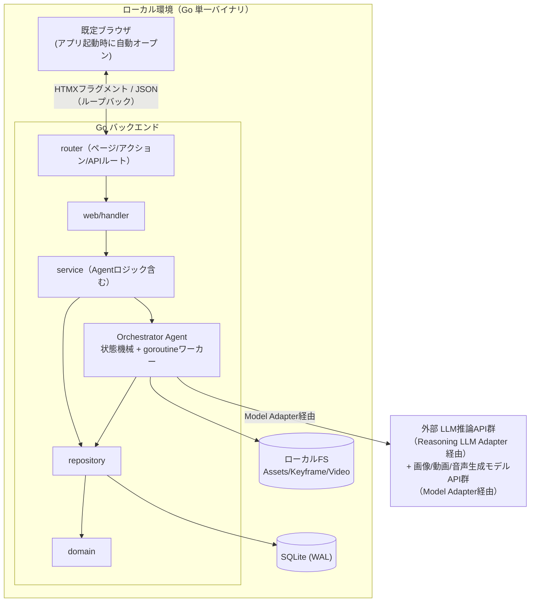
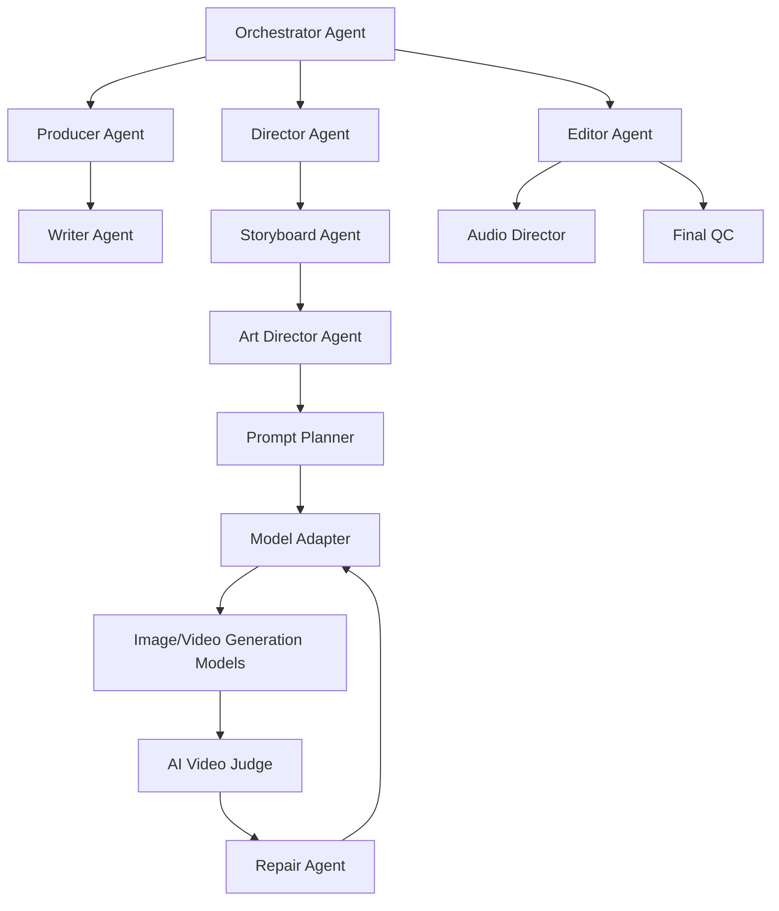

# アーキテクチャ設計

## 1. 設計原則

`spec/spec.md` §29 の技術設計原則、および HALT（`skill://halt`）のサーバーファースト原則をそのまま採用する。

- **Model-Agnostic Core**: Project State / Shot Spec / Judge Result を特定生成モデルの Prompt 形式に依存させない
- **Structured State Before Prompt**: Prompt 文字列を Source of Truth にしない。Source of Truth は Creative Intent / World State / Shot Spec / Constraints / References であり、Prompt はそこから生成される一時的な実行形式
- **Every Generation Is Traceable**: 各 Take について Source Shot Spec・World State version・Prompt version・Model・Parameters・References・Output・Judge result・Repair history を保存する
- **Reversible Decisions**: Shot/Take/Branch/State の主要変更をバージョン化し復元可能にする
- **バックエンドファースト（HALT）**: フロントエンドは API サーバーの中で動く。SPA を作らず、サーバーが UI 制御を握る
- **HATEOAS（HALT）**: サーバーは現在の状態・権限に基づき利用可能なアクションのみを HTML に含める。AUTO/MANUAL/LOCK の状態や Confirmation Level に応じたボタン・フォームの出し分けもこの原則に従う

## 2. 技術スタック

| レイヤー | 技術 | 役割 |
|---------|------|------|
| 実行方式 | Go net/http（Gin） + ブラウザ | ローカルループバック（127.0.0.1）で SSR+HTMX を配信し、起動時に既定ブラウザを自動オープンする。将来的にネイティブシェル（Wails等）へ移行可能な `http.Handler` 設計を維持する |
| サーバーフレームワーク | Go + Gin | ルーティング + SSR。独立した `http.Handler` として起動する |
| API フレームワーク | Huma | OpenAPI 3.1 自動生成、`/api/v1` 配下の JSON API の入出力バリデーション |
| テンプレートエンジン | Templ | 型安全な Go HTML テンプレート（atoms/molecules/organisms/pages） |
| インタラクション | HTMX | サーバー駆動の DOM 更新 |
| リッチUI | Lit (Web Components) | Video Player / Timeline Editor / Take Comparator のみ |
| スタイリング | Tailwind CSS | ユーティリティファースト CSS |
| ビルド | esbuild | TypeScript バンドル |
| 永続化 | SQLite (WAL mode) | Project Data Model の永続化。単一ユーザー・単一バイナリ運用に最適 |
| アセットストレージ | ローカルファイルシステム | Keyframe/Reference/生成動画・画像の保存 |
| バックグラウンド処理 | Go goroutine + 内部ジョブキュー | 生成・Judge・Repair 等の非同期実行、進捗は WebSocket で通知 |
| 外部生成モデル連携 | Model Adapter（アダプタパターン） | 画像/動画生成モデル API をベンダー非依存に抽象化。特定モデルへの構造的依存を作らない。採用プロバイダーは `spec/architecture/model-adapters.md` 参照（画像: Imagen 4/Nano Banana/FLUX.2/GPT Image 2、動画: Kling 3.0/Seedance 2.0/Runway Gen-4.5） |
| エージェント推論用LLM連携 | Reasoning LLM Adapter（アダプタパターン） | Producer/Writer/Director/Judge/Repair等の自然言語推論をLLM API経由で実行する層。Model Adapterとは別レイヤー（画像/動画生成物を伴わない）。採用プロバイダーは Claude Opus系/GPT-5系/Gemini 3.1 Pro（Agentごとのルーティングは `spec/architecture/model-adapters.md` 参照） |
| 認証情報管理 | OS セキュアストレージ（Windows Credential Manager / macOS Keychain / Linux Secret Service） | 外部生成モデル API キーを平文設定ファイルに書かず OS ネイティブストアへ保存・取得する（`internal/credential`） |

## 3. 全体構成図



## 4. Agent Architecture

`spec/spec.md` §20 の Agent 構成を `internal/agent` パッケージ群として実装する。Orchestrator は Core State Machine（§22: DRAFT→PLANNING→VISUAL_DESIGN→(AWAITING_APPROVAL)→GENERATING→JUDGING→(REPAIRING)→EDITING→EDIT_JUDGING→AUDIO→FINAL_QC→READY→EXPORTED）を管理する状態機械として実装する。



Orchestrator の責務（§20.1）: 次に実行する Agent の決定、人間確認要否判定、生成続行/Retake/部分修正/別モデル利用の判断、コスト上限監視、編集での修正可否判定、撮影工程への差し戻し判定、Project State 更新。

## 5. ディレクトリ構成

```
.
├── go.mod                  # モジュール: github.com/ousiassllc/mam
├── Makefile                # dev / build / test / lint / fmt（§9）
├── .air.toml               # make dev のホットリロード設定
├── .golangci.yml           # lint。depguard でレイヤー依存ルールを強制
├── lefthook.yml            # Git フック。pre-commit は linterly（scripts/linterly-staged.sh 経由）・fmt-check・lint-go・typecheck（lint-static）、pre-push は build/vet と make test
├── scripts/
│   ├── build.sh            # 本番ビルド（templ → esbuild/tailwind → go build）。`--all` で全プラットフォーム
│   ├── fetch-face-models.sh # 顔検出・埋め込みモデル（YuNet / SFace）の取得と SHA-256 検証（§9 / model-adapters.md §10.1）
│   └── linterly-staged.sh  # コミット対象ファイルの行数上限チェック（pre-commit）
├── backend/
│   ├── cmd/
│   │   └── server/
│   │       ├── main.go     # エントリーポイント。配線（DI）・起動・グレースフルシャットダウン
│   │       ├── judge.go    # AI Video Judge の起動時の準備（`newJudgeSetup`。ffmpeg と顔モデル・ONNX Runtime を探し、無ければ縮退して警告ログ。model-adapters.md §10）
│   │       ├── listen.go   # 127.0.0.1 の空きポート確保（使用中なら別ポートへフォールバック）
│   │       └── browser.go  # OS別のブラウザ自動オープン
│   └── internal/
│       ├── config/         # フラグ / 環境変数（MAM_*）からの設定解決（データディレクトリ・ポート等）
│       ├── logging/        # 構造化ログ（slog、レベル別、ローカルファイルへローテーション出力）
│       ├── fsutil/         # 一時ファイル→リネームのアトミック書き込み、異常終了時の一時ファイル掃除
│       ├── httpclient/     # ベンダー API アダプターが共通で使う HTTP クライアント（別ホストへのリダイレクトでは独自認証ヘッダーを引き継がない）
│       ├── safefetch/      # ベンダー API が返したダウンロード URL の検証（http・ループバック・リンクローカル・プライベート宛先を拒否）
│       ├── facesim/        # 顔の同一性の局所計測（ONNX Runtime で YuNet / SFace をプロセス内実行、外部送信なし。`model-adapters.md` §10.1）
│       ├── media/          # ffmpeg / ffprobe（Take の解像度・フレームレート取得、4K プロキシ・サムネイル、部分採用の合成）
│       ├── domain/         # Project/Scene/Shot/Take/WorldState等のドメインモデル
│       ├── repository/     # SQLite アクセス層（domainのみに依存）
│       │   └── migrations/ # goose 形式の SQL マイグレーション（タイムスタンプ版、go:embed、起動時に自動適用）
│       ├── credential/     # OSセキュアストレージ（Keychain/Credential Manager/Secret Service）経由の外部モデルAPIキー保存・取得
│       ├── agent/          # Producer/Writer/Director/Storyboard/ArtDirector/
│       │   │               # PromptPlanner/ModelAdapter/VideoJudge/RepairAgent/
│       │   │               # EditorAgent/AudioDirector/FinalQC/Orchestrator
│       │   ├── artdirector/ audiodirector/ commandinterpreter/ continuation/ editor/ finalqc/
│       │   │   generation/ judge/ modeladapter/ promptplanner/ repair/ stateextractor/
│       │   │               # 同名の Agent / Orchestrator（Art Director、Audio Director、Command Interpreter、Continue Agent、Editor Agent + Editor Judge、Final QC、Generation Orchestrator、AI Video Judge、Model Adapter、Prompt Planner、Repair Agent、State Extractor）
│       │   ├── jev/        # TypeSafe Jev クライアント（Repair Agent のシャドー実行、model-adapters.md §4.5）
│       │   ├── resilience/ # LLM Adapter と Model Adapter が共有するサーキットブレーカーと指数バックオフ再試行
│       │   ├── briefing/   # チャット発言からの Creative Brief 抽出（Extractor インターフェース。M1 はルールベース、LLM 版は Reasoning LLM Adapter の Issue で差し替え）
│       │   ├── llm/        # Reasoning LLM Adapter（Agent ごとのプライマリ/代替プロバイダーを設定値から解決。指数バックオフ再試行・プロバイダー単位サーキットブレーカー・代替へのルーティング。Anthropic/OpenAI/Google の HTTP バックエンド）
│       │   ├── planning/   # 企画〜Shot 計画の Agent（Producer/Writer/Director/Storyboard）。llm.Completer 経由で推論し、構造化出力を検証する
│       │   ├── orchestrator/ # Orchestrator Agent。Core State Machine の遷移を永続化し、plan ジョブとして Producer → Writer →（承認）→ Director → Storyboard を実行する
│       │   └── jobqueue/   # 内部ジョブキュー（goroutineワーカー。ジョブは job テーブルに永続化し、再起動時に復旧）
│       ├── service/        # アプリケーションサービス層（agentを利用しユースケースを実装）。services.go が DI ルート
│       ├── router/         # ページ(pages.go)/アクション(actions.go)/API(api.go, Huma)ルート定義
│       └── web/
│           ├── handler/    # projects.go, chat.go, scenes.go, generation.go, take.go, director.go,
│           │                # editor.go, branch.go, settings.go ...（機能ごと）
│           ├── middleware/  # CSRF、ループバック限定ガード、ロギング/リカバリ
│           ├── paths/       # ルート URL の組み立て（ハンドラーとテンプレートで共有）
│           ├── atoms/       # button, badge, field, spinner, toast, lock_toggle(AUTO/MANUAL/LOCK) 等
│           ├── molecules/   # shot_card, take_card, world_state_field, approval_card, escalation_card 等
│           ├── organisms/   # chat_workspace, shot_inspector, take_comparison, brief_form, editor_panel 等
│           ├── pages/       # projects_page, chat_workspace_page, brief_page, editor_page 等
│           └── layout/      # レイアウトラッパー
└── static/
    ├── embed.go            # src/dist を go:embed（`static.Dist()`）
    ├── package.json        # esbuild / Tailwind / htmx / Lit / vitest（lib）/ @web/test-runner（Lit コンポーネント、`*.wtest.ts`）
    ├── build.mjs           # esbuild（JS）+ Tailwind（CSS）のビルド・ウォッチ
    └── src/
        ├── main.ts         # エントリーポイント。htmx へ CSRF トークンを付与、Lit コンポーネントを import
        ├── chat.ts         # Chat Workspace の挙動（WebSocket で更新通知を受け、フラグメントを再取得）
        ├── shot.ts         # 生成中 Shot の進捗表示
        ├── ajax.ts         # chat.ts / shot.ts 用の htmx.ajax ラッパー
        ├── components/
        │   ├── video-player/         # mam-video-player
        │   ├── timeline-editor/      # mam-timeline-editor
        │   ├── take-comparator/      # mam-take-comparator
        │   └── lib/
        │       ├── api.ts            # CSRFトークン自動付与のHTTPクライアント
        │       ├── ajax.ts / errors.ts / toast.ts / connection-notice.ts # フラグメント再取得・エラー表示
        │       ├── history.ts / htmx-config.ts / sync.ts / thread.ts / shot.ts # htmx 履歴・設定・直列再取得・スレッド操作
        │       ├── ws.ts
        │       ├── query.ts          # `selfAndDescendants`: htmx の outerHTML swap で `htmx:load` が届く最上位ノード自身も含めて要素を探す
        │       ├── logger.ts
        │       ├── video.ts          # フレーム精度シーク・タイムコード変換
        │       ├── timeline-model.ts # タイムライン共通データモデル
        │       └── edit-model.ts     # 編集画面のクリップ操作モデル
        ├── css/
        └── dist/                     # ビルド成果物（git 管理外。.gitkeep のみコミット）
```

### レイヤー依存ルール

```
handler → service → agent → repository → domain
                        ↓
   Templ テンプレート（atoms/molecules/organisms/pages）
```

- `domain/`: 他レイヤーに依存しない
- `repository/`: `domain/` のみに依存
- `agent/`: `domain/`, `repository/`, Model Adapter経由の外部API呼び出しに依存
- `service/`: `domain/`, `repository/`, `agent/` に依存。ユースケース単位のオーケストレーション
- `web/handler/`: `service/`, `domain/` に依存。`repository/`・`agent/` を直接使わない
- `router/`: `handler/` を参照してルートを定義
- `service/Services`（`service/services.go`）が DI ルート。`cmd/server/main.go` がインフラ（DB・ジョブキュー・認証情報ストア・ロガー）を生成して `service.New(Deps)` に渡し、`router.New(services, opts)` が `services` を各ルート登録関数へ渡す。新機能は「サービス追加 → `Services` にフィールド追加 → ルートを `pages.go`/`actions.go`/`api.go` に追加」の追記だけで組み込める
- レイヤー依存ルールは `.golangci.yml` の depguard で機械的に検査する（違反はlintエラー）

## 6. 起動方式（ローカル Web サーバー）

`backend/cmd/server/main.go` が Gin サーバーを `127.0.0.1:<port>` で起動し、既定ブラウザで `http://127.0.0.1:<port>` を自動的に開く。ネイティブ WebView は用いず、OS標準のブラウザ（Chrome/Edge/Firefox/Safari）でHALTのSSR+HTMX+Lit UIを表示する。

```go
// backend/cmd/server/main.go（概念コード）
ginEngine := router.New(services) // Gin *gin.Engine（HALTのSSR+HTMXルート+Huma APIを登録済み）

port := findAvailablePort(preferredPort) // 使用中なら空きポートへフォールバック
srv := &http.Server{Addr: fmt.Sprintf("127.0.0.1:%d", port), Handler: ginEngine}

go srv.ListenAndServe()
openBrowser(fmt.Sprintf("http://127.0.0.1:%d", port)) // OS別のブラウザ起動コマンドを実行
waitForShutdownSignal()
```

- HTMX のフラグメント swap・`hx-boost`・WebSocket はすべて `127.0.0.1` へのループバック HTTP リクエストとして処理する
- 本番ビルドでは `static/src/dist` を `go:embed` し、単一バイナリに同梱する（サーバー・アセットとも1バイナリで完結）
- `internal/router`, `internal/web`, `internal/agent` 等はすべて `http.Handler` 単位で完結しており、実行方式（標準サーバー起動 or 将来のネイティブシェル埋め込み）に依存しない
- サーバーは `127.0.0.1` のみにバインドし、加えて `LoopbackOnly` ミドルウェアがループバック以外のクライアント・`Host`（DNSリバインディング対策）・`Origin` を 403 で拒否する（`Origin` はループバックのホストであること。さらに `GET/HEAD/OPTIONS` 以外のリクエストと WebSocket のハンドシェイクでは、`Origin` の host:port が `Host` と一致する、つまりこのサーバー自身のオリジンであることを求め、同じループバック上の別ポートのページからのリクエストも拒否する）。CSRF は Cookie（`mam_csrf`、HttpOnly/SameSite=Strict）と `<meta name="csrf-token">` の二重送信方式で、`GET/HEAD/OPTIONS` 以外は `X-CSRF-Token` ヘッダ（htmx・`lib/api.ts`が付与）の一致を必須とする（ボディは読まない。フォームフィールドでの送信は受け付けない）。これらのミドルウェア（`LoopbackOnly`・CSRF・`MaxBody`・`Recovery`）の拒否は、`HX-Request` のリクエストには他のエラーと同じ `text/html` のトースト（`HX-Reswap: none`）で返し、それ以外には JSON（または空ボディ）で返す。htmx がレスポンスを得られなかった場合（`htmx:sendError`/`htmx:timeout`/`htmx:responseError`）は `main.ts` がトーストを表示する
- 設定は `--data-dir`（既定: OS のユーザー設定ディレクトリ配下の `mam`）・`--port`（既定 8787、使用中なら空きポート）・`--no-browser`・`--log-level`・`--static-dir`（開発時のみ、ディスクから静的アセットを配信）に加え、モデル関連の次の設定を、対応する `MAM_*` 環境変数（フラグ名を大文字・`_` 区切りにした `MAM_LLM_CONFIG` 等）で指定する。フラグは環境変数より優先される。
- データディレクトリは起動時に排他ロック（`<data-dir>/.mam.lock`、OS のファイルロック。プロセスが死ねば OS が解放する）を取る。同じディレクトリで 2 つ目のインスタンスを起動するとエラーで終了し、実行中のインスタンスの一時ファイルやインポート途中のディレクトリを起動時の掃除（`RemoveStaleTemp` / `RemoveStaleImports`）で消すことはない。別の `--data-dir` を指定すれば並行して起動できる。
  - `--llm-config`: Reasoning LLM の Agent ごとのプロバイダー割り当て JSON（`model-adapters.md` §2.1）
  - `--model-config`: 画像・動画生成 Model Adapter の設定 JSON（`model-adapters.md` §9.2。Multi-model routing も同じ JSON、`model-adapters.md` §13）
  - `--judge-config`: AI Video Judge のフレーム抽出と顔類似度の閾値 JSON（`model-adapters.md` §10）
  - `--jev-config`: Repair Agent の TypeSafe Jev シャドー実行（固定バージョン・base URL・タイムアウト・単価）JSON（`model-adapters.md` §11.4）
  - `--face-model-dir`: 顔検出・埋め込みモデルのディレクトリ（既定 `<data-dir>/models`、`model-adapters.md` §10.1）
  - `--onnxruntime-lib`: 顔モデル用 ONNX Runtime 共有ライブラリ（1.23.x、`model-adapters.md` §10.1）
- データディレクトリ配下に `mam.db`（SQLite）・`logs/`・`assets/` を置く
- Huma の対話ドキュメントページは CDN から UI を読み込むため無効化し、OpenAPI 3.1 は `/api/v1/openapi.json` で配信する（外部通信を行わない）

## 7. HTMX ルーティングパターン

HALT の3パターン（ページルート/アクションルート/APIルート）をそのまま適用する。

| パターン | 例 | HX-Request分岐 | 返却 | 登録先 |
|---------|-----|----------------|------|--------|
| ページルート | `GET /projects/:id`, `GET /projects/:id/scenes/:sceneId` | する | フルページ or フラグメント | Gin |
| アクションルート | `POST /shots/:id/generate`, `POST /takes/:id/select`, `PUT /shots/:id/locks` | しない | フラグメントのみ | Gin |
| APIルート | `GET /api/v1/shots/:id/takes`, `GET /api/v1/projects/:id/edit-timeline` | しない | JSON（Lit Web Components向け） | Huma |

Lit Web Components（Video Player/Timeline Editor/Take Comparator）はデータ取得を `/api/v1` の JSON API（GET）で行い、保存・選択などの更新は JSON API の応答がサーバー側から渡すアクションルート（`save_url` / `select_url` など。`PUT /edit-timelines/:id`、`POST /takes/:id/select` 等）へ API クライアント経由の CSRF トークン付き `fetch` で送る。HTMX リクエストはトリガーしない（HALTの境界ルールに従う）。生成進捗は WebSocket（`/ws/shots/:id`）で配信する。チャット画面は、WebSocket（`/ws/projects/:id`）の新着通知を受けて `GET /projects/:id/messages?after=` のフラグメントを HTMX で取得・追記する（WebSocket では本文を配信しない）。

## 8. Lit Web Components 一覧

アプリ名プレフィックス: `mam-`。HALT の使用基準（リアルタイム編集/複雑なD&D/Canvas描画/WebSocket同期）に該当する3コンポーネントのみ実装する。それ以外（Brief フォーム、Inspector、AUTO/MANUAL/LOCKトグル、Branch ツリー等）は HTMX + Templ で実装する。

| コンポーネント | 用途 | 該当基準 |
|--------------|------|---------|
| `<mam-video-player>` | Take/Rough Cutのフレーム精度プレビュー、Judge Issueのフレームマーカー重畳表示 | Canvas描画、WebSocketでの生成進捗同期 |
| `<mam-timeline-editor>` | AI Editorのカット点・尺・トランジション編集 | 複雑なドラッグ＆ドロップ |
| `<mam-take-comparator>` | 複数Takeのスコア比較、区間指定によるPartial Take合成 | 複雑なドラッグ＆ドロップ（区間指定） |

## 9. ビルド / 開発ワークフロー

```makefile
.PHONY: dev
dev:
	@concurrently \
		"air" \
		"templ generate --watch" \
		"npm run dev --prefix static"
```

- `.templ` 編集 → `templ generate --watch` が `_templ.go` を再生成 → `air` が Go 変更を検知しサーバー再起動（`_templ.go` は `go build` だけで動くよう git 管理する）
- `.ts` 編集 → esbuild がバンドル → ブラウザリロードで反映
- `.css` 編集 → Tailwind がビルド → ブラウザリロードで反映
- `make dev` は `MAM_STATIC_DIR=static/src/dist` を設定し、再ビルドのたびにバイナリを作り直さずディスク上のアセットを配信する
- 本番ビルド: `make build`（`scripts/build.sh`）が `templ generate` → `esbuild`（minify） → `tailwind`（minify） → `go build`（`go:embed`で静的アセット同梱、`CGO_ENABLED=0`）を一括実行し `bin/mam` を生成する（`make build-all` = `scripts/build.sh --all` は windows / darwin / linux × amd64 / arm64 の全プラットフォームを `bin/mam-<os>-<arch>` に生成する）。SQLite は純 Go ドライバ（modernc.org/sqlite）のため各 OS/arch へクロスコンパイル可能
- その他のターゲット: `make test`（Go `-race` + フロントの vitest + web-test-runner の Lit コンポーネントテスト（Chrome が必要））、`make lint`（golangci-lint + `tsc --noEmit`）、`make fmt` / `make fmt-check`

## 10. テスト戦略

HALT のレイヤー別テスト方針を踏襲する。

| レイヤー | 手法 | 検証内容 |
|---------|------|---------|
| Go ハンドラ | `httptest` + HTMLアサーション | 正しいフラグメント/フルページ、ステータスコード |
| Templ テンプレート | `Render()` → HTML文字列アサーション | コンポーネント出力 |
| Agent（Producer/Judge/RepairAgent等） | Go ユニットテスト（外部APIはモック） | Shot Spec変換、Judge出力パース、Repair戦略選択ロジック |
| Lit コンポーネント | `@open-wc/testing` + `@web/test-runner` | 単体の振る舞い |
| E2E | 未導入（方針: Playwright で Gin サーバーを直接起動してブラウザから検証する） | HTMXインタラクション込みのユーザーフロー。現状は Go ハンドラ（`internal/router` の `httptest`、HTMX ヘッダ込み）と Lit のブラウザ内テストで層別に検証しており、ブラウザ通しのフローは自動検証されない |

## 11. 将来拡張: Wails によるネイティブデスクトップ化

現段階ではローカル Web サーバー + ブラウザ構成とするが、以下の設計により将来 Wails（またはTauri等）でのネイティブパッケージング化を低コストで行えるようにしておく。

- `internal/router` が返す Gin の `*gin.Engine` は標準の `http.Handler` であり、Wails v3 の `application.AssetOptions.Handler` へそのまま渡せる
- ブラウザ自動オープン処理（`openBrowser()`）は `backend/cmd/server/browser.go`（`main.go` ではなく同じ `cmd/server` パッケージの別ファイル）にあり、`main.go` が起動後に呼ぶだけである。Wails採用時は `cmd/server` のエントリーポイント（`main.go` と `browser.go`）のみ `backend/cmd/wails/main.go` 等に差し替えれば良く、`internal/` 配下（domain/repository/agent/service/web）は変更不要
- Wails化のトリガー例: OSネイティブの通知・トレイアイコン・自動更新・単一実行ファイルへのアイコン付与などデスクトップ体験の強化が必要になった時点で着手する

## 改訂履歴

| 版 | 日付 | 変更内容 | 変更理由 |
|----|------|---------|---------|
| 1.0 | 2026-09-28 | 新規作成 | HALT（HTMX+Atomic+Lit+Templ）+ Wails によるデスクトップアプリ構成を定義 |
| 1.1 | 2026-09-28 | Wails前提の記述をローカルWebサーバー+ブラウザ構成へ変更し、Wailsは将来拡張セクションへ移動 | ユーザー指示により、Wails統合は現段階のスコープ外とし将来拡張に切り出す |
| 1.2 | 2026-09-28 | 技術スタック表に「認証情報管理」行、ディレクトリ構成に `internal/credential` を追加 | non-functional.md §5「APIキーはOSセキュアストレージに保存」を実現する層がアーキテクチャ設計に明記されていなかったため（整合性レビュー指摘） |
| 1.3 | 2026-09-29 | 技術スタック表に「エージェント推論用LLM連携（Reasoning LLM Adapter）」行を追加。Model Adapter行・全体構成図に採用プロバイダー（Imagen4/Nano Banana/FLUX.2/GPT Image 2、Kling 3.0/Seedance 2.0/Runway Gen-4.5）を明記 | ユーザーとの協議によりエージェント推論LLM・画像/動画生成プロバイダーを具体的に選定したため（`spec/architecture/model-adapters.md` 新設に対応） |
| 1.4 | 2026-09-29 | §7 にチャット画面の更新方式（`/ws/projects/:id` の新着通知 + `GET /projects/:id/messages?after=` の HTMX フラグメント取得）を追記 | チャット中心UI（`spec/spec.md` §23）でスレッドをリアルタイム更新する方式が未定義だったため |
| 1.5 | 2026-09-29 | §5 ディレクトリ構成に `config`/`logging`/`fsutil`/`agent/jobqueue`/`repository/migrations`/ビルド関連ファイルを追加し、DI ルートと depguard によるレイヤー検査を追記。§6 にループバックガード・CSRF方式・設定項目を追記、§9 に本番ビルドと各ターゲットの実際の構成を反映 | M1「実行基盤」（Issue #4）の実装で確定した構成を仕様へ反映するため |
| 1.6 | 2026-09-29 | §5 に `agent/briefing`（Brief 抽出）を追加。ジョブ状態変化の通知フック（`jobqueue.Queue.OnChange`）でチャットの進捗カードを更新する構成を追記 | M1「Project とチャット画面」（Issue #5）の実装で確定した構成を仕様へ反映するため |
| 1.7 | 2026-09-29 | §5 に `agent/llm`（Reasoning LLM Adapter）・`agent/planning`・`agent/orchestrator` を追加。AUTO パイプラインの企画〜Shot 計画は `plan` ジョブ（再開可能）として実行し、遷移は `repository.ProjectRepository.Transition`（`domain.CanTransition` で検証）で永続化する構成を追記 | M1「Reasoning LLM Adapter と AUTO パイプライン」（Issue #6）の実装で確定した構成を仕様へ反映するため |
| 1.8 | 2026-09-30 | §5 に `media`（ffmpeg / ffprobe）を追加。Lit コンポーネントのテストは `*.wtest.ts` を `@web/test-runner` で実行し、`lib` の純関数は vitest で検証する | M1「Take システムと補助ビュー」（Issue #11）でプレビュー用プロキシ・部分採用の合成と Lit コンポーネントのテスト方式を実装したため |
| 1.9 | 2026-10-01 | §8 の Lit コンポーネントから `<mam-branch-tree>` を除き 4 → 3 に変更（Branch ツリーは Templ + HTMX でサーバー描画）。`static/src/components/branch-tree/` を削除 | Branch ツリーは HALT の Lit 使用基準に該当しないため（Issue #40） |
| 1.10 | 2026-10-01 | §6 の `LoopbackOnly` の説明に、状態変更リクエスト・WebSocket では `Origin` の host:port が `Host` と一致することを求める規則を追記 | 実装が `Origin` のホストがループバックかだけを見ており、同一ホスト上の別ポートのページが通る状態だったため（Issue #70） |
| 1.11 | 2026-10-01 | §7 の Lit の通信範囲を「`/api/v1` の GET + サーバーが渡すアクションルートへの CSRF 付き `fetch`（HTMX は使わない）」に修正 | 実装の Timeline Editor・Take Comparator が `save_url` / `select_url` 等のアクションルートへ PUT/POST/DELETE しており、「JSON API のみ」の記述と乖離していたため（Issue #163） |
| 1.12 | 2026-10-01 | §2 の設定フラグ説明と `facesim/` の節番号参照に `model-adapters.md` を付けた | 文書名のない `§9.2`・`§10`・`§11.4`・`§13` が overview.md 自身の節（ビルド・テスト戦略・Wails 等）と読み違えられたため（Issue #185） |
| 1.13 | 2026-10-03 | §5 の構成図に `cmd/server/judge.go` と `lib/query.ts` を追加し、§11 の Wails 化の記述の `openBrowser()` の所在を `main.go` から `browser.go` に直した | 実装（`backend/cmd/server/judge.go`・`browser.go`、`static/src/components/lib/query.ts`）に構成図と記述が追従していなかったため（Issue #441） |
