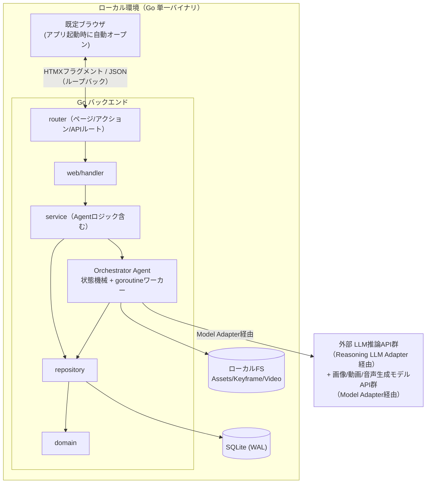
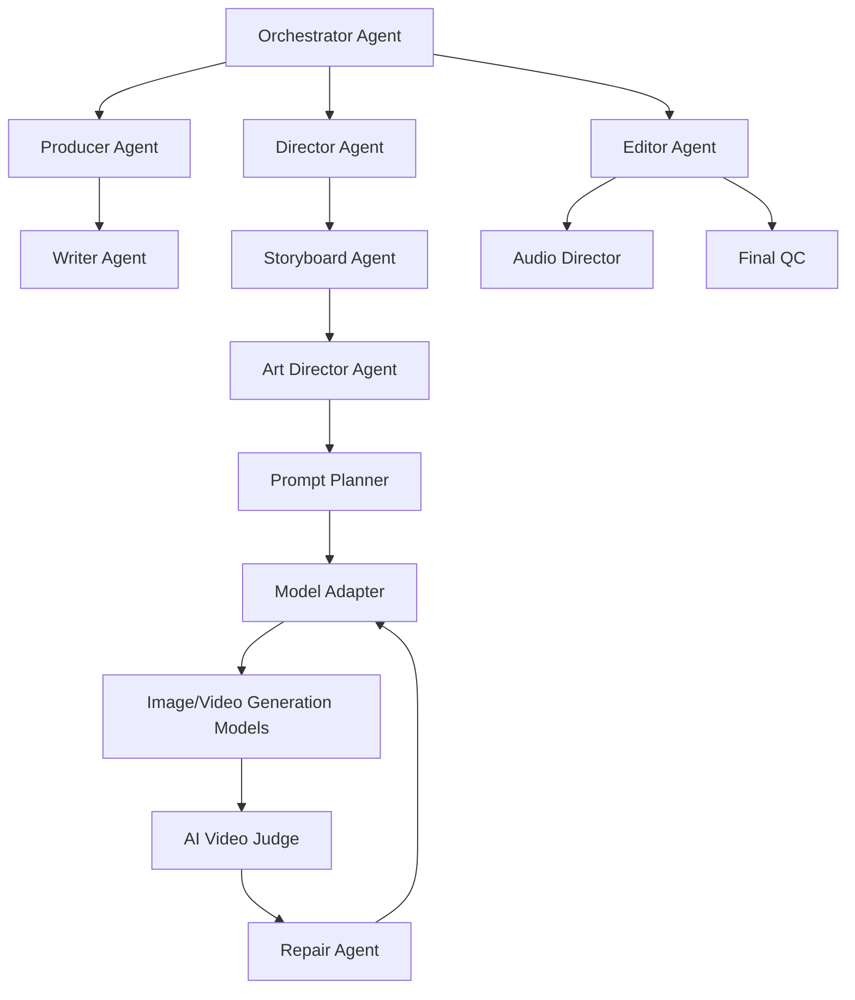

# アーキテクチャ設計

## 1. 設計原則

`spec/spec.md` §29 の技術設計原則、および HALT（`skill://halt`）のサーバーファースト原則をそのまま採用する。

- **Model-Agnostic Core**: Project State / Shot Spec / Judge Result を特定生成モデルの Prompt 形式に依存させない
- **Structured State Before Prompt**: Prompt 文字列を Source of Truth にしない。Source of Truth は Creative Intent / World State / Shot Spec / Constraints / References であり、Prompt はそこから生成される一時的な実行形式
- **Every Generation Is Traceable**: 各 Take について Source Shot Spec・World State version・Prompt version・Model・Parameters・References・Output・Judge result・Repair history を保存する
- **Reversible Decisions**: Shot/Take/Branch/State の主要変更をバージョン化し復元可能にする
- **バックエンドファースト（HALT）**: フロントエンドは API サーバーの中で動く。SPA を作らず、サーバーが UI 制御を握る
- **HATEOAS（HALT）**: サーバーは現在の状態・権限に基づき利用可能なアクションのみを HTML に含める。AUTO/MANUAL/LOCK の状態や Confirmation Level に応じたボタン・フォームの出し分けもこの原則に従う

## 2. 技術スタック

| レイヤー | 技術 | 役割 |
|---------|------|------|
| 実行方式 | Go net/http（Gin） + ブラウザ または Wails ウィンドウ（Windows 版） | ローカルループバック（127.0.0.1）で SSR+HTMX を配信する。ブラウザ版は起動時に既定ブラウザを自動オープンし、Windows 版（Wails v3、WebView2）は同じ URL をネイティブウィンドウで表示する（§11）。サーバーは独立した `http.Handler` として動く |
| サーバーフレームワーク | Go + Gin | ルーティング + SSR。独立した `http.Handler` として起動する |
| API フレームワーク | Huma | OpenAPI 3.1 自動生成、`/api/v1` 配下の JSON API の入出力バリデーション |
| テンプレートエンジン | Templ | 型安全な Go HTML テンプレート（atoms/molecules/organisms/pages） |
| インタラクション | HTMX | サーバー駆動の DOM 更新 |
| リッチUI | Lit (Web Components) | Video Player / Timeline Editor / Take Comparator のみ |
| スタイリング | Tailwind CSS | ユーティリティファースト CSS |
| ビルド | esbuild | TypeScript バンドル |
| 永続化 | SQLite (WAL mode) | Project Data Model の永続化。単一ユーザー・単一バイナリ運用に最適 |
| アセットストレージ | ローカルファイルシステム | Keyframe/Reference/生成動画・画像の保存 |
| バックグラウンド処理 | Go goroutine + 内部ジョブキュー | 生成・Judge・Repair 等の非同期実行、進捗は WebSocket で通知 |
| 外部生成モデル連携 | Model Adapter（アダプタパターン） | 画像/動画生成モデル API をベンダー非依存に抽象化。特定モデルへの構造的依存を作らない。採用プロバイダーは `spec/architecture/model-adapters.md` 参照（画像: Imagen 4/Nano Banana/FLUX.2/GPT Image 2、動画: Kling 3.0/Seedance 2.0/Runway Gen-4.5） |
| エージェント推論用LLM連携 | Reasoning LLM Adapter（アダプタパターン） | Producer/Writer/Director/Judge/Repair等の自然言語推論をLLM API経由で実行する層。Model Adapterとは別レイヤー（画像/動画生成物を伴わない）。採用プロバイダーは Claude Opus系/GPT-5系/Gemini 3.1 Pro（Agentごとのルーティングは `spec/architecture/model-adapters.md` 参照） |
| 認証情報管理 | OS セキュアストレージ（Windows Credential Manager / macOS Keychain / Linux Secret Service） | 外部生成モデル API キーを平文設定ファイルに書かず OS ネイティブストアへ保存・取得する（`internal/credential`）。ストアが `DefaultTimeout`（5 秒）以内に応えないとき（Linux の Secret Service がロック解除の入力待ち）は `credential.ErrUnavailable` で失敗し、設定画面は API キーのパネルだけを「利用できません」にする |

## 3. 全体構成図



## 4. Agent Architecture

`spec/spec.md` §20 の Agent 構成を `internal/agent` パッケージ群として実装する。Orchestrator は Core State Machine（§22: DRAFT→PLANNING→VISUAL_DESIGN→(AWAITING_APPROVAL)→GENERATING→JUDGING→(REPAIRING)→EDITING→EDIT_JUDGING→AUDIO→FINAL_QC→READY→EXPORTED）を管理する状態機械として実装する。



Orchestrator の責務（§20.1）: 次に実行する Agent の決定、人間確認要否判定、生成続行/Retake/部分修正/別モデル利用の判断、コスト上限監視、編集での修正可否判定、撮影工程への差し戻し判定、Project State 更新。

## 5. ディレクトリ構成

```
.
├── go.mod                  # モジュール: github.com/ousiassllc/mam
├── Makefile                # dev / build / test / lint / fmt（§9）
├── Taskfile.yml            # `wails3 package GOOS=windows` の入口（`build/` の Taskfile を取り込む。通常は `scripts/package-windows.sh` 経由。§11）
├── .air.toml               # make dev のホットリロード設定
├── .golangci.yml           # lint。depguard でレイヤー依存ルールを強制し、gocyclo / gocognit で関数の複雑度の悪化を止める
├── .linterly-baseline      # 行数上限（300 行 / 2000 行）を超えている既存のファイル・ディレクトリの行数。CI は悪化だけを止める（環境構築 spec の Linterly 節）
├── lefthook.yml            # Git フック。pre-commit は linterly（scripts/linterly-staged.sh 経由）・fmt-check（Go / templ / TS）・lint-go・lint-static（tsc + Biome lint）、pre-push は build/vet と make test
├── .github/
│   ├── dependabot.yml      # 依存の更新 PR を週次で作る（gomod・npm（`/static`）・github-actions。環境構築 spec の CI 節）
│   └── workflows/
│       ├── ci.yml          # CI（lint・脆弱性検査（`make vuln`）・テスト・ビルド・行数上限の基準値チェック。環境構築 spec の CI 節）
│       └── release.yml     # タグ push で Windows インストーラーをビルドして GitHub Releases へ公開（§11）
├── scripts/
│   ├── build.sh            # 本番ビルド（templ → esbuild/tailwind → go build）。`--all` で全プラットフォーム
│   ├── package-windows.sh  # Windows 版のパッケージング（フロント → Wails ウィンドウ版 exe → NSIS インストーラー。§11）
│   ├── smoke-windows.sh    # リリースのスモーク（インストーラーを `/S` で入れ、`mam.exe` を起動して `GET /` が 200 か確認。release.yml）
│   ├── fetch-face-models.sh # 顔検出・埋め込みモデル（YuNet / SFace）の取得と SHA-256 検証（§9 / model-adapters.md §10.1）
│   ├── linterly-staged.sh  # コミット対象ファイルの行数上限チェック（pre-commit）
│   ├── linterly-baseline.sh # 行数上限の既存超過を `.linterly-baseline` と比べ、悪化を検出する（`make lint-lines`・CI）。`update` で基準値を書き換える
│   ├── slow-tests.sh       # `go test -json` を読み、テストの出力と 3 秒（`SLOW_TEST_SECONDS`）を超えたテストの一覧を出す（`make test-go`）
│   └── *_test.sh           # スクリプトのテスト（`linterly-baseline_test.sh`: 行数基準値、`slow-tests_test.sh`: 遅いテストの一覧、`complexity-ratchet_test.sh`: `.golangci.yml` の複雑度の許可リスト、`makefile_test.sh`: `Makefile` のターゲット。`make test-scripts`）
├── build/                  # Wails v3 のパッケージング設定（`config.yml`・`Taskfile.yml`・`windows/`: アイコン・マニフェスト・`info.json`・`nsis/project.nsi`。§11）
├── backend/
│   ├── cmd/
│   │   ├── server/         # ブラウザ版（全 OS）のエントリーポイント
│   │   │   ├── main.go     # `app.Run` を呼び、起動完了で `openBrowser` する
│   │   │   └── browser.go  # OS別のブラウザ自動オープン
│   │   └── wails/          # Windows 版のエントリーポイント（`//go:build windows`。Wails ウィンドウ。§11）
│   │       ├── main.go     # Wails アプリ・ウィンドウ・単一インスタンス。`app.Run` を別 goroutine で動かし、起動完了で URL を開く
│   │       └── dialog.go   # 起動エラーの Win32 MessageBox（コンソールが無いため。Wails のダイアログはイベントループが要るので使わない）
│   └── internal/
│       ├── app/            # 配線（DI）・起動・グレースフルシャットダウン。`cmd/server/main.go` から移した起動処理（設定読込・データディレクトリのロック・ロガー・`buildServices`・ジョブ復旧・`runHTTP`）、`listen.go`（127.0.0.1 の空きポート確保。使用中なら別ポートへフォールバック）、`judge.go`（AI Video Judge の起動時の準備。`newJudgeSetup`。ffmpeg と顔モデル・ONNX Runtime を探し、無ければ縮退して警告ログ。model-adapters.md §10）。`Run(ctx, Options)` は待ち受けが始まった時点で `Options.OnReady(url)` を呼ぶ。`args.go`（`ValidateArgs`。コンソールの無い `cmd/wails` が `--help`・引数の誤りをダイアログ用の文字列で受け取る）
│       ├── desktop/        # `cmd/wails` のうち Wails に依存しない部分（OS 非依存でテストする）: `Navigator`（サーバーの URL とウィンドウの準備完了を待ち合わせて読み込む）、`Server`（`app.Run` のバックグラウンド実行と停止）
│       ├── config/         # フラグ / 環境変数（MAM_*）からの設定解決（データディレクトリ・ポート等）
│       ├── logging/        # 構造化ログ（slog、レベル別、ローカルファイルへローテーション出力）
│       ├── fsutil/         # 一時ファイル→リネームのアトミック書き込み、異常終了時の一時ファイル掃除
│       ├── httpclient/     # ベンダー API アダプターが共通で使う HTTP クライアント（別ホストへのリダイレクトでは独自認証ヘッダーを引き継がない）
│       ├── safefetch/      # ベンダー API が返したダウンロード URL の検証（https 以外と、公開インターネット以外のアドレス（ループバック・リンクローカル・プライベート・マルチキャスト・CGNAT などの IANA 特殊用途範囲。IPv4 を埋め込んだ IPv6 は埋め込み先で判定）への接続を拒否）
│       ├── facesim/        # 顔の同一性の局所計測（ONNX Runtime で YuNet / SFace をプロセス内実行、外部送信なし。`model-adapters.md` §10.1）
│       ├── textutil/       # 文字列ヘルパー（ルーン単位の切り詰め `TruncateRunes` / `TruncateRunesEllipsis`、ID の短縮 `ShortID`）。domain からは使わない
│       ├── testenv/        # テストの共通ヘルパー: ffmpeg が無いときの扱い（`MissingFFmpeg`: ローカルは Skip、`CI=true` では失敗）、並列実行（`Parallel`: 並列数を 8 に絞る）、ffmpeg の素材（`FFmpegFile` / `WriteFFmpegFile` / `PatternVideo`: プロセスごとに 1 回だけ作り共有する）
│       ├── bgwork/         # 専用ゴルーチンで動かす処理の panic をログに落とす（`RunSafely`）と、起こし合図をまとめて 1 本のワーカーで走らせる `Worker`（サーバー全体を落とさない）
│       ├── keylock/        # キー別のロック（`Locker`）。待機側は ctx のキャンセルで諦められ、エントリは保持・待機中だけ存在する（キーの数だけ増え続けない）。service 層専用ではなく、`agent/orchestrator`（Project ごとの `advance` を 1 度に 1 つに直列化）、`service/take.go`（`compose` のみ。Shot ごと）、`service/editor.go`（`stage` / `auto` / `preview`）、`previewcache`（ファイルごと）が使う
│       ├── media/          # ffmpeg / ffprobe（Take の解像度・フレームレート取得、4K プロキシ・サムネイル、部分採用の合成）。実行には上限時間があり、超えたら強制終了して `ErrTimeout` で失敗にする（キャンセルとは区別する。値は `spec/requirements/non-functional.md` §3）
│       ├── previewcache/   # プレビューファイル（Take の 4K のプロキシ・サムネイルと Rough Cut のプレビュー `edit-<版ID>.mp4`）を `assets/.previews` に 1 度だけ作る（`Path` がファイルを `.previews` 直下に固定する）。同じファイルへの同時要求は 1 回の ffmpeg 実行を待ち、作る処理はクライアントの切断では止めない（サービスの `Close` で止める）。失敗は 10 分覚えて再実行しない（`ErrFailedRecently`）。高さの判定（`Tall`）も Take ごとに覚える。合計が上限（4 GiB）を超えたら最後に使われた（`Make` で要求された）のが古いものから削除し（`prune`。LRU で、作ってから古いものではない。ファイルが既にあるときも `Make` が更新時刻を更新する）、Take のアーカイブでその Take の分も消す。合計は `Size()` で Storage 画面に出す（`PreviewBytes`）。強制終了で残った変換の一時ファイル（`.<名前>.ffmpeg.tmp`）は `Size()` にも `prune` にも入らないので、起動時の `fsutil.RemoveStaleTemp`（`assets` 配下を再帰して、`.` で始まり `.tmp` で終わるファイルを消す。`.previews` も対象）が消す（`app` の `buildServices`、Queue 開始前。`previewcache` 自身は掃除しない）。`service` の `core.previews`（`wiring.go` が作る）が持ち、`take_media.go` / `editor_export.go` / `policy.go` が使う
│       ├── domain/         # Project/Scene/Shot/Take/WorldState等のドメインモデル。サブパッケージ `bundlepath/` は Project バンドルの ID・ファイルパスの検証（`ValidID` / `ValidFilePath`。行数上限のため分けた）
│       ├── repository/     # SQLite アクセス層（domainのみに依存）
│       │   ├── bundle/ review/ # bundle: Project バンドルの書き出し・取り込み（行の検証と全テーブル一覧を持つ）。review: チームコラボレーション（レビュー依頼・返答・コメント）の永続化。どちらも `repository` の接続・エラーに依存
│       │   ├── testdb/     # テスト専用。マイグレーション済みの DB を 1 回だけ作り（`migratedTemplate`）、テストごとにファイルを複製して渡す（`Path` / `Open`）。本番コードから import しない
│       │   └── migrations/ # goose 形式の SQL マイグレーション（タイムスタンプ版、go:embed、起動時に自動適用）
│       ├── bundlezip/      # Project バンドルの ZIP（`manifest.json`・`data.json`・`assets/`）の書き出し・読み取り・検証（サイズ・パス）・アセットディレクトリへの展開。DB は触らない（`service.BundleService` が `repository/bundle` と組み合わせる）
│       ├── credential/     # OSセキュアストレージ（Keychain/Credential Manager/Secret Service）経由の外部モデルAPIキー保存・取得。`credentialtest/` はテスト専用の `credential.Store`（`Memory`・戻らない `Blocking`。テストごとに持つ。本番コードから import しない）
│       ├── agent/          # Producer/Writer/Director/Storyboard/ArtDirector/PromptPlanner/ModelAdapter/
│       │   │               # VideoJudge/RepairAgent/EditorAgent/AudioDirector/FinalQC/Orchestrator
│       │   ├── artdirector/ audiodirector/ commandinterpreter/ continuation/ editor/ finalqc/
│       │   │   generation/ judge/ modeladapter/ promptplanner/ repair/ stateextractor/
│       │   │               # 同名の Agent / Orchestrator（Art Director、Audio Director、Command Interpreter、Continue Agent、Editor Agent + Editor Judge、Final QC、Generation Orchestrator、AI Video Judge、Model Adapter、Prompt Planner、Repair Agent、State Extractor）。`modeladapter/configcheck/` は Model Adapter 設定（`modeladapter.Config`）の整合性検査（`Validate`）と、読み込んで検査する `Load`。`modeladapter/aspectsize/` は Brief の縦横比（`domain.BriefAspectRatios`）ごとの画像サイズ（GPT Image 2・FLUX.2）で、表に無い縦横比は `domain.DefaultAspectRatio` のサイズになる。`repair/escalation/` は自動 Repair ループが Shot ごとに「どの Judge 結果についてユーザーに確認したか」を 1 件だけ覚える `Memory`（`Ask` / `Forget`。新しい結果で置き換わり、確認待ちでなくなった Shot は忘れる。同じ状態で二度確認しない）
│       │   ├── jev/        # TypeSafe Jev クライアント（Repair Agent のシャドー実行、model-adapters.md §4.5）
│       │   ├── resilience/ # LLM Adapter と Model Adapter が共有するサーキットブレーカーと指数バックオフ再試行
│       │   ├── briefing/   # チャット発言からの Creative Brief 抽出（Extractor インターフェース。M1 はルールベース、LLM 版は Reasoning LLM Adapter の Issue で差し替え）
│       │   ├── llm/        # Reasoning LLM Adapter（Agent ごとのプライマリ/代替プロバイダーを設定値から解決。指数バックオフ再試行・プロバイダー単位サーキットブレーカー・代替へのルーティング。Anthropic/OpenAI/Google の HTTP バックエンド）
│       │   ├── planning/   # 企画〜Shot 計画の Agent（Producer/Writer/Director/Storyboard）。llm.Completer 経由で推論し、構造化出力を検証する
│       │   ├── orchestrator/ # Orchestrator Agent。Core State Machine の遷移を永続化し、plan ジョブとして Producer → Writer →（承認）→ Director → Storyboard を実行する
│       │   └── jobqueue/   # 内部ジョブキュー（goroutineワーカー。ジョブは job テーブルに永続化し、再起動時に復旧）
│       ├── service/        # アプリケーションサービス層（agentを利用しユースケースを実装）。services.go が DI ルート、wiring.go が機能ごとの `wire*`（plan → judge → generation → repair → director → continuity → editor の順）とジョブキューの `OnChange` を最後に 1 つだけ登録する `watchJobs`
│       │   ├── chatbrief/  # テスト専用（非テストの `.go` は無い）。チャットの質問カードへの回答が Brief の値域（Aspect Ratio・200 文字）を外れたとき聞き直すことを `service` の公開 API 越しに確かめる回帰テスト
│       │   ├── finalframe/ # テスト専用（`unix` のみ。非テストの `.go` は無い）。Continue Agent に渡す最終フレームの元になる Take ファイルの選び方を `service` の公開 API 越しに確かめる回帰テスト
│       │   ├── servicetest/ # テスト専用。`service.New` に `t.Cleanup(svc.Close)` を付けて組み立てる（`New`）。本番コードから import しない
│       │   └── takepreview/ # テスト専用（`unix` のみ。非テストの `.go` は無い）。`TakeService.Video` / `Thumbnail` の Take のプレビューを実 ffmpeg で確かめる回帰テスト
│       ├── router/         # ページ(pages.go)/アクション(actions.go)/API(api.go, Huma)ルート定義（`router/stack/` はミドルウェア〜ルート全体の配線だけを確かめるテスト専用、`router/swap/` はメモ・参照ライブラリの操作が差し替える範囲を確かめる回帰テスト専用）
│       └── web/
│           ├── handler/    # projects.go, chat.go, scenes.go, generation.go, take.go, director.go, editor.go, branch.go, settings.go ...（機能ごと）
│           ├── health/     # `GET /healthz` と `GET /api/v1/health` が共有するレディネス JSON の応答（`Response` / `Handler`）。Templ / HTMX の `handler/` から切り離してあり、`router/` が `service.HealthService` とともに使う
│           ├── middleware/  # CSRF、ループバック限定ガード、セキュリティヘッダ（CSP）、ロギング/リカバリ
│           ├── paths/       # ルート URL の組み立て（ハンドラーとテンプレートで共有）
│           ├── selector/    # `hx-target` の ID セレクタの組み立て（`selector.ID`。外部由来の ID を CSS エスケープする。手で `#shot-` + ID と連結しない。`paths/` の隣）
│           ├── atoms/       # button, badge, field, spinner, toast 等
│           ├── molecules/   # shot_card, lock_toggle(AUTO/MANUAL/LOCK), take_card, world_state_field, approval_card, escalation_card 等
│           ├── organisms/   # chat_workspace, shot_inspector, take_comparison, brief_form, editor_panel 等。World State の画面部品はサブパッケージ `worldstate/`（`view.templ`・`responses.templ`・`data.go`）、Series 画面の部品はサブパッケージ `seriesview/`（`view.templ`）、メモ一覧は `notelist/`（`list.templ`）、Shot Inspector は `shotinspector/`（`view.templ`・`data.go`）、Brand Template は `brandtemplate/`（`panel.templ`）
│           ├── pages/       # projects_page, chat_workspace_page, brief_page, editor_page 等
│           └── layout/      # レイアウトラッパー
└── static/
    ├── embed.go            # src/dist を go:embed（`static.Dist()`）
    ├── package.json        # esbuild / Tailwind / htmx / Lit / vitest（lib）/ @web/test-runner（Lit コンポーネント、`*.wtest.ts`）
    ├── biome.json          # TypeScript の整形・lint（Biome）の設定。`make fmt` / `make fmt-check` / `make lint-static` が使う
    ├── build.mjs           # esbuild（JS）+ Tailwind（CSS）のビルド・ウォッチ
    └── src/
        ├── main.ts         # エントリーポイント。htmx へ CSRF トークンを付与、Lit コンポーネントを import、その場保存するコントロールの保存失敗時の巻き戻し（`installSaveOnChangeRevert`）を組み込む
        ├── chat.ts         # Chat Workspace の挙動（WebSocket で更新通知を受け、フラグメントを再取得）
        ├── shot.ts         # 生成中 Shot の進捗表示
        ├── ajax.ts         # chat.ts / shot.ts 用の htmx.ajax ラッパー
        ├── components/
        │   ├── video-player/         # mam-video-player
        │   ├── timeline-editor/      # mam-timeline-editor
        │   ├── take-comparator/      # mam-take-comparator
        │   ├── save-on-change/       # 変更でその場保存するコントロール（`hx-trigger="change"` の MODE・Production Template・Quality・Confirmation Level）が保存に失敗したとき、値を保存済みの値へ戻す。`main.ts` が `htmx:afterRequest` で組み込む（Lit ではない）
        │   └── lib/
        │       ├── api.ts            # CSRFトークン自動付与のHTTPクライアント
        │       ├── ajax.ts / errors.ts / toast.ts / connection-notice.ts # フラグメント再取得・エラー表示
        │       ├── history.ts / htmx-config.ts / sync.ts / thread.ts / shot.ts # htmx 履歴・設定・直列再取得・スレッド操作
        │       ├── ws.ts
        │       ├── query.ts          # `selfAndDescendants`: htmx の outerHTML swap で `htmx:load` が届く最上位ノード自身も含めて要素を探す
        │       ├── logger.ts
        │       ├── video.ts          # フレーム精度シーク・タイムコード変換
        │       ├── timeline-model.ts # タイムライン共通データモデル
        │       └── edit-model.ts     # 編集画面のクリップ操作モデル
        ├── css/
        └── dist/                     # ビルド成果物（git 管理外。.gitkeep のみコミット）
```

### レイヤー依存ルール

```
handler → service → agent → repository → domain
                        ↓
   Templ テンプレート（atoms/molecules/organisms/pages）
```

- `domain/`: 他レイヤーに依存しない
- `repository/`: `domain/` のみに依存
- `agent/`: `domain/`, `repository/`, Model Adapter経由の外部API呼び出しに依存
- `service/`: `domain/`, `repository/`, `agent/` に依存。ユースケース単位のオーケストレーション
- `web/handler/`: `service/`, `domain/` に依存。`repository/`・`agent/` を直接使わない
- `web/health/`: `service/`（`HealthService` / `HealthStatus`）だけに依存し、`handler/` とは互いに参照しない。`router/` が `GET /healthz` と `GET /api/v1/health` に使う
- `router/`: `handler/` を参照してルートを定義
- `service/Services`（`service/services.go`）が DI ルート。`internal/app`（`app.Run` → `buildServices`）がインフラ（DB・ジョブキュー・認証情報ストア・ロガー）を生成して `service.New(Deps)` に渡し、`router.New(services, opts)` が `services` を各ルート登録関数へ渡す。`service.New` は `newWiring(deps)` を作り、`service/wiring.go` の `wirePlan` → `wireJudge` → `wireGeneration` → `wireRepair` → `wireDirector` → `wireContinuity` → `wireEditor` → `watchJobs` をこの順に呼ぶ。各 `wire*` は前の `wire*` が設定したものだけを読み、ジョブキューの `OnChange` は `watchJobs` が最後に 1 つだけ登録する（呼び出すエージェントが揃ってから。`Queue` の開始後に登録すると panic する）。新機能は「サービス追加 → Reasoning LLM・ジョブキュー・Model Adapter が要るなら、前提のエージェントより後ろになる `wire*`（無ければ新設）に組み込んで順序の制約を守る → ジョブ状態の変化でチャットを更新するなら `watchJobs` から呼ぶ → `Services` にフィールド追加 → ルートを `pages.go`/`actions.go`/`api.go` に追加」で組み込む。インフラに依存しないサービスは `Services` へのフィールド追加と `wiring.services` の 1 行で済む
- `Services.Close`（`service/services.go`）は editor の再開 Worker など `Services` が持つバックグラウンドの Worker を止め、実行中のプレビュー変換（`previewcache`）も取り消す（クライアントの切断では止めないが、停止では止める）。ジョブ状態の変化がこの Worker を起こすため、**ジョブキューを止めた後・DB を閉じる前**に呼ぶ（`app/services.go` は `closers` を逆順に走らせるので、`services.Close` を `jobs.Stop` より前に積む）。`Services` に Worker を足す機能は、その停止を `Close` に足してこの順序を守る。テストでは `servicetest.New` が DB を閉じるクリーンアップより後に `Close` を登録し、先に走らせる
- レイヤー依存ルールは `.golangci.yml` の depguard で機械的に検査する（違反はlintエラー）
- 関数の複雑度（循環的 25・認知的 50 超）も `.golangci.yml` の `gocyclo` / `gocognit` で検査する。既存の超過関数は除外ルールで 1 関数ずつ（ファイルと複雑度の範囲まで固定して）許可し、新規の超過と悪化を止める（環境構築 spec の「関数の複雑度」節）

## 6. 起動方式（ローカル Web サーバー）

`backend/cmd/server/main.go`（ブラウザ版）は `internal/app` で Gin サーバーを `127.0.0.1:<port>` で起動し、既定ブラウザで `http://127.0.0.1:<port>` を自動的に開く。OS標準のブラウザ（Chrome/Edge/Firefox/Safari）でHALTのSSR+HTMX+Lit UIを表示する。Windows 版（`backend/cmd/wails`）は同じサーバーをネイティブ WebView2 ウィンドウで開く（§11）。

```go
// backend/internal/app（概念コード。cmd/server も cmd/wails も同じ起動処理を呼ぶ）
ginEngine := router.New(services) // Gin *gin.Engine（HALTのSSR+HTMXルート+Huma APIを登録済み）

ln := listenLoopback(preferredPort) // 使用中なら空きポートへフォールバック
srv := &http.Server{Handler: ginEngine}

go srv.Serve(ln)
opts.OnReady(baseURL(ln)) // cmd/server: openBrowser(url) / cmd/wails: window.SetURL(url)
waitForShutdownSignal()
```

- HTMX のフラグメント swap・`hx-boost`・WebSocket はすべて `127.0.0.1` へのループバック HTTP リクエストとして処理する
- 本番ビルドでは `static/src/dist` を `go:embed` し、単一バイナリに同梱する（サーバー・アセットとも1バイナリで完結）
- `internal/router`, `internal/web`, `internal/agent` 等はすべて `http.Handler` 単位で完結しており、実行方式（ブラウザで開く or Wails ウィンドウで開く）に依存しない
- サーバーは `127.0.0.1` のみにバインドし、加えて `LoopbackOnly` ミドルウェアがループバック以外のクライアント・`Host`（DNSリバインディング対策）・`Origin` を 403 で拒否する（`Origin` はループバックのホストであること。さらに `GET/HEAD/OPTIONS` 以外のリクエストと WebSocket のハンドシェイクでは、`Origin` の host:port が `Host` と一致する、つまりこのサーバー自身のオリジンであることを求め、同じループバック上の別ポートのページからのリクエストも拒否する）。CSRF は Cookie（`mam_csrf`、HttpOnly/SameSite=Strict）と `<meta name="csrf-token">` の二重送信方式で、`GET/HEAD/OPTIONS` 以外は `X-CSRF-Token` ヘッダ（htmx・`lib/api.ts`が付与）の一致を必須とする（ボディは読まない。フォームフィールドでの送信は受け付けない）。これらのミドルウェア（`LoopbackOnly`・CSRF・`MaxBody`・`Recovery`）の拒否は、`HX-Request` のリクエストには他のエラーと同じ `text/html` のトースト（`HX-Reswap: none`）で返し、それ以外には JSON（または空ボディ）で返す。htmx がレスポンスを得られなかった場合（`htmx:sendError`/`htmx:timeout`/`htmx:responseError`）は `main.ts` がトーストを表示する
- `SecurityHeaders` ミドルウェア（`LoopbackOnly` の次）が全応答に `Content-Security-Policy: default-src 'self'; script-src 'self'; style-src 'self' 'unsafe-inline'; connect-src 'self' ws://<Host>; img-src 'self' data:; media-src 'self' blob:; object-src 'none'; frame-ancestors 'none'; base-uri 'none'; form-action 'self'` と `X-Content-Type-Options: nosniff` を付ける。スクリプトは `/static/app.js` だけで、インライン `<script>`・`eval` は動かない（htmx の `allowScriptTags=false`・`allowEval=false` と二重の防御）。`style-src` が `'unsafe-inline'` なのは Lit の動的な `style` 属性と htmx のインジケーター用 `<style>` のため。`frame-ancestors 'none'` でクリックジャッキングも防ぐ。`ws://<Host>` は古い WebKit が同一オリジンの `ws:` を `'self'` に含めないための明示で、`Host` は `LoopbackOnly` を通ったループバックのホスト:ポートだけを入れる。ハンドラが自分で付ける `Content-Security-Policy`（アセット・動画配信の `sandbox`）は上書きされる
- 設定は `--data-dir`（既定: OS のユーザー設定ディレクトリ配下の `mam`）・`--port`（既定 8787、使用中なら空きポート）・`--no-browser`・`--log-level`（既定 `info`）・`--static-dir`（開発時のみ、ディスクから静的アセットを配信）と、モデル関連の設定（下の `--llm-config` 等）がある。すべてのフラグは、フラグ名を大文字・`_` 区切りにした `MAM_*` 環境変数でも指定できる（`MAM_DATA_DIR`・`MAM_PORT`・`MAM_NO_BROWSER`・`MAM_LOG_LEVEL`・`MAM_STATIC_DIR` と、モデル関連の `MAM_LLM_CONFIG` 等）。フラグは環境変数より優先され（`--port`・`--no-browser` はフラグが無いときだけ環境変数を読む）、環境変数の不正値（数でない・範囲外の `MAM_PORT`、`1/true/yes/on`・`0/false/no/off` 以外の `MAM_NO_BROWSER`、不正な `MAM_LOG_LEVEL`）は起動エラーになる。
- 起動処理は `internal/app` が持ち、`cmd/server` と `cmd/wails` は表示の仕方（ブラウザを開く／ウィンドウに URL を読み込む）だけが違う。どちらも同じ `127.0.0.1` のサーバーを起動し、設定（フラグ・`MAM_*`）、データディレクトリのロック、ジョブ復旧、グレースフルシャットダウン（時間切れの残リクエストは中断する）は共通である
- データディレクトリは起動時に排他ロック（`<data-dir>/.mam.lock`、OS のファイルロック。プロセスが死ねば OS が解放する）を取る。同じディレクトリで 2 つ目のインスタンスを起動するとエラーで終了し、実行中のインスタンスの一時ファイルやインポート途中のディレクトリを起動時の掃除（`fsutil.RemoveStaleTemp` / `RemoveStaleImports`）で消すことはない。別の `--data-dir` を指定すれば並行して起動できる。
- 起動時の掃除（`fsutil.RemoveStaleTemp` / `RemoveStaleImports`）は best-effort。削除できないファイルや読めないディレクトリがあっても警告ログを残して走査を続け、起動は止めない（残るのは参照されないゴミだけで、次回の起動で再び掃除される）。
  - `--llm-config`: Reasoning LLM の Agent ごとのプロバイダー割り当て JSON（`model-adapters.md` §2.1）
  - `--model-config`: 画像・動画生成 Model Adapter の設定 JSON（`model-adapters.md` §9.2。Multi-model routing も同じ JSON、`model-adapters.md` §13）
  - `--judge-config`: AI Video Judge のフレーム抽出と顔類似度の閾値 JSON（`model-adapters.md` §10）
  - `--jev-config`: Repair Agent の TypeSafe Jev シャドー実行（固定バージョン・base URL・タイムアウト・単価）JSON（`model-adapters.md` §11.4）
  - `--face-model-dir`: 顔検出・埋め込みモデルのディレクトリ（既定 `<data-dir>/models`、`model-adapters.md` §10.1）
  - `--onnxruntime-lib`: 顔モデル用 ONNX Runtime 共有ライブラリ（1.23.x、`model-adapters.md` §10.1）
- データディレクトリ配下に `mam.db`（SQLite）・`logs/`・`assets/` を置く
- Huma の対話ドキュメントページは CDN から UI を読み込むため無効化し、OpenAPI 3.1 は `/api/v1/openapi.json` で配信する（外部通信を行わない）

## 7. HTMX ルーティングパターン

HALT の3パターン（ページルート/アクションルート/APIルート）をそのまま適用する。

| パターン | 例 | HX-Request分岐 | 返却 | 登録先 |
|---------|-----|----------------|------|--------|
| ページルート | `GET /projects/:id`, `GET /projects/:id/scenes/:sceneId` | する | フルページ or フラグメント | Gin |
| アクションルート | `POST /shots/:id/generate`, `POST /takes/:id/select`, `PUT /shots/:id/locks` | しない | フラグメントのみ | Gin |
| APIルート | `GET /api/v1/shots/:id/takes`, `GET /api/v1/projects/:id/edit-timeline` | しない | JSON（Lit Web Components向け） | Huma |

Lit Web Components（Video Player/Timeline Editor/Take Comparator）はデータ取得を `/api/v1` の JSON API（GET）で行い、保存・選択などの更新は JSON API の応答がサーバー側から渡すアクションルート（`save_url` / `select_url` など。`PUT /edit-timelines/:id`、`POST /takes/:id/select` 等）へ API クライアント経由の CSRF トークン付き `fetch` で送る。HTMX リクエストはトリガーしない（HALTの境界ルールに従う）。生成進捗は WebSocket（`/ws/shots/:id`）で配信する。チャット画面は、WebSocket（`/ws/projects/:id`）の新着通知を受けて `GET /projects/:id/messages?after=` のフラグメントを HTMX で取得・追記する（WebSocket では本文を配信しない）。再取得の URL はクライアントで組み立てず、サーバーが描画した HTML の `data-messages-url`（`chat_workspace.templ`。全履歴）・`data-next-url`（`message_frame.templ`。そのメッセージより新しいもの）・`data-card-url`（同。カード 1 枚の現在の描画）で渡し、`chat.ts` はそれを読むだけにする（サーバーが次の遷移先を渡す HATEOAS の方針）。

## 8. Lit Web Components 一覧

アプリ名プレフィックス: `mam-`。HALT の使用基準（リアルタイム編集/複雑なD&D/Canvas描画/WebSocket同期）に該当する3コンポーネントのみ実装する。それ以外（Brief フォーム、Inspector、AUTO/MANUAL/LOCKトグル、Branch ツリー等）は HTMX + Templ で実装する。

| コンポーネント | 用途 | 該当基準 |
|--------------|------|---------|
| `<mam-video-player>` | Take/Rough Cutのフレーム精度プレビュー、Judge Issueのフレームマーカー重畳表示 | Canvas描画、WebSocketでの生成進捗同期 |
| `<mam-timeline-editor>` | AI Editorのカット点・尺・トランジション編集 | 複雑なドラッグ＆ドロップ |
| `<mam-take-comparator>` | 複数Takeのスコア比較、区間指定によるPartial Take合成 | 複雑なドラッグ＆ドロップ（区間指定） |

## 9. ビルド / 開発ワークフロー

```makefile
.PHONY: dev
dev:
	@concurrently \
		"air" \
		"templ generate --watch" \
		"npm run dev --prefix static"
```

- `.templ` 編集 → `templ generate --watch` が `_templ.go` を再生成 → `air` が Go 変更を検知しサーバー再起動（`_templ.go` は `go build` だけで動くよう git 管理する）
- `.ts` 編集 → esbuild がバンドル → ブラウザリロードで反映
- `.css` 編集 → Tailwind がビルド → ブラウザリロードで反映
- `make dev` は `MAM_STATIC_DIR=static/src/dist` を設定し、再ビルドのたびにバイナリを作り直さずディスク上のアセットを配信する
- 本番ビルド: `make build`（`scripts/build.sh`）が `templ generate` → `esbuild`（minify） → `tailwind`（minify） → `go build`（`go:embed`で静的アセット同梱、`CGO_ENABLED=0`）を一括実行し `bin/mam` を生成する（`make build-all` = `scripts/build.sh --all` は windows / darwin / linux × amd64 / arm64 の全プラットフォームを `bin/mam-<os>-<arch>` に生成する）。SQLite は純 Go ドライバ（modernc.org/sqlite）のため各 OS/arch へクロスコンパイル可能
- Windows 版: `scripts/package-windows.sh` が上の本番ビルドと同じフロントエンド工程の後に `wails3 package GOOS=windows` を実行し、ポータブル `mam.exe` と NSIS インストーラーを作る（`desktop.md` §4）。ローカルの確認は Windows 上で行う（Wails v3 の `wails3` CLI と NSIS（`makensis`）が必要）
- その他のターゲット: `make test`（Go `-race`（`make test-go`。`go test -json` を `scripts/slow-tests.sh` に流し、3 秒を超えたテストを遅い順に最大 20 件 stderr に一覧する。警告だけで失敗にはしない）+ フロントの vitest + web-test-runner の Lit コンポーネントテスト（Chrome が必要）+ `make test-scripts`（`bash scripts/linterly-baseline_test.sh`・`scripts/slow-tests_test.sh`・`scripts/makefile_test.sh`・`scripts/complexity-ratchet_test.sh`。行数基準値・遅いテストの一覧・`Makefile` のターゲット・複雑度の許可リストのテスト。`jq` と `golangci-lint` が要る））、`make lint`（golangci-lint + `tsc --noEmit` + Biome lint）、`make vuln`（`govulncheck ./...`。コードから到達できる既知の脆弱性（標準ライブラリ・依存モジュール）があれば失敗する。`make tools` が入れる `govulncheck` が要る。CI の「Vulnerability check」ステップ。`spec/environment/setup.md` の CI 節）、`make lint-lines`（`scripts/linterly-baseline.sh check`。`.linterly-baseline` より悪化した行数超過があれば失敗する。CI の「Line limit (no regression)」ステップ）、`make linterly-baseline`（同 `update`。基準値の書き換え。`spec/environment/setup.md` の Linterly 節）、`make fmt` / `make fmt-check`（Go・templ に加えてフロントの TypeScript を Biome で整形・検査）

## 10. テスト戦略

HALT のレイヤー別テスト方針を踏襲する。

| レイヤー | 手法 | 検証内容 |
|---------|------|---------|
| Go ハンドラ | `httptest` + HTMLアサーション | 正しいフラグメント/フルページ、ステータスコード |
| Templ テンプレート | `Render()` → HTML文字列アサーション | コンポーネント出力 |
| Agent（Producer/Judge/RepairAgent等） | Go ユニットテスト（外部APIはモック） | Shot Spec変換、Judge出力パース、Repair戦略選択ロジック |
| Lit コンポーネント | `@open-wc/testing` + `@web/test-runner` | 単体の振る舞い |
| シェルスクリプト | `bash scripts/linterly-baseline_test.sh`（`make test-scripts`。JSON の報告を返す偽の `linterly` と一時ディレクトリの基準値で `scripts/linterly-baseline.sh` の判定を検証する）、`scripts/slow-tests_test.sh`（`go test -json` を流して遅いテストの一覧を検証する）、`scripts/complexity-ratchet_test.sh`（使い捨てのモジュールを `.golangci.yml` で lint する）、`scripts/makefile_test.sh`（`Makefile` の全ターゲットを検査する） | 行数基準値スクリプトの check / update の振る舞い、遅いテストの一覧の判定、複雑度の許可リストの判定、`Makefile` の `.PHONY` / `make help` |
| DB を使うテスト | `repository/testdb`（`testdb.Open` / `testdb.Path`）。テストバイナリごとにマイグレーション済みの DB を 1 回だけ作り、テストごとに複製する（マイグレーションの再適用を避ける）。DB の開き方・マイグレーション自体を検証するテスト（`repository/db_test.go` など）は `repository.Open` を直接使う | リポジトリ・サービス・Agent のテストが、他のテストと状態を共有せず速く走る |
| router の HTTP テスト | `internal/router` のフィクスチャ（`newApp` / `newEngine` / `newGenApp` / `newTakeApp` / `newJudgeApp`）は `testenv.Parallel`（並列数 8）で並列に走り、鍵の保管庫は `credentialtest.Memory`。ffmpeg の素材は `testenv.FFmpegFile` / `PatternVideo` がプロセスごとに 1 回だけ作る。`t.Setenv` を使うテストは並列にできないので `newSerialApp` / `newSerialEngine` を使う。3 秒を超えるテストは `make test-go` が一覧に出す | router のテストが直列で数分かかり、同じ素材をテストごとに作る無駄を避ける（`spec/environment/setup.md` の CI 節） |
| `Services` を作るテスト | `service/servicetest`（`servicetest.New`）。`service.New` の後始末として `Services.Close` を登録する（DB を閉じるクリーンアップより後に登録して先に走らせる） | 再開 Worker のゴルーチンが閉じた DB を触らない |
| E2E | 未導入（方針: Playwright で Gin サーバーを直接起動してブラウザから検証する） | HTMXインタラクション込みのユーザーフロー。現状は Go ハンドラ（`internal/router` の `httptest`、HTMX ヘッダ込み）と Lit のブラウザ内テストで層別に検証しており、ブラウザ通しのフローは自動検証されない |

## 11. Windows デスクトップ版（Wails v3）

Windows では、ブラウザ版と同じ `127.0.0.1` のサーバーを `internal/app` で起動し、Wails v3 のネイティブウィンドウ（WebView2）がその URL を開く。Gin の `http.Handler` を Wails の AssetServer へ直接渡す方式は、AssetServer が WebSocket を 501 で拒否するため採らない。`LoopbackOnly`・CSRF・WebSocket・Range・アップロードは変更しない。単一インスタンス・終了・起動エラー・パッケージング（NSIS インストーラー）・GitHub Releases への配布・実装時に検証する項目は `spec/architecture/desktop.md` に書く。ブラウザ版の `cmd/server` は全 OS で残す。

## 改訂履歴

[overview.changelog.md](overview.changelog.md) を参照（本文の行数を増やさないよう別ファイルに分けている。環境構築 spec の Linterly 節）。

