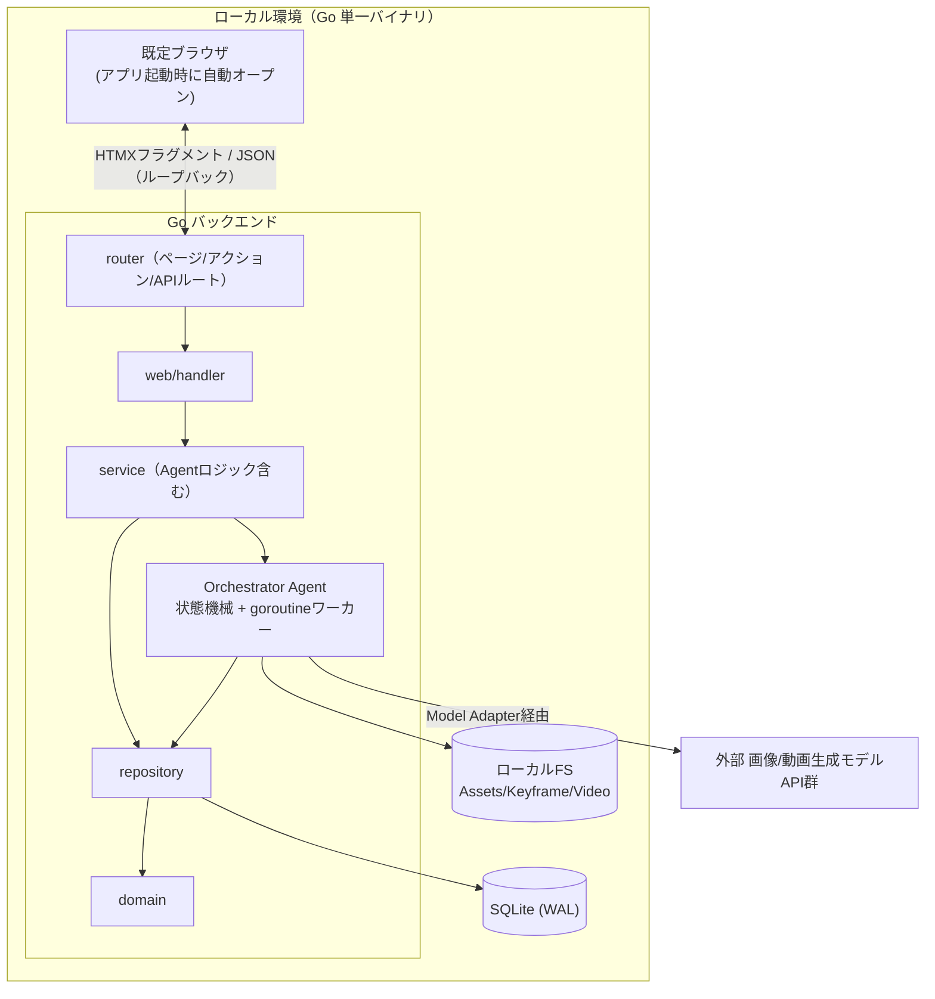
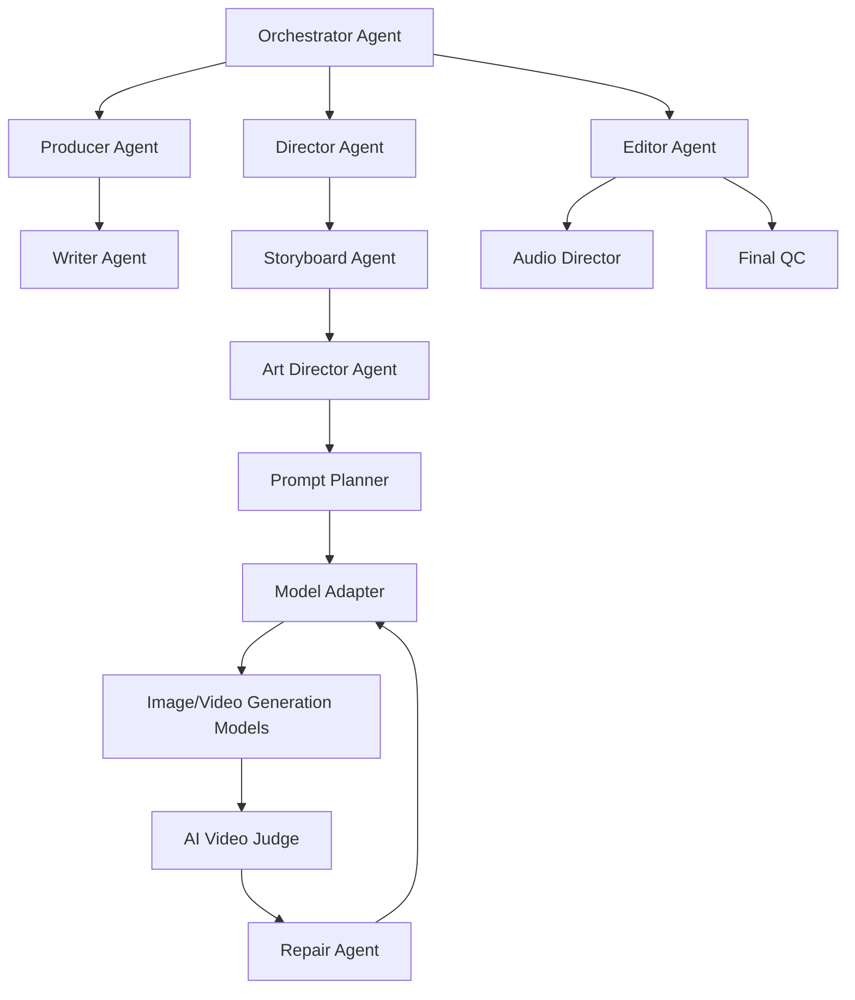

# アーキテクチャ設計

## 1. 設計原則

`spec/spec.md` §29 の技術設計原則、および HALT（`skill://halt`）のサーバーファースト原則をそのまま採用する。

- **Model-Agnostic Core**: Project State / Shot Spec / Judge Result を特定生成モデルの Prompt 形式に依存させない
- **Structured State Before Prompt**: Prompt 文字列を Source of Truth にしない。Source of Truth は Creative Intent / World State / Shot Spec / Constraints / References であり、Prompt はそこから生成される一時的な実行形式
- **Every Generation Is Traceable**: 各 Take について Source Shot Spec・World State version・Prompt version・Model・Parameters・References・Output・Judge result・Repair history を保存する
- **Reversible Decisions**: Shot/Take/Branch/State の主要変更をバージョン化し復元可能にする
- **バックエンドファースト（HALT）**: フロントエンドは API サーバーの中で動く。SPA を作らず、サーバーが UI 制御を握る
- **HATEOAS（HALT）**: サーバーは現在の状態・権限に基づき利用可能なアクションのみを HTML に含める。AUTO/MANUAL/LOCK の状態や Confirmation Level に応じたボタン・フォームの出し分けもこの原則に従う

## 2. 技術スタック

| レイヤー | 技術 | 役割 |
|---------|------|------|
| 実行方式 | Go net/http（Gin） + ブラウザ | ローカルループバック（127.0.0.1）で SSR+HTMX を配信し、起動時に既定ブラウザを自動オープンする。将来的にネイティブシェル（Wails等）へ移行可能な `http.Handler` 設計を維持する |
| サーバーフレームワーク | Go + Gin | ルーティング + SSR。独立した `http.Handler` として起動する |
| API フレームワーク | Huma | OpenAPI 3.1 自動生成、`/api/v1` 配下の JSON API の入出力バリデーション |
| テンプレートエンジン | Templ | 型安全な Go HTML テンプレート（atoms/molecules/organisms/pages） |
| インタラクション | HTMX | サーバー駆動の DOM 更新 |
| リッチUI | Lit (Web Components) | Video Player / Timeline Editor / Take Comparator / Branch Tree のみ |
| スタイリング | Tailwind CSS | ユーティリティファースト CSS |
| ビルド | esbuild | TypeScript バンドル |
| 永続化 | SQLite (WAL mode) | Project Data Model の永続化。単一ユーザー・単一バイナリ運用に最適 |
| アセットストレージ | ローカルファイルシステム | Keyframe/Reference/生成動画・画像の保存 |
| バックグラウンド処理 | Go goroutine + 内部ジョブキュー | 生成・Judge・Repair 等の非同期実行、進捗は WebSocket で通知 |
| 外部生成モデル連携 | Model Adapter（アダプタパターン） | 画像/動画生成モデル API をベンダー非依存に抽象化。特定モデルへの構造的依存を作らない |

## 3. 全体構成図



## 4. Agent Architecture

`spec/spec.md` §20 の Agent 構成を `internal/agent` パッケージ群として実装する。Orchestrator は Core State Machine（§22: DRAFT→PLANNING→VISUAL_DESIGN→(AWAITING_APPROVAL)→GENERATING→JUDGING→(REPAIRING)→EDITING→EDIT_JUDGING→AUDIO→FINAL_QC→READY→EXPORTED）を管理する状態機械として実装する。



Orchestrator の責務（§20.1）: 次に実行する Agent の決定、人間確認要否判定、生成続行/Retake/部分修正/別モデル利用の判断、コスト上限監視、編集での修正可否判定、撮影工程への差し戻し判定、Project State 更新。

## 5. ディレクトリ構成

```
.
├── backend/
│   ├── cmd/
│   │   └── server/
│   │       └── main.go     # エントリーポイント。127.0.0.1のポートでGinサーバーを起動し、既定ブラウザを自動オープンする
│   └── internal/
│       ├── domain/         # Project/Scene/Shot/Take/WorldState等のドメインモデル
│       ├── repository/     # SQLite アクセス層（domainのみに依存）
│       ├── agent/          # Producer/Writer/Director/Storyboard/ArtDirector/
│       │                   # PromptPlanner/ModelAdapter/VideoJudge/RepairAgent/
│       │                   # EditorAgent/AudioDirector/FinalQC/Orchestrator
│       ├── service/        # アプリケーションサービス層（agentを利用しユースケースを実装）
│       ├── router/         # ページ/アクション/APIルート定義
│       └── web/
│           ├── handler/    # brief.go, scene.go, shot.go, take.go, director.go,
│           │                # branch.go, export.go, settings.go ...
│           ├── middleware/  # CSRF、ロギング等
│           ├── atoms/       # button, input, badge, spinner, toast, slider(AUTO/MANUAL/LOCK) 等
│           ├── molecules/   # shot_card, take_row, world_state_field, brief_form 等
│           ├── organisms/   # main_workspace, inspector, scene_tabs, take_comparison_table 等
│           ├── pages/       # project_page, brief_page, export_page 等
│           └── layout/      # レイアウトラッパー
└── static/
    └── src/
        ├── components/
        │   ├── video-player/         # mam-video-player
        │   ├── timeline-editor/      # mam-timeline-editor
        │   ├── take-comparator/      # mam-take-comparator
        │   ├── branch-tree/          # mam-branch-tree
        │   └── lib/
        │       ├── api.ts
        │       ├── ws.ts
        │       ├── logger.ts
        │       ├── video.ts          # フレーム精度シーク・タイムコード変換
        │       └── timeline-model.ts # タイムライン共通データモデル
        ├── css/
        └── dist/
```

### レイヤー依存ルール

```
handler → service → agent → repository → domain
                        ↓
   Templ テンプレート（atoms/molecules/organisms/pages）
```

- `domain/`: 他レイヤーに依存しない
- `repository/`: `domain/` のみに依存
- `agent/`: `domain/`, `repository/`, Model Adapter経由の外部API呼び出しに依存
- `service/`: `domain/`, `repository/`, `agent/` に依存。ユースケース単位のオーケストレーション
- `web/handler/`: `service/`, `domain/` に依存。`repository/`・`agent/` を直接使わない
- `router/`: `handler/` を参照してルートを定義

## 6. 起動方式（ローカル Web サーバー）

`backend/cmd/server/main.go` が Gin サーバーを `127.0.0.1:<port>` で起動し、既定ブラウザで `http://127.0.0.1:<port>` を自動的に開く。ネイティブ WebView は用いず、OS標準のブラウザ（Chrome/Edge/Firefox/Safari）でHALTのSSR+HTMX+Lit UIを表示する。

```go
// backend/cmd/server/main.go（概念コード）
ginEngine := router.New(services) // Gin *gin.Engine（HALTのSSR+HTMXルート+Huma APIを登録済み）

port := findAvailablePort(preferredPort) // 使用中なら空きポートへフォールバック
srv := &http.Server{Addr: fmt.Sprintf("127.0.0.1:%d", port), Handler: ginEngine}

go srv.ListenAndServe()
openBrowser(fmt.Sprintf("http://127.0.0.1:%d", port)) // OS別のブラウザ起動コマンドを実行
waitForShutdownSignal()
```

- HTMX のフラグメント swap・`hx-boost`・WebSocket はすべて `127.0.0.1` へのループバック HTTP リクエストとして処理する
- 本番ビルドでは `static/dist` を `go:embed` し、単一バイナリに同梱する（サーバー・アセットとも1バイナリで完結）
- `internal/router`, `internal/web`, `internal/agent` 等はすべて `http.Handler` 単位で完結しており、実行方式（標準サーバー起動 or 将来のネイティブシェル埋め込み）に依存しない

## 7. HTMX ルーティングパターン

HALT の3パターン（ページルート/アクションルート/APIルート）をそのまま適用する。

| パターン | 例 | HX-Request分岐 | 返却 | 登録先 |
|---------|-----|----------------|------|--------|
| ページルート | `GET /projects/:id`, `GET /projects/:id/scenes/:sceneId` | する | フルページ or フラグメント | Gin |
| アクションルート | `POST /shots/:id/generate`, `POST /takes/:id/select`, `PUT /shots/:id/locks` | しない | フラグメントのみ | Gin |
| APIルート | `GET /api/v1/projects/:id`, `POST /api/v1/shots/:id/generate` | しない | JSON（Lit Web Components向け） | Huma |

Lit Web Components（Video Player/Timeline Editor/Take Comparator/Branch Tree）は `/api/v1` の JSON API のみを利用し、HTMX リクエストをトリガーしない（HALTの境界ルールに従う）。生成進捗は WebSocket（`/ws/shots/:id`）で配信する。

## 8. Lit Web Components 一覧

アプリ名プレフィックス: `mam-`。HALT の使用基準（リアルタイム編集/複雑なD&D/Canvas描画/WebSocket同期）に該当する4コンポーネントのみ実装する。それ以外（Brief フォーム、Inspector、AUTO/MANUAL/LOCKトグル、Branchの一覧表示等）は HTMX + Templ で実装する。

| コンポーネント | 用途 | 該当基準 |
|--------------|------|---------|
| `<mam-video-player>` | Take/Rough Cutのフレーム精度プレビュー、Judge Issueのフレームマーカー重畳表示 | Canvas描画、WebSocketでの生成進捗同期 |
| `<mam-timeline-editor>` | AI Editorのカット点・尺・トランジション編集 | 複雑なドラッグ＆ドロップ |
| `<mam-take-comparator>` | 複数Takeのスコア比較、区間指定によるPartial Take合成 | 複雑なドラッグ＆ドロップ（区間指定） |
| `<mam-branch-tree>` | Scene/Shot配下のBranch階層可視化・切替 | Canvas/SVG描画 |

## 9. ビルド / 開発ワークフロー

```makefile
.PHONY: dev
dev:
	@concurrently \
		"air" \
		"templ generate --watch" \
		"npm run dev --prefix static"
```

- `.templ` 編集 → `templ generate --watch` が `_templ.go` を再生成 → `air` が Go 変更を検知しサーバー再起動
- `.ts` 編集 → esbuild がバンドル → ブラウザリロードで反映
- `.css` 編集 → Tailwind がビルド → ブラウザリロードで反映
- 本番ビルド: `templ generate` → `esbuild`（minify） → `tailwind`（minify） → `go build`（`go:embed`で静的アセット同梱）を一括実行するビルドスクリプトを用意する

## 10. テスト戦略

HALT のレイヤー別テスト方針を踏襲する。

| レイヤー | 手法 | 検証内容 |
|---------|------|---------|
| Go ハンドラ | `httptest` + HTMLアサーション | 正しいフラグメント/フルページ、ステータスコード |
| Templ テンプレート | `Render()` → HTML文字列アサーション | コンポーネント出力 |
| Agent（Producer/Judge/RepairAgent等） | Go ユニットテスト（外部APIはモック） | Shot Spec変換、Judge出力パース、Repair戦略選択ロジック |
| Lit コンポーネント | `@open-wc/testing` + `@web/test-runner` | 単体の振る舞い |
| E2E | Playwright（Ginサーバーを直接起動してブラウザから検証） | HTMXインタラクション込みのユーザーフロー |

## 11. 将来拡張: Wails によるネイティブデスクトップ化

現段階ではローカル Web サーバー + ブラウザ構成とするが、以下の設計により将来 Wails（またはTauri等）でのネイティブパッケージング化を低コストで行えるようにしておく。

- `internal/router` が返す Gin の `*gin.Engine` は標準の `http.Handler` であり、Wails v3 の `application.AssetOptions.Handler` へそのまま渡せる
- ブラウザ自動オープン処理（`openBrowser()`）は `backend/cmd/server/main.go` に閉じているため、Wails採用時はこのエントリーポイントのみ `backend/cmd/wails/main.go` 等に差し替えれば良く、`internal/` 配下（domain/repository/agent/service/web）は変更不要
- Wails化のトリガー例: OSネイティブの通知・トレイアイコン・自動更新・単一実行ファイルへのアイコン付与などデスクトップ体験の強化が必要になった時点で着手する

## 改訂履歴

| 版 | 日付 | 変更内容 | 変更理由 |
|----|------|---------|---------|
| 1.0 | 2026-09-28 | 新規作成 | HALT（HTMX+Atomic+Lit+Templ）+ Wails によるデスクトップアプリ構成を定義 |
| 1.1 | 2026-09-28 | Wails前提の記述をローカルWebサーバー+ブラウザ構成へ変更し、Wailsは将来拡張セクションへ移動 | ユーザー指示により、Wails統合は現段階のスコープ外とし将来拡張に切り出す |
