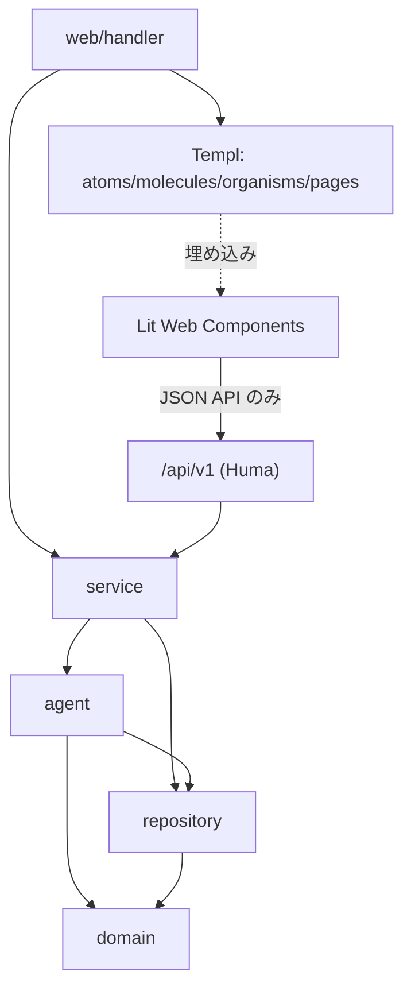

# コンポーネント設計

`spec/architecture/overview.md` のレイヤー構成・Agent Architecture を実装単位のコンポーネントへ分割する。

## 1. Agent コンポーネント（`internal/agent`）

| コンポーネント | 責務 | 入力 | 出力 | 依存 |
|--------------|------|------|------|------|
| **Orchestrator Agent** | Core State Machine（DRAFT〜EXPORTED）の管理。次に実行するAgentの決定、人間確認要否判定、Retake/部分修正/別モデル利用の判断、コスト上限監視、Editor→Reshoot差し戻し判定 | Project State、Confirmation Level、Quality/Cost Policy | 次アクション指示、Project State更新 | 全Agent、`repository` |
| **Producer Agent** | Creative Brief から Concept/Structure を展開 | Creative Brief | Concept/Structure | `domain.Brief` |
| **Writer Agent** | Concept/Structure から Script を生成 | Concept/Structure | Script | Producer出力 |
| **Director Agent** | Script から Scene/Shot Planning を実施。DIRECTOR MODEでのCommand Interpreter結果も受理 | Script、DIRECTOR指示 | Scene/Shot構成 | Writer出力、Command Interpreter |
| **Storyboard Agent** | Scene/Shotから絵コンテを生成 | Scene/Shot Planning | Storyboard | Director出力 |
| **Art Director Agent** | Reference Pack（Character/Product/Location/Style/Lighting Reference, Keyframe）を構築 | Storyboard、Assets | Reference Pack | Storyboard出力 |
| **Prompt Planner** | Canonical Shot Spec（モデル非依存YAML）を生成。Prompt Candidate Generation（Stability First/Acting First/Dynamic Camera）も担当 | Reference Pack、World State、Brand Constraints、ユーザー自然言語指示 | Canonical Shot Spec | Art Director出力、World State |
| **Model Adapter** | Canonical Shot Spec を各画像/動画生成モデル固有のプロンプト/パラメータへ変換し、外部API呼び出しを実行 | Canonical Shot Spec、Quality/Cost Policy | Take（複数候補） | Prompt Planner出力、外部モデルAPI |
| **AI Video Judge** | 生成Takeを解析し、Prompt Adherence/Character/Product/Face/Hands/Pose/Acting/Motion/Camera/Lighting/Continuity等を評価。フレーム単位Issueと Repair Strategy を出力 | Take、Shot Spec、World State、Brand Constraints | Judge Result（pass/fail, issues, repair_strategy） | Model Adapter出力 |
| **Repair Agent** | Judge Resultから Prompt Repair/Partial Regeneration/Full Retake/Different Model/Reference Reinforcement/Edit-Level Repair を選択・実行。Retry Policy（Max retries/cost/score/Escalation）を適用 | Judge Result、Retry Policy | 次アクション（再生成指示 or Escalation） | Judge出力 |
| **Editor Agent** | Selected TakesからRough Cut生成、Shot Selection/Cut Point/Timing/Pace/Transition/Reaction Shot/Insert Shot/Hook/Retention/CTA/Captionを編集。Editor Judgeで素材不足を検知しDirectorへ差し戻す | Selected Takes | Edit Timeline、素材不足時はAdditional Shot要求 | Take選択結果 |
| **Audio Director** | Dialogue/Voice/Narration/Lip Sync/BGM/SE/Foley/Ambience/Mixing/Loudness最適化。Scene Emotionと編集テンポを参照 | Edit Timeline、Scene情報 | Audio Timeline | Editor出力 |
| **Final QC** | 最終的な品質・Brand/Safety Constraint適合をチェック | Edit Timeline、Audio Timeline、Brand Constraints | PASS/FAIL（FAIL時は該当工程へ差し戻し） | Editor/Audio出力 |
| **Command Interpreter** | 自然言語のDIRECTOR指示を構造化操作（LOCK設定/パラメータ更新/再生成/Branch作成等）へ変換 | 自然言語テキスト | 構造化コマンド | Director Agentから呼び出される |
| **State Extractor** | Shot完了後の最終状態を抽出し、World Stateとの差分（State Diff）を生成。LOCK項目は除外 | 完了Shot、現在のWorld State | State Diff、新World State Version | Orchestratorから呼び出される |

## 2. 依存関係図



依存の方向は一方向（`spec/architecture/overview.md` §5のレイヤー依存ルールに従う）。Lit は Templ に埋め込まれるが、Templ から Lit への内部状態アクセスは行わない（HTML属性注入のみ）。

## 3. HALT側コンポーネント（Templ, Atomic Design）

| 区分 | コンポーネント例 | 責務 |
|------|-----------------|------|
| atoms | `button`, `input`, `textarea`, `select`, `avatar`, `badge`, `spinner`, `toast`, `lock_toggle`（AUTO/MANUAL/LOCK 3値スイッチ） | 最小のUI要素。単一責務 |
| molecules | `brief_form`, `shot_card`, `take_row`, `world_state_field`, `scene_tab`, `production_template_select`, `quality_policy_select`, `judge_issue_badge` | atomsを組み合わせた複合要素 |
| organisms | `main_workspace_header`, `scene_shot_navigator`, `inspector_panel`, `take_comparison_table`, `director_command_input`, `brand_constraint_list`, `cost_summary_panel` | molecules/atomsを組み合わせた機能単位 |
| pages | `project_list_page`, `brief_page`, `workspace_page`（`mam-video-player`埋め込み）, `shot_inspector_page`, `take_comparison_page`（`mam-take-comparator`埋め込み）, `edit_page`（`mam-timeline-editor`埋め込み）, `branch_page`（`mam-branch-tree`埋め込み）, `export_page`, `settings_page` | organismsを組み合わせたページ全体 |
| layout | `app_layout` | 共通レイアウト（ナビゲーション、Mode切替、Qualityセレクタを含むフッター） |

## 4. Lit Web Components インターフェース

`spec/architecture/overview.md` §8 の4コンポーネントについて、HATEOAS原則（サーバーがURL・権限をHTML属性で注入、クライアントはURLをハードコードしない）に従ったインターフェースを定義する。

### 4.1 `<mam-video-player>`

```typescript
@customElement('mam-video-player')
export class MamVideoPlayer extends LitElement {
  @property({ type: String, attribute: 'api-url' }) apiUrl = '';       // 例: /api/v1/takes/:id/judge-result
  @property({ type: String, attribute: 'video-src' }) videoSrc = '';   // サーバーが解決したローカルファイルURL
  @property({ type: String, attribute: 'ws-url' }) wsUrl = '';         // 生成中は /ws/shots/:id
  @state() private issues: JudgeIssue[] = [];                          // フレームマーカー描画用

  // イベント: 'seek-requested'（他コンポーネントへ再生位置を伝播）
}
```

責務: フレーム精度シーク、Judge Issueの時間範囲/フレーム範囲をタイムバー上にマーカー表示、生成中はWebSocket進捗をプレースホルダー表示に反映。

### 4.2 `<mam-timeline-editor>`

```typescript
@customElement('mam-timeline-editor')
export class MamTimelineEditor extends LitElement {
  @property({ type: String, attribute: 'api-url' }) apiUrl = '';   // GET/PUT /api/v1/projects/:id/edit-timeline
  @property({ type: Boolean }) readonly = false;                   // 権限に応じてサーバーが注入
  @state() private timeline: EditTimelineShot[] = [];

  // イベント: 'timeline-updated'（HTMX側がhx-triggerで受信しRough Cutプレビューを更新）
}
```

責務: Shotのドラッグ&ドロップ並び替え、Cut Point/Transition編集、保存はAPIルート経由。保存完了時に`timeline-updated` CustomEventを発火し、HTMX側で関連プレビューをサーバー経由更新する（HALTのLit→HTMX間接連携パターン）。

### 4.3 `<mam-take-comparator>`

```typescript
@customElement('mam-take-comparator')
export class MamTakeComparator extends LitElement {
  @property({ type: String, attribute: 'api-url' }) apiUrl = '';  // GET /api/v1/shots/:id/takes
  @state() private takes: TakeScore[] = [];
  @state() private selection: { takeId: string; start: number; end: number }[] = [];

  // イベント: 'partial-take-confirmed'（区間選択確定 → HTMXが /shots/:id/takes/partial へPOST）
}
```

責務: 複数Takeのスコア（Product/Acting/Camera/Continuity）比較表示、タイムライン上でのドラッグによる区間指定（Partial Take Use）。

### 4.4 `<mam-branch-tree>`

```typescript
@customElement('mam-branch-tree')
export class MamBranchTree extends LitElement {
  @property({ type: String, attribute: 'api-url' }) apiUrl = '';  // GET /api/v1/projects/:id/branches
  @state() private tree: BranchNode[] = [];

  // イベント: 'branch-selected'（HTMXが /branches/:id へ遷移）
}
```

責務: Scene/Shot配下のBranch階層をCanvas/SVGで可視化し、選択・切替操作を提供。

## 5. 共通ライブラリ（`static/src/components/lib`）

| ファイル | 責務 |
|---------|------|
| `api.ts` | CSRFトークン自動付与のHTTPクライアント（get/post/put/patch/del/uploadFile） |
| `ws.ts` | WebSocketラッパー（自動再接続、JSONパース） |
| `logger.ts` | ロギングユーティリティ |
| `video.ts` | フレーム精度シーク・タイムコード変換（`mam-video-player`用） |
| `timeline-model.ts` | タイムライン共通データモデル（`mam-timeline-editor` / `mam-take-comparator`で共有） |

すべてのLitコンポーネントはこれらのlibを経由してAPI/WebSocketにアクセスし、直接`fetch()`や`new WebSocket()`を呼ばない（`spec/architecture/overview.md`参照元HALT標準パターン）。

## 改訂履歴

| 版 | 日付 | 変更内容 | 変更理由 |
|----|------|---------|---------|
| 1.0 | 2026-09-28 | 新規作成 | Agent Architecture（`spec/spec.md` §20）とHALTコンポーネント構成をコンポーネント設計として具体化 |
| 1.1 | 2026-09-28 | Prompt Planner・AI Video Judge の入力列に Brand Constraints を追加 | non-functional.md §5・F-23/UC-9の「Prompt生成・AI Video Judge・Final QCの全段階でBrand/Safety Constraintを適用する」との対応が取れていなかったため（整合性レビュー指摘） |
| 1.2 | 2026-09-28 | `workspace_page` に `mam-video-player` 埋め込みの注記を追加 | api/endpoints.md（1周目改訂1.2）で明記済みの埋め込みが、pagesテーブル側では他3ページと異なり未記載だったため（整合性レビュー指摘） |
