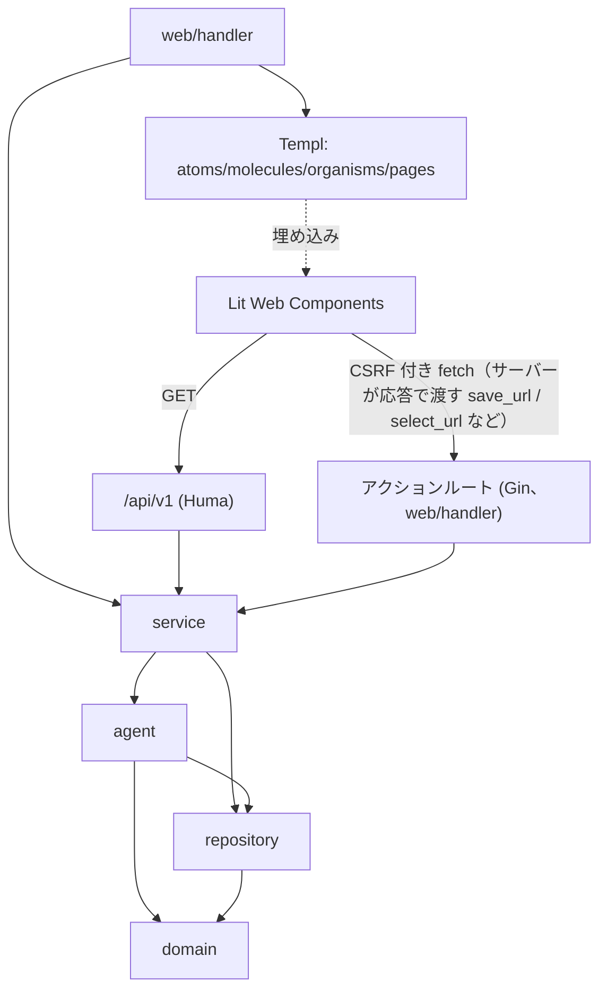

# コンポーネント設計

`spec/architecture/overview.md` のレイヤー構成・Agent Architecture を実装単位のコンポーネントへ分割する。

## 1. Agent コンポーネント（`internal/agent`）

| コンポーネント | 責務 | 入力 | 出力 | 依存 |
|--------------|------|------|------|------|
| **Orchestrator Agent** | Core State Machine（DRAFT〜EXPORTED）の管理。次に実行するAgentの決定（自動実行は Scene/Shot 計画 = VISUAL_DESIGN まで。Art Director 以降の生成（Reference Pack・Keyframe・Image / Video Generation）は Shot 単位の手動起動。編集工程は AUTO MODE で、トランクの全 Shot に Selected Take が揃うと Rough Cut と Editor Judge が自動で始まり、確認ポイント通過後に Audio と Final QC まで進む。承認未応答・Editor Judge の Re-edit・Final QC の FAIL・Export はユーザーを待つ）、人間確認要否判定（承認カードは脚本・Rough Cut・Final）、Retake/部分修正/別モデル利用の判断、コスト上限監視、Editor→Reshoot差し戻し判定 | Project State、Confirmation Level、Quality/Cost Policy | 次アクション指示、Project State更新 | 全Agent、`repository` |
| **Producer Agent** | Creative Brief から Concept/Structure を展開 | Creative Brief | Concept/Structure | `domain.Brief` |
| **Writer Agent** | Concept/Structure から Script を生成。M2 では Notes（制作メモ）を推論の文脈として参照する | Concept/Structure、Notes（M2） | Script | Producer出力 |
| **Director Agent** | Script から Scene/Shot Planning を実施。DIRECTOR MODEでのCommand Interpreter結果も受理。M2 では Notes を推論の文脈として参照する | Script、DIRECTOR指示、Notes（M2） | Scene/Shot構成 | Writer出力、Command Interpreter |
| **Storyboard Agent** | Scene/Shotから絵コンテを生成 | Scene/Shot Planning | Storyboard | Director出力 |
| **Art Director Agent** | Reference Pack（Character/Product/Location/Style/Lighting Reference, Keyframe）を構築 | Storyboard、Assets | Reference Pack | Storyboard出力 |
| **Prompt Planner** | Canonical Shot Spec（モデル非依存YAML）を生成。Prompt Candidate Generation（Stability First/Acting First/Dynamic Camera）も担当。M2 では Notes を推論の文脈として参照し、参照したメモのバージョンを `prompt_version.note_refs` に記録する（ピン留めは常時、他は関連度順にコンテキスト予算内で選別） | Reference Pack、World State、Brand Constraints、Notes（M2）、ユーザー自然言語指示 | Canonical Shot Spec | Art Director出力、World State |
| **Model Adapter** | Canonical Shot Spec を各画像/動画生成モデル固有のプロンプト/パラメータへ変換し、外部API呼び出しを実行。採用プロバイダー・ルーティングは `spec/architecture/model-adapters.md` 参照（画像: Imagen 4/Nano Banana/FLUX.2/GPT Image 2、動画: Kling 3.0/Seedance 2.0/Runway Gen-4.5） | Canonical Shot Spec、Quality/Cost Policy | Take（複数候補） | Prompt Planner出力、外部モデルAPI |
| **AI Video Judge** | 生成Takeを解析し、Prompt Adherence/Character/Product/Face/Hands/Pose/Acting/Motion/Camera/Lighting/Continuity等を評価。顔同一性は Face Identity Similarity（参照顔との埋め込み類似度）をローカルで数値化して併用（`spec/spec.md` §12.4）。フレーム単位Issueと Repair Strategy を出力 | Take、Shot Spec、World State、Brand Constraints | Judge Result（pass/fail, issues, metrics, repair_strategy） | Model Adapter出力。M1の実装は `internal/agent/judge`（定性評価は Reasoning LLM、顔の数値化は `internal/facesim`）。判定は決定的ルールで、LOCK 違反は score に関係なく FAIL（`spec/architecture/model-adapters.md` §10） |
| **Repair Agent** | Judge Resultから Prompt Repair/Partial Regeneration/Full Retake/Different Model/Reference Reinforcement/Edit-Level Repair を選択・実行。戦略は LLM が選ぶ。Decision Classifier（Jev、`spec/architecture/model-adapters.md`§4.5・§11.4）は M1 ではシャドー実行のみで、LLM が選んだ後に一致度を測って `repair_shadow` に記録するだけ（前段選別は有効にしていない。confidence による LLM との切り分けは無い）。Retry Policy（Max retries/cost/score/Escalation）を適用。Partial Regeneration は保持する部分（`preserve`）を保って Shot 全体を作り直し、M2 では問題の時間範囲だけを差し替えた候補 Take も足す（DIRECTOR MODE の区間指定は Retry Policy を経ずに起動）| Judge Result、Retry Policy、（M2）時間範囲つきの指示 | 次アクション（再生成指示 or Escalation） | Judge出力 |
| **Editor Agent** | Selected TakesからRough Cut生成、Shot Selection/Cut Point/Timing/Pace/Transition/Reaction Shot/Insert Shot/Product Exposure/Narrative Clarity/Hook/Retention/CTA/Captionを編集。Editor Judgeで素材不足を検知しDirectorへ差し戻す | Selected Takes | Edit Timeline、素材不足時はAdditional Shot要求 | Take選択結果 |
| **Audio Director** | Dialogue/Voice/Narration/Lip Sync/BGM/SE/Foley/Ambience/Mixing/Loudness最適化。Scene Emotionと編集テンポを参照。TTS/Music/SFXはElevenLabs、Lip SyncはSync Labs、Mixing/LoudnessはローカルDSP処理（詳細は`spec/architecture/model-adapters.md`§5） | Edit Timeline、Scene情報 | Audio Timeline | Editor出力 |
| **Final QC** | 最終的な品質・Brand/Safety Constraint適合をチェック | Edit Timeline、Audio Timeline、Brand Constraints | PASS/FAIL（FAIL時は該当工程へ差し戻し） | Editor/Audio出力 |
| **Command Interpreter** | 自然言語のDIRECTOR指示を構造化操作（LOCK設定/パラメータ更新/再生成/Branch作成等）へ変換。対象 Scene/Shot/Take はカードへの返信・発言中の番号・直前の文脈から解決し、解決できなければ聞き返しの質問を返す（操作は `set_lock`/`regenerate`/`partial_regenerate`（M2、時間範囲を名指しした再生成）/`set_mode`/`create_branch`（`count` 1〜5、`point_type` は `scene|shot`、`directions`。指示のない分は Continue Agent の NEXT 候補））。再生成は変更する部分と保持する部分（Character/Acting/Environment 等）を分けて返す。M2 では「覚えておいて」等の発言を Project スコープの Note 作成（`source=chat`）へ変換する | 自然言語テキスト | 構造化コマンド | Director Agentから呼び出される |
| **State Extractor** | Shot完了後の最終状態を抽出し、World Stateとの差分（State Diff）を生成。LOCK項目は除外。M2 では Note の新規/更新バージョンから World State に構造化できる項目を検出し、非ブロッキングの昇格提案（`note_promotion`、LOCK項目は除外）を生成する | 完了Shot、現在のWorld State、Note Version（M2） | State Diff、新World State Version、昇格提案（M2） | Orchestratorから呼び出される |

各Agentの自然言語推論は Reasoning LLM Adapter（`spec/architecture/overview.md` §2）経由でLLM APIを呼び出す。Agentごとのプライマリ/代替プロバイダー（Claude Opus系/GPT-5系/Gemini 3.1 Pro）の割当は `spec/architecture/model-adapters.md` §2 を参照。

### 1.1 M1 の Editor / Audio Director / Final QC（`internal/agent/editor`・`audiodirector`・`finalqc`）

範囲は `spec/requirements/functional.md` §3.6。ステージは `service.EditorService` が Project ごとに 1 つずつ実行する（実行中の別ステージは 409）。

- **Editor Agent（`editor`）**: `RoughCut` は各 Shot の Selected Take を Scene 順・Shot 順に並べ、Take の先頭から Shot の計画尺（Take が短ければ Take 全体）を区間とし、Scene の切れ目を `fade`（0.25 秒）、Scene 内を `cut` にした Edit Timeline を作る（LLM は使わない）。**Editor Judge** は決定的なチェック（クリップの Take が Shot の Selected Take と一致・ファイルの有無・総尺が Brief の Duration から ±15% 以内）と、Reasoning LLM（`llm.AgentEditor`）による編集の講評を合わせて PASS / Re-edit を返す。LLM が使えないときは決定的なチェックだけで判定する。M3（F-18 Advanced / F-19）では `Advance` が Production Template の評価軸（`ProfileFor`）に従って Rough Cut に Pace / Hook / Retention / CTA Timing / Caption を反映し、Editor Judge は Product Exposure / Reaction Shot / Insert Shot の不足を追加 Shot の指定（`need_shot`）付きで報告して `need_shot` を返す。追加 Shot は `EditorService.RequestAdditionalShot` が Director（Continue と同じ Shot 追加経路）に作らせ、Retry Policy の上限は Repair Loop と共通。詳細は `spec/requirements/functional.md` §3.7
- **Audio Director（`audiodirector`）**: 脚本の Scene ごとの `dialogue` 行を ElevenLabs の TTS（`POST /v1/text-to-speech/:voice_id`、認証は `xi-api-key`、キーは設定画面の `elevenlabs`）で音声化し、Scene の先頭 Shot の開始時刻から順に置く（行と行の間は 0.3 秒）。Take 自体の音声と TTS をローカルの ffmpeg で 1 本にミックスし、`loudnorm` の 2 パスで −14 LUFS（True Peak −1.5 dBTP）に正規化した AAC を `assets/<project>/audio/<edit_timeline_id>/<run>/mix.m4a` に保存する（`<run>` は実行ごとのディレクトリ。失敗した実行のディレクトリは削除される）。行が 1 つもなければ TTS は呼ばない。BGM / SE / Foley / Ambience / Lip Sync は M3
- **Audio Director（M3、`audiodirector`）**: M1 の範囲に加えて、Scene ごとに編集テンポと Scene Emotion を読み、Planner が BGM・Ambience・SE・Foley を設計する。ElevenLabs の TTS（音声クローンの声を含む）・Music・Sound Effects と Sync Labs の Lip Sync を Model Adapter の識別子（`elevenlabs-tts` / `elevenlabs-music` / `elevenlabs-sfx` / `sync-labs`）で呼び、`cost_ledger_entry` にコストを記録して Project の予算上限に従う。作る層は Quality Policy（FAST: BGM / BALANCED: + Ambience・SE / MAX QUALITY: + Foley・Lip Sync）で決まり、ミキシングとラウドネスはローカル DSP。Audio Timeline は Branch ごとの版で管理する。詳細は `spec/architecture/model-adapters.md` §14
- **Final QC（`finalqc`）**: 決定的なチェックのみ。①音声が最新の Edit Timeline に対して作られている（不一致 → EDITING）②各クリップの Take のファイルがある（→ EDITING）③映像と音声の長さの差 ≤ 0.5 秒（→ AUDIO）④セリフがあるのに音声がない、ミックスのファイルがない（→ AUDIO）⑤ラウドネスが目標から ±1.5 LU 以内、True Peak ≤ −1.0 dBTP（→ AUDIO）。⑥（M2）Brand / Safety Constraint: `lock` の禁止表現がセリフ（→ AUDIO）または Shot Spec（→ EDITING）にある、必須の免責表記がどこにもない（→ EDITING）、Take の Judge が `lock` の Brand 違反を出している（→ EDITING）。`advisory` の違反は警告として指摘に残し FAIL にしない（`spec/spec.md` §26.1）。1 つでも失敗（警告を除く）すれば FAIL で、差し戻し先は EDITING が 1 つでもあれば EDITING、なければ AUDIO
- **Export**: `media.Render` が Edit Timeline の各クリップを切り出して Transition でつなぎ、ミックス済みの音声を重ねて、指定の Aspect Ratio / 解像度 / コーデックで `assets/<project>/exports/<id>.mp4|webm` に書く。ffmpeg は一時ファイルへ出力し成功後にリネームする（アトミック）

## 2. 依存関係図



依存の方向は一方向（`spec/architecture/overview.md` §5のレイヤー依存ルールに従う）。図の Lit からの線は、データの取得が `/api/v1` の GET、書き込み（Timeline Editor の保存、Take Comparator の採否・部分採用など）がサーバーが応答で渡すアクションルートへの CSRF トークン付きの fetch（`lib/api.ts`）であることを表す。Lit は Templ に埋め込まれるが、Templ から Lit への内部状態アクセスは行わない（HTML属性注入のみ）。

## 3. HALT側コンポーネント（Templ, Atomic Design）

| 区分 | コンポーネント例 | 責務 |
|------|-----------------|------|
| atoms | `button`, `input`, `textarea`, `select`, `badge`, `spinner`, `toast`, `back_link`（補助ビューの戻るリンク） | 最小のUI要素。単一責務 |
| molecules | `shot_card`, `lock_toggle`（AUTO/MANUAL/LOCK 3値スイッチ）, `world_state_field`, `mode_control`（AUTO ⇄ DIRECTOR 切替）, `message_frame`（発言の枠。`attachment_strip`（添付の並び）・`reply_button`（返信対象の指定）を含む）, `text_message`（ユーザー/AI の発言）, `confirmation_control`, `question_card`, `approval_card`（M2 では Notes の昇格提案＝差分の一覧と「LOCK 中のため未反映」表示も担う）, `keyframe_card`, `take_card`（`mam-video-player` 埋め込み）, `progress_card`, `escalation_card`, `note_card`（M2、Notes の1件表示。タイトル・カテゴリ・ピン留め・最新バージョン） | atomsを組み合わせた複合要素 |
| organisms | `brief_form`（補助ビューの Brief 確認・編集用）, `chat_thread`（メッセージ履歴の表示と新着追記）, `chat_composer`（入力欄・添付・MODE/Quality コントロール・返信対象の表示。Quality の選択はここにインラインで置く）, `chat_workspace`（標準画面の本体。`chat_thread` + `chat_composer` を `/ws/projects/:id` の更新に繋ぐ）, `scene_shot_view`（Scene / Shot 階層の一覧と作成フォーム）, `shot_inspector`（Shot Inspector 本体。末尾の「演出指示」フォームが DIRECTOR の自然言語コマンド入力で、`chat_composer` とは別に補助ビュー内に置く）, `take_comparison`（`mam-take-comparator` を埋め込む Take 比較）, `brand_constraint_list`, `cost_summary_panel`, `branch_tree`（Branch 階層の `<ul role="tree">`。各 Branch は `hx-get="/branches/:id"` で `#branch-detail` に詳細を読み込み、応答は選択中の Branch を示したツリーを `hx-swap-oob` で同梱する。名前変更後も同様に再描画。`branch_tree` と詳細の `BranchDetail` は `branch_view.templ` にあり、`branch_page` が `BranchView` で組み立てる）, `analytics_panel`（Production Analytics、M3。North Star と §28 の各指標を名称・値・根拠の組で表示。分母が 0 の指標は「—」。`GET /projects/:id/analytics`・`GET /analytics` の画面本体。集計は `AnalyticsService`（`internal/service`）が `AnalyticsRepository` 経由でローカル DB のみから行う）, `version_history_panel`（Shot Spec / World State（トランク・Branch）/ Branch のバージョン一覧と復元ボタン。新しい順で先頭が現在。復元は新バージョンとして追記され、履歴に残る。Shot Inspector・World State ビューに埋め込み、Branch は `GET /branches/:id/versions` で 2 枚（`branch_version` と Branch の World State 系列）を返す。M2 では Note のバージョン復元にも使う）, `take_trace_panel`（Take の Generation Trace: Prompt version・World State version・Model・References・Output・Judge results・Repair history と Source Shot Spec/Model parameters/Adapter 出力。Shot Inspector の Take ごとの「生成の経緯」から読み込む）, `project_import_form`（プロジェクト一覧のバンドル読み込み。エクスポートは設定画面のリンク）, `note_list`（M2、`note_card` の一覧と作成・編集・アーカイブ）, `project_list`（Project 一覧、新しい順）, `new_project_form`（最初のメッセージから Project を始める）, `editor_panel`（編集画面の本体: Rough Cut・Editor Judge・Audio・Final QC・Export）, `world_state_view`（World State の表示・編集と属性ごとの LOCK 切替）, `reference_library`（参照画像の検索とアップロード）, `series_view`（Series の正典と Episode）, `review_list`・`review_workspace`（レビュー依頼の一覧と、レビュワー側の Review Package 取り込み・一覧）, `storage_panel`（Project のディスク使用量と Take のアーカイブ）, `policy_form`（Quality Policy と上限・閾値）, `production_template_form`（Production Template の切替）, `brand_template_panel`（Brand Template）, `credential_panel`（API キーの登録状況。値は表示しない） | molecules/atomsを組み合わせた機能単位 |
| pages | `projects_page`, `chat_workspace_page`（標準画面、`chat_thread` + `chat_composer`）, `brief_page`（補助ビュー）, `shot_inspector_page`, `take_comparison_page`（`mam-take-comparator`埋め込み）, `editor_page`（Rough Cut〜Export。`mam-timeline-editor`埋め込み）, `branch_page`（`branch_tree` を含む）, `world_state_page`, `notes_page`（M2、Project / Series 共用）, `settings_page`, `analytics_page`, `reviews_page`（`ReviewsPage` / `ReviewInboxPage` / `ReviewPage`）, `series_page`, `scene_shot_page`, `reference_library_page`, `error_page` | organismsを組み合わせたページ全体 |
| layout | `app_layout` | 共通シェル（CSRF メタ・JS/CSS・エラートースト領域 `#toast-region` と、`toast.ts` / `connection-notice.ts` が複製するテンプレート）。ナビゲーションは持たず、戻りは各ページの `back_link`。Mode切替・Qualityセレクタは `chat_composer` に置く |

外部由来の ID（バンドル取込で `.`・`:`・空白を含みうる）から作る ID セレクタ（`hx-target="#shot-<id>"` など）は、Templ では `internal/web/selector` の `selector.ID`、`shot.ts` では `CSS.escape` で組み立てる（手で `"#shot-" + id` と連結しない。連結すると `htmx:targetError` で結果が画面に反映されない）。URL のセグメントを `internal/web/paths` でパスエスケープするのと同じ位置づけ。

## 4. Lit Web Components インターフェース

`spec/architecture/overview.md` §8 の3コンポーネントについて、HATEOAS原則（サーバーがURL・権限をHTML属性で注入、クライアントはURLをハードコードしない）に従ったインターフェースを定義する。

### 4.1 `<mam-video-player>`

```typescript
@customElement('mam-video-player')
export class MamVideoPlayer extends LitElement {
  @property({ type: String, attribute: 'api-url' }) apiUrl = '';       // 例: /api/v1/takes/:id/judge-result
  @property({ type: String, attribute: 'video-src' }) videoSrc = '';   // サーバーが解決したローカルファイルURL
  @property({ type: String, attribute: 'ws-url' }) wsUrl = '';         // 生成中は /ws/shots/:id
  @state() private issues: JudgeIssue[] = [];                          // フレームマーカー描画用

  @property({ type: String }) poster = '';                              // 再生前の静止画（サーバーが注入）
  @property({ type: Number }) fps = 0;                                 // 既知のフレームレート。0 のときは再生中に計測（未計測は 30fps 扱い）

  // イベント: 'seek-requested'（他コンポーネントへ再生位置 {time, frame} を伝播）、'progress-finished'（生成/Judge の完了・失敗を通知）
}
```

責務: フレーム精度シーク、Judge Issueの時間範囲/フレーム範囲をタイムバー上にマーカー表示、生成中はWebSocket進捗をプレースホルダー表示に反映。

- Light DOM に描画する（Tailwind のクラスをそのまま使うため。`static/src/css/app.css` の `@source` に `components` を含める）。
- 再生位置は「コマの中央」へシークして表示コマを確定する（`lib/video.ts`）。← / → で 1 コマ、Shift 併用で 10 コマ移動。フレームレートが未知のときは、コマ送りの前に無音で短く再生して計測する。
- マーカーはフレーム範囲（`frames`）を優先し、フレームレートが未知の間は `time_range` を使う。
- `video-src` が空、または `ws-url` の進捗が `queued`/`generating`/`repairing` の間はプレースホルダー（進捗文言と、Take 数が分かるときは進捗バー）を出す。
- 4K は `/takes/:id/video` が 1080p プロキシを返すため、コンポーネント側に分岐はない。

### 4.2 `<mam-timeline-editor>`

```typescript
@customElement('mam-timeline-editor')
export class MamTimelineEditor extends LitElement {
  @property({ type: String, attribute: 'api-url' }) apiUrl = '';   // GET /api/v1/projects/:id/edit-timeline（保存は応答の save_url へ PUT /edit-timelines/:id）
  @property({ type: Boolean }) readonly = false;                   // 編集可否は GET の応答の readonly で決まる（属性はテスト・上書き用）
  @state() private body: EditTimelineBody | null = null;           // GET の応答（limits・transitions・save_url・preview_url・judge・readonly を含む）
  @state() private clips: EditClip[] = [];                         // 編集中のクリップ（`lib/edit-model.ts`）。`body.clips` との差が「未保存の変更」

  // イベント: 'timeline-updated'（HTMX側がhx-triggerで受信しRough Cutプレビューを更新）
}
```

責務: Shotのドラッグ&ドロップ並び替え、Cut Point/Transition編集、保存はAPIルート経由。保存完了時に`timeline-updated` CustomEventを発火し、HTMX側で関連プレビューをサーバー経由更新する（HALTのLit→HTMX間接連携パターン）。

M1 の実装（F-18 Simple。`static/src/components/timeline-editor/`）:

- 編集項目は Shot Selection（クリップのドラッグ or ↑↓での並べ替え、「外す」）・Cut Point（開始/終了秒）・Timing（区間の長さ、最短 0.5 秒）・Transition（`cut`/`fade`/`fade_black`/`dissolve` と長さ、先頭クリップにはなし）。範囲は `spec/requirements/functional.md` §3.6。純関数は `lib/edit-model.ts`（並べ替え・トリム・Transition・開始時刻の再計算・保存 payload）に置き、サーバー（`domain.EditTimeline.Normalize`）が最終判定する
- 保存は PUT で「次の版」を作る。表示中の版より新しい版があるとサーバーが 409 を返し、エディタは変更を保持したままエラーを表示する（変更を戻す/読み直しで最新を取得）。保存に成功したら最新の版を再読込し、再読込にも成功したら `timeline-updated`（detail: `{id}`）を発火する。再読込に失敗したときは「保存は完了しましたが再読込に失敗しました」とエラーに出し、`timeline-updated` は発火しない（画面は古い版のまま「未保存の変更あり」になり、「変更を戻す」で読み直せる）。編集画面の `#editor-actions` が `hx-trigger="timeline-updated from:body"` でステージボタンを再取得する
- サーバーの Rough Cut 作成・Editor Judge・Final QC がタイムラインを差し替えたり Judge 結果・編集可否を変えたときは、応答の `HX-Trigger: timeline-reload` で `htmx` が発火するイベントを受けて読み直す
- プレビューは `<mam-video-player video-src=preview_url>`（保存済みの版の Rough Cut を下書き品質でレンダリングしたもの）。未保存の編集はプレビューに反映されない
- M3（F-18 Advanced）: クリップごとに字幕（Caption、最大 60 文字）を編集でき、追加 Shot 由来のクリップ（`kind` が `insert`/`reaction`）にはバッジを表示する。`kind`・`caption` は保存に含める。Editor Judge が `need_shot` のときは指摘に追加 Shot（種類・秒数・挿入位置）を表示し、追加 Shot の要求は編集画面のボタン（`POST /edit-timelines/:id/request-additional-shot`）から行う。Edit Timeline は Branch ごとに読み込む（`api-url` に `?branch_id=` を付ける）
- `readonly`（プロパティ、およびサーバー応答の `readonly`）が真、または保存中は編集できない。Rough Cut がまだないときは案内を表示し、エラーにはしない

### 4.3 `<mam-take-comparator>`

```typescript
@customElement('mam-take-comparator')
export class MamTakeComparator extends LitElement {
  @property({ type: String, attribute: 'api-url' }) apiUrl = '';  // GET /api/v1/shots/:id/takes
  @state() private takes: TakeScore[] = [];
  @state() private selection: Segment[] = [];  // Segment = { take_id: string; start: number; end: number }（`lib/timeline-model.ts`）

  // イベント: 'partial-take-confirmed'（サーバーが部分採用を確定した後に発火。detail: {segments}。HTML 側の更新契機に使う）
}
```

責務: 複数Takeのスコア（Product/Acting/Camera/Continuity）比較表示、タイムライン上でのドラッグによる区間指定（Partial Take Use）。

- スコア表（Status: Candidate / AI Pick / Selected / Rejected）に「選択」「除外」ボタンを置き、`select_url` / `reject_url`（サーバーが `GET /api/v1/shots/:id/takes` で返す URL）へ `lib/api.ts` 経由で送る。URL はハードコードしない。アクションの可否はサーバーが決め、各リンクは操作可能なときだけ返る（選択済み・除外済み・ファイルがアーカイブ済みの Take には `select_url` が、除外済み・アーカイブ済みの Take には `reject_url` が無い）。コンポーネントは `status` を見ず、リンクの有無だけでボタンを出し分ける（`status` は表示ラベル用）。「除外」は取り消せない（除外済みの Take は選択できず、除外を戻すルートも無い）ため、`window.confirm('この Take を除外しますか？')` で確認してから `reject_url` へ送り、断られたら何も送らない。文言は Shot カードの `TakeRow`（Templ。`hx-confirm`）と同じで、入口によって確認の有無が違わないようにする。
- Take ごとに `mam-video-player` と区間指定用のレーンを表示する（`partial_usable` が true の Take のみ）。レーン上のドラッグはフレームに丸めて区間にし、選んだ順に並べる。区間数の上限と最短秒数はサーバーが `GET /api/v1/shots/:id/takes` の `limits`（`max_segments`・`min_segment_seconds`）で渡し、コンポーネントは値を持たない（現行の値は最大 8 個・各 0.3 秒以上）。自然言語（「Take A の 0-2秒 + Take B の 2-4秒」）でも指定でき、その文字列はサーバーが解釈する。
- 合成は `partial_url`（`POST /shots/:id/takes/partial`）へ `lib/api.ts` 経由で送る。`partial_url` は ffmpeg が使え、切り出せる Take があるときだけ返り、無ければ区間指定 UI ごと出さない。確定後に `partial-take-confirmed` を発火し、Take 一覧を読み直す。

## 5. 共通ライブラリ（`static/src/components/lib`）

| ファイル | 責務 |
|---------|------|
| `api.ts` | CSRFトークン自動付与のHTTPクライアント（get/post/put/del） |
| `ws.ts` | WebSocketラッパー（自動再接続、JSONパース。1 秒以内に閉じた接続は失敗として数え、断念後は `retry()` / `online` / `visibilitychange` で再試行） |
| `logger.ts` | スコープ付きの `console.warn`（サーバーへは送らない） |
| `video.ts` | フレーム精度シーク・タイムコード変換（`mam-video-player`用） |
| `timeline-model.ts` | Take 区間指定（Partial Take Use）のデータモデル（`mam-take-comparator`用） |
| `edit-model.ts` | 編集タイムラインの純関数（並べ替え・トリム・Transition・開始時刻の再計算・保存 payload。`mam-timeline-editor`用） |
| `errors.ts` | API エラー応答を利用者向けメッセージに変換する（`errorMessage`。各コンポーネントで共有） |
| `toast.ts` | エラートースト（`#toast-region`）の生成と閉じるボタン。マークアップは `atoms.Toast` の 1 か所だけで定義し、`AppLayout` が埋め込む `#toast-template` を複製してメッセージだけ差し込む。トーストは利用者が閉じるまで残り、自動では消えない |
| `connection-notice.ts` | 接続断念通知（「接続が切れました」＋「再接続」「再読み込み」）の表示。マークアップは `atoms.ConnectionNotice` の 1 か所だけで定義し、`AppLayout` が埋め込む `#connection-notice-template` を複製してメッセージとボタンの動作だけ差し込む。チャット・Shot カード・`mam-video-player` が共通で使う |
| `ajax.ts` | htmx の GET 再取得（`htmx.ajax`）を HTTP エラー・通信失敗でも reject させず、失敗をトースト表示して成否を返すラッパー（`failOnHttpError`） |
| `history.ts` | htmx の履歴スナップショット（sessionStorage）から、初期化済みマーカー・接続断通知・表示中のトーストを取り除く（`sanitizeHistoryHtml` / `installHistorySnapshotHygiene`。`main.ts` が読み込む） |
| `query.ts` | `selfAndDescendants`。htmx の `outerHTML` 差し替えで `htmx:load` が差し替え後の最上位ノードに発火するため、そのノード自身と子孫を合わせて返す |
| `shot.ts` | Shot の進捗表示の純関数（`/ws/shots/:id` のメッセージ型 `ShotProgress`、終了判定、完了した Shot カードの再取得リクエストの組み立て。再取得の対象 `#shot-<id>` は `CSS.escape` でセレクタにする（手で連結しない。サーバー側は `selector.ID`）。DOM の結線は `static/src/shot.ts`） |
| `sync.ts` | 再取得を 1 本ずつ実行し、成功するまで再試行する（実行中の要求は 1 回分にまとめる。失敗はバックオフ付きで再試行し、上限で断念を通知する。`chat.ts` が使う） |
| `thread.ts` | チャットスレッドの純関数（WebSocket の再取得ヒント `ProjectEvent`、重複した id の除去、成功応答の判定など。続きのメッセージ・カードの取得 URL は持たない（サーバーが `data-messages-url` / `data-next-url` / `data-card-url` で注入し、`chat.ts` はそれを読むだけ）。`main.ts` / `chat.ts` / `ajax.ts` が使う） |
| `htmx-config.ts` | htmx の設定（同一オリジンのみ、`allowScriptTags` / `allowEval` は無効） |

すべてのLitコンポーネントはこれらのlibを経由してAPI/WebSocketにアクセスし、直接`fetch()`や`new WebSocket()`を呼ばない（`spec/architecture/overview.md`参照元HALT標準パターン）。

### 5.1 その場保存するコントロールの巻き戻し（`static/src/components/save-on-change/`）

`hx-trigger="change"` の `<select>` / `<form>`（MODE・Production Template・Quality・Confirmation Level）は、ブラウザが送信前に選択を変えるため、保存に失敗すると画面に保存されていない値が残る。`main.ts` が `installSaveOnChangeRevert()` で `htmx:afterRequest`（応答の状態に関わらず、応答が無い通信断・タイムアウトでも発火する）を購読し、`settleSavedChange(elt, status)` でコントロールを落ち着かせる。Lit コンポーネントではない。

- 成功は HTTP ステータス 200〜399（`commitSavedChange`）、それ以外と応答なし（status 0）は失敗（`revertUnsavedChange`）。htmx の `successful` フラグは使えない（`main.ts` が HTML のエラー応答を swap させるため、422・5xx でもエラー扱いが消える）
- 失敗時は `<select>` なら各 option を `defaultSelected` に、`<form>` なら `form.reset()` で、描画時または直近の保存成功時の値へ戻す。Confirmation Level は select と CUSTOM CHECK の確認ポイントの checkbox を持つ 1 つの `<form>` なので、フォームごと戻る
- 成功時は現在の値を「保存済みの値」にする（select の `defaultSelected`、input の `defaultChecked` / `defaultValue`）。Quality の select は 204 を返して何も swap しないため、これをしないと後の失敗で最初に描画された値まで戻ってしまう

## 改訂履歴

| 版 | 日付 | 変更内容 | 変更理由 |
|----|------|---------|---------|
| 1.0 | 2026-09-28 | 新規作成 | Agent Architecture（`spec/spec.md` §20）とHALTコンポーネント構成をコンポーネント設計として具体化 |
| 1.1 | 2026-09-28 | Prompt Planner・AI Video Judge の入力列に Brand Constraints を追加 | non-functional.md §5・F-23/UC-9の「Prompt生成・AI Video Judge・Final QCの全段階でBrand/Safety Constraintを適用する」との対応が取れていなかったため（整合性レビュー指摘） |
| 1.2 | 2026-09-28 | `workspace_page` に `mam-video-player` 埋め込みの注記を追加 | api/endpoints.md（1周目改訂1.2）で明記済みの埋め込みが、pagesテーブル側では他3ページと異なり未記載だったため（整合性レビュー指摘） |
| 1.3 | 2026-09-28 | Editor Agent の責務説明に「Product Exposure」「Narrative Clarity」を追加 | F-18のAI Editor機能範囲と表現が一致していなかったため（整合性レビュー指摘） |
| 1.4 | 2026-09-28 | organisms一覧に `version_history_panel`（Shot/World State/Branchのバージョン一覧表示・復元ボタン）を追加 | F-28・api/endpoints.mdの復元エンドポイント群（Shot/WorldState/Branch）に対応するUI導線コンポーネントが定義されていなかったため（整合性レビュー指摘） |
| 1.5 | 2026-09-28 | pagesテーブルに `world_state_page` を追加 | api/endpoints.mdの`GET /projects/:id/world-state`に対応するページがpagesテーブルに存在しなかったため（整合性レビュー指摘） |
| 1.6 | 2026-09-28 | `<mam-branch-tree>` の `branch-selected` イベント注記に、選択中Branchの World State（`branch_id`スコープ）へ遷移するリンクの併設を追記 | api/endpoints.md 1.11/1.12でCharacter/Product/Location・World State取得エンドポイントに`branch_id`クエリが追加されたのに対し、Branch選択後にそのBranchのWorld Stateへ遷移するUI導線が定義されていなかったため（整合性レビュー指摘） |
| 1.7 | 2026-09-29 | Model Adapter・Audio Director行に採用プロバイダーを明記。Agentテーブル直後にReasoning LLM Adapterの参照割当に関する注記を追加 | ユーザーとの協議によりエージェント推論LLM・画像/動画生成/音声プロバイダーを具体的に選定したため（`spec/architecture/model-adapters.md` 新設に対応） |
| 1.8 | 2026-09-29 | AI Video Judge に Face Identity Similarity、Repair Agent に Decision Classifier（Jev）を追記 | 顔同一性の数値化と、Repair 戦略選択の低コスト化（低 confidence は LLM へ回す）を導入するため |
| 1.9 | 2026-09-29 | チャット中心UIに合わせ、molecules に各種カード、organisms に `chat_thread`/`chat_composer`、pages に `chat_workspace_page` を追加。`workspace_page` を置換。Mode切替・Qualityセレクタを `app_layout` から `chat_composer` へ移動 | ユーザー要望「基本的にはただのチャット画面にしたい」（`spec/spec.md` §23） |
| 1.10 | 2026-09-29 | Writer/Director/Prompt Planner の入力に Notes を追加。Command Interpreter に Note 作成、State Extractor に昇格提案を追記。`note_card`/`note_list`/`notes_page` を追加し、`approval_card`・`version_history_panel` の用途を拡張 | F-31（Notes, M2）を実現する Agent の入出力と UI コンポーネントが定義されていなかったため |
| 1.11 | 2026-09-29 | Orchestrator の M1 範囲（DRAFT → PLANNING → VISUAL_DESIGN、Producer → Writer →（脚本の確認ポイント）→ Director → Storyboard）を `plan` ジョブとして実装。Brief が揃った AUTO Project でのみ起動し、脚本の Approval が未応答の間は次工程へ進まない。修正依頼は Producer/Writer に前版とコメントを渡して新しい `script_version` を作る。失敗はチャットに通知し、次のユーザー操作で完了済みの工程を飛ばして再開する | M1「Reasoning LLM Adapter と AUTO パイプライン」（Issue #6）の実装で確定した動作を仕様へ反映するため |
| 1.12 | 2026-09-29 | AI Video Judge の M1 実装（`internal/agent/judge`・`internal/facesim`）と判定ルールへの参照を追記 | M1「AI Video Judge（Face Identity Similarity 含む）」（Issue #9）で実装先と判定方式を明示するため |
| 1.13 | 2026-09-29 | Command Interpreter の M1 範囲（操作の種類・対象解決・保持する部分の扱い）を追記。`lock_toggle` の 3 値スイッチと `mode_control`（`chat_composer` 内の AUTO/DIRECTOR 切替）、`shot_inspector` を実装 | M1「AUTO/MANUAL/LOCK と DIRECTOR MODE」（Issue #12）で確定した動作を仕様へ反映するため |
| 1.14 | 2026-09-30 | `mam-video-player` の `poster`/`fps` 属性と `progress-finished` イベント、`mam-take-comparator` の選択・除外・区間指定・合成の動作と `partial-take-confirmed` の発火時点（サーバー確定後）を明記。`lib/video.ts`・`lib/timeline-model.ts` を実装 | M1「Take システムと補助ビュー」（Issue #11）で確定した動作を仕様へ反映するため（HTMX 側で POST する案は、失敗表示と一覧の再読込をコンポーネントに閉じるため採らなかった） |
| 1.15 | 2026-09-30 | Repair Agent の Partial Regeneration（時間範囲のつなぎ込み、DIRECTOR MODE からの `StartPartial`）と Command Interpreter の `partial_regenerate` 操作を追記 | M2「Partial Regeneration」（Issue #16）で確定した動作を仕様へ反映するため |
| 1.16 | 2026-09-30 | organisms に `take_trace_panel`・`project_import_form` を追加し、`version_history_panel` の表示と組み込み先を具体化 | F-27（Generation Traceability）の閲覧導線とデータポータビリティ（Issue #20）の入出力 UI が未定義だったため |
| 1.17 | 2026-09-30 | `mam-branch-tree` の実装範囲を追記: SVG のツリー（トランク → Branch、入れ子は 1 段ずつ字下げ）、クリック/Enter/Space で `branch-selected`（detail は API の Branch、`detail_url` / `world_state_url` 付き）、`selected` 属性、`load()` での再読込。`main.ts` が `branch-selected` で `detail_url` を `#branch-detail` に読み込み、`branches-changed` でツリーを再描画する | M2「Branch（別展開の並行生成）」（Issue #18） |
| 1.18 | 2026-09-30 | `mam-timeline-editor` の M1 の編集項目・保存の版管理と競合時の挙動・`timeline-updated` / `timeline-reload`・プレビューを追記。Editor Agent / Audio Director / Final QC の M1 範囲を追記 | M1「簡易 Editor・簡易 Audio・Final QC・Export」（Issue #14）の実装に合わせるため |
| 1.19 | 2026-09-30 | Prompt Planner・AI Video Judge・Final QC への Brand Constraints の適用（`lock` は FAIL・403、`advisory` は警告）と `brand_constraint_list` の設置場所（設定画面）を追記 | M2「Safety / Brand Constraints」（Issue #23）の実装に合わせるため |
| 1.20 | 2026-09-30 | organisms に `analytics_panel`（Production Analytics）を追加 | M3「Production Analytics」（Issue #29） |
| 1.21 | 2026-09-30 | Editor Agent / Editor Judge の M3 範囲（Advanced 編集項目・`need_shot`・Reshoot Loop）と `mam-timeline-editor` の字幕・追加 Shot 表示・Branch 別読み込みを追記 | Advanced Editor Agent と Editor → Reshoot Loop（Issue #24）の実装に合わせるため |
| 1.22 | 2026-09-30 | §1.1 に Audio Director の M3 範囲（Scene Emotion・編集テンポによる設計、BGM / SE / Foley / Ambience / Lip Sync / 音声クローン、Quality Policy ごとの層、コスト記録、Branch ごとの版）を追記。M1 の「BGM / SE / Foley / Ambience / Lip Sync は M3」の記述は M3 に更新 | M3「Audio Director（フル機能）」（Issue #25）の実装に合わせるため |
| 1.23 | 2026-10-01 | `<mam-branch-tree>`（§4.4）を廃止し、Branch ツリーを organisms の `branch_tree`（Templ でサーバー描画、HTMX で詳細を読み込む）に変更。Lit コンポーネントは 4 → 3 | Branch ツリーは D&D・Canvas・WebSocket 同期を使わず HALT の Lit 使用基準に該当しないため（Issue #40） |
| 1.24 | 2026-10-01 | Orchestrator Agent の自動実行範囲が Scene/Shot 計画（VISUAL_DESIGN 到達）までで、Art Director 以降は Shot 単位の手動起動であることを明記 | 実装の現状に仕様を合わせるため（#85）。詳細は `spec/spec.md` §4.3 |
| 1.25 | 2026-10-01 | `ws.ts` の再接続仕様（即閉じる接続を失敗として数える・断念後の再試行）と、断念時の「接続が切れました」通知を追記 | Issue #76 |
| 1.26 | 2026-10-01 | 共通ライブラリに `errors.ts`（`errorMessage`）を追加 | `errorMessage` が `mam-take-comparator` の実装ファイルにあり、他コンポーネントがそのモジュールを横断 import していたため（Issue #39） |
| 1.27 | 2026-10-01 | 共通ライブラリから未使用の `patch`・`uploadFile`・`setLogLevel` と `debug/info/error` ログを削除し、`api.ts` を get/post/put/del、`logger.ts` を warn のみに記述を修正 | どこからも使われていないコードを保守対象にしないため（Issue #81） |
| 1.28 | 2026-10-01 | エラートーストを閉じるボタン付きの手動消去にし（6 秒の自動消去を廃止）、htmx の `allowScriptTags` / `allowEval` を無効にする設定を追記 | 読み終える前にエラーが消える問題（WCAG 2.2.1）と、フラグメントに紛れた script の実行余地を無くすため（Issue #82） |
| 1.29 | 2026-10-01 | Templ/ハンドラーが作る `/projects/:id/…` の URL を `internal/web/paths` に集約し（各セグメントをパスエスケープ）、補助ビューの戻るリンクを atoms の `back_link` / `chat_back_link` に共通化 | URL の文字列連結と戻るリンクが各所で重複し、ID に URL の特殊文字が含まれると壊れるため（Issue #72） |
| 1.30 | 2026-10-01 | Orchestrator の自動実行を、生成（Art Director 以降は Shot 単位の手動起動）と編集工程（AUTO では Selected Take が揃うと Rough Cut・Editor Judge、確認後に Audio・Final QC。Export はユーザー操作）に分けて書いた | AUTO の編集連鎖が実装済みで、§4.3 が「AI Editor 以降は手動」のままだったため（Issue #116） |
| 1.31 | 2026-10-01 | Command Interpreter の操作種別に `create_branch` を含め、「Branch 作成は M2 まで unsupported」を削除 | チャットからの Branch 作成は実装済みで、M1 の文だけが現行契約と食い違っていたため（Issue #117） |
| 1.32 | 2026-10-01 | pages 表を実在ページ名に修正（`project_list_page`→`projects_page`、`edit_page`→`editor_page`、`export_page` 削除）し、未記載の 6 ページを追加 | 実装（`backend/internal/web/pages/`）との乖離（#159） |
| 1.33 | 2026-10-01 | molecules/atoms 一覧から実装にない名前（`avatar`・`take_row`・`scene_tab`・`production_template_select`・`quality_policy_select`・`judge_issue_badge`・`message_bubble`・`attachment_chip`）を削除し、実在する `message_frame`（`attachment_strip`・`reply_button`）・`text_message`・`confirmation_control` を追記。`brief_form` を organisms へ移し、Quality の選択が `chat_composer` 内にあることを明記 | 実装（`backend/internal/web/{atoms,molecules,organisms}/`）との乖離（#160） |
| 1.34 | 2026-10-01 | organisms 一覧の実在しない名前（`main_workspace_header`・`scene_shot_navigator`・`inspector_panel`・`take_comparison_table`・`director_command_input`）を実名（`scene_shot_view`・`shot_inspector`・`take_comparison`）に直し、未記載の organisms 14 件（`chat_workspace`・`project_list`・`editor_panel` など）と `branch_view` の構成を追記 | 実装（`backend/internal/web/organisms/`）との乖離（#161） |
| 1.35 | 2026-10-01 | layout の `app_layout` を「共通シェル（CSRF メタ・JS/CSS・エラートースト領域）」とし、ナビゲーションを持たず戻りは各ページの `back_link` であることを明記 | 実装の `app_layout.templ` に共通ナビゲーションは無く、仕様の「ナビゲーション」と乖離していたため（Issue #188） |
| 1.36 | 2026-10-01 | §4.1 の `mam-video-player` のプレースホルダー条件に `repairing` を加えた（`queued`/`generating`/`repairing`） | 実装（`mam-video-player.ts` の `renderBody`）は Repair 再生成中もプレースホルダーを出すため（Issue #236） |
| 1.37 | 2026-10-02 | §3 の Audio Director のミックス保存先を `…/<edit_timeline_id>/<run>/mix.m4a` に直し、`<run>` が実行ごとのディレクトリで失敗した実行では削除されることを書いた | 実装（`audiodirector/director.go` の `runRel`・`mixRel`）はミックスを実行ごとのディレクトリに置くため（Issue #250） |
| 1.38 | 2026-10-02 | §2 の依存関係図の Lit → API の線を「JSON API のみ」から、`/api/v1` の GET と、サーバーが応答で渡すアクションルートへの CSRF 付き fetch の 2 本に直し、注記を足した | 実装（`mam-timeline-editor` の `save_url`、`mam-take-comparator` の `select_url`/`reject_url`/`partial_url`）はアクションルートも呼び、§4.2/§4.3 の本文とも食い違っていたため（Issue #255） |
| 1.39 | 2026-10-11 | §4.3 の Take Comparator に、「選択」「除外」ボタンを `status` ではなく `select_url` / `reject_url` の有無で出し分けること、`partial_usable` が true の Take だけ区間指定のレーンを出すこと、`partial_url` が無ければ区間指定 UI ごと出さないことを追記した | アクションの可否をサーバーが決め、コンポーネントはリンクの有無に従うよう実装を変えたため（`mam-take-comparator.ts`。Issue #482） |
| 1.40 | 2026-10-11 | §5 の `thread.ts` の責務を、続きのメッセージ・カードの取得 URL を持たない（サーバーが `data-messages-url` / `data-next-url` / `data-card-url` で注入し、`chat.ts` は読むだけ）ものに書き換えた | チャットの取得 URL をクライアントで組み立てる方式から、サーバーが HTML に注入する方式へ変えたため（`chat_workspace.templ`・`message_frame.templ`・`static/src/chat.ts`。Issue #507・#513）。サーバー注入の契約は `spec/architecture/overview.md` §7 にも書いた |
| 1.41 | 2026-10-11 | §4.3 の Take Comparator に、区間数の上限と最短秒数をクライアントの定数ではなくサーバーの `limits` から受け取ることを追記した | `mam-take-comparator` / `lib/timeline-model.ts` から `MAX_SEGMENTS` / `MIN_SEGMENT_SECONDS` を外し、`mam-timeline-editor` の `limits` と方針を揃えたため（Issue #519） |
| 1.42 | 2026-10-12 | §4.3 の Take Comparator に、「除外」を押したときに確認ダイアログ（Shot カードの Templ 版と同じ文言）を出し、断られたら送らないことを追記した | 除外は取り消せないのに、Shot カードの `TakeRow` は確認し、比較画面の Lit は確認せず即実行していたため（`mam-take-comparator.ts`。Issue #528） |
| 1.43 | 2026-10-12 | 共通ライブラリの節に §5.1「その場保存するコントロールの巻き戻し」を足した（`main.ts` が `installSaveOnChangeRevert()` で `htmx:afterRequest` を購読し、`settleSavedChange` が成功（HTTP 200〜399）なら `commitSavedChange`、それ以外・応答なしなら `revertUnsavedChange`。`<select>` は `defaultSelected`、`<form>` は `reset()` で戻す。Quality の 204 で `defaultSelected` を更新する理由も書いた） | #538 の `static/src/components/save-on-change/` が `endpoints.md` §0 の 1 行にしか書かれておらず、構成図にも共通ライブラリの説明にも改訂履歴にも載っていなかった（Issue #547・#553） |
| 1.44 | 2026-10-12 | §3 の Templ の節に、外部由来の ID を含む ID セレクタは `selector.ID`（Templ）・`CSS.escape`（`shot.ts`）で作り、手で連結しないことを追記し、§5 の `shot.ts` の行にも同じ規約を書いた | Issue #561。#550 が `internal/web/selector` と `shot.ts` の `CSS.escape` を足したのに、仕様のどこにもこの契約が無く、`.`・`:`・空白を含む ID を手で連結すると `htmx:targetError` になる制約が実装コメントにしか無かった |
