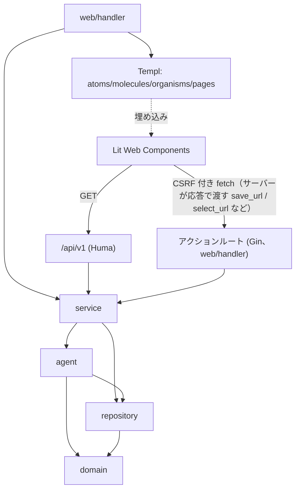

# コンポーネント設計

`spec/architecture/overview.md` のレイヤー構成・Agent Architecture を実装単位のコンポーネントへ分割する。

## 1. Agent コンポーネント（`internal/agent`）

| コンポーネント | 責務 | 入力 | 出力 | 依存 |
|--------------|------|------|------|------|
| **Orchestrator Agent** | Core State Machine（DRAFT〜EXPORTED）の管理。次に実行するAgentの決定（自動実行は Scene/Shot 計画 = VISUAL_DESIGN まで。Art Director 以降の生成（Reference Pack・Keyframe・Image / Video Generation）は Shot 単位の手動起動。編集工程は AUTO MODE で、トランクの全 Shot に Selected Take が揃うと Rough Cut と Editor Judge が自動で始まり、確認ポイント通過後に Audio と Final QC まで進む。承認未応答・Editor Judge の Re-edit・Final QC の FAIL・Export はユーザーを待つ）、人間確認要否判定（承認カードは脚本・Rough Cut・Final）、Retake/部分修正/別モデル利用の判断、コスト上限監視、Editor→Reshoot差し戻し判定 | Project State、Confirmation Level、Quality/Cost Policy | 次アクション指示、Project State更新 | 全Agent、`repository` |
| **Producer Agent** | Creative Brief から Concept/Structure を展開 | Creative Brief | Concept/Structure | `domain.Brief` |
| **Writer Agent** | Concept/Structure から Script を生成。M2 では Notes（制作メモ）を推論の文脈として参照する | Concept/Structure、Notes（M2） | Script | Producer出力 |
| **Director Agent** | Script から Scene/Shot Planning を実施。DIRECTOR MODEでのCommand Interpreter結果も受理。M2 では Notes を推論の文脈として参照する。計画は LLM の答えをそのままは使わず整える: Brief の Duration が秒数として読めるとき（`15秒`・`30 sec`・`1分30秒` のように `秒/sec/s` と `分/min/m` の合計）、全 Shot の合計が目標から ±10% を超えて外れていれば全 Shot を同じ比率で拡縮する（0.1 秒に丸め、1 Shot は 0.5 秒以上。丸めと下限のため合計は目標と少しずれうる）。Duration の有無にかかわらず 1 Shot は 60 秒までに切り詰める（長い Duration では合計が届かない）。Scene の title / location / time は 100 文字、Scene / Shot の objective は 300 文字に切り詰める（手動作成の上限と同じ）。Continue の次 Shot の計画（`POST /shots/:id/continue/confirm`）にも同じ上限を使う | Script、DIRECTOR指示、Notes（M2） | Scene/Shot構成 | Writer出力、Command Interpreter |
| **Storyboard Agent** | Scene/Shotから絵コンテを生成 | Scene/Shot Planning | Storyboard | Director出力 |
| **Art Director Agent** | Reference Pack（Character/Product/Location/Style/Lighting Reference, Keyframe）を構築 | Storyboard、Assets | Reference Pack | Storyboard出力 |
| **Prompt Planner** | Canonical Shot Spec（モデル非依存YAML）を生成。Prompt Candidate Generation（Stability First/Acting First/Dynamic Camera）も担当。M2 では Notes を推論の文脈として参照し、参照したメモのバージョンを `prompt_version.note_refs` に記録する（ピン留めは常時、他は関連度順にコンテキスト予算内で選別） | Reference Pack、World State、Brand Constraints、Notes（M2）、ユーザー自然言語指示 | Canonical Shot Spec | Art Director出力、World State |
| **Model Adapter** | Canonical Shot Spec を各画像/動画生成モデル固有のプロンプト/パラメータへ変換し、外部API呼び出しを実行。採用プロバイダー・ルーティングは `spec/architecture/model-adapters.md` 参照（画像: GPT Image 2/Nano Banana/Nano Banana Lite/FLUX.2、動画: Kling 3.0/Seedance 2.0/Runway Gen-4.5） | Canonical Shot Spec、Quality/Cost Policy | Take（複数候補） | Prompt Planner出力、外部モデルAPI |
| **AI Video Judge** | 生成Takeを解析し、Prompt Adherence/Character/Product/Face/Hands/Pose/Acting/Motion/Camera/Lighting/Continuity等を評価。顔同一性は Face Identity Similarity（参照顔との埋め込み類似度）をローカルで数値化して併用（`spec/spec.md` §12.4）。フレーム単位Issueと Repair Strategy を出力 | Take、Shot Spec、World State、Brand Constraints | Judge Result（pass/fail, issues, metrics, repair_strategy） | Model Adapter出力。M1の実装は `internal/agent/judge`（定性評価は Reasoning LLM、顔の数値化は `internal/facesim`）。判定は決定的ルールで、LOCK 違反は score に関係なく FAIL（`spec/architecture/model-adapters.md` §10） |
| **Repair Agent** | Judge Resultから Prompt Repair/Partial Regeneration/Full Retake/Different Model/Reference Reinforcement/Edit-Level Repair を選択・実行。戦略は LLM が選ぶ。Decision Classifier（Jev、`spec/architecture/model-adapters.md`§4.5・§11.4）は M1 ではシャドー実行のみで、LLM が選んだ後に一致度を測って `repair_shadow` に記録するだけ（前段選別は有効にしていない。confidence による LLM との切り分けは無い）。Retry Policy（Max retries/cost/score/Escalation）を適用。Partial Regeneration は保持する部分（`preserve`）を保って Shot 全体を作り直し、M2 では問題の時間範囲だけを差し替えた候補 Take も足す（DIRECTOR MODE の区間指定は Retry Policy を経ずに起動）| Judge Result、Retry Policy、（M2）時間範囲つきの指示 | 次アクション（再生成指示 or Escalation） | Judge出力 |
| **Editor Agent** | Selected TakesからRough Cut生成、Shot Selection/Cut Point/Timing/Pace/Transition/Reaction Shot/Insert Shot/Product Exposure/Narrative Clarity/Hook/Retention/CTA/Captionを編集。Editor Judgeで素材不足を検知しDirectorへ差し戻す | Selected Takes | Edit Timeline、素材不足時はAdditional Shot要求 | Take選択結果 |
| **Audio Director** | Dialogue/Voice/Narration/Lip Sync/BGM/SE/Foley/Ambience/Mixing/Loudness最適化。Scene Emotionと編集テンポを参照。TTS/Music/SFXはElevenLabs、Lip SyncはSync Labs、Mixing/LoudnessはローカルDSP処理（詳細は`spec/architecture/model-adapters.md`§5） | Edit Timeline、Scene情報 | Audio Timeline | Editor出力 |
| **Final QC** | 最終的な品質・Brand/Safety Constraint適合をチェック | Edit Timeline、Audio Timeline、Brand Constraints | PASS/FAIL（FAIL時は該当工程へ差し戻し） | Editor/Audio出力 |
| **Command Interpreter** | 自然言語のDIRECTOR指示を構造化操作（LOCK設定/パラメータ更新/再生成/Branch作成等）へ変換。対象 Scene/Shot/Take はカードへの返信・発言中の番号・直前の文脈から解決し、解決できなければ聞き返しの質問を返す（操作は `set_lock`/`regenerate`/`partial_regenerate`（M2、時間範囲を名指しした再生成）/`set_mode`/`create_branch`（`count` 1〜5、`point_type` は `scene|shot`、`directions`。指示のない分は Continue Agent の NEXT 候補））。再生成は変更する部分と保持する部分（Character/Acting/Environment 等）を分けて返す。M2 では「覚えておいて」等の発言を Project スコープの Note 作成（`source=chat`）へ変換する | 自然言語テキスト | 構造化コマンド | Director Agentから呼び出される |
| **State Extractor** | Shot完了後の最終状態を抽出し、World Stateとの差分（State Diff）を生成。LOCK項目は除外。M2 では Note の新規/更新バージョンから World State に構造化できる項目を検出し、非ブロッキングの昇格提案（`note_promotion`、LOCK項目は除外）を生成する | 完了Shot、現在のWorld State、Note Version（M2） | State Diff、新World State Version、昇格提案（M2） | Orchestratorから呼び出される |

各Agentの自然言語推論は Reasoning LLM Adapter（`spec/architecture/overview.md` §2）経由でLLM APIを呼び出す。Agentごとのプライマリ/代替プロバイダー（Claude Opus系/GPT-5系/Gemini 3.1 Pro）の割当は `spec/architecture/model-adapters.md` §2 を参照。

### 1.1 M1 の Editor / Audio Director / Final QC（`internal/agent/editor`・`audiodirector`・`finalqc`）

範囲は `spec/requirements/functional.md` §3.6。ステージは `service.EditorService` が Project ごとに 1 つずつ実行する（実行中の別ステージは 409）。

- **Editor Agent（`editor`）**: `RoughCut` は各 Shot の Selected Take を Scene 順・Shot 順に並べ、Take の先頭から Shot の計画尺（Take が短ければ Take 全体）を区間とし、Scene の切れ目を `fade`（0.25 秒）、Scene 内を `cut` にした Edit Timeline を作る（LLM は使わない）。**Editor Judge** は決定的なチェック（クリップの Take が Shot の Selected Take と一致・ファイルの有無・総尺が Brief の Duration から ±15% 以内）と、Reasoning LLM（`llm.AgentEditor`）による編集の講評を合わせて PASS / Re-edit を返す。LLM が使えないときは決定的なチェックだけで判定する。M3（F-18 Advanced / F-19）では `Advance` が Production Template の評価軸（`ProfileFor`）に従って Rough Cut に Pace / Hook / Retention / CTA Timing / Caption を反映し、Editor Judge は Product Exposure / Reaction Shot / Insert Shot の不足を追加 Shot の指定（`need_shot`）付きで報告して `need_shot` を返す。追加 Shot は `EditorService.RequestAdditionalShot` が Director（Continue と同じ Shot 追加経路）に作らせ、Retry Policy の上限は Repair Loop と共通。詳細は `spec/requirements/functional.md` §3.7
- **Audio Director（`audiodirector`）**: 脚本の Scene ごとの `dialogue` 行を ElevenLabs の TTS（`POST /v1/text-to-speech/:voice_id`、認証は `xi-api-key`、キーは設定画面の `elevenlabs`）で音声化し、Scene の先頭 Shot の開始時刻から順に置く（行と行の間は 0.3 秒）。Take 自体の音声と TTS をローカルの ffmpeg で 1 本にミックスし、`loudnorm` の 2 パスで −14 LUFS（True Peak −1.5 dBTP）に正規化した AAC を `assets/<project>/audio/<edit_timeline_id>/<run>/mix.m4a` に保存する（`<run>` は実行ごとのディレクトリ。失敗した実行のディレクトリは削除される）。行が 1 つもなければ TTS は呼ばない。BGM / SE / Foley / Ambience / Lip Sync は M3
- **Audio Director（M3、`audiodirector`）**: M1 の範囲に加えて、Scene ごとに編集テンポと Scene Emotion を読み、Planner が BGM・Ambience・SE・Foley を設計する。ElevenLabs の TTS（音声クローンの声を含む）・Music・Sound Effects と Sync Labs の Lip Sync を Model Adapter の識別子（`elevenlabs-tts` / `elevenlabs-music` / `elevenlabs-sfx` / `sync-labs`）で呼び、`cost_ledger_entry` にコストを記録して Project の予算上限に従う。作る層は Quality Policy（FAST: BGM / BALANCED: + Ambience・SE / MAX QUALITY: + Foley・Lip Sync）で決まり、ミキシングとラウドネスはローカル DSP。Audio Timeline は Branch ごとの版で管理する。詳細は `spec/architecture/model-adapters-m3.md` §14
- **Final QC（`finalqc`）**: 決定的なチェックのみ。①音声が最新の Edit Timeline に対して作られている（不一致 → EDITING）②各クリップの Take のファイルがある（→ EDITING）③映像と音声の長さの差 ≤ 0.5 秒（→ AUDIO）④セリフがあるのに音声がない、ミックスのファイルがない（→ AUDIO）⑤ラウドネスが目標から ±1.5 LU 以内、True Peak ≤ −1.0 dBTP（→ AUDIO）。⑥（M2）Brand / Safety Constraint: `lock` の禁止表現がセリフ（→ AUDIO）または Shot Spec（→ EDITING）にある、必須の免責表記がどこにもない（→ EDITING）、Take の Judge が `lock` の Brand 違反を出している（→ EDITING）。`advisory` の違反は警告として指摘に残し FAIL にしない（`spec/spec.md` §26.1）。1 つでも失敗（警告を除く）すれば FAIL で、差し戻し先は EDITING が 1 つでもあれば EDITING、なければ AUDIO
- **Export**: `media.Render` が Edit Timeline の各クリップを切り出して Transition でつなぎ、ミックス済みの音声を重ねて、指定の Aspect Ratio / 解像度 / コーデックで `assets/<project>/exports/<id>.mp4|webm` に書く。ffmpeg は一時ファイルへ出力し成功後にリネームする（アトミック）

## 2. 依存関係図



依存の方向は一方向（`spec/architecture/overview.md` §5のレイヤー依存ルールに従う）。図の Lit からの線は、データの取得が `/api/v1` の GET、書き込み（Timeline Editor の保存、Take Comparator の採否・部分採用など）がサーバーが応答で渡すアクションルートへの CSRF トークン付きの fetch（`lib/api.ts`）であることを表す。Lit は Templ に埋め込まれるが、Templ から Lit への内部状態アクセスは行わない（HTML属性注入のみ）。

## 3. HALT側コンポーネント（Templ, Atomic Design）

| 区分 | コンポーネント例 | 責務 |
|------|-----------------|------|
| atoms | `button`（`SmallButton`・`LinkButton`（`tone` を受ける）・`ButtonLink`（ボタンの見た目の `<a>`。ナビゲーション・ダウンロード用）・`IconButton` の変種を含む）, `input`, `textarea`, `select`, `choice`（チェックボックス / ラジオの `<input>`。`atoms/field.templ` の `Choice`）, `badge`, `spinner`, `toast`（OOB 用の `ToastOOB` を含む）, `back_link`（補助ビューの戻るリンク。チャット用の `ChatBackLink` を含む）, `HxVals`（`hx-vals` を JSON エスケープして組み立てる共有ヘルパー。手で文字列連結しない）, `ButtonFor`・`SmallButtonFor`・`LinkButtonFor`（一覧の行ごと・エンティティごとに繰り返すボタン用の `Button`（通常サイズ）/ `SmallButton` / `LinkButton`。見える文言は変えず、`aria-label` に行名を足す。行ごとに繰り返すボタンは `Button` / `SmallButton` / `LinkButton` ではなく必ずこの `*For` を使う。使う画面は、制約・Brand Template・Storage の Take・Shot カードの `take_row` と Shot の操作（生成・Reference Pack・続きを作る・Judge・Repair）・レビューのコメント（削除・解決切り替え）・版履歴・認証情報・Reference Library・Note・Shot Inspector の Take の「生成の経緯」・World State の保存と割り当て・Series の Character の保存・チャットの承認カード（「承認」「修正を依頼」とコメント欄）と質問 / 相談カードの選択肢・「AIに任せる」（カード本文の抜粋 `excerpt` で名付ける）で、`Button` などで書くと全行で同じ名前になる）, `RowLabel`（その `aria-label` を組み立てる。見える文言を先頭に置き（WCAG 2.5.3）、行名は空白をまとめて 60 文字で切り詰める。`label: 行名`）, `icon`（`Icon(name, class)`。Lucide の SVG をコピーした飾りのアイコン。`aria-hidden`・`currentColor`。使う分だけ持ち、`IconName` の定数で選ぶ（#847 で `IconKey`・`IconText`・`IconMedia`・`IconLocal`・`IconPlug`・`IconUpdate`・`IconClose` を足した。`IconCopy` は MCP のトークンのコピー（後続）で足す）。ライセンスは `atoms/icons/LICENSE`。[shared-ui-parts.md](shared-ui-parts.md) §2） | 最小のUI要素。単一責務 |
| molecules | `shot_card`（`shot_actions`（生成・Reference Pack・「続きを作る」のフォーム。Shot が実行中でないときだけ出る。`ShotActions` は Shot 名（`Shot 2: 目的`）を受け、3 つのボタンと「追加の指示」の sr-only ラベルを Shot ごとの名前にする）と `take_row`（Take 1 行。状態バッジと「選択」「除外」「Repair」「Judge」ボタン。`TakeRow` は Shot 内の 0 始まりの並び順 `n` を受け、「選択」「除外」の `aria-label` を「選択: Take A · モデル名」のように行ごとに変える）を含む）, `status`（`TakeStatusBadge`・`ShotStateLabel`。Take と Shot の状態名を Shot カードと Shot Inspector で同じ文言にする。Take の名前は `domain.TakeStatus.Label`（候補 / AI Pick / 採用 / 除外）で、Templ が決めるのは色だけ。Storage パネルも同じ `Label` を使う）, `lock_toggle`（AUTO/MANUAL/LOCK 3値スイッチ）, `world_state_field`（Character / Product / Location の編集項目。`WorldStateSave`（編集フォームの「保存」。編集できる項目がすべて LOCK のときは、必ず 422 になる「保存」の代わりに編集できない理由を出す）と、`world_state_readonly`（Camera / Story の参照専用項目）を含む）, `mode_control`（AUTO ⇄ DIRECTOR 切替）, `message_frame`（発言の枠。`attachment_strip`（添付の並び）・`reply_button`（返信対象の指定）を含む）, `text_message`（ユーザー/AI の発言。AI のテキスト発言の `ref_type` が `export` / `settings` のときは、書き出した動画のダウンロード・設定画面を開くリンクボタンを本文の下に付ける。リンクは `ref_type` / `ref_id` から `web/paths` で作り、本文に URL は書かない。`spec/architecture/er.md` §3 の `chat_message`）, `confirmation_control`, `question_card`, `approval_card`（M2 では Notes の昇格提案＝差分の一覧と「LOCK 中のため未反映」表示も担う。保留中のカードは同時に複数並ぶので、「承認」「修正を依頼」とコメント欄は `返信` と同じくカード本文の抜粋で名付ける。`question_card` / `escalation_card` の選択肢も同じ）, `keyframe_card`, `take_card`（`mam-video-player` 埋め込み）, `progress_card`, `escalation_card`, `note_card`（M2、Notes の1件表示。タイトル・カテゴリ・ピン留め・最新バージョン）, `settings_section`（設定画面の見出し付きブロック。タイトルと説明を持つ。`SettingsSectionAt(level, …)` で見出しを h2 / h3 / なしから選べ、分類のページに入れた今のままの区画は見出しなし）, `settingsui`（サブパッケージ `molecules/settingsui/`。`Nav`（`<nav aria-label="設定">`、現在の分類に `aria-current="page"`、ふつうのリンク）・`Category`（分類の `h2` つきの枠）・`CardItem`（一覧の行 `<li>`。名前・状態のバッジ・説明・要約・ボタン・OOB。[shared-ui-parts.md](shared-ui-parts.md) §5。表 `SettingsTable` は後続）。[settings-screen.md](settings-screen.md)）, `modal`（サブパッケージ `molecules/modal/`。ページに 1 つの `<dialog id="mam-modal">`（`Host`）と、本文の枠 `Frame`・`Error`・`Notice`・ボタンの `OpenAttrs`。動きは `static/src/components/modal/`（`installModal`。`showModal`・Esc・フォーカスの閉じ込めと復帰・`modal-close` イベントで閉じる）。[shared-ui-parts.md](shared-ui-parts.md) §4）, `constraint_level_badge`（Brand 制約の強制レベル。LOCK は FAIL、Advisory は警告）, `tool_card`（`ToolCard`・`ToolCardItem`・`ToolStatus`（`Status` に、サーバーが知っている状態の行を `StatusLine` で持てる。概要のカード）。トップ画面のツールのカード。カード全体が 1 つの `<a>` で、名前はタイトル、説明と状態は `aria-describedby`。状態は `StatusURL` を `hx-trigger="load"` で後から読む。[shared-ui-parts.md](shared-ui-parts.md) §3） | atomsを組み合わせた複合要素 |
| organisms | `brief_form`（補助ビューの Brief 確認・編集用）, `voice_reference_form`（Character の参照音声（F-20・F-29）のフォーム。実体は `voicereference.Form`、サブパッケージ `organisms/voicereference/`。録音の試聴（`<audio>`）・長さと言語・音声ファイルと書き起こしと言語の入力・保存・削除（`hx-confirm` つき）。`PUT`・`DELETE …/characters/:characterId/voice-reference` の応答はこのフォームだけで、Series ページ（`seriesview`）は正本の Character ごとに、World State ページ（`worldstate`）は Character ごとに置く。既存の部品・色だけを使い、長さが測れていないときの注記は `text-amber-300`。[endpoints.md](../api/endpoints.md) §2.8・§2.9）, `settings_body`（Project の設定画面の本体。Production Template・Quality Policy・予算・コスト・ストレージ・Brand・バンドルの各セクションを並べ、各セクションは `settings_section` で包む）, `settings/overview`（`organisms/settings/overview/`。全体の設定画面の概要 `GET /settings`。分類ごとの `tool_card` のカード。[settings-screen.md](settings-screen.md) §5）。分類のページの本文は `pages/settings_categories.templ` の `Settings*Body`（`SettingsOverviewBody` / `SettingsAPIKeysBody` / `SettingsLLMBody` / `SettingsModelsBody` / `SettingsLocalModelsBody` / `SettingsMCPBody` / `SettingsUpdateBody`）。LLM の割り当て（`llm.Section`。サブパッケージ `organisms/settings/llm/`。Agent ごとの表と、1 Agent のモーダル `Modal`。保存の応答は行の OOB `RowOOB`）・画像・動画モデル（`media.Section`。サブパッケージ `organisms/settings/media/`。画像の用途の表と Quality Policy の表、行のモーダル `ImageModal`・`PolicyModal`、保存の応答は行の OOB と `Status`）は、表とモーダルに作り直した（[settings-screen.md](settings-screen.md) §7 の②-3・②-4）。ローカル・代替モデル（`settings/local`。下）・MCP（`settings/mcp`。下）も作り直した（②-5・②-6）。バージョンとアップデート（`updatepanel`）は、今の区画をそのまま分類に移した。`settings/local`（`organisms/settings/local/`。`Section` はモデルマネージャーの `ToolCard`（`ManagerCard`）と接続先のカード一覧、`endpointCard` は接続先 1 枚（一覧用とサブページ用の 2 形。`EndpointCardOOB` は保存の応答）、`EndpointModal` は追加・編集のモーダル（接続テストつき）、`Page` は接続先のサブページ（`SettingsTable` のモデルの表 `ModelRows`・行 `ModelRowOOB`・`ModelAppended`、フォームを開くエディタ `#local-models-editor`）、`ModelFormView`・`startForm` はモデルのフォーム、`KeyRow` は API キーの行、`TestResult` は接続テストの結果）, `settings/mcp`（`organisms/settings/mcp/`。`Section` は待ち受け先のカード `BindRow` と `SettingsTable` のトークンの表、`TokenRowItem`・`TokenAppended` は行、`BindModal`・`IssueModal` はモーダル、`IssuedModal` は発行したトークンを 1 回だけ出す本文（コピーのボタン付き）。値は表の行に載らない）。TypeScript の `static/src/components/copy/` が「コピー」のボタンを受け持つ。atoms に `SmallButtonLinkFor`（行の名前を持つリンク）を足した。ハンドラーは `handler/settings/local/`・`handler/settings/mcp/`。`settings/credentials`（`organisms/settings/credentials/`。API キーのカード一覧 `Panel`・1 枚 `Row`・保存の応答 `RowOOB`・モーダル `Modal`・接続テストの結果 `TestResult`。キーは欄に入れず、モーダルの欄は値を持たない。`Section` が `settings_section`（h3）で包む）, `settings/chatgpt`（`organisms/settings/chatgpt/`。ChatGPT のログインの 3 枚のカード（公式 → 画像生成 → Codex 経由）の一覧 `Panel`、ログインのモーダル `LoginModal`、利用できるモデルのモーダル `ModelsModal`。`role="tablist"` は廃止）, `credential_panel`（API キーの登録状況。値は表示しない。保存・削除はそのプロバイダのカードだけを差し替える。実体は `credentials.Panel`（サブパッケージ `organisms/settings/credentials/`）。他のカードの状態に触れない） | molecules/atomsを組み合わせた機能単位 |
| pages | `projects_page`（プロジェクト一覧の下に、ツールのカード 7 枚を 3 グループで持つ（`tool_section`。生成テスト・ノード・ワークフロー・モデルマネージャー・設定・制作指標・レビューパッケージ。状態の断片は `GET /tools/:tool/status`、`web/handler/toolstatus`）。[home-screen.md](home-screen.md)）, `settings_pages`（`pages/settings_pages.templ`。全体の設定画面 `GlobalSettingsPage`。左のナビ `settingsui.Nav` と分類の本文（`GlobalSettingsPageData.Body`）、`modal.Host()` を持つ。戻るリンクはプロジェクト一覧。`AppLayoutAt` で `canonical` を足せる）, `chat_workspace_page`（標準画面、`chat_thread` + `chat_composer`）, `brief_page`（補助ビュー）, `shot_inspector_page`, `take_comparison_page`（`mam-take-comparator`埋め込み）, `editor_page`（Rough Cut〜Export。`mam-timeline-editor`埋め込み）, `branch_page`（`branch_tree` を含む）, `world_state_page`, `notes_page`（M2、Project / Series 共用）, `settings_page`, `analytics_page`, `reviews_page`（`ReviewsPage` / `ReviewInboxPage` / `ReviewPage`）, `series_page`, `scene_shot_page`, `reference_library_page`, `error_page` | organismsを組み合わせたページ全体 |
| layout | `app_layout` | 共通シェル（CSRF メタ・JS/CSS・エラートースト領域 `#toast-region` と、`toast.ts` / `connection-notice.ts` が複製するテンプレート）。ナビゲーションは持たず、戻りは各ページの `back_link`。Mode切替・Qualityセレクタは `chat_composer` に置く |

色（用途ごとの許可する Tailwind のクラスと例外。`a11y/color_allowlist_test.go` が検査する。#867）は [color-rules.md](color-rules.md)。すべての部品がこれに従う（#865 のモデルのカード・#866 の「?」ヘルプを含む）。

「?」ヘルプ（molecules の `help`（`molecules/help/`）と TypeScript の `help`。見出しの横のボタンで、説明のポップオーバーを開く。#866）の契約と、説明をヘルプへ移した画面の一覧は [shared-ui-parts.md](shared-ui-parts.md) §9・§10。

モデルマネージャー画面（`model_manager_page` と organisms の `modelmgr`）のコンポーネントは [model-manager-screen.md](model-manager-screen.md)。

生成テスト画面（`gentest_pages` と organisms の `gentest`）のコンポーネントは [gentest-screen.md](gentest-screen.md)。トップ画面のツールのカード（#846。実装済み）は [home-screen.md](home-screen.md)、カード・アイコンの部品は [shared-ui-parts.md](shared-ui-parts.md)。全体の設定画面のサブページ・モーダル（#847）の画面仕様案（実装前）は [settings-screen.md](settings-screen.md)。

初回ガイド（ウォークスルー 3 ページと初期セットアップ。`pages` の `onboarding_page`、organisms の `onboarding`。#863。実装済み）は [onboarding-screen.md](onboarding-screen.md)。ルートは [../api/endpoints-onboarding.md](../api/endpoints-onboarding.md)。設定の保存は設定画面の部品とルートをそのまま使い、ガイド専用の保存経路は持たない。

外部由来の ID は現状 `[A-Za-z0-9_-]{1,64}`（UUID を含む）に限られ、`.`・`:`・空白を含む ID はバンドル取込で拒否される（`bundlepath.ValidID`。`spec/requirements/non-functional.md` §8）。ID セレクタ（`hx-target="#shot-<id>"` など）の CSS エスケープは、この制約が将来緩められたときに備えた多層防御で、Templ では `internal/web/selector` の `selector.ID`、`shot.ts` では `CSS.escape` で組み立てる（手で `"#shot-" + id` と連結しない。制約が緩んだ後に連結していると、`.` などを含む ID で `htmx:targetError` になり結果が画面に反映されない）。URL のセグメントを `internal/web/paths` でパスエスケープするのと同じ位置づけ。

## 4. Lit Web Components インターフェース

`spec/architecture/overview.md` §8 の3コンポーネントと、ノード画面の `<mam-comfy-frame>`（§4.4）について、HATEOAS原則（サーバーがURL・権限をHTML属性で注入、クライアントはURLをハードコードしない）に従ったインターフェースを定義する。

### 4.1 `<mam-video-player>`

```typescript
@customElement('mam-video-player')
export class MamVideoPlayer extends LitElement {
  @property({ type: String, attribute: 'api-url' }) apiUrl = '';       // 例: /api/v1/takes/:id/judge-result
  @property({ type: String, attribute: 'video-src' }) videoSrc = '';   // サーバーが解決したローカルファイルURL
  @property({ type: String, attribute: 'ws-url' }) wsUrl = '';         // 生成中は /ws/shots/:id
  @state() private issues: JudgeIssue[] = [];                          // フレームマーカー描画用

  @property({ type: String }) poster = '';                              // 再生前の静止画（サーバーが注入）
  @property({ type: Number }) fps = 0;                                 // 既知のフレームレート（Take カードの `fps`。ffprobe で読めた Take のみ）。0 のときは再生中に計測（未計測は 30fps 扱い）

  // イベント: 'seek-requested'（他コンポーネントへ再生位置 {time, frame} を伝播）、'progress-finished'（生成/Judge の完了・失敗を通知）
}
```

責務: フレーム精度シーク、Judge Issueの時間範囲/フレーム範囲をタイムバー上にマーカー表示、生成中はWebSocket進捗をプレースホルダー表示に反映。

- Light DOM に描画する（Tailwind のクラスをそのまま使うため。`static/src/css/app.css` の `@source` に `components` を含める）。
- 再生位置は「コマの中央」へシークして表示コマを確定する（`lib/video.ts`）。← / → で 1 コマ、Shift 併用で 10 コマ移動。フレームレートが未知のときは、コマ送りの前に無音で短く再生して計測する。操作ボタンは「1 コマ戻る」（`◀|`）・「再生 / 一時停止」（`▶` / `❚❚`）・「1 コマ進む」（`|▶`）で、見える文字が重ならないようにし、3 つとも `title` に `aria-label` と同じ文言を付ける。
- マーカーはフレーム範囲（`frames`）を優先し、フレームレートが未知の間は `time_range` を使う。
- `video-src` が空、または `ws-url` の進捗が `queued`/`generating`/`repairing` の間はプレースホルダー（進捗文言と、Take 数が分かるときは進捗バー）を出す。
- 4K は `/takes/:id/video` が 1080p プロキシを返すため、コンポーネント側に分岐はない。

### 4.2 `<mam-timeline-editor>`

```typescript
@customElement('mam-timeline-editor')
export class MamTimelineEditor extends LitElement {
  @property({ type: String, attribute: 'api-url' }) apiUrl = '';   // GET /api/v1/projects/:id/edit-timeline（保存は応答の save_url へ PUT /edit-timelines/:id）
  @state() private body: EditTimelineBody | null = null;           // GET の応答（limits・transitions・save_url・preview_url・readonly を含む）
  @state() private clips: EditClip[] = [];                         // 編集中のクリップ（`lib/edit-model.ts`）。`body.clips` との差が「未保存の変更」

  // イベント: 'timeline-updated'（HTMX側がhx-triggerで受信しRough Cutプレビューを更新）
}
```

責務: Shotのドラッグ&ドロップ並び替え、Cut Point/Transition編集、保存はAPIルート経由。保存完了時に`timeline-updated` CustomEventを発火し、HTMX側で関連プレビューをサーバー経由更新する（HALTのLit→HTMX間接連携パターン）。

M1 の実装（F-18 Simple。`static/src/components/timeline-editor/`）:

- 編集項目は Shot Selection（クリップのドラッグ or ↑↓での並べ替え、「外す」）・Cut Point（開始/終了秒）・Timing（区間の長さ、最短 0.5 秒）・Transition（`cut`/`fade`/`fade_black`/`dissolve` と長さ、先頭クリップにはなし）。範囲は `spec/requirements/functional.md` §3.6。純関数は `lib/edit-model.ts`（並べ替え・トリム・Transition・開始時刻の再計算・保存 payload）に置き、サーバー（`domain.EditTimeline.Normalize`）が最終判定する
- 保存は PUT で「次の版」を作る。表示中の版より新しい版があるとサーバーが 409 を返し、エディタは変更を保持したままエラーを表示する（変更を戻す/読み直しで最新を取得）。保存に成功したら最新の版を再読込し、再読込にも成功したら `timeline-updated`（detail: `{id}`）を発火する。再読込に失敗したときは「保存は完了しましたが、最新の版の再読込に失敗しました。「変更を戻す」で再読込してください（<原因>）」とエラーに出し、`timeline-updated` は発火しない（画面は古い版のまま「未保存の変更あり」になり、「変更を戻す」で読み直せる）。編集画面の `#editor-actions` が `hx-trigger="timeline-updated from:body"`（`hx-swap="none"`）で各ステージの結果の領域を再取得する
- サーバーの Rough Cut 作成・Editor Judge・Final QC がタイムラインを差し替えたり Judge 結果・編集可否を変えたときは、応答の `HX-Trigger: timeline-reload` で `htmx` が発火するイベントを受けて読み直す。読み直しで未保存の編集は失われない: サーバーの版が表示中の版と同じなら、編集中の内容を保ったまま `readonly` などサーバー由来の値だけを更新し、新しい版に差し替わっていた（Rough Cut の作り直し）ときだけ編集を破棄して「未保存の変更は破棄されました」と通知する。「変更を戻す」と保存後の再読込は従来どおり最新の版で置き換える
- プレビューは `<mam-video-player video-src=preview_url>`（保存済みの版の Rough Cut を下書き品質でレンダリングしたもの）。未保存の編集はプレビューに反映されない
- M3（F-18 Advanced）: クリップごとに字幕（Caption、最大 60 文字）を編集でき、追加 Shot 由来のクリップ（`kind` が `insert`/`reaction`）にはバッジを表示する。`kind`・`caption` は保存に含める。Editor Judge の結果（指摘と `need_shot` の追加 Shot）はこのコンポーネントでは描かず、編集画面の Templ（`editorpanel.Actions`。`organisms/editorpanel/panel.templ`）だけが表示する（読み取り専用の表示に Lit を使わない。文言は 1 か所）。追加 Shot の要求は編集画面のボタン（`POST /edit-timelines/:id/request-additional-shot`）から行う。Edit Timeline は Branch ごとに読み込む（`api-url` に `?branch_id=` を付ける）
- サーバー応答の `readonly`（HATEOAS。属性では渡さない）が真、または保存中は編集できない。Rough Cut がまだないときは案内を表示し、エラーにはしない
- クリップの「外す」ボタンは、見える文言のまま `aria-label` を「外す: <クリップ名>」にする（`timeline-clip.ts`。↑↓も「<クリップ名> を上へ / を下へ」）。行ボタンを同じ名前で並べない（Templ の `atoms.RowLabel` と同じ規約）。

### 4.3 `<mam-take-comparator>`

```typescript
@customElement('mam-take-comparator')
export class MamTakeComparator extends LitElement {
  @property({ type: String, attribute: 'api-url' }) apiUrl = '';  // GET /api/v1/shots/:id/takes
  @state() private takes: TakeScore[] = [];
  @state() private selection: Segment[] = [];  // Segment = { take_id: string; start: number; end: number }（`lib/timeline-model.ts`）

  // イベント: 'partial-take-confirmed'（サーバーが部分採用を確定した後に発火。detail: {segments}。HTML 側の更新契機に使う）
}
```

責務: 複数Takeのスコア（Product/Acting/Camera/Continuity）比較表示、タイムライン上でのドラッグによる区間指定（Partial Take Use）。

- スコア表（Status: 候補 / AI Pick / 採用 / 除外。ラベルはサーバーが各 Take の `status_label` で返す Shot カードと同じ文言で、クライアントは持たない。色だけクライアントが `status` から決める）に「選択」「除外」ボタンを置き、`select_url` / `reject_url`（サーバーが `GET /api/v1/shots/:id/takes` で返す URL）へ `lib/api.ts` 経由で送る。URL はハードコードしない。アクションの可否はサーバーが決め、各リンクは操作可能なときだけ返る（選択済み・除外済み・ファイルがアーカイブ済みの Take には `select_url` が、除外済み・アーカイブ済みの Take には `reject_url` が無い）。コンポーネントは `status` を見ず、リンクの有無だけでボタンを出し分ける（`status` は表示ラベル用）。スコアは軸ごとの値が `limits.min_axis_score`（Project の Quality Policy にユーザーの上書きを当てた軸ごとの最低点。AI Video Judge が不合格にする下限）を下回るとき赤で出し、色だけに頼らないよう数字の後ろに `▼` と読み上げ用の「（基準 N 未満）」を足す（スコアが無い Take の `—` には「スコアなし」を読み上げ用に添える。WCAG 1.4.1）。閾値もクライアントは持たず、`limits` が無い・未取得のときは 0 として赤も `▼` も出さない。「除外」は取り消せない（除外済みの Take は選択できず、除外を戻すルートも無い）ため、`window.confirm('この Take を除外しますか？')` で確認してから `reject_url` へ送り、断られたら何も送らない。文言は Shot カードの `TakeRow`（Templ。`hx-confirm`）と同じで、入口によって確認の有無が違わないようにする。
- Take ごとに `mam-video-player` と区間指定用のレーンを表示する（`partial_usable` が true の Take のみ）。レーン上のドラッグはフレームに丸めて区間にし、選んだ順に並べる。区間数の上限と最短秒数はサーバーが `GET /api/v1/shots/:id/takes` の `limits`（`max_segments`・`min_segment_seconds`）で渡し、コンポーネントは値を持たない（現行の値は最大 8 個・各 0.3 秒以上）。自然言語（「Take A の 0-2秒 + Take B の 2-4秒」）でも指定でき、その文字列はサーバーが解釈する。
- 「選択」「除外」のボタンは、見える文言のまま `aria-label` を「選択: Take A」「除外: Take A」のように Take ごとに変える（`take-table.ts`。Templ の `take_row` と同じ形。atoms の `RowLabel`）。
- 合成は `partial_url`（`POST /shots/:id/takes/partial`）へ `lib/api.ts` 経由で送る。`partial_url` は ffmpeg が使え、切り出せる Take があるときだけ返り、無ければ区間指定 UI ごと出さない。確定後に `partial-take-confirmed` を発火し、Take 一覧を読み直す。

### 4.4 `<mam-comfy-frame>`

```typescript
@customElement('mam-comfy-frame')
export class MamComfyFrame extends LitElement {
  @property({ type: String }) src = '';                                       // サーバーが組み立てた ComfyUI のアドレス（mam のページと同じ文字どおりのホスト）
  @property({ type: String, attribute: 'open-url' }) openUrl = '';            // 「ブラウザで開く」のリンク先（常に出す）
  @property({ type: String, attribute: 'failure-message' }) failureMessage = '';
  @property({ type: String, attribute: 'open-label' }) openLabel = 'ブラウザで開く';
  @property({ type: Number, attribute: 'timeout-ms' }) timeoutMs = 20_000;    // iframe の `load` を待つ時間

  // イベント: 'comfy-frame-failed'（`load` が時間内に来ない・`error` のとき 1 回。bubbles / composed）
}
```

責務: ノード画面（`GET /nodes`）で ComfyUI の画面を iframe に入れ、出なかったときは案内と「ブラウザで開く」を出す。データ取得はせず、`src` / `open-url` はサーバーが渡す（HATEOAS）。ブラウザは別オリジンの iframe が空の理由を教えないので、拒否と遅延は区別できない（ComfyUI が拒否の応答を返すときはサーバーが `workflows.Service.NodeTarget` で先に見つけ、iframe を描かない）。Light DOM に描画する。CSP は `GET /nodes` の応答だけが、描画する ComfyUI の 1 オリジンを `frame-src` に持つ（`comfy/comfy-embedding.md`）。

## 5. 共通ライブラリ（`static/src/components/lib`）

| ファイル | 責務 |
|---------|------|
| `api.ts` | CSRFトークン自動付与のHTTPクライアント（get/post/put/del） |
| `ws.ts` | WebSocketラッパー（自動再接続、JSONパース。1 秒以内に閉じた接続は失敗として数え、断念後は `retry()` / `online` / `visibilitychange` で再試行） |
| `logger.ts` | スコープ付きの `console.warn`（サーバーへは送らない） |
| `video.ts` | フレーム精度シーク・タイムコード変換（`mam-video-player`用） |
| `timeline-model.ts` | Take 区間指定（Partial Take Use）のデータモデル（`mam-take-comparator`用） |
| `edit-model.ts` | 編集タイムラインの純関数（並べ替え・トリム・Transition・開始時刻の再計算・保存 payload。`mam-timeline-editor`用） |
| `errors.ts` | API エラー応答を利用者向けメッセージに変換する（`errorMessage`。各コンポーネントで共有） |
| `toast.ts` | エラートースト（`#toast-region`）の生成と閉じるボタン。マークアップは `atoms.Toast` の 1 か所だけで定義し、`AppLayout` が埋め込む `#toast-template` を複製してメッセージだけ差し込む。トーストは利用者が閉じるまで残り、自動では消えない |
| `connection-notice.ts` | 接続断念通知（「接続が切れました」＋「再接続」「再読み込み」）の表示。マークアップは `atoms.ConnectionNotice` の 1 か所だけで定義し、`AppLayout` が埋め込む `#connection-notice-template` を複製してメッセージとボタンの動作だけ差し込む。チャット・Shot カード・`mam-video-player` が共通で使う |
| `ajax.ts` | htmx の GET 再取得（`htmx.ajax`）が 4xx/5xx 応答でも reject するようにするラッパー（`failOnHttpError`）。reject は `sync.ts` の再試行が受け、断念したときだけトーストを出す（`chat.ts` / `shot.ts`） |
| `history.ts` | htmx の履歴スナップショット（sessionStorage）から、初期化済みマーカー・接続断通知・表示中のトーストを取り除く（`sanitizeHistoryHtml` / `installHistorySnapshotHygiene`。`main.ts` が読み込む） |
| `query.ts` | `selfAndDescendants`。htmx の `outerHTML` 差し替えで `htmx:load` が差し替え後の最上位ノードに発火するため、そのノード自身と子孫を合わせて返す |
| `shot.ts` | Shot の進捗表示の純関数（`/ws/shots/:id` のメッセージ型 `ShotProgress`、終了判定、完了した Shot カードの再取得リクエストの組み立て。再取得の対象 `#shot-<id>` は `CSS.escape` でセレクタにする（手で連結しない。サーバー側は `selector.ID`）。DOM の結線は `static/src/shot.ts`） |
| `sync.ts` | 再取得を 1 本ずつ実行し、成功するまで再試行する（実行中の要求は 1 回分にまとめる。失敗はバックオフ付きで再試行し、上限で断念を通知する。`chat.ts`（新着メッセージの取得と、カード ID ごとのカード再取得）と `shot.ts`（完了した Shot カードの再取得。「作業が終わった」通知は 1 回しか来ず、取得に失敗するとカードが進行中のまま残るため）が使う） |
| `thread.ts` | チャットスレッドの純関数（WebSocket の再取得ヒント `ProjectEvent`、重複した id の除去、成功応答の判定など。続きのメッセージ・カードの取得 URL は持たない（サーバーが `data-messages-url` / `data-next-url` / `data-card-url` で注入し、`chat.ts` はそれを読むだけ）。`main.ts` / `chat.ts` / `ajax.ts` が使う） |
| `htmx-config.ts` | htmx の設定（同一オリジンのみ、`allowScriptTags` / `allowEval` は無効） |

すべてのLitコンポーネントはこれらのlibを経由してAPI/WebSocketにアクセスし、直接`fetch()`や`new WebSocket()`を呼ばない（`spec/architecture/overview.md`参照元HALT標準パターン）。

### 5.1 その場保存するコントロールの巻き戻し（`static/src/components/save-on-change/`）

`hx-trigger="change"` の `<select>` / `<form>`（MODE・Production Template・Quality・Confirmation Level）は、ブラウザが送信前に選択を変えるため、保存に失敗すると画面に保存されていない値が残る。`main.ts` が `installSaveOnChangeRevert()` で `htmx:afterRequest`（応答の状態に関わらず、応答が無い通信断・タイムアウトでも発火する）を購読し、`settleSavedChange(elt, status)` でコントロールを落ち着かせる。Lit コンポーネントではない。

- 成功は HTTP ステータス 200〜399（`commitSavedChange`）、それ以外と応答なし（status 0）は失敗（`revertUnsavedChange`）。htmx の `successful` フラグは使えない（`main.ts` が HTML のエラー応答を swap させるため、422・5xx でもエラー扱いが消える）
- 失敗時は `<select>` なら各 option を `defaultSelected` に、`<form>` なら `form.reset()` で、描画時または直近の保存成功時の値へ戻す。Confirmation Level は select と CUSTOM CHECK の確認ポイントの checkbox を持つ 1 つの `<form>` なので、フォームごと戻る
- 成功時は現在の値を「保存済みの値」にする（select の `defaultSelected`、input の `defaultChecked` / `defaultValue`）。Quality の select は 204 を返して何も swap しないため、これをしないと後の失敗で最初に描画された値まで戻ってしまう

### 5.2 差し替え後のフォーカスの復帰（`static/src/components/focus-restore/`）

押したボタンを含む領域を `hx-swap="outerHTML"` で差し替える操作（LockToggle の AUTO / MANUAL / LOCK、削除、アーカイブ）では、htmx は元の要素が `id` を持つときだけ同じ `id` の要素へフォーカスを戻す。ボタンに `id` は付けないため、`main.ts` が `installFocusRestore()` で `htmx:beforeRequest`（押したコントロールを覚える）・`htmx:beforeSwap`（差し替え前の位置を控える）・`htmx:afterSwap`（戻す）・`htmx:afterRequest`（残ったコントロールのフォーカスを戻す）を購読する。Lit コンポーネントではない。

- 対象は、利用者の操作（`click`・`submit`・`change`・`input`・`keydown`・`keyup`・`dblclick`）で始まったリクエスト、およびその応答の `HX-Trigger`（Branch の版の復元後の `branch-reload` など）が起こしたリクエストの swap のうち、押したコントロールが消えてフォーカスが `<body>` へ落ちたものだけ。ポーリング（`every`）・`load` / `revealed`・WebSocket 起点の再取得は、利用者の操作の応答の最中でなければ操作のイベントを持たないので触らない。応答が届く前に利用者がフォーカスを別へ移していたとき、htmx が `id` で戻したときも触らない
- 押したコントロールは、**リクエストを出す時点**（`htmx:beforeRequest`）の `document.activeElement` で覚える。`hx-disabled-elt` は直後に押したボタンを `disabled` にし、Chrome は `disabled` にしたボタンのフォーカスを `<body>` へ落とすため、応答が届いた時点（`htmx:beforeSwap`）では覚えられない。フォーカスが `<body>` に落ちていても、押したコントロールがまだ DOM にあれば、それを覚えたものとして扱う
- 戻し先は、差し替え後の領域（`hx-target`、`hx-swap-oob` で同じ `id` の要素に置き換わった祖先）の中で、(1) 種類・`name`・`value`・`hx-*` の URL・ラベルが同じコントロール（同じものが複数あれば同じ順番）。`data-focus-key` を持つコントロールは、種類と `data-focus-key` の値だけで照合し、`name`・`value`・`hx-*` の URL・`aria-label`・ラベルは見ない（(2) の種類の照合も同じ）。押すとラベルが反転するボタン（レビューコメントの「解決済みにする」⇄「未解決に戻す」は `resolve-<コメント ID>`、Note の「アーカイブ」⇄「アーカイブを解除」は `archive-<Note ID>`、保存すると並びも「保存: <タイトル>」の名前も変わる Note の「保存」は `save-<Note ID>`、どのパネルにも同じ名前で並ぶバージョン履歴の「このバージョンに復元」は `restore-<パネルの id>-<版>`）に、行ごとに変わらない値で付ける、(2) 行の URL・ラベルを除いた種類が同じコントロールの同じ順番（最後を超えたら最後。削除した行の次の行の削除ボタン）、(3) 領域自身（`tabindex="-1"` を付けて）の順。押したコントロールが残り、`disabled` が外れたときは、リクエストの終了後にそのコントロールへ戻す
- 戻し先へ `focus()` してもフォーカスが移らなければ（戻し先が閉じた `<details>` の中にある、表示されていない）、次の候補（種類が同じコントロール、次の領域）、最後は領域自身へ進む（Lit の `focusFirst()` と同じく `document.activeElement` で確かめる）。戻し先が閉じた `<details>` の中にあるときは、その `<details>` を開いてからフォーカスする（Note をアーカイブすると「アーカイブ済み」の折りたたみの中へ、バージョンを復元するとバージョン履歴の折りたたみの中へ戻るため。押した結果を見せる）。折りたたまれた `<details>` の `<summary>` そのものは開かない
- `hx-swap-oob` で領域を差し替える操作（編集画面のステージボタン、Brand 制約・Brand Template・Note の追加フォーム）では、押したコントロールが `hx-target` の外にあっても、それを含む `id` 付きの祖先を `id` で探し直し、その中の同じコントロールへ戻す。チャットの返信先の「×」（`#reply-cancel`）は swap ではなく自分で非表示にするため、`chat.ts` が押したときに入力欄へフォーカスを戻す（返信を始めたときの動作と揃える）
- Lit コンポーネント（`mam-take-comparator`・`mam-timeline-editor`）は htmx を通らないため、操作の結果の描画が終わった後（`updateComplete`）に `focus-restore/lit-focus.ts` の `focusAfterUpdate()` でフォーカスを戻す。フォーカスが `<body>` に落ちたとき、または `disabled` になったコントロールに残っているときだけ動き（Chrome 155 は `disabled` にしたボタンを、しばらく `document.activeElement` のまま残してから `<body>` へ落とす）、利用者が別へ移していれば触らない。戻し先は、(1) 同じ行の同じ種類のボタン、(2) 同じ行の別のボタン、(3) 行・パネル・一覧（`tabindex="-1"` を付けて）の順:
  - Take の「選択」「除外」→ 同じ行の残ったボタン、なければ行見出し。「この区間で合成」→ 選択パネル、区間の「×」→ 次の区間の「×」（最後なら 1 つ前）
  - Timeline の「↑」「↓」→ 動かしたクリップの同じ向きのボタン（動かせなくなったら反対向き）。「外す」→ 代わりに同じ位置に来たクリップの「外す」（残りが 1 つで押せなければ行）。「保存」→ 保存失敗なら「保存」、成功なら「保存しました」の通知。「変更を戻す」→ クリップ一覧
  - Timeline の行は `shot_id` をキーに描画し（`repeat`）、行を入れ替えても DOM がクリップと一緒に動く（フォーカス中のボタンが別のクリップの `aria-label` に変わらない）。並べ替え・削除の結果は `role="status"` の `data-announce` で「X を N 番目へ移動しました」「X を外しました」と読み上げる

## 改訂履歴

| 版 | 日付 | 変更内容 | 変更理由 |
|----|------|---------|---------|
| 1.0 | 2026-09-28 | 新規作成 | Agent Architecture（`spec/spec.md` §20）とHALTコンポーネント構成をコンポーネント設計として具体化 |
| 1.1 | 2026-09-28 | Prompt Planner・AI Video Judge の入力列に Brand Constraints を追加 | non-functional.md §5・F-23/UC-9の「Prompt生成・AI Video Judge・Final QCの全段階でBrand/Safety Constraintを適用する」との対応が取れていなかったため（整合性レビュー指摘） |
| 1.2 | 2026-09-28 | `workspace_page` に `mam-video-player` 埋め込みの注記を追加 | api/endpoints.md（1周目改訂1.2）で明記済みの埋め込みが、pagesテーブル側では他3ページと異なり未記載だったため（整合性レビュー指摘） |
| 1.3 | 2026-09-28 | Editor Agent の責務説明に「Product Exposure」「Narrative Clarity」を追加 | F-18のAI Editor機能範囲と表現が一致していなかったため（整合性レビュー指摘） |
| 1.4 | 2026-09-28 | organisms一覧に `version_history_panel`（Shot/World State/Branchのバージョン一覧表示・復元ボタン）を追加 | F-28・api/endpoints.mdの復元エンドポイント群（Shot/WorldState/Branch）に対応するUI導線コンポーネントが定義されていなかったため（整合性レビュー指摘） |
| 1.5 | 2026-09-28 | pagesテーブルに `world_state_page` を追加 | api/endpoints.mdの`GET /projects/:id/world-state`に対応するページがpagesテーブルに存在しなかったため（整合性レビュー指摘） |
| 1.6 | 2026-09-28 | `<mam-branch-tree>` の `branch-selected` イベント注記に、選択中Branchの World State（`branch_id`スコープ）へ遷移するリンクの併設を追記 | api/endpoints.md 1.11/1.12でCharacter/Product/Location・World State取得エンドポイントに`branch_id`クエリが追加されたのに対し、Branch選択後にそのBranchのWorld Stateへ遷移するUI導線が定義されていなかったため（整合性レビュー指摘） |
| 1.7 | 2026-09-29 | Model Adapter・Audio Director行に採用プロバイダーを明記。Agentテーブル直後にReasoning LLM Adapterの参照割当に関する注記を追加 | ユーザーとの協議によりエージェント推論LLM・画像/動画生成/音声プロバイダーを具体的に選定したため（`spec/architecture/model-adapters.md` 新設に対応） |
| 1.8 | 2026-09-29 | AI Video Judge に Face Identity Similarity、Repair Agent に Decision Classifier（Jev）を追記 | 顔同一性の数値化と、Repair 戦略選択の低コスト化（低 confidence は LLM へ回す）を導入するため |
| 1.9 | 2026-09-29 | チャット中心UIに合わせ、molecules に各種カード、organisms に `chat_thread`/`chat_composer`、pages に `chat_workspace_page` を追加。`workspace_page` を置換。Mode切替・Qualityセレクタを `app_layout` から `chat_composer` へ移動 | ユーザー要望「基本的にはただのチャット画面にしたい」（`spec/spec.md` §23） |
| 1.10 | 2026-09-29 | Writer/Director/Prompt Planner の入力に Notes を追加。Command Interpreter に Note 作成、State Extractor に昇格提案を追記。`note_card`/`note_list`/`notes_page` を追加し、`approval_card`・`version_history_panel` の用途を拡張 | F-31（Notes, M2）を実現する Agent の入出力と UI コンポーネントが定義されていなかったため |
| 1.11 | 2026-09-29 | Orchestrator の M1 範囲（DRAFT → PLANNING → VISUAL_DESIGN、Producer → Writer →（脚本の確認ポイント）→ Director → Storyboard）を `plan` ジョブとして実装。Brief が揃った AUTO Project でのみ起動し、脚本の Approval が未応答の間は次工程へ進まない。修正依頼は Producer/Writer に前版とコメントを渡して新しい `script_version` を作る。失敗はチャットに通知し、次のユーザー操作で完了済みの工程を飛ばして再開する | M1「Reasoning LLM Adapter と AUTO パイプライン」（Issue #6）の実装で確定した動作を仕様へ反映するため |
| 1.12 | 2026-09-29 | AI Video Judge の M1 実装（`internal/agent/judge`・`internal/facesim`）と判定ルールへの参照を追記 | M1「AI Video Judge（Face Identity Similarity 含む）」（Issue #9）で実装先と判定方式を明示するため |
| 1.13 | 2026-09-29 | Command Interpreter の M1 範囲（操作の種類・対象解決・保持する部分の扱い）を追記。`lock_toggle` の 3 値スイッチと `mode_control`（`chat_composer` 内の AUTO/DIRECTOR 切替）、`shot_inspector` を実装 | M1「AUTO/MANUAL/LOCK と DIRECTOR MODE」（Issue #12）で確定した動作を仕様へ反映するため |
| 1.14 | 2026-09-30 | `mam-video-player` の `poster`/`fps` 属性と `progress-finished` イベント、`mam-take-comparator` の選択・除外・区間指定・合成の動作と `partial-take-confirmed` の発火時点（サーバー確定後）を明記。`lib/video.ts`・`lib/timeline-model.ts` を実装 | M1「Take システムと補助ビュー」（Issue #11）で確定した動作を仕様へ反映するため（HTMX 側で POST する案は、失敗表示と一覧の再読込をコンポーネントに閉じるため採らなかった） |
| 1.15 | 2026-09-30 | Repair Agent の Partial Regeneration（時間範囲のつなぎ込み、DIRECTOR MODE からの `StartPartial`）と Command Interpreter の `partial_regenerate` 操作を追記 | M2「Partial Regeneration」（Issue #16）で確定した動作を仕様へ反映するため |
| 1.16 | 2026-09-30 | organisms に `take_trace_panel`・`project_import_form` を追加し、`version_history_panel` の表示と組み込み先を具体化 | F-27（Generation Traceability）の閲覧導線とデータポータビリティ（Issue #20）の入出力 UI が未定義だったため |
| 1.17 | 2026-09-30 | `mam-branch-tree` の実装範囲を追記: SVG のツリー（トランク → Branch、入れ子は 1 段ずつ字下げ）、クリック/Enter/Space で `branch-selected`（detail は API の Branch、`detail_url` / `world_state_url` 付き）、`selected` 属性、`load()` での再読込。`main.ts` が `branch-selected` で `detail_url` を `#branch-detail` に読み込み、`branches-changed` でツリーを再描画する | M2「Branch（別展開の並行生成）」（Issue #18） |
| 1.18 | 2026-09-30 | `mam-timeline-editor` の M1 の編集項目・保存の版管理と競合時の挙動・`timeline-updated` / `timeline-reload`・プレビューを追記。Editor Agent / Audio Director / Final QC の M1 範囲を追記 | M1「簡易 Editor・簡易 Audio・Final QC・Export」（Issue #14）の実装に合わせるため |
| 1.19 | 2026-09-30 | Prompt Planner・AI Video Judge・Final QC への Brand Constraints の適用（`lock` は FAIL・403、`advisory` は警告）と `brand_constraint_list` の設置場所（設定画面）を追記 | M2「Safety / Brand Constraints」（Issue #23）の実装に合わせるため |
| 1.20 | 2026-09-30 | organisms に `analytics_panel`（Production Analytics）を追加 | M3「Production Analytics」（Issue #29） |
| 1.21 | 2026-09-30 | Editor Agent / Editor Judge の M3 範囲（Advanced 編集項目・`need_shot`・Reshoot Loop）と `mam-timeline-editor` の字幕・追加 Shot 表示・Branch 別読み込みを追記 | Advanced Editor Agent と Editor → Reshoot Loop（Issue #24）の実装に合わせるため |
| 1.22 | 2026-09-30 | §1.1 に Audio Director の M3 範囲（Scene Emotion・編集テンポによる設計、BGM / SE / Foley / Ambience / Lip Sync / 音声クローン、Quality Policy ごとの層、コスト記録、Branch ごとの版）を追記。M1 の「BGM / SE / Foley / Ambience / Lip Sync は M3」の記述は M3 に更新 | M3「Audio Director（フル機能）」（Issue #25）の実装に合わせるため |
| 1.23 | 2026-10-01 | `<mam-branch-tree>`（§4.4）を廃止し、Branch ツリーを organisms の `branch_tree`（Templ でサーバー描画、HTMX で詳細を読み込む）に変更。Lit コンポーネントは 4 → 3 | Branch ツリーは D&D・Canvas・WebSocket 同期を使わず HALT の Lit 使用基準に該当しないため（Issue #40） |
| 1.24 | 2026-10-01 | Orchestrator Agent の自動実行範囲が Scene/Shot 計画（VISUAL_DESIGN 到達）までで、Art Director 以降は Shot 単位の手動起動であることを明記 | 実装の現状に仕様を合わせるため（#85）。詳細は `spec/spec.md` §4.3 |
| 1.25 | 2026-10-01 | `ws.ts` の再接続仕様（即閉じる接続を失敗として数える・断念後の再試行）と、断念時の「接続が切れました」通知を追記 | Issue #76 |
| 1.26 | 2026-10-01 | 共通ライブラリに `errors.ts`（`errorMessage`）を追加 | `errorMessage` が `mam-take-comparator` の実装ファイルにあり、他コンポーネントがそのモジュールを横断 import していたため（Issue #39） |
| 1.27 | 2026-10-01 | 共通ライブラリから未使用の `patch`・`uploadFile`・`setLogLevel` と `debug/info/error` ログを削除し、`api.ts` を get/post/put/del、`logger.ts` を warn のみに記述を修正 | どこからも使われていないコードを保守対象にしないため（Issue #81） |
| 1.28 | 2026-10-01 | エラートーストを閉じるボタン付きの手動消去にし（6 秒の自動消去を廃止）、htmx の `allowScriptTags` / `allowEval` を無効にする設定を追記 | 読み終える前にエラーが消える問題（WCAG 2.2.1）と、フラグメントに紛れた script の実行余地を無くすため（Issue #82） |
| 1.29 | 2026-10-01 | Templ/ハンドラーが作る `/projects/:id/…` の URL を `internal/web/paths` に集約し（各セグメントをパスエスケープ）、補助ビューの戻るリンクを atoms の `back_link` / `chat_back_link` に共通化 | URL の文字列連結と戻るリンクが各所で重複し、ID に URL の特殊文字が含まれると壊れるため（Issue #72） |
| 1.30 | 2026-10-01 | Orchestrator の自動実行を、生成（Art Director 以降は Shot 単位の手動起動）と編集工程（AUTO では Selected Take が揃うと Rough Cut・Editor Judge、確認後に Audio・Final QC。Export はユーザー操作）に分けて書いた | AUTO の編集連鎖が実装済みで、§4.3 が「AI Editor 以降は手動」のままだったため（Issue #116） |
| 1.31 | 2026-10-01 | Command Interpreter の操作種別に `create_branch` を含め、「Branch 作成は M2 まで unsupported」を削除 | チャットからの Branch 作成は実装済みで、M1 の文だけが現行契約と食い違っていたため（Issue #117） |
| 1.32 | 2026-10-01 | pages 表を実在ページ名に修正（`project_list_page`→`projects_page`、`edit_page`→`editor_page`、`export_page` 削除）し、未記載の 6 ページを追加 | 実装（`backend/internal/web/pages/`）との乖離（#159） |
| 1.33 | 2026-10-01 | molecules/atoms 一覧から実装にない名前（`avatar`・`take_row`・`scene_tab`・`production_template_select`・`quality_policy_select`・`judge_issue_badge`・`message_bubble`・`attachment_chip`）を削除し、実在する `message_frame`（`attachment_strip`・`reply_button`）・`text_message`・`confirmation_control` を追記。`brief_form` を organisms へ移し、Quality の選択が `chat_composer` 内にあることを明記 | 実装（`backend/internal/web/{atoms,molecules,organisms}/`）との乖離（#160） |
| 1.34 | 2026-10-01 | organisms 一覧の実在しない名前（`main_workspace_header`・`scene_shot_navigator`・`inspector_panel`・`take_comparison_table`・`director_command_input`）を実名（`scene_shot_view`・`shot_inspector`・`take_comparison`）に直し、未記載の organisms 14 件（`chat_workspace`・`project_list`・`editor_panel` など）と `branch_view` の構成を追記 | 実装（`backend/internal/web/organisms/`）との乖離（#161） |
| 1.35 | 2026-10-01 | layout の `app_layout` を「共通シェル（CSRF メタ・JS/CSS・エラートースト領域）」とし、ナビゲーションを持たず戻りは各ページの `back_link` であることを明記 | 実装の `app_layout.templ` に共通ナビゲーションは無く、仕様の「ナビゲーション」と乖離していたため（Issue #188） |
| 1.36 | 2026-10-01 | §4.1 の `mam-video-player` のプレースホルダー条件に `repairing` を加えた（`queued`/`generating`/`repairing`） | 実装（`mam-video-player.ts` の `renderBody`）は Repair 再生成中もプレースホルダーを出すため（Issue #236） |
| 1.37 | 2026-10-02 | §3 の Audio Director のミックス保存先を `…/<edit_timeline_id>/<run>/mix.m4a` に直し、`<run>` が実行ごとのディレクトリで失敗した実行では削除されることを書いた | 実装（`audiodirector/director.go` の `runRel`・`mixRel`）はミックスを実行ごとのディレクトリに置くため（Issue #250） |
| 1.38 | 2026-10-02 | §2 の依存関係図の Lit → API の線を「JSON API のみ」から、`/api/v1` の GET と、サーバーが応答で渡すアクションルートへの CSRF 付き fetch の 2 本に直し、注記を足した | 実装（`mam-timeline-editor` の `save_url`、`mam-take-comparator` の `select_url`/`reject_url`/`partial_url`）はアクションルートも呼び、§4.2/§4.3 の本文とも食い違っていたため（Issue #255） |
| 1.39 | 2026-10-11 | §4.3 の Take Comparator に、「選択」「除外」ボタンを `status` ではなく `select_url` / `reject_url` の有無で出し分けること、`partial_usable` が true の Take だけ区間指定のレーンを出すこと、`partial_url` が無ければ区間指定 UI ごと出さないことを追記した | アクションの可否をサーバーが決め、コンポーネントはリンクの有無に従うよう実装を変えたため（`mam-take-comparator.ts`。Issue #482） |
| 1.40 | 2026-10-11 | §5 の `thread.ts` の責務を、続きのメッセージ・カードの取得 URL を持たない（サーバーが `data-messages-url` / `data-next-url` / `data-card-url` で注入し、`chat.ts` は読むだけ）ものに書き換えた | チャットの取得 URL をクライアントで組み立てる方式から、サーバーが HTML に注入する方式へ変えたため（`chat_workspace.templ`・`message_frame.templ`・`static/src/chat.ts`。Issue #507・#513）。サーバー注入の契約は `spec/architecture/overview.md` §7 にも書いた |
| 1.41 | 2026-10-11 | §4.3 の Take Comparator に、区間数の上限と最短秒数をクライアントの定数ではなくサーバーの `limits` から受け取ることを追記した | `mam-take-comparator` / `lib/timeline-model.ts` から `MAX_SEGMENTS` / `MIN_SEGMENT_SECONDS` を外し、`mam-timeline-editor` の `limits` と方針を揃えたため（Issue #519） |
| 1.42 | 2026-10-12 | §4.3 の Take Comparator に、「除外」を押したときに確認ダイアログ（Shot カードの Templ 版と同じ文言）を出し、断られたら送らないことを追記した | 除外は取り消せないのに、Shot カードの `TakeRow` は確認し、比較画面の Lit は確認せず即実行していたため（`mam-take-comparator.ts`。Issue #528） |
| 1.43 | 2026-10-12 | 共通ライブラリの節に §5.1「その場保存するコントロールの巻き戻し」を足した（`main.ts` が `installSaveOnChangeRevert()` で `htmx:afterRequest` を購読し、`settleSavedChange` が成功（HTTP 200〜399）なら `commitSavedChange`、それ以外・応答なしなら `revertUnsavedChange`。`<select>` は `defaultSelected`、`<form>` は `reset()` で戻す。Quality の 204 で `defaultSelected` を更新する理由も書いた） | #538 の `static/src/components/save-on-change/` が `endpoints.md` §0 の 1 行にしか書かれておらず、構成図にも共通ライブラリの説明にも改訂履歴にも載っていなかった（Issue #547・#553） |
| 1.44 | 2026-10-12 | §3 の Templ の節に、外部由来の ID を含む ID セレクタは `selector.ID`（Templ）・`CSS.escape`（`shot.ts`）で作り、手で連結しないことを追記し、§5 の `shot.ts` の行にも同じ規約を書いた | Issue #561。#550 が `internal/web/selector` と `shot.ts` の `CSS.escape` を足したのに、仕様のどこにもこの契約が無く、`.`・`:`・空白を含む ID を手で連結すると `htmx:targetError` になる制約が実装コメントにしか無かった |
| 1.45 | 2026-10-12 | §3 の表に `settings_body`（organisms）・`settings_section`（molecules）・`choice`（atoms）を足し、`button`・`toast`・`back_link` の変種（`SmallButton`・`LinkButton`・`IconButton`・`ToastOOB`・`ChatBackLink`）を各行の括弧書きに足した | Issue #588。設定画面の構成要素が表に無く、「実在する名前だけを載せる」方針（1.33）のまま設定画面を直す人が入口の organism を仕様から見つけられなかった |
| 1.46 | 2026-10-12 | §4.2 の `<mam-timeline-editor>` から `readonly` プロパティと Editor Judge の描画（`judge`）を外し、§4.3 の Take 比較の状態ラベルをサーバーの `status_label`（候補 / AI Pick / 採用 / 除外）にした | Issue #601・#602・#603。`readonly` はどの Templ も渡さず、Judge 結果は Lit と Templ の 2 か所に別の文言で出ており、Take の状態名が画面ごとに違っていた |
| 1.47 | 2026-10-12 | §3 の atoms の行に、`ButtonLink`（ボタンの見た目の `<a>`。ナビゲーション・ダウンロード用）と、`tone` を受ける `LinkButton`、共有ヘルパー `HxVals`（`hx-vals` を JSON エスケープして組み立てる）を足した | Issue #598。#578 が `ButtonLink` を足して `LinkButton` に `tone` を渡すようにし、#568 が `hx-vals` の組み立てを `atoms.HxVals` に一本化したのに、atoms の一覧に載っていなかった |
| 1.48 | 2026-10-12 | §4.1 の `mam-video-player` の `fps` を、Take カードの本文 JSON の `fps`（カード作成時に ffprobe で 1 回読んだ値）から `take_card` が注入すると明記（ffprobe がない構成は従来どおり再生中に計測） | `fps` を Templ がどこからも渡しておらず、サーバーが知る値をクライアントが無音再生で取り直していたため（Issue #618） |
| 1.49 | 2026-10-12 | §4.2 の `<mam-timeline-editor>` に、`timeline-reload` での読み直しで未保存の編集を保つこと（サーバーの版が表示中の版と同じなら編集中の内容を保ち、`readonly` などサーバー由来の値だけを更新する。新しい版に差し替わっていたときだけ編集を破棄して「未保存の変更は破棄されました」と通知する。「変更を戻す」と保存後の再読込は最新の版で置き換える）を足したことを記録した（本文は 2e7e560 で更新済み） | Issue #610・#612・#630。Rough Cut 作成や Editor Judge の再読み込みで、ユーザーの未保存の編集が黙って消えていた。`load({ keepEdits: true })` の契約変更なのに改訂履歴の行が無かった |
| 1.50 | 2026-10-12 | §3 の molecules に `shot_actions`・`take_row`（shot_card の部品）・`status`（`TakeStatusBadge`・`ShotStateLabel`）・`world_state_readonly`・`constraint_level_badge` を足し、`text_message` の説明に、AI のテキスト発言の `ref_type` が `export` / `settings` のときリンクボタンを付けることを足した。§4.3 の Take Comparator のスコア表に、`limits.min_axis_score` を下回る値を赤で出し、閾値をクライアントが持たないこと（`limits` が無いときは 0）を足した。1.33 の `take_row` 削除は誤りで、`TakeRow` は e11bb29 から実装にある | Issue #637・#638・#639・#640・#641・#642。0906dad（#633）の `min_axis_score`、2e0aadc（#631）の `refLinkOf`、65f7abd（#632）の `status.templ` が仕様に載っていなかった。#639 の molecules の欠け（`shot_actions`・`take_row`・`world_state_readonly`）と、6b409aa（#647）の `constraint_level_badge` も同じ一覧の欠けだった |
| 1.51 | 2026-10-12 | §3 の molecules の `world_state_field` に、編集フォームの「保存」を描く `WorldStateSave`（編集できる項目がすべて LOCK のときは「保存」を出さず編集できない理由を表示する）を足した | 全項目 LOCK で「保存」を押すと必ず 422 になっていた。操作可否をサーバーが出し分ける HALT の方針に合わせた（Issue #656） |
| 1.52 | 2026-10-12 | §5 の `ajax.ts` を「失敗を reject する」ものに書き換え、`sync.ts` の利用者に、チャットのカード再取得（`card.updated`・再接続後の補完）と `shot.ts` の完了した Shot カードの再取得を加えた | Issue #668。「作業が終わった」通知は 1 回しか来ず、その直後の再取得が一時的に失敗するとリトライされず、カードが「生成中」のまま固まっていた。新着メッセージの取得だけが持っていたバックオフ付きの再試行を、カードの再取得にも使う |
| 1.53 | 2026-10-12 | §3 の ID セレクタの規約の前提を訂正した。外部由来の ID は現状 `[A-Za-z0-9_-]{1,64}` に限られ（`domain.ValidBundleID`）、`selector.ID`・`CSS.escape` はその制約が将来緩められたときに備えた多層防御であることを書いた（本文の行数は増やしていない。1.44 の過去の行は書き換えず、この版で訂正する） | Issue #672。1.44 は「バンドル取込で `.`・`:`・空白を含みうる」と書いたが、取込は `ValidBundleID` でそれらを拒否する（`non-functional.md` §8 と食い違い）。#567 がコードのコメントとテストを直したのに仕様書だけ前提が残っていた |
| 1.54 | 2026-10-12 | §4.2 の `<mam-timeline-editor>` が引用する、保存後の再読込に失敗したときのエラー文言を、実装の文言（「保存は完了しましたが、最新の版の再読込に失敗しました。「変更を戻す」で再読込してください（<原因>）」）に合わせた（本文の行数は増やしていない） | Issue #675。仕様の引用は読点・「最新の版の」・末尾の案内と原因が無く、`mam-timeline-editor.ts` の文言（#446 の修正 038fa86）と一致しなかった。挙動（`timeline-updated` を発火しない・「変更を戻す」で読み直せる）は一致しており、文言だけを実装に揃えた |
| 1.55 | 2026-10-12 | §3 の organisms の `world_state_view`・`note_list`・`brand_constraint_list`・`reference_library`・`credential_panel` に、操作で差し替える範囲（操作した部品だけ。別フォームの書きかけの入力を消さない）を足した | Issues #685・#686。一覧や World State の 1 操作が、同じ領域の別フォームの未保存の入力（本文・選んだファイル・API キー・LOCK 設定の開閉）を領域ごと差し替えて消していた |
| 1.56 | 2026-10-12 | §3 の organisms の `world_state_view` に、実体が `worldstate.View`（サブパッケージ `organisms/worldstate/`）で、`EntitySaved`・`LockSwitched`・`ReferenceAssigned` の応答部品も同じパッケージにあることを足した | Issues #690・#691。#685・#686 が `organisms/world_state_view.templ` をサブパッケージへ移したのに、コンポーネント名と実体の対応がどこにも書かれていなかった |
| 1.57 | 2026-10-12 | §3 の organisms の `series_view` に、実体が `seriesview.View`（サブパッケージ `organisms/seriesview/`）であることと、Style・Character の保存で差し替える範囲（保存したフォームだけ。版数表示・更新履歴は `hx-swap-oob`）を足した | Issue #693。#685 が World State で直した問題が Series 画面に残っており、1 件の保存が Series 画面全体を差し替えて、ほかの Character・Style・Episode 作成フォームの書きかけの入力を通知なしに消していた |
| 1.58 | 2026-10-12 | §3 の organisms の `shot_inspector` に、実体が `shotinspector.View`（サブパッケージ `organisms/shotinspector/`）で、Shot Spec と Reference Pack を各フォームの応答で自分の領域だけ差し替える部品（`SpecSection`・`SpecChanged`・`ReferencePackSection`）を足した | Issue #695。Shot Spec の保存・参照の追加・版の復元が Inspector 全体を差し替え、演出指示や JSON の書きかけの入力が消えていた |
| 1.59 | 2026-10-12 | §3 の organisms の `note_list` に、実体が `notelist.View`（サブパッケージ `organisms/notelist/`）であることと、メモ 1 件の操作で操作したメモだけを描くこと、`reference_library` に、「ライブラリから外す」が絞り込み条件を保つことを足した | Issues #694・#696。別のメモの書きかけの入力が消える、絞り込みが無言で解除される問題の修正に合わせた |
| 1.60 | 2026-10-13 | §3 の organisms に `series_membership`（World State ページの Series 欄。所属なら Series 正本と Episode への導線、未所属なら `POST /series`（`from_project_id`）のフォーム）を足した | Issue #705。`organisms/series_membership.templ` が既存 Project から Series を作る画面上の唯一の入口なのに、organisms の一覧に載っていなかった |
| 1.61 | 2026-10-16 | §3 の organisms の `brand_template_panel` に、実体が `brandtemplate.Panel`（サブパッケージ `organisms/brandtemplate/`）であることと、操作で差し替える範囲（削除は一覧 `#brand-template-list` だけ、保存の応答は一覧に保存フォームを `hx-swap-oob` で添える）を足した | Issue #729。Brand Template の削除が保存フォームごと領域を差し替え、書きかけのテンプレート名を消していた（#686 の `brand_constraint_list` と同じ構造） |
| 1.62 | 2026-10-16 | §3 の ID の制約の所在を `domain.ValidBundleID` から `bundlepath.ValidID`（`domain/bundlepath`）に改めた（本文の行数は増やしていない） | Issue #727。バンドルの ID・パスの検証を、行数基準値のためにサブパッケージへ切り出した（1.53 の過去の行は書き換えない） |
| 1.63 | 2026-10-16 | §3 の organisms の `editor_panel` に、実体が `editorpanel.Workspace`（サブパッケージ `organisms/editorpanel/`）で、書き出しの選択と声のクローンのフォームを差し替えず、各ステージの結果の領域だけを `hx-swap-oob` で差し替えることを足した。§4.2 の `#editor-actions` の再取得は `hx-swap="none"` | Issue #731。別ステージの操作・タイムライン保存の再読込で書きかけの入力が消えた |
| 1.64 | 2026-10-16 | §3 の organisms の `scene_shot_view` に、実体が `sceneshot.View`（サブパッケージ `organisms/sceneshot/`）であることと、Scene・Shot の追加で差し替える範囲（送ったフォームと変わる部分だけ）を追記した | Issue #733。Scene・Shot の追加が、もう一方のフォームの書きかけの入力を消さないようにしたため |
| 1.65 | 2026-10-16 | §4.2 の Timeline Editor（M3）の Editor Judge の結果を描く Templ の名前を、実在しない `EditorActions` から `editorpanel.Actions`（`organisms/editorpanel/panel.templ`）に直した（行数は増やしていない） | Issue #745。#731 が `organisms/editor_panel.templ` の `templ EditorActions` を `organisms/editorpanel/` の `Actions`・`ActionsFragment` に移したのに、§4.2 だけ旧名のままだった（`EditorActions` は今は Go のハンドラ名 `handler.EditorActions`） |
| 1.66 | 2026-10-16 | §3 の organisms の `review_list` に、実体が `reviewlist`（サブパッケージ `organisms/reviewlist/`）であることと、作成・取り込みの応答の範囲を追記した | Issue #743。レビュー依頼の作成・応答の取り込みが、もう一方のフォームの書きかけの入力を消さないようにしたため |
| 1.67 | 2026-10-16 | §1.1 の Director Agent の行に、Brief の Duration への Shot の尺の自動拡縮（±10% を超えたとき・0.1 秒丸め・1 Shot の下限 0.5 秒）、1 Shot の上限 60 秒、Scene / Shot の文字数の切り詰め（title / location / time 100・objective 300）を追記した（行数は増やしていない） | Issue #758。`planning.Director.Plan` は LLM の計画を書き換えて保存するが、仕様のどこにも書かれていなかった |
| 1.68 | 2026-10-16 | §3 の organisms の `branch_tree` を、tree ロール・`aria-selected`・`aria-expanded` を外し、選択中の Branch のリンクに `aria-current="true"` を付ける記述に改めたことを記録した（本文は 79b3f7a で更新済み）。§3 の atoms に `SmallButtonFor`・`LinkButtonFor`・`RowLabel`、molecules の `take_row` に `TakeRow` の `n`（並び順）と行ごとの `aria-label` を足し、§4.2 / §4.3 に Lit 側の行ボタンの `aria-label` の規約を足した | Issues #786・#788。#782 は矢印キー操作を持たない Branch ツリーから tree ロールを外したが、改訂履歴に行が無かった。#783（6a2f2d7）は一覧の行ボタンの accessible name を行ごとに変える `SmallButtonFor` / `LinkButtonFor` / `RowLabel` を足したが、仕様書に無く、行ボタンを `SmallButton` で書くと全行で同じ名前になる退行を仕様書から防げなかった |
| 1.69 | 2026-10-16 | §4.3 の Take Comparator のスコア表で、`limits.min_axis_score` を下回る値に `▼` と読み上げ用の「（基準 N 未満）」を足し、スコアの無い `—` に「スコアなし」を添えることを書いた。§4.1 の動画プレイヤーの操作ボタンを `◀|` / `▶` / `|▶` に分け、3 つに `title` を付けることを書いた（本文の行数は増やしていない） | Issue #790・#795・#791。基準未満が赤色だけで伝わらず（WCAG 1.4.1）、再生と 1 コマ進むが同じ `▶` で見分けられなかった |
| 1.70 | 2026-10-16 | 共通ライブラリの節に §5.2「差し替え後のフォーカスの復帰」を足した（`main.ts` が `installFocusRestore()` で `htmx:beforeSwap` / `htmx:afterSwap` を購読し、利用者の操作で始まった swap が、フォーカス中のコントロールを消したときだけ、差し替え後の同じコントロールへフォーカスを戻す）。`chat.ts` の返信先の「×」は、押すとフォーカスを入力欄へ戻す | Issues #789・#794。LockToggle・削除・アーカイブなどのボタンは `id` を持たないまま領域ごと `outerHTML` で差し替わるため、htmx が戻すフォーカスが働かず、キーボード・スクリーンリーダーの利用者は押すたびに `<body>` へ落ちていた（WCAG 2.4.3） |
| 1.71 | 2026-10-16 | §3 の atoms に `ButtonFor`（通常サイズの `Button` の行ごと版）を足し、行ごとに繰り返すボタンは `*For` を使うという規約と、その適用範囲（レビューのコメント・版履歴・認証情報・Reference Library・Note・Shot カードの操作・Shot Inspector の Take・World State・Series の Character）を一般化して書いた。レビューのコメントの解決切り替え・Shot カードの生成 / Reference Pack / 続きを作る・「追加の指示」の sr-only ラベル・Shot Inspector の「生成の経緯」・World State の「保存」「割り当て」・Series の Character の「保存」を `*For`（`RowLabel`）にしたことを記録した（`molecules.WorldStateSave` と `molecules.ShotActions` は行名の引数を持つ） | Issues #799・#800・#804。#783/#793 の行ボタンの accessible name が `ButtonFor` と上の画面に及んでおらず、仕様の atoms 一覧も `ButtonFor` を欠いていたため（実装が妥当で、仕様書を更新する） |
| 1.72 | 2026-10-16 | §5.2 のフォーカス復帰を拡張した: 押したコントロールを `htmx:beforeRequest` で覚える（`hx-disabled-elt` で `<body>` に落ちても働く）、`HX-Trigger` が起こした再読込を対象にする、`hx-swap-oob` で差し替わる領域（ステージボタン・追加フォーム）の中の同じコントロールへ戻す、`htmx:afterRequest` で残ったボタンのフォーカスを戻す、Lit コンポーネント（Take Comparator・Timeline Editor）の操作後のフォーカスの戻し先と Timeline の行のキー・読み上げ（`data-announce`）を規定した | Issues #798・#801・#802・#803。#789 の復帰は `hx-disabled-elt` 付きのボタン・`HX-Trigger` の再読込・OOB 差し替え・Lit の操作では働かず、フォーカスが `<body>` に落ちたままだった（WCAG 2.4.3） |
| 1.73 | 2026-10-17 | §3 の atoms の `*For` の適用範囲に、チャットの承認カード（「承認」「修正を依頼」とコメント欄）と質問 / 相談カードの選択肢・「AIに任せる」を足し、molecules の `approval_card` に保留中のカードが複数並ぶときの名付け方（カード本文の抜粋。`返信` と同じ）を書いた | Issue #807。#783 / #793 / #804 は行ごとに繰り返すボタンを行名付きにしたが、チャットの承認カードだけが残っていた。保留中の承認カード（Note のバージョンごとに 1 枚）・開いた質問 / 相談カードは同時に複数並び、「承認」「修正を依頼」「コメント」「AIに任せる」と選択肢がカード間で同名になり、ボタン一覧・音声操作でどのカードか分からなかった（WCAG 2.4.6 / 4.1.2） |
| 1.74 | 2026-10-17 | §5.2 の戻し先（1）を、`data-focus-key` を持つコントロールは種類とその値だけで照合する（ラベル・`aria-label`・`name`・`value`・`hx-*` の URL は見ない）に改め、押すとラベルが反転するレビューコメントの解決切り替え・Note のアーカイブ / 解除のボタンに `data-focus-key` を付けた | Issues #806・#808。`keyOf` / `kindOf` が `aria-label` と見える文言を必ず含めていたため、押すとラベルが変わるボタンは差し替え後に見つからず、同じ領域の別の行の同名ボタンか領域へフォーカスが飛んでいた。`data-focus-key` は連結されるだけで、ラベルの差を打ち消せなかった |
| 1.75 | 2026-10-17 | §5.2 の `data-focus-key` を付けるボタンに、Note カードの「保存」（`save-<Note ID>`）を足した | Issue #809。保存すると Note は一覧の別の位置へ動き、ボタンの `aria-label`（タイトルを含む）も変わるため、`data-focus-key` を持たない「保存」は差し替え後に「同じ種類の n 番目」へ落ち、別の Note の「保存」ボタンへフォーカスが移っていた |
| 1.76 | 2026-10-17 | §5.2 のフォーカス復帰が、戻し先へ `focus()` した後に `document.activeElement` で確かめ、移らなければ次の候補・領域へ進むようにした。戻し先が閉じた `<details>` の中なら開いてからフォーカスする。バージョン履歴の「このバージョンに復元」に `data-focus-key`（`restore-<パネルの id>-<版>`）を付けた | Issue #810。戻し先が閉じた `<details>`（アーカイブ済みの Note、Note のバージョン履歴）の中にあると `focus()` は何も起こさず、確かめずに return するためフォーカスが `<body>` に落ちていた。復元ボタンは全パネルで同じ名前のため、復元で Note が動くと別の Note のパネルへ戻り（さらにそれを開き）かねなかった |
| 1.77 | 2026-10-17 | §5.2 の Lit のフォーカス復帰（`lostFocus()`）が、`<body>` に加えて `disabled` になったコントロールに残ったフォーカスも「落ちた」と見なすようにした | CI（Chrome for Testing 155）で、押して `disabled` になるボタン（「保存」「変更を戻す」「↑」、Take の「この区間で合成」）の操作後にフォーカスが `<body>` へ落ちたままだった。Chrome 155 は `disabled` にしたボタンを描画直後も `document.activeElement` に残し、少し後に `<body>` へ落とすため、描画直後に `<body>` かどうかだけを見ていた `focusAfterUpdate()` は戻さなかった（Chrome 148 は即座に落とすため再現しなかった） |
| 1.78 | 2026-10-21 | §3 の表に `global_settings_body`（organisms）と `global_settings_page`（pages）を足し、`settings_body` から API キーの区画を外した。`credential_panel` は `organisms/credentialpanel/` のサブパッケージ（`Panel` / `Row` / `Section`）へ移した（`organisms/` の行数上限のため）。`projects_page` に全体の設定へのリンクを足した | API キーを Project の設定画面から全体の設定画面（`GET /settings`）へ移したため（`spec/api/endpoints.md` の改訂 1.147） |
| 1.79 | 2026-10-21 | §3 の `global_settings_body` に「LLM の割り当て」（`llmassign.Section`）と「画像・動画モデル」（`modelassignment.Section`。サブパッケージ `organisms/modelassignment/`。画像の用途と Quality Policy ごとの主・代替モデルを 1 つのフォームで編集し、保存・既定に戻すはこのフォームの区画（`#model-assignment`）を丸ごと差し替える）の区画を足した（既存の行へ追記し、行数は増やしていない） | `--llm-config` / `--model-config` の JSON を手で書かないと割り当てを変えられなかったため、全体の設定画面から編集できるようにした（`spec/api/endpoints.md` の改訂 1.148）。Quality Policy ごとの動画モデルは、モデルと解像度を 1 つの `<select>`（値は `<モデル>@<解像度>`）にまとめ、そのモデルが対応しない解像度を選べないようにした |
| 1.80 | 2026-10-21 | §1.1 の Audio Director（M3）の参照先を `spec/architecture/model-adapters-m3.md` §14 に改めた | `endpoints.md`・`model-adapters.md` が行数上限（300 行）を超え、後半を別ファイルに分けたため（`spec/api/endpoints.changelog.md` 1.149、`spec/architecture/model-adapters.changelog.md` 1.46） |
| 1.81 | 2026-10-21 | §3 の `global_settings_body` に「バージョンとアップデート」（`updatepanel.Section`。サブパッケージ `organisms/updatepanel/`）を足した | Windows 版の自動更新（`spec/architecture/desktop.md` §6）の状態を設定画面で確かめ、手動で確認できるようにした。区画は `organisms/` の行数基準値のためサブパッケージに置き、`handler/appupdate/` が値を組み立てる |
| 1.82 | 2026-10-25 | §3 の `global_settings_body` に「ローカル・代替モデル」（`localmodels.Section`）の区画を足した | Issue #831。ComfyUI・OpenAI 互換の接続先とモデルを設定画面で登録するため |
| 1.83 | 2026-10-25 | §3 にモデルマネージャー画面のコンポーネントの案内を足し、[model-manager-screen.md](model-manager-screen.md) に分けて書いた | Issue #833。ComfyUI エンジンの導入・モデルのカタログ・ライセンスの同意・試し生成の画面 |
| 1.84 | 2026-10-26 | §3 に生成テスト画面のコンポーネントの案内を足し、[gentest-screen.md](gentest-screen.md) に分けて書いた | Issue #835 |
| 1.85 | 2026-10-26 | 1.80 が 2 行あったため、後ろの #831 の行を 1.82 に振り直し、以降を 1.83・1.84 にした。§4.4 に `<mam-comfy-frame>`（ノード画面の iframe。Lit は 3 → 4）を足した | 統合時に版番号が重複した。#834 の `static/src/components/comfy-frame/` が §4 に無く、`architecture/overview.md` §8 の「3 コンポーネント」の例外が仕様から辿れなかった（`comfy/comfy-embedding.md` §4） |
| 1.86 | 2026-10-25 | §1.1 の Model Adapter の行の画像プロバイダーを、Imagen 4 を外して GPT Image 2 / Nano Banana / Nano Banana Lite / FLUX.2 にした | Imagen 4 の終了と、画像モデルの割り当て・識別子の変更（`model-adapters.md` 1.52。Issue #836・#837） |
| 1.87 | 2026-10-25 | §3 の atoms に `icon`、molecules に `tool_card`、pages の `projects_page` にツールのカード（7 枚・3 グループ）を足し、トップ画面の文字のリンクを置き換えたことを記録した。画面仕様は [home-screen.md](home-screen.md)、部品は [shared-ui-parts.md](shared-ui-parts.md) | Issue #846 |
| 1.88 | 2026-10-25 | §3 の「モデルマネージャー画面…」と「生成テスト画面…」の段落の間の空行を戻した | 1.87 の編集で空行が消え、2 つの段落が 1 つに結合していた（独立レビュー（PR #849 の 2 周目）の指摘）。ツールのカードの状態は `modelmanager.Service.Brief()`（ディスクに書かない）から読む |
| 1.89 | 2026-10-25 | §3 の `global_settings_body` / `global_settings_page` を、分類ごとのページ（`settings_pages`・`settings_categories`・`settings/overview`）に置き換え、molecules に `settingsui`・`modal`、`tool_card` の `Status`、atoms の `icon` の追加分、organisms の `settings/credentials`・`settings/chatgpt`（`credentialpanel`・`chatgptpanel` の移動）を記録した。§5.2 の 2 つの箇条を 1 つにまとめた（行数上限のため） | Issue #847（設定画面の分類ごとのサブページ。段階 ①・②-1・②-2） |
| 1.90 | 2026-10-25 | §3 の `global_settings_body` の LLM の割り当て・画像・動画モデルを、`organisms/settings/llm/`・`organisms/settings/media/`（表＋行のモーダル）に置き換え、`molecules/settingsui` に表（`SettingsTable`・`TableRowItem`・`RowHead`・`Cell`）、atoms の `icon` に `IconCopy` を足した（旧 `organisms/llmassign/`・`organisms/modelassignment/` は消した）。`spec/architecture/overview.md` §5 のディレクトリ構成の該当 2 か所も直した（`spec/architecture/` は行数が上限ちょうどで改訂履歴の行を足せないため、ここに書く） | Issue #847 段階 ②-3・②-4 |
| 1.91 | 2026-10-25 | §3 の organisms に `settings/local`・`settings/mcp`（`localmodels`・`mcppanel` の作り直しと移動）、atoms に `SmallButtonLinkFor`、TypeScript の `copy` を足し、`localmodels` の「`#model-assignment` を添える」の記述を外した | Issue #847 ②-5・②-6 |
| 1.92 | 2026-10-28 | §3 に初回ガイド（`pages` の `onboarding_page`・organisms の `onboarding`）の案内を足し、[onboarding-screen.md](onboarding-screen.md) に分けて書いた | Issue #863 |
| 1.93 | 2026-10-28 | §3 に「?」ヘルプ（`molecules/help`・`static/src/components/help/`）の案内を足した。`settings_section` の説明・`settingsui.Category` の説明は、常時表示ではなくヘルプになった | Issue #866 |
| 1.94 | 2026-10-28 | §3 の「?」ヘルプの記述を、開示でなくポップオーバー（ネイティブの Popover API）に合わせた | Issue #866 のオーナーの決定。契約は shared-ui-parts.md §9 |
| 1.95 | 2026-10-28 | §3 に、色の決まり [color-rules.md](color-rules.md) への案内を足した | Issue #867 |
| 1.96 | 2026-11-01 | §3 の organisms に `voice_reference_form`（Character の参照音声のフォーム。Series ページと World State ページに置く）を足した | Issue #919（#912） |