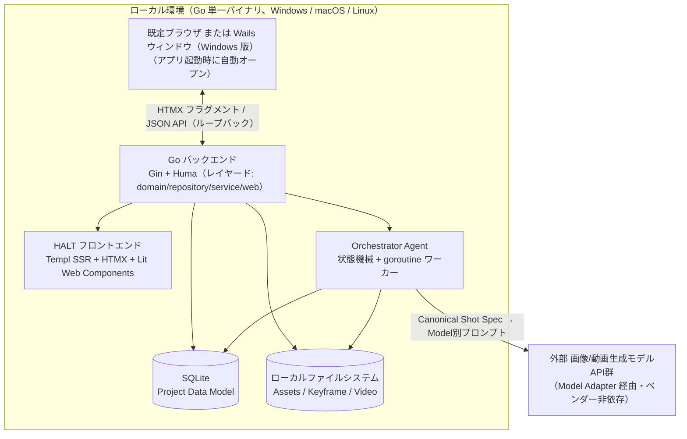

# プロジェクト概要

## 目的

AI Video Production Agent は、単一プロンプトで動画を出す「生成ツール」ではなく、企画・脚本・演出・撮影・品質判定・撮り直し・編集・音声・最終QCまでを AI が自律的に遂行する **AI Production Studio** を、ローカルで動作する Web アプリとして提供する。ユーザーは高度なプロンプトエンジニアリングではなく、「何を作りたいか」「どこを自分で決めたいか」を伝えるだけで、商品CM・SNS広告・ドラマ・アニメ・MV 等の映像を完成まで到達させることを目的とする。

## 背景

生成AI単体の性能向上だけでは「完成作品」に到達しない。単発生成物の寄せ集めではなく、キャラクター・商品・世界観・物語の一貫性（World State）を Shot 間で維持し、生成結果を AI 自身が視聴・判定し、不合格なら撮り直す、というプロフェッショナルな制作プロセスをソフトウェア化する必要がある。詳細な思想・ワークフローは製作初期に `spec/spec.md`（製品仕様ドラフト v1.0、全31章）としてまとめられており、本ドキュメント群はそれを実装可能な仕様セットへ構造化したものである。

## スコープ

### 含むもの

- **AUTO MODE**: Creative Brief から完成動画までの自律制作パイプライン（Producer → Writer → Director → Storyboard → Art Director → Prompt Planner → Generation → Judge → Repair → Editor → Audio → Final QC）
- **DIRECTOR MODE**: 自然言語による演出指示（Command Interpreter）と Scene / Shot / Take 階層の監督操作
- **Granular AUTO / MANUAL / LOCK**: 工程・パラメータ単位での制御粒度切り替え
- **Prompt Autopilot**: 自然言語指示から Canonical Shot Spec（モデル非依存）への変換と Model Adapter によるモデル別最適化
- **World State / Continuity Memory**: キャラクター・商品・場所・物語状態の Shot 間引き継ぎ
- **AI Video Judge / Repair・Retake Loop**: フレーム単位の合否判定と自動修復戦略
- **Take System / Continue / Branch**: 複数 Take 管理、続きの生成、別展開の分岐保存
- **AI Editor Loop**: 素材不足時に撮影工程へ戻る自己修正ループ、音声制作連携
- **Production Templates**: PRODUCT/CM・DRAMA・ANIME・SNS/SHORT VIDEO ごとの評価軸切り替え
- **Quality/Cost Policy**: FAST / BALANCED / MAX QUALITY と予算・リトライ上限設定
- **Safety / Brand Constraints**: ブランドガイドライン・禁止表現・権利メタデータの Prompt/Judge 適用
- 対象コンテンツ種別: 商品PV、TVCM/Web CM、SNS広告・縦型ショート、ドラマ、アニメーション、MV、YouTubeコンテンツ、ブランドムービー、シリーズ/エピソード型コンテンツ
- **Team Collaboration**（M3）: Review Package（動画とメモの ZIP）を渡してレビュアーからコメント・承認を返してもらう、ファイル受け渡し方式のレビュー・承認。編集できるのは Project を持つインスタンスだけで、同時編集・アカウント・サーバーは持たない
- 実行基盤: HALT（HTMX + Atomic Design + Lit + Templ）構成のサーバー内蔵型フロントエンドを持つ、ローカル起動型 Web アプリ（Go 単一バイナリ）。表示は既定ブラウザ（全 OS）、または Windows 版の Wails ネイティブウィンドウ（WebView2）。どちらも同じ `127.0.0.1` のサーバーを開く
- **Windows デスクトップ版の配布**（F-33）: Wails v3 のウィンドウ版 `mam.exe` と NSIS インストーラー exe を GitHub Releases に載せる（Windows x64、コード署名なし）。macOS・Linux・Windows arm64 の成果物は Releases に載せない（`make build-all` で自前ビルド）

### 含まないもの

- SaaS マルチテナント化・サーバー運用基盤（本製品は個人クリエイター/マーケター向けのシングルユーザー・デスクトップツールとして設計する）
- リアルタイム同時共同編集（マルチユーザー同時操作）。チーム利用は、MVP3 の Team Collaboration（非同期のファイル受け渡しによるレビュー・承認。アカウント・サーバー・同時編集を持たない。`spec/spec.md` §27.1）だけを対象とし、それ以外は対象外
- 画像/動画生成モデルの自前学習・ファインチューニング（外部モデルAPIの利用のみを前提とする）
- モバイルアプリ（iOS/Android）
- 特定ベンダーの生成モデルへの構造的ロックイン（Model Adapter 層でモデル差し替え可能に保つ）

## ステークホルダー / 想定ユーザー

| 区分 | 役割 | 備考 |
|------|------|------|
| エンドユーザー（個人クリエイター/マーケター） | 企画者・監督・クライアントとして AI 制作チームを監督し、映像を完成させる | 1デバイス・1ユーザー前提。プロジェクトファイルはローカル保存 |
| 開発者（本プロジェクトの実装者） | Go バックエンド（Orchestrator/各Agent/Model Adapter）とHALTフロントエンドの実装・保守 | サーバー運用チームは存在しない（ローカル起動型 Web アプリのため） |

## システム全体像

詳細なアーキテクチャ（レイヤー構成、HALT の技術スタック、Wails ウィンドウ版の構成）は `spec/architecture/overview.md` を参照。

## ドキュメントマップ

このプロジェクトの仕様は以下のドキュメントで構成される。実装時はそれぞれ参照すること。各仕様の改訂履歴は、本文に置くと行数上限を超えるものを `<spec>.changelog.md`（`spec/architecture/overview.changelog.md` など）に分けている。

| ドキュメント | パス | 概要 |
|------------|------|------|
| 機能要件 | `spec/requirements/functional.md` | AUTO/DIRECTOR MODE、Prompt Autopilot、World State、Judge、Repair/Retake、Take/Continue/Branch、Editor、Audio 等のユースケースと機能一覧 |
| 非機能要件 | `spec/requirements/non-functional.md` | ローカル起動型 Web アプリとしての性能・可用性・データ整合性・セキュリティ・コスト制御要件 |
| アーキテクチャ設計 | `spec/architecture/overview.md` | HALT（Gin/Huma/Templ/HTMX/Lit）レイヤー構成、Agent Architecture、通信フロー、Wails ウィンドウ版（Windows）の構成 |
| Windows デスクトップ版 | `spec/architecture/desktop.md` | Wails v3 ウィンドウ版（サーバーを維持して URL を開く方式、単一インスタンス・終了・起動エラー、NSIS インストーラーと GitHub Releases 配布、実装時に検証する項目） |
| ER / データモデル | `spec/architecture/er.md` | Project Data Model（Scene/Shot/Take/World State 等）の ER 図とテーブル定義（MCP トークンは `spec/architecture/er-mcp.md`） |
| MCP サーバー | `spec/architecture/mcp.md` | 画面の全操作を MCP（Streamable HTTP）で操作する内蔵サーバー。別リスナー・待ち受け先の規則（`127.0.0.1` / tailnet）・ベアラートークン・Origin 検査・ジョブ・ファイルのチケット・API キー・設定画面 |
| API 仕様 | `spec/api/endpoints.md` | ページルート/アクションルート（HTMX）のエンドポイント仕様（§0〜§2） |
| API 仕様（API ルートと WebSocket） | `spec/api/endpoints-api.md` | `/api/v1` JSON API（Huma/OpenAPI）と WebSocket のエンドポイント仕様（§3・§4。`endpoints.md` の続き） |
| MCP ツール一覧 | `spec/api/mcp-tools.md` | MCP ツールの規約と基盤のツール（`get_job`・`list_credentials`・`create_upload_ticket` など）。ドメイン別は `mcp-tools-<ドメイン>.md` |
| API 共通エラーコード | `spec/api/errors.md` | HTTP ステータスの意味（全ルート共通。各ルートの行にはそのルート固有の条件だけを書く） |
| コンポーネント設計 | `spec/components/overview.md` | Agent 群（Producer/Director/Editor 等）とHALT側コンポーネント（atoms/molecules/organisms/Lit）の責務分割 |
| Model Adapter 選定 | `spec/architecture/model-adapters.md` | エージェント推論LLM・画像/動画生成モデル・音声プロバイダーの具体的な選定とルーティング表（Claude/GPT-5/Gemini、Imagen4/Nano Banana/FLUX.2/GPT Image 2、Kling/Seedance/Runway、ElevenLabs/Sync Labs） |
| Model Adapter 選定（M3） | `spec/architecture/model-adapters-m3.md` | Multi-model routing（§13）と Audio Director の実装（§14）。`model-adapters.md` の続き |
| 環境構築 | `spec/environment/setup.md` | 開発ツール、Makefile タスク、CI、リリース（Windows インストーラー）、Linterly、Git Hooks（Lefthook） |

## マイルストーン / リリース計画

時期は未定。`spec/spec.md` §27 の MVP 区分をそのまま採用する。

- **M1 — Autonomous Shot Studio**: Chat Workspace（チャット中心の標準画面）、Creative Brief、AUTO/DIRECTOR 切替、Scene/Shot/Take、Keyframe Generation、Prompt Autopilot、Video Model Adapter（Kling 3.0 + Seedance 2.0 の2アダプタ）、Video Judge、Retake Loop、Basic World State、Simple Timeline Editing、Final Export。1本の短尺動画をAIが自律制作できることを検証する（採用プロバイダーの詳細は `spec/architecture/model-adapters.md` 参照）
- **M2 — Production Memory**: Character Lock、Product Lock、Location State、Continue、Branch、Reference Library、Partial Regeneration、Series/Episode Memory、Notes（制作メモ）を追加
- **M3 — AI Production Studio**: Advanced Editor Agent、Editor→Reshoot Loop、Audio Director、Multi-model routing、Brand Templates、Team Collaboration、Production Analytics を追加

## 用語集

`spec/spec.md` の英語用語を規範用語として採用し、日本語定義を付与する。

| 用語 | 定義 |
|------|------|
| AUTO MODE | Creative Brief から完成動画まで AI が自律的に制作するモード |
| DIRECTOR MODE | ユーザーが自然言語で AI 制作チームを監督するモード |
| Scene / Shot / Take | Scene: 物語・場所・時間・目的を共有する単位。Shot: 一つの連続した撮影単位。Take: 同一 Shot Spec を基準に生成された複数候補 |
| Shot Spec | ユーザー指示から展開される、モデル非依存の構造化された撮影仕様（YAML形式で表現） |
| World State | キャラクター・商品・場所・カメラ・物語状態を保持し、Shot 間で継承される状態 |
| Notes | Project / Series 単位の自由記述の制作メモ（登場人物の背景・世界観・トーン等）。Writer/Director/Prompt Planner の推論の文脈として参照され、構造化できる内容は承認を経て World State へ昇格できる。Source of Truth ではない（M2） |
| Review Package | オーナーがレビュアーに渡す ZIP（`manifest.json` と Final Export の動画 1 本だけ）。レビュアーは自分のインスタンスに読み込み、コメントと判定（承認 / 修正依頼）を Review Response（JSON）に書いてオーナーに返す。API キー・顔データ・Brief 等は含まれない（M3、`spec/spec.md` §27.1） |
| Model Adapter | Canonical Shot Spec を各画像/動画生成モデル固有のプロンプト/パラメータへ変換する層 |
| AI Video Judge | 生成動画を AI 自身が視聴し、フレーム/時間単位で Issue と Repair Strategy を返す評価機構 |
| Repair / Retake Loop | Judge の Issue 分類に基づき Prompt 修正・部分再生成・全撮り直し・別モデル利用等を選択する自己修正ループ |
| Continue | 完成 Shot/Scene から World State を引き継いで続きを生成する機能 |
| Branch | 任意の Scene/Shot/Frame を分岐点として保存し、別展開を生成する機能 |
| AUTO / MANUAL / LOCK | 各パラメータの制御モード。AUTO: AIが決定・変更可能、MANUAL: ユーザー指定、LOCK: 現在値固定でAI変更禁止 |
| Confirmation Level | AUTO MODE 内での人間確認頻度。FULL AUTO / KEY CHECK / CUSTOM CHECK の3段階 |
| Orchestrator Agent | 制作全体を状態機械として管理し、次に実行する Agent や人間確認要否を判断する中枢 Agent |
| Production Template | コンテンツ種別（PRODUCT/CM・DRAMA・ANIME・SNS/SHORT VIDEO）ごとの評価軸・優先度・Workflow定義 |
| HALT | HTMX + Atomic Design + Lit + Templ による、フロントエンドが API サーバー内で動くサーバー内蔵型アーキテクチャ |
| Wails | Go バックエンドとネイティブ WebView を組み合わせてデスクトップアプリを構築するフレームワーク。本製品の Windows 版は Wails v3 のウィンドウから `127.0.0.1` のサーバー（HALT）の URL を開く「WebView シェル」として使う。Gin の `http.Handler` を Wails の AssetServer へ直接渡す方式は、AssetServer が WebSocket を扱わない（501 を返す）ため採らない |

## 改訂履歴

| 版 | 日付 | 変更内容 | 変更理由 |
|----|------|---------|---------|
| 1.0 | 2026-09-28 | 新規作成 | `spec/spec.md`（製品仕様ドラフト v1.0）を構造化ドキュメントセットへ展開する初版 |
| 1.1 | 2026-09-28 | 実行基盤を Wails デスクトップアプリ前提からローカル起動型 Web アプリ（Go 単一バイナリ + ブラウザ）前提へ変更。Wails は将来拡張として位置付け | ユーザー指示により、Wails 統合は現段階のスコープ外とし将来拡張に切り出す |
| 1.2 | 2026-09-29 | ドキュメントマップに `model-adapters.md` を追加。M1マイルストーンにVideo Model Adapterの採用プロバイダー（Kling 3.0 + Seedance 2.0）を明記 | ユーザーとの協議によりエージェント推論LLM・画像/動画生成/音声プロバイダーを具体的に選定したため |
| 1.3 | 2026-09-29 | Series/Episode Memory を M3 から M2 へ前倒し | シリーズ制作で顔・見た目が話数ごとにブレることを避けるため。Reference Library・Character Lock（いずれも M2）と同時に提供する必要があるため |
| 1.4 | 2026-09-29 | M1 に Chat Workspace（チャット中心の標準画面）を追加 | ユーザー要望「基本的にはただのチャット画面にしたい」。詳細は `spec/spec.md` §23、F-30 |
| 1.5 | 2026-09-29 | M2 に Notes（制作メモ）を追加。用語集に Notes を追加 | 構造化された World State だけでは登場人物の背景・世界観など自由記述の文脈を保持できないため（ユーザー要望、F-31） |
| 1.6 | 2026-09-30 | M3 に Team Collaboration（Review Package によるレビュー・承認）を追加。「含まないもの」のチーム利用の記述を明確化し、用語集に Review Package を追加 | Issue #28。要件・認証モデル・共有方法が未定義だったため、スコープ外（同時編集・SaaS）を超えない範囲（非同期のファイル受け渡し・アカウント無し）で設計を確定した。スコープの改訂は不要と判断 |
| 1.7 | 2026-10-03 | スコープと実行基盤に Windows デスクトップ版（Wails v3 ウィンドウ + NSIS インストーラーの GitHub Releases 配布）を追加。Wails を将来拡張から現段階の Windows 版の表示シェルに改め、Handler 直埋め込みを採らない理由を用語集に追記。環境構築の概要にリリースを追加 | Issue #480。「GitHub の Releases にインストーラーの exe を入れたい」というユーザー要望。Wails v3 の AssetServer は WebSocket を処理せず（`assetserver.go` が 501）、本製品はチャット・生成進捗に WebSocket を使うため、サーバーを `127.0.0.1` に維持して URL を開く方式にした |
| 1.8 | 2026-10-03 | ドキュメントマップに `spec/architecture/desktop.md`（Windows デスクトップ版）を追加 | Issue #480。`spec/architecture/overview.md` が行数上限（300 行）を超えるため、Windows 版の詳細を別ファイルに切り出した |
| 1.9 | 2026-10-12 | ドキュメントマップに `spec/api/errors.md`（API 共通エラーコード）を追加し、改訂履歴が `*.changelog.md` に分かれている仕様があることを注記した | Issue #674。`endpoints.md` §0 が共通ビジネスエラーコードを `errors.md` に切り出しているのに、ドキュメントマップから辿れず、各ルートの 4xx/5xx の正本が見つけにくかった |
| 1.10 | 2026-10-21 | ドキュメントマップに `spec/api/endpoints-api.md`（`endpoints.md` の §3・§4）と `spec/architecture/model-adapters-m3.md`（`model-adapters.md` の §13・§14）を追加し、`endpoints.md` の説明をページ/アクションルートに絞った | `endpoints.md`・`model-adapters.md` が行数上限（300 行）を超えたため後半を別ファイルに分けた。詳細は各 `*.changelog.md` |
| 1.11 | 2026-10-24 | ドキュメントマップに `spec/architecture/mcp.md`（MCP サーバー）・`spec/api/mcp-tools.md`（MCP ツール一覧）・`spec/architecture/er-mcp.md`（MCP トークンのテーブル）を追加した | Issue #830。MCP サーバーの仕様の所在をドキュメントマップに残すため |
