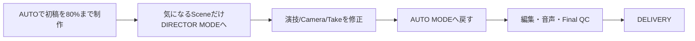

# 機能要件

`spec/overview.md` のスコープに基づく機能要件。原典は `spec/spec.md`（製品仕様ドラフト v1.0）。

## 1. ユースケース

### UC-1: AUTO MODE で完成動画まで自律制作する

- **Actor**: エンドユーザー（クリエイター/マーケター）
- **事前条件**: プロジェクト未作成、またはドラフト状態
- **フロー**:
  1. ユーザーがチャットで作りたい動画を伝える。発言から Creative Brief（Content Type / Objective / Subject / Target / Duration / Aspect Ratio / Mood / Assets / References）をルールベース（キーワード・正規表現。LLM による抽出は未実装）で抽出し、不足項目は質問する（「AIに任せる」を選べる）。添付した画像・動画は Assets/References として取り込む
  2. Confirmation Level（FULL AUTO / KEY CHECK / CUSTOM CHECK）を選択する
  3. Producer → Writer → Director → Storyboard → Art Director → Prompt Planner → Video Generation → AI Video Judge → (Repair/Retake) → AI Editor → Audio Production → Final QC の順に進む。ただし自動実行されるのは Scene/Shot 計画（Storyboard）までで、Art Director 以降（Reference Pack・Keyframe・Video Generation）は Shot 単位でユーザーが起動する（起動した Shot では Judge → Repair → AI Pick が連鎖する）。全 Shot に Selected Take が揃うと Rough Cut の作成と Editor Judge が自動で始まり、承認カードの回答後（または確認不要の設定）に Audio Production と Final QC が続く。Editor Judge の Re-edit 判定と Final QC の FAIL はユーザーの対応を待って止まる（Editor Judge が `need_shot` のときは、AUTO では追加 Shot の要求が自動で始まり、Retry Policy の範囲で繰り返して上限で Escalation に止まる。MANUAL ではユーザーが要求する）。Export は Final QC を PASS した（READY の）動画へのユーザーの操作で行う
  4. 設定した確認ポイント（脚本・Rough Cut・Final）でのみ、承認カードとしてチャットに提示される。ユーザーはボタンまたは返信で承認/差し戻しを行う
- **事後条件**: Final QC を PASS した動画が Export 可能な状態になる

### UC-2: DIRECTOR MODE で特定 Shot の演技/カメラを修正する

- **Actor**: エンドユーザー
- **事前条件**: AUTO MODE で生成済みの Scene/Shot が存在する
- **フロー**:
  1. ユーザーがチャットで、対象の Scene/Shot/Take を示して（カードへの返信、または文脈から AI が解決）DIRECTOR MODE に切り替える
  2. 自然言語で演出指示を発言する（例:「もう少し寄って」「この瞬間だけ不安そうな顔にして」）
  3. Command Interpreter が指示を構造化操作（LOCK設定、パラメータ更新、再生成、Branch生成等）へ変換する
  4. 対象 Shot のみ再生成され、Character/Acting/Environment 等の指定要素は保持される。時間範囲を名指しした指示（M2、「2〜3秒目のカメラの揺れだけ直して」）は、その区間だけを差し替えた新しい Take（Partial Regeneration）になり、元の Take は変わらない
  5. 修正完了後、AUTO MODE に戻し後続工程を再開できる
- **事後条件**: 対象 Shot が更新され、World State に反映される

### UC-3: Take を比較し部分採用する

- **Actor**: エンドユーザー
- **事前条件**: 対象 Shot に複数 Take が生成済み
- **フロー**:
  1. Take 一覧（評価スコア: Product/Acting/Camera/Continuity, Status）を比較表示する
  2. ユーザーが Take 全体、または「Take A の 0-2秒 + Take B の 2-4秒」のように部分区間を指定する
  3. Editor/Repair Agent が指定区間を自然に接続する
- **事後条件**: Selected Take（または合成結果）が Shot に確定する

### UC-4: Continue で続きの Shot/Scene を生成する

- **Actor**: エンドユーザー
- **事前条件**: 完成済み Shot/Scene/Video が存在する
- **フロー**:
  1. AI が最終フレームおよび Story/Character/Position/Emotion/Object/Camera/Lighting/Motion/Dialogue/Music State を解析する
  2. 複数の展開候補（NEXT A/B/C/... + 自由指示 + AIに任せる）を提示する
  3. ユーザーが選択、または AI に一任する
  4. World State を引き継いだ次 Shot/Scene が生成される
- **事後条件**: 新しい Shot/Scene が既存プロジェクトに連結される

### UC-5: Branch で別展開を作成する

- **Actor**: エンドユーザー
- **事前条件**: Branch Point としたい Scene/Shot/Frame が存在する
- **フロー**:
  1. ユーザーが Branch Point を指定する
  2. 分岐点（Branch Point）の World State を Snapshot として保存し、Branch 専用の World State の版として持つ
  3. 複数 Branch（例: ドアを開ける / 逃げる / 電話する）を並行して生成し、Branch ツリーで切り替えて見比べる（2 つの Branch を並べる専用の比較画面は設けない）
- **事後条件**: 各 Branch が独立した派生プロジェクトツリーとして保持される

### UC-6: AI Editor が素材不足を検知し追加撮影ループへ戻る

- **Actor**: システム（Editor Agent）、エンドユーザー（承認時）
- **事前条件**: Selected Take群から Rough Cut が生成済み
- **フロー**:
  1. Editor Judge が Rough Cut を評価する（Shot Selection / Cut Point / Timing / Pace / Transition / Hook / Retention / CTA Timing 等）
  2. 「Editで修正可能」と判定された場合は Re-edit する
  3. 「素材不足」と判定された場合は Director Agent へ差し戻し、Additional Shot を Video Generation から再実行し、完了後 Editor に戻る
  4. 問題なしと判定されたら Audio Production へ進む
- **事後条件**: Rough Cut が Audio Production に進める品質になる

### UC-7: Production Template を切り替える

- **Actor**: エンドユーザー
- **フロー**: プロジェクト作成時に、最初の発言から抽出した Content Type で Production Template が決まる（「ドラマ」→ DRAMA、「アニメ」→ ANIME、「SNS/ショート動画」→ SNS/SHORT VIDEO、それ以外・不明は PRODUCT/CM）。Series の次の Episode（`POST /series/:id/episodes`）は最初の発言も Content Type も持たないため、Series が DRAMA 等であっても常に PRODUCT/CM で始まり、変えるときは設定画面で選ぶ（Series からは継承しない）。その後に Brief の Content Type を答えたり編集したりしても、テンプレートは自動では変わらない。変えるときは設定画面（`PUT /projects/:id/production-template`）で PRODUCT/CM・DRAMA・ANIME・SNS/SHORT VIDEO のいずれかを選択する。選択に応じて Judge/Editor の評価軸優先度（例: PRODUCT/CM は Product Accuracy 最優先、DRAMA は Story/Acting 最優先）が切り替わる
- **事後条件**: 以降の Judge/Editor 評価が選択テンプレートの優先度に従う

### UC-8: Quality/Cost ポリシーを選択する

- **Actor**: エンドユーザー
- **フロー**: FAST / BALANCED / MAX QUALITY のいずれかを選択し、必要に応じて Project budget ceiling・Shot budget ceiling・Max retries・Max generation time・Minimum quality thresholds を個別設定する
- **事後条件**: Generation Orchestrator と Repair/Retake Loop が設定ポリシーに従って動作する

### UC-9: Safety / Brand Constraints を適用する

- **Actor**: エンドユーザー（設定）、システム（適用）
- **フロー**: Project 単位で Brand Guidelines・Forbidden Expressions・Required Disclaimer・Product Claims・Logo Rules・Character Restrictions・Music/Asset Rights・Platform Rules を登録する。これらは Prompt 生成・AI Video Judge・Final QC すべてに適用される。LOCK 違反はスコアに関係なく FAIL とする（強制レベルと適用の詳細は `spec/spec.md` §26.1）
- **事後条件**: 制約に反する生成結果は自動的に不合格となる

#### UC-9 拡張: Brand Templates（M3）

- **フロー**: 設定画面で、その Project の制約の現在のセットに名前を付けて Brand Template として保存する。新しい Project の作成フォーム、Series 画面の「次の Episode を作成」、既存 Project の設定画面から、テンプレートを選んで適用できる
- **保存単位**: テンプレート 1 件 = 名前（前後・連続する空白を 1 つにまとめた 1〜100 文字。大文字小文字を区別せず一意）＋ 制約のセット（`type` / `enforcement_level` / `text`）。テンプレートはどの Project・Series にも属さない（Organization は存在しないため。全 Project から共有して選べる）。制約が 1 件もない Project は保存できない
- **適用範囲**: 新規 Project 作成（`POST /projects`）、新規 Episode 作成（`POST /series/:id/episodes`）、既存 Project への適用。適用は制約の **コピー**（新しい `brand_constraint` 行）で、リンクは持たない。既存 Project に適用するときは、同じ `type`・`enforcement_level`・`text` の制約をすでに持っていればその制約はコピーせず、既存の制約は削除も変更もしない
- **更新の非伝播（Traceability）**: 保存はその時点の制約のスナップショットで、保存後に元の Project の制約を変えてもテンプレートは変わらない。適用後の各 Project の制約は独立して追加・削除でき、テンプレートの削除やテンプレート側の変更は、すでに適用した Project に自動では伝播しない（`er.md` の Series 正本と同じ方針）。テンプレート内の制約を編集する機能は持たず、変える場合は制約を整えた Project から別名で保存し直す
- **Series との関係**: Series は制約を持たない（Series の正本は Character / Product / Location / Style / Notes）。Series には制約を継承させず、Episode 作成時にテンプレートを選んだ場合だけその Episode に制約がコピーされる
- **事後条件**: 適用された制約は UC-9 の他の制約と同じく Prompt 生成・AI Video Judge・Final QC に適用される

### UC-10: 制作メモを登録し、制作に反映する（M2）

- **Actor**: エンドユーザー、システム（State Extractor）
- **事前条件**: Project が存在する（Series メモの場合は Series が存在する）
- **フロー**:
  1. ユーザーがチャットで「これ覚えておいて」と発言する（または補助ビューの Notes から登録・編集する）。Project の Notes に新しいメモバージョンが追加される
  2. 以降の Writer / Director / Prompt Planner が、ピン留めされたメモと関連するメモを推論の文脈として参照する
  3. State Extractor がメモから World State に構造化できる項目（髪型・衣装・性格等）を検出した場合、非ブロッキングの承認カードで World State への昇格を提案する。承認すると World State に新バージョンが追加される。LOCK 中の項目は提案から除外される
  4. Series 単位のメモは Episode 開始時に Project へコピーされる
- **事後条件**: メモが以降の制作の文脈として使われ、承認された項目は World State（構造化状態）に反映される。昇格カードへの応答がなくても制作は止まらない

### UC-11: 完成動画をチームでレビューし、承認をもらう（M3）

- **Actor**: オーナー（Project を持つ人）、レビュアー（別のメンバー。自分のインスタンスを使う）
- **事前条件**: オーナーの Project に Final Export が 1 本以上ある。ネットワーク上の共有基盤は使わず、ファイルの受け渡し経路（メール・チャット等）は利用者が用意する
- **フロー**:
  1. オーナーが補助ビュー「レビュー」で書き出しを 1 本選び、レビュアーへのメモを添えてレビュー依頼を作り、Review Package（ZIP）をダウンロードして渡す
  2. レビュアーが自分のインスタンスの「レビュー」で Review Package を読み込み、動画を視聴して時刻付きコメントを付け、表示名と判定（承認 / 修正依頼）を書き、Review Response（JSON）を書き出してオーナーに返す
  3. オーナーが Review Response を取り込む。レビュー依頼の状態（未回答 / 承認済み / 修正依頼あり）とコメントが表示され、Chat Workspace のスレッドにレビュー結果が記録される
  4. オーナーはコメントを見ながらチャットで修正を指示し、対応したコメントを解決済みにする。修正後の書き出しで、新しいレビュー依頼を作る
- **代替フロー**: 別 Project のレビュー依頼への応答・取り込み済みの応答・形式の違うファイルは取り込まない（422 / 409）
- **事後条件**: レビュアーは Project の中身・API キー・顔データを受け取らない（`spec/spec.md` §27.1）。レビュアーの応答は制作の状態遷移や Final Export をブロックしない

## 2. 機能一覧

| ID | カテゴリ | 機能 | 概要 | MVP |
|----|---------|------|------|-----|
| F-01 | Brief | Creative Brief 入力 | チャットでの発言・添付から Content Type/Objective/Subject/Target/Duration/Aspect Ratio/Mood/Assets/References をルールベース（キーワード・正規表現。LLM 抽出は未実装）で抽出し、不足を質問して補完する。「AIに任せる」を選択可 | M1 |
| F-02 | Mode | AUTO ⇄ DIRECTOR 切替 | 同一プロジェクト上でモードをいつでも切替 | M1 |
| F-03 | Confirmation | Confirmation Level 設定 | FULL AUTO / KEY CHECK / CUSTOM CHECK | M1 |
| F-04 | Hierarchy | Scene/Shot/Take 階層管理 | 階層構造の表示・選択・生成状態管理 | M1 |
| F-05 | Control | AUTO/MANUAL/LOCK 粒度制御 | Story/Dialogue/Character Identity/Acting/Camera/Lighting/Product Geometry/Prompt/Video Model/Take Selection/Editing/Music 等パラメータ単位の制御 | M1 |
| F-06 | Prompt | Prompt Autopilot | 自然言語指示 → Canonical Shot Spec（YAML）への変換 | M1 |
| F-07 | Prompt | Model Adapter | Canonical Shot Spec をモデル固有プロンプトへ変換。モデル非依存のプロジェクト構造を維持。採用プロバイダー・ルーティングは `spec/architecture/model-adapters.md` 参照 | M1 |
| F-08 | Prompt | Prompt Candidate Generation | Stability First/Acting First/Dynamic Camera 等の複数撮影戦略生成（Quality/Balanced/Economy Mode。Shot カードの「生成」・Continue・Branch・追加撮影・Director の再生成はこれで起動し、Judge 未構成または Prompt が LOCK のときだけ単発生成） | M2 |
| F-09 | State | World State 管理 | characters/products/location/camera/story を構造化保持。M2 で Location State（time/lighting_state/weather）の自動更新と、項目単位の LOCK（`spec/spec.md` §9.3） | M1（Basic）/ M2（Lock/Continue拡張） |
| F-10 | State | State Update（差分抽出） | Shot完了後に State Extractor が差分をWorld Stateへ反映。LOCK項目は自動更新禁止 | M1 |
| F-11 | Keyframe | Keyframe / Reference Pack 生成 | Character/Product/Location/Style/Lighting Reference と Keyframe の生成。M2 で Reference Library（Project 内の参照画像の登録・検索・再利用、`spec/spec.md` §10.1） | M1（Reference Pack）/ M2（Reference Library） |
| F-12 | Generation | Video Generation Orchestration | Shot Spec/World State/References/Cost/Model能力から生成戦略決定、複数Take出力 | M1 |
| F-13 | Judge | AI Video Judge | Prompt Adherence/Character/Product/Face/Hands/Pose/Acting/Lip Sync/Motion/Physics/Camera/Composition/Lighting/Background/Temporal Consistency/Flicker/Scene Continuity 等の評価とフレーム単位Issue出力。顔同一性は Face Identity Similarity（参照顔との埋め込み類似度、`spec/spec.md` §12.4）も数値で評価する | M1 |
| F-14 | Repair | Repair/Retake Loop | Prompt Repair/Partial Regeneration/Full Retake/Different Model/Reference Reinforcement/Edit-Level Repair の選択、Retry Policy（Max retries/Max cost/Min score/Critical constraints/Escalation）。Partial Regeneration は M1 では Judge の `preserve` を保つ Shot 全体の再生成、M2 では加えて問題の時間範囲だけを差し替えたTake（新しい `take`、既存 Take は変えない）を作り、DIRECTOR MODE の自然言語指示（「2〜3秒目だけ直して」）からも起動できる（`spec/spec.md` §13） | M1（Partial Regeneration の時間範囲つなぎ込みは M2） |
| F-15 | Take | Take System | 複数Take保持、AI Pick（AUTO）/ユーザー選択（DIRECTOR）、Partial Take合成（Partial Regeneration のつなぎ込み〈M2〉も同じ合成を使う） | M1 |
| F-16 | Continuity | Continue | 次展開候補提示とWorld State引き継ぎでの続き生成 | M2 |
| F-17 | Continuity | Branch | Branch Point保存、Snapshot化、複数展開の並行生成 | M2 |
| F-18 | Editor | AI Editor | Shot Selection/Cut Point/Timing/Pace/Transition/Reaction Shot/Insert Shot/Product Exposure/Narrative Clarity/Hook/Retention/CTA Timing/Caption | M1（Simple）/ M3（Advanced） |
| F-19 | Editor | Editor → Reshoot Loop | Editor Judgeが素材不足を検知しDirector Agent/追加撮影へ差し戻す | M3 |
| F-20 | Audio | Audio Production | Dialogue/Voice/Narration/Lip Sync/BGM/SE/Foley/Ambience/Mixing/Loudness最適化。TTS/Music/SFXはElevenLabs、Lip SyncはSync Labs（`spec/architecture/model-adapters.md`§5）。Character ごとの**参照音声**（約 3〜10 秒の録音、書き起こし、言語。Series 正本から Episode へ継承。画面は Series ページと World State ページ、MCP は `character_voice_reference`）は、ローカルの声のプロバイダーが「同じキャラ＝同じ声」を毎回作るための入力で、台本の話者名（ナレーションは「ナレーション」という名前の Character）から引く（`spec/architecture/er.md` §4）。**ローカル TTS**: Dialogue / Narration を、クラウドの ElevenLabs の代わりに、mam が導入・起動する GPT-SoVITS で作れる（API 費用 0 円。1 回の実行ごとに `elevenlabs`（既定）か `local` を選ぶ。参照音声が無い話者・未導入・重み未取得・非対応の環境・GPU 不足は、課金や起動の前に種類つきのエラーで止める。`spec/architecture/model-adapters-m3.md` §14.8） | M3（Audio Director含む）/ 簡易版はM1 |
| F-21 | Template | Production Templates | PRODUCT/CM・DRAMA・ANIME・SNS/SHORT VIDEO ごとの評価軸切替 | M1〜 |
| F-22 | Policy | Quality/Cost Control | FAST/BALANCED/MAX QUALITY、予算・リトライ上限設定 | M1 |
| F-23 | Safety | Safety/Brand Constraints | Brand Guidelines等の登録とPrompt/Judge/Final QCへの適用。M3 で Brand Templates（制約のセットの保存と、新規 Project / Episode・既存 Project へのコピー適用） | M2〜 |
| F-24 | Director | Natural Language Director Commands | 自然言語 → 構造化操作（LOCK設定/パラメータ更新/Branch作成等）へのCommand Interpreter変換 | M1 |
| F-25 | Project | Project Data Model管理 | Brief/Template/Policy（Confirmation / Quality / Budget / Retry。利用者の好みはここで保持する）/World State/Assets/Scenes/Shots/Takes/Edit Timeline/Audio Timeline/Branches/Exports の保持 | M1 |
| F-26 | Export | Final Export | Final QC PASS後の動画書き出し | M1 |
| F-27 | Trace | Generation Traceability | Shot Spec/World State version/Prompt version/Model/Parameters/References/Output/Judge結果/Repair履歴の保存 | M2 |
| F-28 | Versioning | Reversible Decisions | Shot/Take/Branch/State/Note の主要変更のバージョン化と復元 | M2〜M3 |
| F-29 | Continuity | Series / Episode Memory | Series 単位で Character/Product/Location/Style の正本と Reference Pack を保持し、Episode（Project）開始時に継承する。前 Episode 終了時の World State を次 Episode の開始状態にできる。正本の更新は既存 Episode へ自動伝播しない（Traceability）。顔同一性は Series 正本の `face_reference` を基準に Episode 間でも計測する（`spec/spec.md` §12.4）。Character の**参照音声**（録音・書き起こし・言語）も正本が持ち、Episode 開始時にコピーして継承する（正本の更新は既存 Episode に伝播しない。Episode の Character はその Episode だけ差し替えられる。Series に属さない Project の Character にも付けられる）。詳細は `spec/architecture/er.md` §4「キャラクターの参照音声」 | M2 |
| F-30 | UI | Chat Workspace | 1プロジェクト＝1チャットスレッドを標準画面とし、Brief 入力・確認ポイントの承認・演出指示・進捗確認・Take 視聴をスレッド内で完結できる。Inspector/Take比較/Timeline/Branch/World State は補助ビュー（`spec/spec.md` §23） | M1 |
| F-31 | Continuity | Notes（制作メモ） | Project / Series 単位の自由記述メモ（登場人物の背景・世界観・トーン等）。チャット発言（「覚えておいて」）または補助ビューから登録し、バージョン管理する。Writer/Director/Prompt Planner が推論の文脈として参照し（ピン留めは常時、他は関連度順）、画像/動画生成モデルには渡さない。Series メモは Episode 開始時にコピーし、自動伝播しない。State Extractor が構造化可能な内容を World State への昇格として非ブロッキングの承認カードで提案し、LOCK 項目は除外する。守らせたいルールは Brand Constraint（F-23）に登録する（`spec/spec.md` §9.4） | M2 |
| F-32 | Collaboration | Team Collaboration（Review Package） | 完成動画のレビュー・承認をファイル受け渡しで行う。オーナーが Final Export 1 本から Review Package を作り、レビュアーが自分のインスタンスで視聴・時刻付きコメント・判定（承認 / 修正依頼）を書いて Review Response を返し、オーナーが取り込む。アカウント・サーバー・同時編集は持たず、認証は自己申告の表示名（検証しない）。共有物は allowlist の項目だけで、API キー・顔データ・Brief 等を含まない（`spec/spec.md` §27.1、`spec/requirements/non-functional.md` §5） | M3 |
| F-33 | Distribution | デスクトップ版（Wails ウィンドウ + インストーラー。Windows・macOS） | Windows では Wails のネイティブウィンドウ（WebView2）、macOS（Apple Silicon）では WKWebView で本アプリを開く。ウィンドウは `127.0.0.1` のサーバー（既定ブラウザ版と同一）の URL を表示し、画面・操作・データはブラウザ版と同じ。起動すると既に起動中のインスタンスがあれば新しいウィンドウは開かずそのウィンドウを前面に出し、ウィンドウを閉じるとアプリ全体が（ブラウザ版の終了と同じグレースフルシャットダウンで）終了する。NSIS インストーラー exe とポータブル `mam.exe`（Windows x64）、macOS（Apple Silicon・Apple の署名なし）の `.dmg` を GitHub Releases から入手でき、インストール済みのアプリは新しいリリースを検証して自動で入れ替える（`spec/requirements/non-functional.md` §1、`spec/architecture/desktop.md`、`spec/environment/setup.md`） | M1 |

## 3. 画面・操作フロー

### 3.1 Chat Workspace（標準画面）

```text
┌────────────────────────────────────────────────────┐
│ PROJECT: <プロジェクト名>            [ ⋯ 補助ビュー ] │
├────────────────────────────────────────────────────┤
│ チャットスレッド（ユーザー発言 / AI 発言 / カード）  │
│                                                    │
├────────────────────────────────────────────────────┤
│ [＋] 指示を入力…                          [ 送信 ] │
│ MODE [ AUTO | DIRECTOR ]   Quality: Balanced        │
└────────────────────────────────────────────────────┘
```

- ユーザーの操作は、スレッドへの発言とスレッド内カードのボタン操作で完結する。補助ビューは使わなくても制作を完了できる
- カードの種類: Question / Approval / Keyframe / Take / Progress / Escalation（`spec/spec.md` §23.2）
- 指示の対象 Scene/Shot/Take は、カードへの返信または直前の文脈から AI が解決し、解決できない場合は聞き返す
- MODE トグルで AUTO ⇄ DIRECTOR をいつでも切替可能（同一プロジェクト内、状態は保持）
- Quality セレクタで FAST/BALANCED/MAX QUALITY を切替
- スレッドは Project ごとに永続化され、再度開いたときに履歴を再表示する

### 3.2 補助ビュー

チャットの横、または別ページで開く。スレッド内カードと［⋯］メニューから到達でき、操作結果は同じ Project の状態とスレッドに反映される。

- **Inspector**（選択中 Shot の詳細）: Shot Objective / Duration / Character / Acting / Camera / Lighting / Product / Continuity / References / Prompt / Generation Model / Take List / Judge Results / Locks。Take List は Take ごとに最新の Judge Result（pass/fail・確信度・Issue の一覧、LOCK 違反の印）を並べ、Generation Model は Shot に LOCK または MANUAL で指定したモデル（AUTO のときは使わない）、なければ最新 Take のモデル、なければ「自動選択」を示す。Prompt（モデル別プロンプト）は Shot のインスペクターには常設せず、各 Take の「生成の経緯」（Generation Trace）で確認する。AUTO / MANUAL / LOCK の切替は Locks セクションだけにあり、Shot 単位のパラメータ（`spec/spec.md` §6 の Dialogue / Character Identity / Acting / Camera / Lighting / Product Geometry / Prompt / Video Model / Take Selection / Editing）ごとに切り替える。その他の項目（Shot Objective・Duration・Continuity・References・Take List・Judge Results）は表示のみ
- Take 比較（§3.4）、Timeline、Branch ツリー（§3.5）、World State、Notes（M2）、Cost、Settings

### 3.3 典型的な操作フロー（モード遷移）



### 3.4 Take 比較 UI

Take一覧をスコア表（Product/Acting/Camera/Continuity, Status: Candidate/AI Pick/Selected/Rejected）で表示し、区間指定による部分採用（例:「Take Aの0〜2秒 + Take Bの2〜4秒」）を自然言語入力またはタイムライン上のドラッグで指定できる。

### 3.5 Branch ツリー UI

Scene/Shot 配下に複数 Branch をツリー表示し、Branch の切替（ツリーの項目を選ぶと詳細を読み込む）・名称変更を行える。Branch は追記のみで保持し（F-28、`spec/architecture/er.md` §4）、削除はしない。2 つの Branch を並べて比較する専用の画面も設けず、比較はツリーでの切替で行う。

### 3.6 M1 の編集・音声・書き出しの範囲（F-18 Simple / F-20 簡易版 / F-26）

**F-18 Simple（M1）で扱う編集項目**は次の 4 つ。それ以外は M3（Advanced）とする。

| 項目 | M1 で扱う内容 |
|------|--------------|
| Shot Selection | Rough Cut は各 Shot の採用 Take（Selected Take）を Scene 順・Shot 順に並べて作る。編集では Shot の並べ替えと除外ができる（Shot の追加は M3） |
| Cut Point | 各クリップの Take 内の開始点・終了点（In / Out）。Rough Cut の初期値は Take の先頭から Shot の計画尺まで |
| Timing | クリップの長さ（Out − In）。最短 0.5 秒 |
| Transition | クリップの前に置く切り替え（`cut` / `fade` / `fade_black` / `dissolve`）と長さ。Rough Cut の初期値は Scene 内が `cut`、Scene の切れ目が `fade`（0.25 秒） |

**M3（Advanced）に残す項目**: Pace の自動調整、Reaction Shot / Insert Shot、Product Exposure、Narrative Clarity、Hook / Retention / CTA Timing の最適化、Caption。Editor Judge の判定は PASS / Re-edit のみで、素材不足（NEED_SHOT）の差し戻しは F-19（M3）で扱う。

**F-20 簡易版（M1）の範囲**は次のとおり。BGM / SE / Foley / Ambience / Lip Sync / 音声クローンは M3（Audio Director、§3.8）で加わる。映像尺の変更への追従は、編集のたびに Audio Director が Scene を読み直して Audio Timeline の新しい版を作ることで行う。

- **Dialogue / Narration**: 脚本（`script_version`）の Scene ごとの `dialogue` 行（`話者: セリフ`、話者なしまたは `ナレーション` / `NA` は Narration）を ElevenLabs の TTS で音声化し、Scene の先頭 Shot の開始時刻から順に置く。行が 1 つもない Project は TTS を呼ばない
- **ミキシング**: Take 自体の音声（あれば）と TTS 音声をローカルの ffmpeg で 1 本に混ぜる
- **ラウドネス正規化**: ローカル DSP（ffmpeg `loudnorm` の 2 パス）で目標ラウドネス（既定 −14 LUFS、SNS 向け）に揃え、測定値を Audio Timeline に保存する。外部 API は呼ばない

**Final QC（F-26）の M1 の判定**は、決定的なチェック（Audio Timeline が最新の Edit Timeline と一致しているか、各クリップの Take のファイルがあるか、映像と音声の長さの差、ラウドネスが目標から ±1.5 LU 以内か、True Peak が −1.0 dBTP 以下か、音声が入っているべき Project に音声があるか、ミックス済みの音声ファイルがあるか）のみとする。FAIL のときは原因の工程（編集の不一致・Take ファイルの欠落 → EDITING、音声の不備 → AUDIO）へ戻す。Brand / Safety Constraint（F-23）の適用は M2 で加わる（`spec/spec.md` §26.1）。`lock` の制約違反は FAIL、`advisory` は警告のみ。

**Export（F-26）**: Aspect Ratio（Project の Brief の値を既定とし、`16:9` / `9:16` / `1:1` / `4:5` から選択）、解像度（短辺 `720p` / `1080p` / `1440p` / `2160p`）、コーデック（`h264` / `h265` / `vp9`）を指定してローカルへ書き出す。書き出しはアトミックに行い（一時ファイルへ書いて完了後にリネーム）、途中で失敗しても不完全なファイルは残らない。

### 3.7 M3 の Editor（F-18 Advanced / F-19）の範囲

Editor Agent は Production Template（`spec/spec.md` §19）が評価軸に持つ項目だけを扱う。テンプレートに無い項目は見ない。

| 項目 | 見るテンプレート | 内容 | 直し方 |
|------|-----------------|------|--------|
| Pace / Retention | SNS / SHORT VIDEO（Tempo・Retention）、DRAMA（Editing Rhythm） | 1 クリップの長さの上限（SNS 4 秒、DRAMA 6 秒） | 編集（Rough Cut 作成時に自動で短縮。Brief の Duration の許容範囲を下回らない） |
| Hook | PRODUCT / CM（Hook）、SNS（Opening Hook） | 冒頭クリップを 3 秒以内で切り替える | 編集 |
| CTA Timing | PRODUCT / CM、SNS（CTA） | 最後のクリップを 1.5 秒以上見せる | 編集（Take の長さの範囲で延長） |
| Caption | SNS（Caption） | セリフのある Shot に字幕を入れる。タイムラインで編集でき、書き出し・プレビューに焼き込む | 編集 |
| Product Exposure | PRODUCT / CM | 商品が映る時間が全体の 25% 以上 | 素材不足（商品のインサートショットを追加） |
| Reaction Shot / Insert Shot | DRAMA（Dialogue・Acting・Emotion） | セリフのクリップが 3 つ続いたらリアクションを挟む | 素材不足（リアクションショットを追加） |
| Narrative Clarity | すべて | LLM による Editor Judge の講評（Shot の並びと物語の流れ） | 編集 または 素材不足 |

**Editor → Reshoot Loop（F-19）**: 素材不足の指摘は追加 Shot（`kind`・挿入位置・長さ・狙い）を伴い、Editor Judge の判定は `need_shot` になる。1 回の Editor Judge が求める追加 Shot は最大 3 件（`MaxShotNeeds`）で、同じ挿入位置・同じ `kind` には 1 件に絞る（超えた分は追加 Shot を伴わない指摘として残る）。追加 Shot の長さは 1〜8 秒（`MinNeedSeconds`〜`MaxNeedSeconds`）で、指定が無ければ 2 秒（`DefaultNeedSeconds`）、1 秒未満は 1 秒にし、8 秒を超える指定は追加 Shot の要求にしない（指摘のみ残る）。Edit Timeline がすでに 200 クリップ（`MaxClips`）あるときは追加 Shot を求めない。`POST /edit-timelines/:id/request-additional-shot`（AUTO では判定に続いて自動）が Director に追加 Shot を作らせ、Selected Take が揃うと元の Shot の後にクリップとして足して EDITING へ戻る。要求の回数は Retry Policy の Max retries（Repair / Retake Loop と共通）で制限し、上限に達したら Escalation カードでユーザーに判断を求める。Edit Timeline は Branch ごとに独立した版として保持する。

### 3.8 M3 の Audio Director（F-20）の範囲

- **入力**: 最新の Edit Timeline（Scene ごとのクリップ数・長さから編集テンポ `fast`/`medium`/`slow`）、Scene Emotion（Reasoning LLM が Scene の脚本・目的・Shot の目的から判定。LLM 未設定時は規則で設計）、Production Template と Brief
- **Audio Timeline**: Dialogue / Narration（ElevenLabs TTS、話者ごとの音声クローン。実行ごとにローカルの GPT-SoVITS も選べる。§14.8）、BGM（ElevenLabs Music v2）、SE / Foley / Ambience（ElevenLabs Sound Effects）、Lip Sync（Sync Labs）を層として持ち、ローカル DSP（ffmpeg）でミックス・ラウドネス正規化（−14 LUFS / −1.5 dBTP）する
- **Quality/Cost Policy**: FAST = セリフ + BGM / BALANCED = + Ambience・SE / MAX QUALITY = + Foley・Lip Sync。生成コストは `cost_ledger_entry` に見積で記録し、Project の予算上限を超える層は作らない（セリフの合成自体が上限を超えるときは実行しない）
- **版管理**: Audio Timeline は Branch ごとの追記のみの系列。M1 の簡易音声の版はそのまま読める。`POST /projects/:id/audio/generate` は以後常に Audio Director で作る
- 詳細は `spec/architecture/model-adapters-m3.md` §14

## 改訂履歴

| 版 | 日付 | 変更内容 | 変更理由 |
|----|------|---------|---------|
| 1.0 | 2026-09-28 | 新規作成 | `spec/spec.md` §3〜19, 23〜26 を機能要件として構造化 |
| 1.1 | 2026-09-28 | UC-9 のフローから「Organization 単位」の記述を削除し「Project 単位」に統一 | `spec/overview.md` のスコープ（SaaSマルチテナント化・組織単位運用は対象外の単一ユーザー向けツール）と、ER図（`er.md`）にOrganizationエンティティが存在しないことの矛盾を解消するため（整合性レビュー指摘） |
| 1.2 | 2026-09-28 | 3.4 Take比較UIのStatus表示に「Selected」を追加 | er.mdの`take.status` CHECK制約（candidate/ai_pick/selected/rejected）およびF-15のDIRECTORモードでのユーザー選択に対応する状態表示が欠落していたため（整合性レビュー指摘） |
| 1.3 | 2026-09-29 | F-07（Model Adapter）・F-20（Audio Production）に採用プロバイダーへの参照を追加 | ユーザーとの協議によりエージェント推論LLM・画像/動画生成/音声プロバイダーを具体的に選定したため（`spec/architecture/model-adapters.md` 新設に対応） |
| 1.4 | 2026-09-29 | F-13 に Face Identity Similarity を追記。F-29（Series / Episode Memory, M2）を追加 | シリーズ制作で顔が毎回ブレることを避けるための数値指標と、話数をまたぐ正本管理が仕様になかったため |
| 1.5 | 2026-09-29 | 標準画面を Scene/Shot タブ + Video Preview 構成から、チャット中心の Chat Workspace に変更（§3.1, §3.2）。F-30 を追加。UC-1/UC-2 と F-01 をチャット入力前提に更新 | ユーザー要望「基本的にはただのチャット画面にしたい」。従来の Inspector 等は補助ビューへ位置づけ直した |
| 1.6 | 2026-09-29 | UC-10（制作メモの登録と反映）と F-31（Notes, M2）を追加。F-28 のバージョン化対象に Note を追加。§3.2 補助ビューに Notes を追加 | 登場人物の背景・世界観など構造化フィールドに収まらない文脈を置く場所がなく、World State と Brand Constraint だけでは制作の記憶を保持できなかったため（ユーザー要望） |
| 1.7 | 2026-09-30 | F-14 の Partial Regeneration を「M1: Judge の `preserve` を保つ Shot 全体の再生成 / M2: 問題の時間範囲だけを差し替えるつなぎ込み」に分けて明記（`spec/spec.md` §13・§27 と一致）。UC-2 に区間指定の指示を追加 | `spec.md` §27 は Partial Regeneration を MVP 2、F-14 は M1 としており食い違っていたため（Issue #16） |
| 1.8 | 2026-09-30 | §3.6 を追加し、F-18 Simple の編集項目（Shot Selection / Cut Point / Timing / Transition）、F-20 簡易版の範囲（Dialogue / Narration の TTS + ローカル DSP のラウドネス正規化）、Final QC の M1 判定、Export の指定項目を確定 | Issue #14 の着手前確定事項（M1 の Simple / 簡易版と Advanced / M3 の境界が仕様になかったため） |
| 1.9 | 2026-09-30 | UC-9 / F-23 に強制レベル（`lock` は違反時 FAIL・403、`advisory` は警告）と適用の仕方（`spec/spec.md` §26.1）を参照させ、Final QC の記述を更新 | M2「Safety / Brand Constraints」（Issue #23）の実装に合わせるため。制約の単位は UC-9 のとおり Project 単位（`spec.md` §26 の Organization 表記を修正） |
| 1.10 | 2026-09-30 | §3.7 に M3 の Editor（Advanced 編集項目・Reshoot Loop）の範囲を追加 | Advanced Editor Agent と Editor → Reshoot Loop（Issue #24）の実装に合わせるため |
| 1.11 | 2026-09-30 | UC-9 に Brand Templates（M3）の保存単位・適用範囲・Series との関係・更新の非伝播ルールを追記し、F-23 を更新 | M3「Brand Templates」（Issue #27）。要件が未定義だったため保守的に確定（Organization が無いのでテンプレートはグローバル、適用はコピー、テンプレート編集は持たない） |
| 1.12 | 2026-09-30 | UC-11（チームでのレビューと承認）と F-32（Team Collaboration）を追加 | M3「Team Collaboration」（Issue #28）の要件が未定義だったため。スコープ外（同時編集・SaaS）を超えない範囲で確定した（`spec/overview.md` 1.6） |
| 1.13 | 2026-09-30 | §3.8 に M3 の Audio Director の範囲を追加。F-20 簡易版の M3 送りの記述を §3.8 への参照に更新 | M3「Audio Director（フル機能）」（Issue #25）の実装に合わせるため |
| 1.14 | 2026-10-01 | UC-1 に、AUTO の自動実行範囲が Scene/Shot 計画までで Art Director 以降は Shot 単位の手動起動であること、確認ポイントが脚本・Rough Cut・Final であることを明記 | 実装は Orchestrator が Storyboard までを自動実行し、Reference Pack 以降は `POST /shots/:id/reference-pack\|generate\|generate/candidates` の起動で進むため（#85, #87） |
| 1.15 | 2026-10-01 | F-05 の Editing / Music / Dialogue の制御が効く範囲を `spec/spec.md` §6 に明記 | Editor Agent・Audio Director が Editing / Music の設定を参照するようにしたため（#88） |
| 1.16 | 2026-10-01 | UC-1 に、AUTO MODE の編集工程（Rough Cut〜Editor Judge〜Audio〜Final QC）の自動連鎖と、人の対応を待つ停止点・Export がユーザー操作であることを明記 | 仕様と実装が乖離していた（#86） |
| 1.17 | 2026-10-01 | §3.5 と UC-5 から Branch の削除と Branch 間の比較画面を外し、切替・名称変更までを範囲と明記 | 実装は作成・詳細・名称変更・バージョン復元・ツリーでの切替までで、Branch は追記のみ保持する方針（F-28）と、削除時の配下の行・World State の扱いを持ち込まないため（Issue #102） |
| 1.18 | 2026-10-01 | §3.2 の Inspector に、Take List が Take ごとの最新 Judge Result を表示すること、Generation Model の決まり方、Prompt は Generation Trace で見ることを明記 | 実装は Judge Results と Generation Model を表示していなかったため Inspector に追加し、Prompt の置き場所を仕様に書き分けた（Issue #104） |
| 1.19 | 2026-10-01 | Final QC（F-26）の M1 の判定の列挙に、各クリップの Take ファイルの存在（欠落は EDITING へ戻す）・True Peak ≤ −1.0 dBTP・ミックスファイルの存在を追記 | 実装（`internal/agent/finalqc`）と `spec/components/overview.md` が既に持つチェックが、この節の列挙に無かったため（Issue #172） |
| 1.20 | 2026-10-01 | 改訂 1.14 の変更理由のルート名 `generate-candidates` を実在の `generate/candidates` に訂正 | 存在しないルート名を参照していたため（Issue #176） |
| 1.21 | 2026-10-01 | UC-7 に、Production Template は作成時の最初の発言の Content Type から導出し（規則を明記）、後からの Brief の変更では再導出せず、設定画面で切り替えることを明記 | 実装は作成時の 1 回だけ導出し、Brief 更新はテンプレートに触れない。ユーザーの明示選択を上書きしないため、再導出ではなく仕様を実装に合わせた（Issue #198） |
| 1.22 | 2026-10-01 | UC-5 の手順 2 を「Branch 作成時点」から「分岐点の World State を Snapshot として保存し Branch 専用の版として持つ」に改めた | 実装は分岐点の状態から Branch 専用の版を作り、他の仕様も「分岐点」と書いていたため（Issue #204） |
| 1.23 | 2026-10-03 | F-25 から「Preferences」を外し、利用者の好みは Confirmation / Quality / Budget / Retry の各 Policy が保持すると書いた。spec.md §21 の Project Data Model からも「User Preferences」を削除した | 項目の定義がなく、実装にも対応する実体が無かった。確認の好みや品質・予算の好みは既存の Policy で保持しているため（Issue #444） |
| 1.24 | 2026-10-03 | F-08 に、Candidate 生成を Shot カードの「生成」・Continue・Branch・追加撮影・Director の再生成から起動すること、単発生成になる条件（Judge 未構成・Prompt が LOCK）を追記した | 導線が無く Quality Policy の生成方針が画面から使えなかったため（Issue #437） |
| 1.25 | 2026-10-03 | UC-7 に、Series の次の Episode は Content Type を持たないため Production Template が常に PRODUCT/CM で始まり、変更は設定画面で行う（Series から継承しない）ことを追記 | 実装（`SeriesService.CreateEpisode`）は Template を PRODUCT/CM に固定し、Episode の Brief は Content Type を持たない。Series に Template を持たせる要件はなく、導出規則の記述が Episode の経路に触れていなかったため仕様を実装に合わせた（Issue #463） |
| 1.26 | 2026-10-03 | 機能一覧に F-33（Windows デスクトップ版: Wails ウィンドウ + インストーラー）を追加 | Issue #480。Windows 向けにインストーラー exe を GitHub Releases で配布する要望。表示・操作は変えず、起動と終了の挙動（単一インスタンス・ウィンドウを閉じると終了）だけが新規の要件 |
| 1.27 | 2026-10-12 | §3.7 の Editor → Reshoot Loop（F-19）に、1 回の Editor Judge が求める追加 Shot は最大 3 件（同じ挿入位置・`kind` は 1 件）、長さは 1〜8 秒（未指定 2 秒）、Timeline が 200 クリップのときは求めないことを追記した | 実装（`domain.MaxShotNeeds`・`MinNeedSeconds` / `MaxNeedSeconds` / `DefaultNeedSeconds`・`MaxClips`、`agent/editor` の `limitNeeds`）が持つ上限が仕様に無く、F-19 は Retry Policy の回数制限しか書いていなかったため（Issue #536） |
| 1.28 | 2026-10-21 | §3.8 の Audio Director の参照先を `spec/architecture/model-adapters-m3.md` §14 に改めた | `endpoints.md`・`model-adapters.md` が行数上限（300 行）を超え、後半を別ファイルに分けたため（`spec/api/endpoints.changelog.md` 1.149、`spec/architecture/model-adapters.changelog.md` 1.46） |
| 1.29 | 2026-10-27 | F-33 を、Windows に加えて macOS（Apple Silicon・署名なし）のデスクトップ版（dmg の配布と自動更新）に広げた | Issue #853 |
| 1.30 | 2026-11-01 | F-29 に Character の参照音声の継承、F-20 にその入力としての扱いを足した | Issue #919（#912 声と口パクのローカル化）。ローカルの声が同じキャラに同じ声を作る入力が要件になかったため |
| 1.31 | 2026-11-01 | F-20 と §3.8 に、Dialogue / Narration のローカル TTS（GPT-SoVITS。実行ごとの選択、API 費用 0 円、参照音声の無い話者・使えないときの種類つきエラー）を足した | Issue #922（#912 声と口パクのローカル化）。ローカルの声が要件になかったため |
