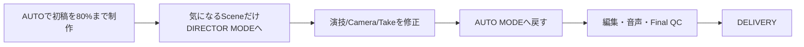

# 機能要件

`spec/overview.md` のスコープに基づく機能要件。原典は `spec/spec.md`（製品仕様ドラフト v1.0）。

## 1. ユースケース

### UC-1: AUTO MODE で完成動画まで自律制作する

- **Actor**: エンドユーザー（クリエイター/マーケター）
- **事前条件**: プロジェクト未作成、またはドラフト状態
- **フロー**:
  1. ユーザーが Creative Brief（Content Type / Objective / Subject / Target / Duration / Aspect Ratio / Mood / Assets / References）を入力する。不足項目は AI が自動補完する
  2. Confirmation Level（FULL AUTO / KEY CHECK / CUSTOM CHECK）を選択する
  3. Producer → Writer → Director → Storyboard → Art Director → Prompt Planner → Video Generation → AI Video Judge → (Repair/Retake) → AI Editor → Audio Production → Final QC の順に自動実行される
  4. 設定した確認ポイントでのみユーザーに提示され、承認/差し戻しを行う
- **事後条件**: Final QC を PASS した動画が Export 可能な状態になる

### UC-2: DIRECTOR MODE で特定 Shot の演技/カメラを修正する

- **Actor**: エンドユーザー
- **事前条件**: AUTO MODE で生成済みの Scene/Shot が存在する
- **フロー**:
  1. ユーザーが気になる Scene/Shot を選択し DIRECTOR MODE に切り替える
  2. 自然言語で演出指示を入力する（例:「もう少し寄って」「この瞬間だけ不安そうな顔にして」）
  3. Command Interpreter が指示を構造化操作（LOCK設定、パラメータ更新、再生成、Branch生成等）へ変換する
  4. 対象 Shot のみ再生成され、Character/Acting/Environment 等の指定要素は保持される
  5. 修正完了後、AUTO MODE に戻し後続工程を再開できる
- **事後条件**: 対象 Shot が更新され、World State に反映される

### UC-3: Take を比較し部分採用する

- **Actor**: エンドユーザー
- **事前条件**: 対象 Shot に複数 Take が生成済み
- **フロー**:
  1. Take 一覧（評価スコア: Product/Acting/Camera/Continuity, Status）を比較表示する
  2. ユーザーが Take 全体、または「Take A の 0-2秒 + Take B の 2-4秒」のように部分区間を指定する
  3. Editor/Repair Agent が指定区間を自然に接続する
- **事後条件**: Selected Take（または合成結果）が Shot に確定する

### UC-4: Continue で続きの Shot/Scene を生成する

- **Actor**: エンドユーザー
- **事前条件**: 完成済み Shot/Scene/Video が存在する
- **フロー**:
  1. AI が最終フレームおよび Story/Character/Position/Emotion/Object/Camera/Lighting/Motion/Dialogue/Music State を解析する
  2. 複数の展開候補（NEXT A/B/C/... + 自由指示 + AIに任せる）を提示する
  3. ユーザーが選択、または AI に一任する
  4. World State を引き継いだ次 Shot/Scene が生成される
- **事後条件**: 新しい Shot/Scene が既存プロジェクトに連結される

### UC-5: Branch で別展開を作成する

- **Actor**: エンドユーザー
- **事前条件**: Branch Point としたい Scene/Shot/Frame が存在する
- **フロー**:
  1. ユーザーが Branch Point を指定する
  2. Branch 作成時点の World State を Snapshot として保存する
  3. 複数 Branch（例: ドアを開ける / 逃げる / 電話する）を並行して生成・比較する
- **事後条件**: 各 Branch が独立した派生プロジェクトツリーとして保持される

### UC-6: AI Editor が素材不足を検知し追加撮影ループへ戻る

- **Actor**: システム（Editor Agent）、エンドユーザー（承認時）
- **事前条件**: Selected Take群から Rough Cut が生成済み
- **フロー**:
  1. Editor Judge が Rough Cut を評価する（Shot Selection / Cut Point / Timing / Pace / Transition / Hook / Retention / CTA Timing 等）
  2. 「Editで修正可能」と判定された場合は Re-edit する
  3. 「素材不足」と判定された場合は Director Agent へ差し戻し、Additional Shot を Video Generation から再実行し、完了後 Editor に戻る
  4. 問題なしと判定されたら Audio Production へ進む
- **事後条件**: Rough Cut が Audio Production に進める品質になる

### UC-7: Production Template を切り替える

- **Actor**: エンドユーザー
- **フロー**: プロジェクト作成時またはブリーフ入力時に PRODUCT/CM・DRAMA・ANIME・SNS/SHORT VIDEO のいずれかを選択する。選択に応じて Judge/Editor の評価軸優先度（例: PRODUCT/CM は Product Accuracy 最優先、DRAMA は Story/Acting 最優先）が切り替わる
- **事後条件**: 以降の Judge/Editor 評価が選択テンプレートの優先度に従う

### UC-8: Quality/Cost ポリシーを選択する

- **Actor**: エンドユーザー
- **フロー**: FAST / BALANCED / MAX QUALITY のいずれかを選択し、必要に応じて Project budget ceiling・Shot budget ceiling・Max retries・Max generation time・Minimum quality thresholds を個別設定する
- **事後条件**: Generation Orchestrator と Repair/Retake Loop が設定ポリシーに従って動作する

### UC-9: Safety / Brand Constraints を適用する

- **Actor**: エンドユーザー（設定）、システム（適用）
- **フロー**: Project 単位で Brand Guidelines・Forbidden Expressions・Required Disclaimer・Product Claims・Logo Rules・Character Restrictions・Music/Asset Rights・Platform Rules を登録する。これらは Prompt 生成・AI Video Judge・Final QC すべてに適用される。LOCK 違反はスコアに関係なく FAIL とする
- **事後条件**: 制約に反する生成結果は自動的に不合格となる

## 2. 機能一覧

| ID | カテゴリ | 機能 | 概要 | MVP |
|----|---------|------|------|-----|
| F-01 | Brief | Creative Brief 入力 | Content Type/Objective/Subject/Target/Duration/Aspect Ratio/Mood/Assets/References の入力と自動補完 | M1 |
| F-02 | Mode | AUTO ⇄ DIRECTOR 切替 | 同一プロジェクト上でモードをいつでも切替 | M1 |
| F-03 | Confirmation | Confirmation Level 設定 | FULL AUTO / KEY CHECK / CUSTOM CHECK | M1 |
| F-04 | Hierarchy | Scene/Shot/Take 階層管理 | 階層構造の表示・選択・生成状態管理 | M1 |
| F-05 | Control | AUTO/MANUAL/LOCK 粒度制御 | Story/Dialogue/Character Identity/Acting/Camera/Lighting/Product Geometry/Prompt/Video Model/Take Selection/Editing/Music 等パラメータ単位の制御 | M1 |
| F-06 | Prompt | Prompt Autopilot | 自然言語指示 → Canonical Shot Spec（YAML）への変換 | M1 |
| F-07 | Prompt | Model Adapter | Canonical Shot Spec をモデル固有プロンプトへ変換。モデル非依存のプロジェクト構造を維持 | M1 |
| F-08 | Prompt | Prompt Candidate Generation | Stability First/Acting First/Dynamic Camera 等の複数撮影戦略生成（Quality/Balanced/Economy Mode） | M2 |
| F-09 | State | World State 管理 | characters/products/location/camera/story を構造化保持 | M1（Basic）/ M2（Lock/Continue拡張） |
| F-10 | State | State Update（差分抽出） | Shot完了後に State Extractor が差分をWorld Stateへ反映。LOCK項目は自動更新禁止 | M1 |
| F-11 | Keyframe | Keyframe / Reference Pack 生成 | Character/Product/Location/Style/Lighting Reference と Keyframe の生成 | M1 |
| F-12 | Generation | Video Generation Orchestration | Shot Spec/World State/References/Cost/Model能力から生成戦略決定、複数Take出力 | M1 |
| F-13 | Judge | AI Video Judge | Prompt Adherence/Character/Product/Face/Hands/Pose/Acting/Lip Sync/Motion/Physics/Camera/Composition/Lighting/Background/Temporal Consistency/Flicker/Scene Continuity 等の評価とフレーム単位Issue出力 | M1 |
| F-14 | Repair | Repair/Retake Loop | Prompt Repair/Partial Regeneration/Full Retake/Different Model/Reference Reinforcement/Edit-Level Repair の選択、Retry Policy（Max retries/Max cost/Min score/Critical constraints/Escalation） | M1 |
| F-15 | Take | Take System | 複数Take保持、AI Pick（AUTO）/ユーザー選択（DIRECTOR）、Partial Take合成 | M1 |
| F-16 | Continuity | Continue | 次展開候補提示とWorld State引き継ぎでの続き生成 | M2 |
| F-17 | Continuity | Branch | Branch Point保存、Snapshot化、複数展開の並行生成 | M2 |
| F-18 | Editor | AI Editor | Shot Selection/Cut Point/Timing/Pace/Transition/Reaction Shot/Insert Shot/Product Exposure/Narrative Clarity/Hook/Retention/CTA Timing/Caption | M1（Simple）/ M3（Advanced） |
| F-19 | Editor | Editor → Reshoot Loop | Editor Judgeが素材不足を検知しDirector Agent/追加撮影へ差し戻す | M3 |
| F-20 | Audio | Audio Production | Dialogue/Voice/Narration/Lip Sync/BGM/SE/Foley/Ambience/Mixing/Loudness最適化 | M3（Audio Director含む）/ 簡易版はM1 |
| F-21 | Template | Production Templates | PRODUCT/CM・DRAMA・ANIME・SNS/SHORT VIDEO ごとの評価軸切替 | M1〜 |
| F-22 | Policy | Quality/Cost Control | FAST/BALANCED/MAX QUALITY、予算・リトライ上限設定 | M1 |
| F-23 | Safety | Safety/Brand Constraints | Brand Guidelines等の登録とPrompt/Judge/Final QCへの適用 | M2〜 |
| F-24 | Director | Natural Language Director Commands | 自然言語 → 構造化操作（LOCK設定/パラメータ更新/Branch作成等）へのCommand Interpreter変換 | M1 |
| F-25 | Project | Project Data Model管理 | Brief/Template/Preferences/Policy/World State/Assets/Scenes/Shots/Takes/Edit Timeline/Audio Timeline/Branches/Exports の保持 | M1 |
| F-26 | Export | Final Export | Final QC PASS後の動画書き出し | M1 |
| F-27 | Trace | Generation Traceability | Shot Spec/World State version/Prompt version/Model/Parameters/References/Output/Judge結果/Repair履歴の保存 | M2 |
| F-28 | Versioning | Reversible Decisions | Shot/Take/Branch/State の主要変更のバージョン化と復元 | M2〜M3 |

## 3. 画面・操作フロー

### 3.1 Main Workspace

```text
┌────────────────────────────────────────────────────┐
│ PROJECT: <プロジェクト名>                    Export │
├────────────────────────────────────────────────────┤
│                  VIDEO PREVIEW                     │
├────────────────────────────────────────────────────┤
│ Scene 01 │ Scene 02 │ Scene 03 │ Scene 04 │   +   │
├────────────────────────────────────────────────────┤
│ Shot 01  │ Shot 02  │ Shot 03  │ Shot 04           │
├────────────────────────────────────────────────────┤
│ 自然言語での演出指示入力欄                          │
│                                       [ Generate ] │
├────────────────────────────────────────────────────┤
│ MODE  [ DIRECTOR ] [ AUTO ]    Quality: Balanced  │
└────────────────────────────────────────────────────┘
```

- Scene/Shot タブ切替で選択状態を変更する
- MODE トグルで AUTO ⇄ DIRECTOR をいつでも切替可能（同一プロジェクト内、状態は保持）
- Quality セレクタで FAST/BALANCED/MAX QUALITY を切替

### 3.2 Inspector（選択中 Shot の詳細）

表示項目: Shot Objective / Duration / Character / Acting / Camera / Lighting / Product / Continuity / References / Prompt / Generation Model / Take List / Judge Results / Locks

各項目には AUTO / MANUAL / LOCK の切替コントロールを持つ。

### 3.3 典型的な操作フロー（モード遷移）



### 3.4 Take 比較 UI

Take一覧をスコア表（Product/Acting/Camera/Continuity, Status: Candidate/AI Pick/Rejected）で表示し、区間指定による部分採用（例:「Take Aの0〜2秒 + Take Bの2〜4秒」）を自然言語入力またはタイムライン上のドラッグで指定できる。

### 3.5 Branch ツリー UI

Scene/Shot 配下に複数 Branch をツリー表示し、Branch 間の比較・切替・削除を行える。

## 改訂履歴

| 版 | 日付 | 変更内容 | 変更理由 |
|----|------|---------|---------|
| 1.0 | 2026-09-28 | 新規作成 | `spec/spec.md` §3〜19, 23〜26 を機能要件として構造化 |
| 1.1 | 2026-09-28 | UC-9 のフローから「Organization 単位」の記述を削除し「Project 単位」に統一 | `spec/overview.md` のスコープ（SaaSマルチテナント化・組織単位運用は対象外の単一ユーザー向けツール）と、ER図（`er.md`）にOrganizationエンティティが存在しないことの矛盾を解消するため（整合性レビュー指摘） |
