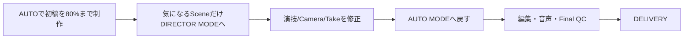

# 機能要件

`spec/overview.md` のスコープに基づく機能要件。原典は `spec/spec.md`（製品仕様ドラフト v1.0）。

## 1. ユースケース

### UC-1: AUTO MODE で完成動画まで自律制作する

- **Actor**: エンドユーザー（クリエイター/マーケター）
- **事前条件**: プロジェクト未作成、またはドラフト状態
- **フロー**:
  1. ユーザーがチャットで作りたい動画を伝える。発言から Creative Brief（Content Type / Objective / Subject / Target / Duration / Aspect Ratio / Mood / テーマ・制約 / Assets / References）をルールベース（キーワード・正規表現。LLM による抽出は未実装）で抜き出し、述べられた項目は聞き直さない。決まっていない項目には、目的（TikTok・YouTube Shorts・Instagram Reels）から決めた Aspect Ratio と Duration を仮の推奨値として置き、値の出どころ（`user` / `inferred_from_request` / `recommended`）を区別して持つ。確認は 1 枚の「この内容でよいですか？」にまとめ（質問するのは Subject を決められないときと、Subject の食い違いだけ）、FULL AUTO では確認せずに進める。後の否定・一般的な発言（「ただの投稿動画」）や明示でない発言は決めた値を上書きしない。この確認は生成の承認ではない（`spec/spec.md` §4.2。Subject を除き「AIに任せる」を選べる。Subject が空・薄いまま無関係な題材の脚本を作らないため、Subject は答えるまで脚本を作らず質問で止まる。Additional Instruction に題材があればそれを使う。#1108・#1114）。添付した画像・動画は Assets/References として取り込む
  2. Confirmation Level（FULL AUTO / KEY CHECK / CUSTOM CHECK）を選択する
  3. Producer → Writer → Director → Storyboard → Art Director → Prompt Planner → Video Generation → AI Video Judge → (Repair/Retake) → AI Editor → Audio Production → Final QC の順に進む。自動実行されるのは Scene/Shot 計画（Storyboard）までで、その直後に、AUTO を選んでいること自体を生成を始める同意として、承認カードを出さずに Art Director 以降（Reference Pack・Keyframe・Video Generation）を本線で自動進行する（Reference Pack → Shot 生成。起動した Shot では Judge → Repair → AI Pick が連鎖する）。始めるときに、生成する内容（Shot 数・Reference Pack を作る Shot・使うモデル・おおよその本数）と費用の見積（出せないときは「不明」。不明でも止めない）・予算上限・止め方をチャットに 1 件お知らせする（待たない）。予算上限は AUTO でも効き、超える起動は Escalation で止まる。DIRECTOR / MANUAL では自動で始めず、従来どおり Shot 単位でユーザーが起動する。全 Shot に Selected Take が揃うと Rough Cut の作成と Editor Judge が自動で始まり、確認ポイントの承認カードの回答後（または確認不要の設定）に Audio Production と Final QC が続く。Editor Judge の Re-edit 判定と Final QC の FAIL はユーザーの対応を待って止まる（Editor Judge が `need_shot` のときは、AUTO では追加 Shot の要求が自動で始まり、Retry Policy の範囲で繰り返して上限で Escalation に止まる。MANUAL ではユーザーが要求する）。Export は Final QC を PASS した（READY の）動画へのユーザーの操作で行う
  4. 設定した確認ポイント（脚本・Rough Cut・Final）が、承認カードとしてチャットに提示される（生成の開始は確認しない。#1115）。ユーザーはボタンまたは返信で承認/差し戻しを行う
- **事後条件**: Final QC を PASS した動画が Export 可能な状態になる

### UC-2: DIRECTOR MODE で特定 Shot の演技/カメラを修正する

- **Actor**: エンドユーザー
- **事前条件**: AUTO MODE で生成済みの Scene/Shot が存在する
- **フロー**:
  1. ユーザーがチャットで、対象の Scene/Shot/Take を示して（カードへの返信、または文脈から AI が解決）DIRECTOR MODE に切り替える
  2. 自然言語で演出指示を発言する（例:「もう少し寄って」「この瞬間だけ不安そうな顔にして」）
  3. Command Interpreter が指示を構造化操作（LOCK設定、パラメータ更新、再生成、Branch生成等）へ変換する
  4. 対象 Shot のみ再生成され、Character/Acting/Environment 等の指定要素は保持される。時間範囲を名指しした指示（M2、「2〜3秒目のカメラの揺れだけ直して」）は、その区間だけを差し替えた新しい Take（Partial Regeneration）になり、元の Take は変わらない
  5. 修正完了後、AUTO MODE に戻し後続工程を再開できる
- **事後条件**: 対象 Shot が更新され、World State に反映される

### UC-3: Take を比較し部分採用する

- **Actor**: エンドユーザー
- **事前条件**: 対象 Shot に複数 Take が生成済み
- **フロー**:
  1. Take 一覧（評価スコア: Product/Acting/Camera/Continuity, Status）を比較表示する
  2. ユーザーが Take 全体、または「Take A の 0-2秒 + Take B の 2-4秒」のように部分区間を指定する
  3. Editor/Repair Agent が指定区間を自然に接続する
- **事後条件**: Selected Take（または合成結果）が Shot に確定する

### UC-4: Continue で続きの Shot/Scene を生成する

- **Actor**: エンドユーザー
- **事前条件**: 完成済み Shot/Scene/Video が存在する
- **フロー**:
  1. AI が最終フレームおよび Story/Character/Position/Emotion/Object/Camera/Lighting/Motion/Dialogue/Music State を解析する
  2. 複数の展開候補（NEXT A/B/C/... + 自由指示 + AIに任せる）を提示する
  3. ユーザーが選択、または AI に一任する
  4. World State を引き継いだ次 Shot/Scene が生成される
- **事後条件**: 新しい Shot/Scene が既存プロジェクトに連結される

### UC-5: Branch で別展開を作成する

- **Actor**: エンドユーザー
- **事前条件**: Branch Point としたい Scene/Shot/Frame が存在する
- **フロー**:
  1. ユーザーが Branch Point を指定する
  2. 分岐点（Branch Point）の World State を Snapshot として保存し、Branch 専用の World State の版として持つ
  3. 複数 Branch（例: ドアを開ける / 逃げる / 電話する）を並行して生成し、Branch ツリーで切り替えて見比べる（2 つの Branch を並べる専用の比較画面は設けない）
- **事後条件**: 各 Branch が独立した派生プロジェクトツリーとして保持される

### UC-6: AI Editor が素材不足を検知し追加撮影ループへ戻る

- **Actor**: システム（Editor Agent）、エンドユーザー（承認時）
- **事前条件**: Selected Take群から Rough Cut が生成済み
- **フロー**:
  1. Editor Judge が Rough Cut を評価する（Shot Selection / Cut Point / Timing / Pace / Transition / Hook / Retention / CTA Timing 等）
  2. 「Editで修正可能」と判定された場合は Re-edit する
  3. 「素材不足」と判定された場合は Director Agent へ差し戻し、Additional Shot を Video Generation から再実行し、完了後 Editor に戻る
  4. 問題なしと判定されたら Audio Production へ進む
- **事後条件**: Rough Cut が Audio Production に進める品質になる

### UC-7: Production Template を切り替える

- **Actor**: エンドユーザー
- **フロー**: プロジェクト作成時に、最初の発言から抽出した Content Type で Production Template が決まる（「ドラマ」→ DRAMA、「アニメ」→ ANIME、「SNS/ショート動画」→ SNS/SHORT VIDEO、それ以外・不明は PRODUCT/CM）。Series の次の Episode（`POST /series/:id/episodes`）は最初の発言も Content Type も持たないため、Series が DRAMA 等であっても常に PRODUCT/CM で始まり、変えるときは設定画面で選ぶ（Series からは継承しない）。その後に Brief の Content Type を答えたり編集したりしても、テンプレートは自動では変わらない。変えるときは設定画面（`PUT /projects/:id/production-template`）で PRODUCT/CM・DRAMA・ANIME・SNS/SHORT VIDEO のいずれかを選択する。選択に応じて Judge/Editor の評価軸優先度（例: PRODUCT/CM は Product Accuracy 最優先、DRAMA は Story/Acting 最優先）が切り替わる
- **事後条件**: 以降の Judge/Editor 評価が選択テンプレートの優先度に従う

### UC-8: Quality/Cost ポリシーを選択する

- **Actor**: エンドユーザー
- **フロー**: FAST / BALANCED / MAX QUALITY のいずれかを選択し、必要に応じて Project budget ceiling・Shot budget ceiling・Max retries・Max generation time・Minimum quality thresholds を個別設定する
- **事後条件**: Generation Orchestrator と Repair/Retake Loop が設定ポリシーに従って動作する

### UC-9: Safety / Brand Constraints を適用する

- **Actor**: エンドユーザー（設定）、システム（適用）
- **フロー**: Project 単位で Brand Guidelines・Forbidden Expressions・Required Disclaimer・Product Claims・Logo Rules・Character Restrictions・Music/Asset Rights・Platform Rules を登録する。これらは Prompt 生成・AI Video Judge・Final QC すべてに適用される。LOCK 違反はスコアに関係なく FAIL とする（強制レベルと適用の詳細は `spec/spec.md` §26.1）
- **事後条件**: 制約に反する生成結果は自動的に不合格となる

#### UC-9 拡張: Brand Templates（M3）

- **フロー**: 設定画面で、その Project の制約の現在のセットに名前を付けて Brand Template として保存する。新しい Project の作成フォーム、Series 画面の「次の Episode を作成」、既存 Project の設定画面から、テンプレートを選んで適用できる
- **保存単位**: テンプレート 1 件 = 名前（前後・連続する空白を 1 つにまとめた 1〜100 文字。大文字小文字を区別せず一意）＋ 制約のセット（`type` / `enforcement_level` / `text`）。テンプレートはどの Project・Series にも属さない（Organization は存在しないため。全 Project から共有して選べる）。制約が 1 件もない Project は保存できない
- **適用範囲**: 新規 Project 作成（`POST /projects`）、新規 Episode 作成（`POST /series/:id/episodes`）、既存 Project への適用。適用は制約の **コピー**（新しい `brand_constraint` 行）で、リンクは持たない。既存 Project に適用するときは、同じ `type`・`enforcement_level`・`text` の制約をすでに持っていればその制約はコピーせず、既存の制約は削除も変更もしない
- **更新の非伝播（Traceability）**: 保存はその時点の制約のスナップショットで、保存後に元の Project の制約を変えてもテンプレートは変わらない。適用後の各 Project の制約は独立して追加・削除でき、テンプレートの削除やテンプレート側の変更は、すでに適用した Project に自動では伝播しない（`er.md` の Series 正本と同じ方針）。テンプレート内の制約を編集する機能は持たず、変える場合は制約を整えた Project から別名で保存し直す
- **Series との関係**: Series は制約を持たない（Series の正本は Character / Product / Location / Style / Notes）。Series には制約を継承させず、Episode 作成時にテンプレートを選んだ場合だけその Episode に制約がコピーされる
- **事後条件**: 適用された制約は UC-9 の他の制約と同じく Prompt 生成・AI Video Judge・Final QC に適用される

### UC-10: 制作メモを登録し、制作に反映する（M2）

- **Actor**: エンドユーザー、システム（State Extractor）
- **事前条件**: Project が存在する（Series メモの場合は Series が存在する）
- **フロー**:
  1. ユーザーがチャットで「これ覚えておいて」と発言する（または補助ビューの Notes から登録・編集する）。Project の Notes に新しいメモバージョンが追加される
  2. 以降の Writer / Director / Prompt Planner が、ピン留めされたメモと関連するメモを推論の文脈として参照する
  3. State Extractor がメモから World State に構造化できる項目（髪型・衣装・性格等）を検出した場合、非ブロッキングの承認カードで World State への昇格を提案する。承認すると World State に新バージョンが追加される。LOCK 中の項目は提案から除外される
  4. Series 単位のメモは Episode 開始時に Project へコピーされる
- **事後条件**: メモが以降の制作の文脈として使われ、承認された項目は World State（構造化状態）に反映される。昇格カードへの応答がなくても制作は止まらない

### UC-11: 完成動画をチームでレビューし、承認をもらう（M3）

- **Actor**: オーナー（Project を持つ人）、レビュアー（別のメンバー。自分のインスタンスを使う）
- **事前条件**: オーナーの Project に Final Export が 1 本以上ある。ネットワーク上の共有基盤は使わず、ファイルの受け渡し経路（メール・チャット等）は利用者が用意する
- **フロー**:
  1. オーナーが補助ビュー「レビュー」で書き出しを 1 本選び、レビュアーへのメモを添えてレビュー依頼を作り、Review Package（ZIP）をダウンロードして渡す
  2. レビュアーが自分のインスタンスの「レビュー」で Review Package を読み込み、動画を視聴して時刻付きコメントを付け、表示名と判定（承認 / 修正依頼）を書き、Review Response（JSON）を書き出してオーナーに返す
  3. オーナーが Review Response を取り込む。レビュー依頼の状態（未回答 / 承認済み / 修正依頼あり）とコメントが表示され、Chat Workspace のスレッドにレビュー結果が記録される
  4. オーナーはコメントを見ながらチャットで修正を指示し、対応したコメントを解決済みにする。修正後の書き出しで、新しいレビュー依頼を作る
- **代替フロー**: 別 Project のレビュー依頼への応答・取り込み済みの応答・形式の違うファイルは取り込まない（422 / 409）
- **事後条件**: レビュアーは Project の中身・API キー・顔データを受け取らない（`spec/spec.md` §27.1）。レビュアーの応答は制作の状態遷移や Final Export をブロックしない

## 2. 機能一覧

| ID | カテゴリ | 機能 | 概要 | MVP |
|----|---------|------|------|-----|
| F-01 | Brief | Creative Brief 入力 | チャットでの発言・添付から Content Type/Objective/Subject/Target/Duration/Aspect Ratio/Mood/テーマ・制約/Assets/References をルールベース（キーワード・正規表現。LLM 抽出は未実装）で抽出し、述べられた項目は聞き直さない。決まっていない項目には目的から決めた推奨値（TikTok・YouTube Shorts・Instagram Reels の Aspect Ratio と Duration。表は `spec/spec.md` §4.2）を仮に置き、値の出どころ（`user` / `inferred_from_request` / `recommended`）を Brief・画面・MCP で区別する。確認は 1 枚の「この内容でよいですか？」にまとめ、FULL AUTO では確認しない。後の否定・一般的な発言は決めた Subject を上書きしない。Producer の主人公が Brief と明らかに食い違う案は使わない。「AIに任せる」は Subject 以外で選べる | M1 |
| F-02 | Mode | AUTO ⇄ DIRECTOR 切替 | 同一プロジェクト上でモードをいつでも切替 | M1 |
| F-03 | Confirmation | Confirmation Level 設定 | FULL AUTO / KEY CHECK / CUSTOM CHECK。選べる確認ポイントは script / rough_cut / final。AUTO は Scene/Shot 計画後の生成の開始を確認せずに始める（AUTO を選ぶことが同意。どの確認レベルでも承認カードを出さない。始めるときのお知らせと予算上限は `spec/spec.md` §4.3。旧「生成の承認」（`generation`）は #1115 で廃止） | M1 |
| F-04 | Hierarchy | Scene/Shot/Take 階層管理 | 階層構造の表示・選択・生成状態管理 | M1 |
| F-05 | Control | AUTO/MANUAL/LOCK 粒度制御 | Story/Dialogue/Character Identity/Acting/Camera/Lighting/Product Geometry/Prompt/Video Model/Take Selection/Editing/Music 等パラメータ単位の制御 | M1 |
| F-06 | Prompt | Prompt Autopilot | 自然言語指示 → Canonical Shot Spec（YAML）への変換 | M1 |
| F-07 | Prompt | Model Adapter | Canonical Shot Spec をモデル固有プロンプトへ変換。モデル非依存のプロジェクト構造を維持。採用プロバイダー・ルーティングは `spec/architecture/model-adapters.md` 参照 | M1 |
| F-08 | Prompt | Prompt Candidate Generation | Stability First/Acting First/Dynamic Camera 等の複数撮影戦略生成（Quality/Balanced/Economy Mode。Shot カードの「生成」・Continue・Branch・追加撮影・Director の再生成はこれで起動し、Judge 未構成または Prompt が LOCK のときだけ単発生成） | M2 |
| F-09 | State | World State 管理 | characters/products/location/camera/story を構造化保持。M2 で Location State（time/lighting_state/weather）の自動更新と、項目単位の LOCK（`spec/spec.md` §9.3）。Character は企画（LLM）のほか、画面の「登場人物を追加」・MCP `create_character` で手で作れる（Issue #1001）。企画が LLM の API キー未設定で止まったときは、LLM を使わず Brief の添付画像 1 枚につき下書きの Character（仮の名前・その画像が face 参照・`draft` の印）を作り、再実行しても増やさず、すでに Character がいる Project には作らない。下書きは画面のバッジ・MCP の `draft` で分かり、編集すると印が消える（Issue #1022） | M1（Basic）/ M2（Lock/Continue拡張） |
| F-10 | State | State Update（差分抽出） | Shot完了後に State Extractor が差分をWorld Stateへ反映。LOCK項目は自動更新禁止 | M1 |
| F-11 | Keyframe | Keyframe / Reference Pack 生成 | Character/Product/Location/Style/Lighting Reference と Keyframe の生成。M2 で Reference Library（Project 内の参照画像の登録・検索・再利用、`spec/spec.md` §10.1） | M1（Reference Pack）/ M2（Reference Library） |
| F-12 | Generation | Video Generation Orchestration | Shot Spec/World State/References/Cost/Model能力から生成戦略決定、複数Take出力 | M1 |
| F-13 | Judge | AI Video Judge | Prompt Adherence/Character/Product/Face/Hands/Pose/Acting/Lip Sync/Motion/Physics/Camera/Composition/Lighting/Background/Temporal Consistency/Flicker/Scene Continuity 等の評価とフレーム単位Issue出力。顔同一性は Face Identity Similarity（参照顔との埋め込み類似度、`spec/spec.md` §12.4）も数値で評価する | M1 |
| F-14 | Repair | Repair/Retake Loop | Prompt Repair/Partial Regeneration/Full Retake/Different Model/Reference Reinforcement/Edit-Level Repair の選択、Retry Policy（Max retries/Max cost/Min score/Critical constraints/Escalation）。Partial Regeneration は M1 では Judge の `preserve` を保つ Shot 全体の再生成、M2 では加えて問題の時間範囲だけを差し替えたTake（新しい `take`、既存 Take は変えない）を作り、DIRECTOR MODE の自然言語指示（「2〜3秒目だけ直して」）からも起動できる（`spec/spec.md` §13） | M1（Partial Regeneration の時間範囲つなぎ込みは M2） |
| F-15 | Take | Take System | 複数Take保持、AI Pick（AUTO）/ユーザー選択（DIRECTOR）、Partial Take合成（Partial Regeneration のつなぎ込み〈M2〉も同じ合成を使う） | M1 |
| F-16 | Continuity | Continue | 次展開候補提示とWorld State引き継ぎでの続き生成 | M2 |
| F-17 | Continuity | Branch | Branch Point保存、Snapshot化、複数展開の並行生成 | M2 |
| F-18 | Editor | AI Editor | Shot Selection/Cut Point/Timing/Pace/Transition/Reaction Shot/Insert Shot/Product Exposure/Narrative Clarity/Hook/Retention/CTA Timing/Caption | M1（Simple）/ M3（Advanced） |
| F-19 | Editor | Editor → Reshoot Loop | Editor Judgeが素材不足を検知しDirector Agent/追加撮影へ差し戻す | M3 |
| F-20 | Audio | Audio Production | Dialogue/Voice/Narration/Lip Sync/BGM/SE/Foley/Ambience/Mixing/Loudness最適化。TTS/Music/SFXはElevenLabs、Lip SyncはSync Labs（`spec/architecture/model-adapters.md`§5）。Character ごとの**参照音声**（約 3〜10 秒の録音、書き起こし、言語。Series 正本から Episode へ継承。画面は Series ページと World State ページ、MCP は `character_voice_reference`）は、ローカルの声のプロバイダーが「同じキャラ＝同じ声」を毎回作るための入力で、台本の話者名（ナレーションは「ナレーション」という名前の Character）から引く（`spec/architecture/er.md` §4）。**ローカル TTS**: Dialogue / Narration を、クラウドの ElevenLabs の代わりに、mam が導入・起動する GPT-SoVITS で作れる（API 費用 0 円。`elevenlabs`（既定）か `local` を選ぶ。参照音声が無い話者・未導入・重み未取得・非対応の環境・GPU 不足は、課金や起動の前に種類つきのエラーで止める。`spec/architecture/model-adapters-m3.md` §14.8）。**プロバイダーの選択（#924）**: 声（`elevenlabs` / `local`）・口パク（`synclabs` / `local`）・「ローカルが使えないときはクラウドに切り替える」（既定オフ）を、設定画面「音声・口パク」（`/settings/audio`）と MCP（`get_audio_providers` / `set_audio_providers`）で選び、`<データフォルダ>/audio.json` に保存する（未設定は今までと同じクラウド。次の音声作成から使われ、再起動後も残る）。この PC で動かせないローカル（macOS・NVIDIA の GPU 無しなど）は選べず、画面にその理由とクラウドの案内を出す。使えない理由（未導入・重み未取得・非対応の環境・GPU 不足・プロセスの失敗）は、画面・チャット・MCP・ジョブの失敗理由で**同じ文**にする。切り替えの設定がオフ（既定）なら、ローカルが使えないとき自動ではクラウドに切り替えず、理由つきのエラー（声）／スキップの理由（口パク）で止める（無断で API 費用が出ない）。オンなら、実行の開始前の検査でローカルが使えないと分かったときだけ、その実行の全体をクラウドで作り（途中で声を混ぜない）、切り替えたことをチャットと結果に残す。クラウドの API キーが無ければ、キーの案内つきのエラー（`spec/architecture/model-adapters-m3.md` §14.10） | M3（Audio Director含む）/ 簡易版はM1 **ローカル Lip Sync**: 実行ごとに `synclabs`（既定）か `local`（MuseTalk 1.5。mam が自動で導入・起動する。API 費用 0 円で台帳に `musetalk-1.5` を 0 円で記録）を選べる（`audiodirector.Input.LipSyncProvider`、`service.AudioOptions.LipSyncProvider`。設定の保存は下の「プロバイダーの選択」）。MAX QUALITY のみ・保存先・Export の使い方は Sync Labs と同じ。ランタイム全体が使えない（未導入・重み未取得・この PC で動かない）ことは 1 回で分かり、残りのクリップを試さず `skipped` に 1 件だけ残し、顔が見つからない・ビデオメモリ不足・時間切れなどはそのクリップだけ理由つきで `skipped` に残す（音声は作る）。実機の口パクの質・実物のランタイムでの生成は未確認（`spec/architecture/model-adapters-m3.md` §14.9）。 |
| F-21 | Template | Production Templates | PRODUCT/CM・DRAMA・ANIME・SNS/SHORT VIDEO ごとの評価軸切替 | M1〜 |
| F-22 | Policy | Quality/Cost Control | FAST/BALANCED/MAX QUALITY、予算・リトライ上限設定。予算はチャットの発言（最初の発言・途中の変更）からも、確認カードのあとで設定でき、予算を超えそうなときは止めて選択肢を出す（#1139） | M1 |
| F-23 | Safety | Safety/Brand Constraints | Brand Guidelines等の登録とPrompt/Judge/Final QCへの適用。M3 で Brand Templates（制約のセットの保存と、新規 Project / Episode・既存 Project へのコピー適用） | M2〜 |
| F-24 | Director | Natural Language Director Commands | 自然言語 → 構造化操作（LOCK設定/パラメータ更新/Branch作成等）へのCommand Interpreter変換。全体設定（API キー・プロバイダー・モデルの導入・割り当て・LoRA・書き出し・キャラクターの参照）もチャットから確認カード付きで操作できる（#1140、`spec/components/chat-settings-operations.md`） | M1 |
| F-25 | Project | Project Data Model管理 | Brief/Template/Policy（Confirmation / Quality / Budget / Retry。利用者の好みはここで保持する）/World State/Assets/Scenes/Shots/Takes/Edit Timeline/Audio Timeline/Branches/Exports の保持 | M1 |
| F-26 | Export | Final Export | Final QC PASS後の動画書き出し | M1 |
| F-27 | Trace | Generation Traceability | Shot Spec/World State version/Prompt version/Model/Parameters/References/Output/Judge結果/Repair履歴の保存 | M2 |
| F-28 | Versioning | Reversible Decisions | Shot/Take/Branch/State/Note の主要変更のバージョン化と復元 | M2〜M3 |
| F-29 | Continuity | Series / Episode Memory | Series 単位で Character/Product/Location/Style の正本と Reference Pack を保持し、Episode（Project）開始時に継承する。前 Episode 終了時の World State を次 Episode の開始状態にできる。正本の更新は既存 Episode へ自動伝播しない（Traceability）。顔同一性は Series 正本の `face_reference` を基準に Episode 間でも計測する（`spec/spec.md` §12.4）。Character の**参照音声**（録音・書き起こし・言語）も正本が持ち、Episode 開始時にコピーして継承する（正本の更新は既存 Episode に伝播しない。Episode の Character はその Episode だけ差し替えられる。Series に属さない Project の Character にも付けられる）。詳細は `spec/architecture/er.md` §4「キャラクターの参照音声」 | M2 |
| F-30 | UI | Chat Workspace | 1プロジェクト＝1チャットスレッドを標準画面とし、Brief 入力・確認ポイントの承認・演出指示・進捗確認・Take 視聴をスレッド内で完結できる。Inspector/Take比較/Timeline/Branch/World State は補助ビュー（`spec/spec.md` §23） | M1 |
| F-31 | Continuity | Notes（制作メモ） | Project / Series 単位の自由記述メモ（登場人物の背景・世界観・トーン等）。チャット発言（「覚えておいて」）または補助ビューから登録し、バージョン管理する。Writer/Director/Prompt Planner が推論の文脈として参照し（ピン留めは常時、他は関連度順）、画像/動画生成モデルには渡さない。Series メモは Episode 開始時にコピーし、自動伝播しない。State Extractor が構造化可能な内容を World State への昇格として非ブロッキングの承認カードで提案し、LOCK 項目は除外する。守らせたいルールは Brand Constraint（F-23）に登録する（`spec/spec.md` §9.4） | M2 |
| F-32 | Collaboration | Team Collaboration（Review Package） | 完成動画のレビュー・承認をファイル受け渡しで行う。オーナーが Final Export 1 本から Review Package を作り、レビュアーが自分のインスタンスで視聴・時刻付きコメント・判定（承認 / 修正依頼）を書いて Review Response を返し、オーナーが取り込む。アカウント・サーバー・同時編集は持たず、認証は自己申告の表示名（検証しない）。共有物は allowlist の項目だけで、API キー・顔データ・Brief 等を含まない（`spec/spec.md` §27.1、`spec/requirements/non-functional.md` §5） | M3 |
| F-33 | Distribution | デスクトップ版（Wails ウィンドウ + インストーラー。Windows・macOS） | Windows では Wails のネイティブウィンドウ（WebView2）、macOS（Apple Silicon）では WKWebView で本アプリを開く。ウィンドウは `127.0.0.1` のサーバー（既定ブラウザ版と同一）の URL を表示し、画面・操作・データはブラウザ版と同じ。起動すると既に起動中のインスタンスがあれば新しいウィンドウは開かずそのウィンドウを前面に出し、ウィンドウを閉じるとアプリ全体が（ブラウザ版の終了と同じグレースフルシャットダウンで）終了する。NSIS インストーラー exe とポータブル `mam.exe`（Windows x64）、macOS（Apple Silicon・Apple の署名なし）の `.dmg` を GitHub Releases から入手でき、インストール済みのアプリは新しいリリースを検証して自動で入れ替える（`spec/requirements/non-functional.md` §1、`spec/architecture/desktop.md`、`spec/environment/setup.md`） | M1 |

## 3. 画面・操作フロー

### 3.1 Chat Workspace（標準画面）

```text
┌────────────────────────────────────────────────────┐
│ PROJECT: <プロジェクト名>            [ ⋯ 補助ビュー ] │
├────────────────────────────────────────────────────┤
│ チャットスレッド（ユーザー発言 / AI 発言 / カード）  │
│                                                    │
├────────────────────────────────────────────────────┤
│ [＋] 指示を入力…                          [ 送信 ] │
│ MODE [ AUTO | DIRECTOR ]   Quality: Balanced        │
└────────────────────────────────────────────────────┘
```

- ユーザーの操作は、スレッドへの発言とスレッド内カードのボタン操作で完結する。補助ビューは使わなくても制作を完了できる
- カードの種類: Question / Approval / Keyframe / Take / Progress / Escalation（`spec/spec.md` §23.2）
- 指示の対象 Scene/Shot/Take は、カードへの返信または直前の文脈から AI が解決し、解決できない場合は聞き返す
- MODE トグルで AUTO ⇄ DIRECTOR をいつでも切替可能（同一プロジェクト内、状態は保持）
- Quality セレクタで FAST/BALANCED/MAX QUALITY を切替
- スレッドは Project ごとに永続化され、再度開いたときに履歴を再表示する

### 3.2 補助ビュー

チャットの横、または別ページで開く。スレッド内カードと［⋯］メニューから到達でき、操作結果は同じ Project の状態とスレッドに反映される。

- **Inspector**（選択中 Shot の詳細）: Shot Objective / Duration / Character / Acting / Camera / Lighting / Product / Continuity / References / Prompt / Generation Model / Take List / Judge Results / Locks。Take List は Take ごとに最新の Judge Result（pass/fail・確信度・Issue の一覧、LOCK 違反の印）を並べ、Generation Model は Shot に LOCK または MANUAL で指定したモデル（AUTO のときは使わない）、なければ最新 Take のモデル、なければ「自動選択」を示す。Prompt（モデル別プロンプト）は Shot のインスペクターには常設せず、各 Take の「生成の経緯」（Generation Trace）で確認する。AUTO / MANUAL / LOCK の切替は Locks セクションだけにあり、Shot 単位のパラメータ（`spec/spec.md` §6 の Dialogue / Character Identity / Acting / Camera / Lighting / Product Geometry / Prompt / Video Model / Take Selection / Editing）ごとに切り替える。その他の項目（Shot Objective・Duration・Continuity・References・Take List・Judge Results）は表示のみ
- Take 比較（§3.4）、Timeline、Branch ツリー（§3.5）、World State、Notes（M2）、Cost、Settings

### 3.3 典型的な操作フロー（モード遷移）



### 3.4 Take 比較 UI

Take一覧をスコア表（Product/Acting/Camera/Continuity, Status: Candidate/AI Pick/Selected/Rejected）で表示し、区間指定による部分採用（例:「Take Aの0〜2秒 + Take Bの2〜4秒」）を自然言語入力またはタイムライン上のドラッグで指定できる。

### 3.5 Branch ツリー UI

Scene/Shot 配下に複数 Branch をツリー表示し、Branch の切替（ツリーの項目を選ぶと詳細を読み込む）・名称変更を行える。Branch は追記のみで保持し（F-28、`spec/architecture/er.md` §4）、削除はしない。2 つの Branch を並べて比較する専用の画面も設けず、比較はツリーでの切替で行う。

### 3.6 M1 の編集・音声・書き出しの範囲（F-18 Simple / F-20 簡易版 / F-26）

**F-18 Simple（M1）で扱う編集項目**は次の 4 つ。それ以外は M3（Advanced）とする。

| 項目 | M1 で扱う内容 |
|------|--------------|
| Shot Selection | Rough Cut は各 Shot の採用 Take（Selected Take）を Scene 順・Shot 順に並べて作る。編集では Shot の並べ替えと除外ができる（Shot の追加は M3） |
| Cut Point | 各クリップの Take 内の開始点・終了点（In / Out）。Rough Cut の初期値は Take の先頭から Shot の計画尺まで |
| Timing | クリップの長さ（Out − In）。最短 0.5 秒 |
| Transition | クリップの前に置く切り替え（`cut` / `fade` / `fade_black` / `dissolve`）と長さ。Rough Cut の初期値は Scene 内が `cut`、Scene の切れ目が `fade`（0.25 秒） |

**M3（Advanced）に残す項目**: Pace の自動調整、Reaction Shot / Insert Shot、Product Exposure、Narrative Clarity、Hook / Retention / CTA Timing の最適化、Caption。Editor Judge の判定は PASS / Re-edit のみで、素材不足（NEED_SHOT）の差し戻しは F-19（M3）で扱う。

**F-20 簡易版（M1）の範囲**は次のとおり。BGM / SE / Foley / Ambience / Lip Sync / 音声クローンは M3（Audio Director、§3.8）で加わる。映像尺の変更への追従は、編集のたびに Audio Director が Scene を読み直して Audio Timeline の新しい版を作ることで行う。

- **Dialogue / Narration**: 脚本（`script_version`）の Scene ごとの `dialogue` 行（`話者: セリフ`、話者なしまたは `ナレーション` / `NA` は Narration）を ElevenLabs の TTS で音声化し、Scene の先頭 Shot の開始時刻から順に置く。行が 1 つもない Project は TTS を呼ばない
- **ミキシング**: Take 自体の音声（あれば）と TTS 音声をローカルの ffmpeg で 1 本に混ぜる
- **ラウドネス正規化**: ローカル DSP（ffmpeg `loudnorm` の 2 パス）で目標ラウドネス（既定 −14 LUFS、SNS 向け）に揃え、測定値を Audio Timeline に保存する。外部 API は呼ばない

**Final QC（F-26）の M1 の判定**は、決定的なチェック（Audio Timeline が最新の Edit Timeline と一致しているか、各クリップの Take のファイルがあるか、映像と音声の長さの差、ラウドネスが目標から ±1.5 LU 以内か、True Peak が −1.0 dBTP 以下か、音声が入っているべき Project に音声があるか、ミックス済みの音声ファイルがあるか）のみとする。FAIL のときは原因の工程（編集の不一致・Take ファイルの欠落 → EDITING、音声の不備 → AUDIO）へ戻す。Brand / Safety Constraint（F-23）の適用は M2 で加わる（`spec/spec.md` §26.1）。`lock` の制約違反は FAIL、`advisory` は警告のみ。

**Export（F-26）**: Aspect Ratio（Project の Brief の値を既定とし、`16:9` / `9:16` / `1:1` / `4:5` から選択）、解像度（短辺 `720p` / `1080p` / `1440p` / `2160p`）、コーデック（`h264` / `h265` / `vp9`）を指定してローカルへ書き出す。書き出しはアトミックに行い（一時ファイルへ書いて完了後にリネーム）、途中で失敗しても不完全なファイルは残らない。

### 3.7 M3 の Editor（F-18 Advanced / F-19）の範囲

Editor Agent は Production Template（`spec/spec.md` §19）が評価軸に持つ項目だけを扱う。テンプレートに無い項目は見ない。

| 項目 | 見るテンプレート | 内容 | 直し方 |
|------|-----------------|------|--------|
| Pace / Retention | SNS / SHORT VIDEO（Tempo・Retention）、DRAMA（Editing Rhythm） | 1 クリップの長さの上限（SNS 4 秒、DRAMA 6 秒） | 編集（Rough Cut 作成時に自動で短縮。Brief の Duration の許容範囲を下回らない） |
| Hook | PRODUCT / CM（Hook）、SNS（Opening Hook） | 冒頭クリップを 3 秒以内で切り替える | 編集 |
| CTA Timing | PRODUCT / CM、SNS（CTA） | 最後のクリップを 1.5 秒以上見せる | 編集（Take の長さの範囲で延長） |
| Caption | SNS（Caption） | セリフのある Shot に字幕を入れる。タイムラインで編集でき、書き出し・プレビューに焼き込む | 編集 |
| Product Exposure | PRODUCT / CM | 商品が映る時間が全体の 25% 以上 | 素材不足（商品のインサートショットを追加） |
| Reaction Shot / Insert Shot | DRAMA（Dialogue・Acting・Emotion） | セリフのクリップが 3 つ続いたらリアクションを挟む | 素材不足（リアクションショットを追加） |
| Narrative Clarity | すべて | LLM による Editor Judge の講評（Shot の並びと物語の流れ） | 編集 または 素材不足 |

**Editor → Reshoot Loop（F-19）**: 素材不足の指摘は追加 Shot（`kind`・挿入位置・長さ・狙い）を伴い、Editor Judge の判定は `need_shot` になる。1 回の Editor Judge が求める追加 Shot は最大 3 件（`MaxShotNeeds`）で、同じ挿入位置・同じ `kind` には 1 件に絞る（超えた分は追加 Shot を伴わない指摘として残る）。追加 Shot の長さは 1〜8 秒（`MinNeedSeconds`〜`MaxNeedSeconds`）で、指定が無ければ 2 秒（`DefaultNeedSeconds`）、1 秒未満は 1 秒にし、8 秒を超える指定は追加 Shot の要求にしない（指摘のみ残る）。Edit Timeline がすでに 200 クリップ（`MaxClips`）あるときは追加 Shot を求めない。`POST /edit-timelines/:id/request-additional-shot`（AUTO では判定に続いて自動）が Director に追加 Shot を作らせ、Selected Take が揃うと元の Shot の後にクリップとして足して EDITING へ戻る。要求の回数は Retry Policy の Max retries（Repair / Retake Loop と共通）で制限し、上限に達したら Escalation カードでユーザーに判断を求める。Edit Timeline は Branch ごとに独立した版として保持する。

### 3.8 M3 の Audio Director（F-20）の範囲

- **入力**: 最新の Edit Timeline（Scene ごとのクリップ数・長さから編集テンポ `fast`/`medium`/`slow`）、Scene Emotion（Reasoning LLM が Scene の脚本・目的・Shot の目的から判定。LLM 未設定時は規則で設計）、Production Template と Brief
- **Audio Timeline**: Dialogue / Narration（ElevenLabs TTS、話者ごとの音声クローン。設定でローカルの GPT-SoVITS も選べる。§14.8・§14.10）、BGM（ElevenLabs Music v2）、SE / Foley / Ambience（ElevenLabs Sound Effects）、Lip Sync（Sync Labs。設定でローカルの MuseTalk 1.5 も選べる。§14.9・§14.10）を層として持ち、ローカル DSP（ffmpeg）でミックス・ラウドネス正規化（−14 LUFS / −1.5 dBTP）する
- **Quality/Cost Policy**: FAST = セリフ + BGM / BALANCED = + Ambience・SE / MAX QUALITY = + Foley・Lip Sync。生成コストは `cost_ledger_entry` に見積で記録し、Project の予算上限を超える層は作らない（セリフの合成自体が上限を超えるときは実行しない）
- **版管理**: Audio Timeline は Branch ごとの追記のみの系列。M1 の簡易音声の版はそのまま読める。`POST /projects/:id/audio/generate` は以後常に Audio Director で作る
- 詳細は `spec/architecture/model-adapters-m3.md` §14

## 改訂履歴

| 版 | 日付 | 変更内容 | 変更理由 |
|----|------|---------|---------|
| 1.0 | 2026-09-28 | 新規作成 | `spec/spec.md` §3〜19, 23〜26 を機能要件として構造化 |
| 1.1 | 2026-09-28 | UC-9 のフローから「Organization 単位」の記述を削除し「Project 単位」に統一 | `spec/overview.md` のスコープ（SaaSマルチテナント化・組織単位運用は対象外の単一ユーザー向けツール）と、ER図（`er.md`）にOrganizationエンティティが存在しないことの矛盾を解消するため（整合性レビュー指摘） |
| 1.2 | 2026-09-28 | 3.4 Take比較UIのStatus表示に「Selected」を追加 | er.mdの`take.status` CHECK制約（candidate/ai_pick/selected/rejected）およびF-15のDIRECTORモードでのユーザー選択に対応する状態表示が欠落していたため（整合性レビュー指摘） |
| 1.3 | 2026-09-29 | F-07（Model Adapter）・F-20（Audio Production）に採用プロバイダーへの参照を追加 | ユーザーとの協議によりエージェント推論LLM・画像/動画生成/音声プロバイダーを具体的に選定したため（`spec/architecture/model-adapters.md` 新設に対応） |
| 1.4 | 2026-09-29 | F-13 に Face Identity Similarity を追記。F-29（Series / Episode Memory, M2）を追加 | シリーズ制作で顔が毎回ブレることを避けるための数値指標と、話数をまたぐ正本管理が仕様になかったため |
| 1.5 | 2026-09-29 | 標準画面を Scene/Shot タブ + Video Preview 構成から、チャット中心の Chat Workspace に変更（§3.1, §3.2）。F-30 を追加。UC-1/UC-2 と F-01 をチャット入力前提に更新 | ユーザー要望「基本的にはただのチャット画面にしたい」。従来の Inspector 等は補助ビューへ位置づけ直した |
| 1.6 | 2026-09-29 | UC-10（制作メモの登録と反映）と F-31（Notes, M2）を追加。F-28 のバージョン化対象に Note を追加。§3.2 補助ビューに Notes を追加 | 登場人物の背景・世界観など構造化フィールドに収まらない文脈を置く場所がなく、World State と Brand Constraint だけでは制作の記憶を保持できなかったため（ユーザー要望） |
| 1.7 | 2026-09-30 | F-14 の Partial Regeneration を「M1: Judge の `preserve` を保つ Shot 全体の再生成 / M2: 問題の時間範囲だけを差し替えるつなぎ込み」に分けて明記（`spec/spec.md` §13・§27 と一致）。UC-2 に区間指定の指示を追加 | `spec.md` §27 は Partial Regeneration を MVP 2、F-14 は M1 としており食い違っていたため（Issue #16） |
| 1.8 | 2026-09-30 | §3.6 を追加し、F-18 Simple の編集項目（Shot Selection / Cut Point / Timing / Transition）、F-20 簡易版の範囲（Dialogue / Narration の TTS + ローカル DSP のラウドネス正規化）、Final QC の M1 判定、Export の指定項目を確定 | Issue #14 の着手前確定事項（M1 の Simple / 簡易版と Advanced / M3 の境界が仕様になかったため） |
| 1.9 | 2026-09-30 | UC-9 / F-23 に強制レベル（`lock` は違反時 FAIL・403、`advisory` は警告）と適用の仕方（`spec/spec.md` §26.1）を参照させ、Final QC の記述を更新 | M2「Safety / Brand Constraints」（Issue #23）の実装に合わせるため。制約の単位は UC-9 のとおり Project 単位（`spec.md` §26 の Organization 表記を修正） |
| 1.10 | 2026-09-30 | §3.7 に M3 の Editor（Advanced 編集項目・Reshoot Loop）の範囲を追加 | Advanced Editor Agent と Editor → Reshoot Loop（Issue #24）の実装に合わせるため |
| 1.11 | 2026-09-30 | UC-9 に Brand Templates（M3）の保存単位・適用範囲・Series との関係・更新の非伝播ルールを追記し、F-23 を更新 | M3「Brand Templates」（Issue #27）。要件が未定義だったため保守的に確定（Organization が無いのでテンプレートはグローバル、適用はコピー、テンプレート編集は持たない） |
| 1.12 | 2026-09-30 | UC-11（チームでのレビューと承認）と F-32（Team Collaboration）を追加 | M3「Team Collaboration」（Issue #28）の要件が未定義だったため。スコープ外（同時編集・SaaS）を超えない範囲で確定した（`spec/overview.md` 1.6） |
| 1.13 | 2026-09-30 | §3.8 に M3 の Audio Director の範囲を追加。F-20 簡易版の M3 送りの記述を §3.8 への参照に更新 | M3「Audio Director（フル機能）」（Issue #25）の実装に合わせるため |
| 1.14 | 2026-10-01 | UC-1 に、AUTO の自動実行範囲が Scene/Shot 計画までで Art Director 以降は Shot 単位の手動起動であること、確認ポイントが脚本・Rough Cut・Final であることを明記 | 実装は Orchestrator が Storyboard までを自動実行し、Reference Pack 以降は `POST /shots/:id/reference-pack\|generate\|generate/candidates` の起動で進むため（#85, #87） |
| 1.15 | 2026-10-01 | F-05 の Editing / Music / Dialogue の制御が効く範囲を `spec/spec.md` §6 に明記 | Editor Agent・Audio Director が Editing / Music の設定を参照するようにしたため（#88） |
| 1.16 | 2026-10-01 | UC-1 に、AUTO MODE の編集工程（Rough Cut〜Editor Judge〜Audio〜Final QC）の自動連鎖と、人の対応を待つ停止点・Export がユーザー操作であることを明記 | 仕様と実装が乖離していた（#86） |
| 1.17 | 2026-10-01 | §3.5 と UC-5 から Branch の削除と Branch 間の比較画面を外し、切替・名称変更までを範囲と明記 | 実装は作成・詳細・名称変更・バージョン復元・ツリーでの切替までで、Branch は追記のみ保持する方針（F-28）と、削除時の配下の行・World State の扱いを持ち込まないため（Issue #102） |
| 1.18 | 2026-10-01 | §3.2 の Inspector に、Take List が Take ごとの最新 Judge Result を表示すること、Generation Model の決まり方、Prompt は Generation Trace で見ることを明記 | 実装は Judge Results と Generation Model を表示していなかったため Inspector に追加し、Prompt の置き場所を仕様に書き分けた（Issue #104） |
| 1.19 | 2026-10-01 | Final QC（F-26）の M1 の判定の列挙に、各クリップの Take ファイルの存在（欠落は EDITING へ戻す）・True Peak ≤ −1.0 dBTP・ミックスファイルの存在を追記 | 実装（`internal/agent/finalqc`）と `spec/components/overview.md` が既に持つチェックが、この節の列挙に無かったため（Issue #172） |
| 1.20 | 2026-10-01 | 改訂 1.14 の変更理由のルート名 `generate-candidates` を実在の `generate/candidates` に訂正 | 存在しないルート名を参照していたため（Issue #176） |
| 1.21 | 2026-10-01 | UC-7 に、Production Template は作成時の最初の発言の Content Type から導出し（規則を明記）、後からの Brief の変更では再導出せず、設定画面で切り替えることを明記 | 実装は作成時の 1 回だけ導出し、Brief 更新はテンプレートに触れない。ユーザーの明示選択を上書きしないため、再導出ではなく仕様を実装に合わせた（Issue #198） |
| 1.22 | 2026-10-01 | UC-5 の手順 2 を「Branch 作成時点」から「分岐点の World State を Snapshot として保存し Branch 専用の版として持つ」に改めた | 実装は分岐点の状態から Branch 専用の版を作り、他の仕様も「分岐点」と書いていたため（Issue #204） |
| 1.23 | 2026-10-03 | F-25 から「Preferences」を外し、利用者の好みは Confirmation / Quality / Budget / Retry の各 Policy が保持すると書いた。spec.md §21 の Project Data Model からも「User Preferences」を削除した | 項目の定義がなく、実装にも対応する実体が無かった。確認の好みや品質・予算の好みは既存の Policy で保持しているため（Issue #444） |
| 1.24 | 2026-10-03 | F-08 に、Candidate 生成を Shot カードの「生成」・Continue・Branch・追加撮影・Director の再生成から起動すること、単発生成になる条件（Judge 未構成・Prompt が LOCK）を追記した | 導線が無く Quality Policy の生成方針が画面から使えなかったため（Issue #437） |
| 1.25 | 2026-10-03 | UC-7 に、Series の次の Episode は Content Type を持たないため Production Template が常に PRODUCT/CM で始まり、変更は設定画面で行う（Series から継承しない）ことを追記 | 実装（`SeriesService.CreateEpisode`）は Template を PRODUCT/CM に固定し、Episode の Brief は Content Type を持たない。Series に Template を持たせる要件はなく、導出規則の記述が Episode の経路に触れていなかったため仕様を実装に合わせた（Issue #463） |
| 1.26 | 2026-10-03 | 機能一覧に F-33（Windows デスクトップ版: Wails ウィンドウ + インストーラー）を追加 | Issue #480。Windows 向けにインストーラー exe を GitHub Releases で配布する要望。表示・操作は変えず、起動と終了の挙動（単一インスタンス・ウィンドウを閉じると終了）だけが新規の要件 |
| 1.27 | 2026-10-12 | §3.7 の Editor → Reshoot Loop（F-19）に、1 回の Editor Judge が求める追加 Shot は最大 3 件（同じ挿入位置・`kind` は 1 件）、長さは 1〜8 秒（未指定 2 秒）、Timeline が 200 クリップのときは求めないことを追記した | 実装（`domain.MaxShotNeeds`・`MinNeedSeconds` / `MaxNeedSeconds` / `DefaultNeedSeconds`・`MaxClips`、`agent/editor` の `limitNeeds`）が持つ上限が仕様に無く、F-19 は Retry Policy の回数制限しか書いていなかったため（Issue #536） |
| 1.28 | 2026-10-21 | §3.8 の Audio Director の参照先を `spec/architecture/model-adapters-m3.md` §14 に改めた | `endpoints.md`・`model-adapters.md` が行数上限（300 行）を超え、後半を別ファイルに分けたため（`spec/api/endpoints.changelog.md` 1.149、`spec/architecture/model-adapters.changelog.md` 1.46） |
| 1.29 | 2026-10-27 | F-33 を、Windows に加えて macOS（Apple Silicon・署名なし）のデスクトップ版（dmg の配布と自動更新）に広げた | Issue #853 |
| 1.30 | 2026-11-01 | F-29 に Character の参照音声の継承、F-20 にその入力としての扱いを足した | Issue #919（#912 声と口パクのローカル化）。ローカルの声が同じキャラに同じ声を作る入力が要件になかったため |
| 1.31 | 2026-11-01 | F-20 と §3.8 に、Dialogue / Narration のローカル TTS（GPT-SoVITS。実行ごとの選択、API 費用 0 円、参照音声の無い話者・使えないときの種類つきエラー）を足した | Issue #922（#912 声と口パクのローカル化）。ローカルの声が要件になかったため |
| 1.32 | 2026-11-01 | F-20 と §3.8 に、声・口パクのプロバイダーの選択（設定画面・MCP。既定はクラウド）、使えない理由の統一した文、ローカルが使えないときのクラウドへの切り替え（利用者が選んだときだけ。実行の開始前の検査で、その実行の全体）を足した。F-20 の「#924」への参照を、保存の説明に置き換えた | Issue #924（#912 声と口パクのローカル化）。ローカルの声・口パクを利用者が選べ、使えないときにクラウドへ切り替えられることが要件になかったため |
| 1.33 | 2026-11-03 | F-09 に、Character を手で作る手段と、企画が LLM 未設定で止まったときの Brief の添付画像からの下書きを足した（Issue #1001・#1022） |
| 1.34 | 2026-11-07 | UC-1 / F-01 に、Subject は「AIに任せる」を選べず空のままでは脚本を作らず質問で止まることを足した。AUTO の Scene/Shot 計画後に全 Shot が PLANNING で止まるのは、生成が有料でユーザーが Shot 単位で起動する明示待機であり、その理由と次に押すものをチャットと Scene / Shot 画面に出すことを `spec/spec.md` §4.3 に足した | Issue #1108。待機の理由が見えず、Brief の Subject が空でも無関係な脚本が計画されうるため |
| 1.35 | 2026-11-07 | UC-1 と F-03 を、AUTO の Scene/Shot 計画のあとに「生成の承認」（生成する内容と費用の見積。確認レベルに関わらず必ず出る）を求め、承認されたら Reference Pack → Shot 生成を自動で進める仕様に改めた。承認前・差戻しでは生成しないこと、範囲の変更・見積の増加で再承認すること、起動の重複を防ぐこと、予算上限は承認の代わりにならないことを `spec/spec.md` §4.3・§4.4 に書いた。UC-1 の「Art Director 以降は Shot 単位の手動起動」（1.14・1.34）は、DIRECTOR / MANUAL のときと手動の Shot カードに限る | Issue #1108（A 方針: 承認後に自動進行する仕様に変更）。生成が有料なので、ユーザーの承認なしに自動で始めず、承認したら止まらず進めるため |
| 1.36 | 2026-11-08 | UC-1 と F-03 から「生成の承認」（確認レベルに関わらず必ず出る）を外し、AUTO は Scene/Shot 計画のあと承認カードを出さずに Reference Pack → Shot 生成を自動で始める仕様に改めた。単価が不明でも止めず、始めるときに見積（「不明」を含む）・予算上限・止め方をお知らせする。予算上限・キャンセル・重複起動の防止・使えないモデルの検出は変えない。旧カードの扱いは `spec/spec.md` §4.3 | Issue #1115: owner's explicit spec change supersedes #1108 A policy: AUTO does not ask for generation approval。AUTO を選ぶことが同意であり、FULL AUTO で承認を求めるのは意図に反するため |
| 1.37 | 2026-11-08 | UC-1 / F-01 を、発言から述べられた主役・題材・目的・掲載先・雰囲気・制約を抜き出して聞き直さないこと、決まっていない項目には目的から決めた推奨値を仮に置くこと（値の出どころを区別する）、確認を 1 枚の「この内容でよいですか？」にまとめて FULL AUTO では確認しないこと、後の否定・一般的な発言で決めた Subject を上書きしないこと、Producer の主人公が Brief と明らかに食い違う案を使わないことに改めた。詳細は `spec/spec.md` §4.2 | Issue #1114。最初の発言の主人公が、「商品ではなく、ただの投稿動画」という曖昧な答えで題材に上書きされ、別の主人公の脚本が計画されたため |
| 1.38 | 2026-11-08 | F-03 と UC-1 の自動開始について、DIRECTOR・MANUAL には生成の承認は元からなく、新しく加えない（Shot を手で起動し、ゲートは何も求めない。Issue #1115 の「manual による承認」はこの意味で、迂回を足したものではない）ことを明記した。使えるモデルが無いために起動を断られたときは、ラウンドを止めて原因を 1 件だけ知らせ、断られた Shot だけを失敗として記録する（`spec/spec.md` §4.3） | Issue #1115 のレビュー指摘 |
| 1.39 | 2026-11-08 | F-01 の抜き出し規則を、保守的なものに改めた。「なんでもいい」「お任せします」「未定」などの答えと、「…を主人公にしてほしくない」のような拒否は題材にしない。「A じゃなくて B」は B だけを題材とし、題材は助詞・読点で区切った名詞句にして掲載先や話題を含めない。「今回」「次」「弊社」などは題材にしない。明示した変更は、新しい値を述べている節に変更の語があるときだけにした（別の項目の節の変更の語は数えない）。制約（成人・架空・着衣）は否定や別の語の一部になりうるときは記録しない。後のテーマは読み取っただけの前のテーマを置き換える。保存・確定しても、読み取っただけのテーマ・制約の行は題材に数えない。確認カードは最新の 1 枚だけが開く。`update_brief` は渡した項目を値が同じでも利用者の値にする。Producer の主人公の検査から「女性向け」などの対象の語と「大人っぽい」を外した。詳細は `spec/spec.md` §4.2 | Issue #1114（レビュー指摘）。曖昧な答えや否定を含む発言で Subject が上書きされる・制約が誤って記録される・テーマ行が題材の代わりになる・古い確認カードが承認できる問題を直すため |
| 1.40 | 2026-11-08 | F-01 の抜き出し規則の取りこぼしを直した。決めていない・任せるという答えを語の一覧ではなく形（述語だけの文・聞き返す文・助詞だけの文）で退け、「A ではなく B」を題材の変更と読むのは、ほかの項目の名前が文に無く A が題材らしいときだけにし（ターゲット・雰囲気・長さの対比は題材を変えず、否定された側を値に読まない）、「猫が主人公ではなく犬が主人公」は丸ごと否定として読む。拒否は文・節ごとに読み、制約の否定はその語の述語の範囲に限り、同じ文の別の語への否定で制約を落とさない。発言から読み取っただけの制約は、取り下げの発言（「やっぱり成人じゃない」）で外す | Issue #1114（最終レビュー指摘）。「わかりません」「何がいいですか」が題材になる・「ターゲットは学生ではなく社会人」が題材の変更になる・「…主人公で商品は紹介しない」で成人・架空の制約が落ちる問題を直すため。詳細は `spec/spec.md` §4.2 |
| 1.41 | 2026-11-08 | F-01 の抜き出し規則を直した。任せる相手（あなた・そちら・AI など）しか残らない委ね方（「AIにお任せします」）とためらい（「うーん、思いつかない」）は題材にしない。制約は、語の直後の否定だけを否定と数え、「成人しか出ない」「成人以外は出さない」「成人でない人物は出さない」は制約を述べたものとして記録し取り下げにも数えない。「主人公は猫でターゲットは学生ではなく社会人」は題材を猫、Target を社会人とし、「赤ではなく青の服にして」「朝じゃなくて夕方にして」のようなただの対比は、主人公・題材・「の動画」などの語があるか両側が人物・商品のときだけ決めた題材を置き換え、それ以外は食い違いとして聞く | Issue #1114（再レビュー指摘）。宛先つきの委ね方が題材に残る・限定の言い方が制約の取り下げに読まれる・別の項目の節が題材を上書きする問題を直すため。詳細は `spec/spec.md` §4.2 |
| 1.42 | 2026-11-08 | F-01 の抜き出し規則を直した。任せる相手（あなた・AI など）は、決定を委ねる・先送りする語（「お任せ」「決めて」「考え」「お願い」「ください」など）が同じ文にあるときだけ題材から外し、「AI」「AI動画」「AIの動画」「ChatGPT」「AIがいい」は題材とする。制約の否定は語の直後に加え、助詞と短い名詞の並びのあと（「成人の女性ではない」「成人女性ではなく少女にして」「架空の人物ではなく実在の人物」）や「成人は出さない」「成人にはしない」「着衣しない」「成人だけではない」も否定として数えて記録せず、取り下げにも数える（限定の言い方「成人しか出ない」「成人以外は出さない」は引き続き記録する）。ただの対比「A ではなく B」が決めた題材を置き換えるのは、同じ節に「主人公」「主役」「題材」「テーマ」があるとき、「の動画・CM・広告」があって A か B が人物・動物・商品の名前のとき、A と B がどちらも人物・商品の名前のときだけにし、「朝ではなく夜の動画にして」「冬ではなく夏の動画にして」「赤ではなく青の動画にして」は題材を変えず提案に留める。人物・商品の名前は末尾の一字ではなく語で見分け（「個性」「様子」「作品」は数えない）、「テーマは」も次の項目の名前として題材を終え、「主人公は女性に変えて」の「に変えて」は題材に含めない | Issue #1114 の再レビュー指摘 |
| 1.43 | 2026-11-08 | §4.3 の AUTO の生成開始を直した。①予算上限は単価が分かるモデルの呼び出しだけを数え、単価が不明の呼び出しは止めないので、止める手段としては単独で勧めず、確実に止めるのは MODE を DIRECTOR にすることと書いた（お知らせの単価不明のリスクの行は、予算上限を決めていても出す。取り消す操作が無いことも書いた）。②お知らせを出す順序は、起動のあと（起動の記録とお知らせの間でプロセスが終わるとお知らせが出ない）に直した。③差し戻された旧カードを解く「差戻しのあとの発言」は、差戻しの返信より後（返信が無ければカードより後）に直した。④`create_project` の AUTO の既定が作る時点では同意の文面を示さないことを既知の制限に書いた | Issue #1115・#1116: 予算上限は不明な単価を数えないのに「止める手段」と案内していた。仕様は「お知らせは起動の前」と書いたが実装は後。差戻しより前の発言も旧カードの差戻しを解いていた |
| 1.44 | 2026-11-08 | F-01 の抜き出し規則を直した。「YouTube Shorts」「InstagramのReels」「YouTubeのショート動画」などは掲載先をその形式として読み、9:16 と Duration の仮の提案を出す（「Instagram広告」は提案なしのまま）。「主人公は変えたい」「主人公は後で変更します」のような変更を告げるだけの節と、「主人公はまだ決まっていないけど、TikTokで出したい」のように決めていない・お任せの語が題材の候補のどこかに入る文は題材にしない。「にはしない」「にしません」と、主人公の語がない節の「作らない」「出さない」は拒否として読む。制約は、「服を着ていない人物は出さない」「成人ではない子どもは一切出さない」のように、語を否定した名詞句を出さないとする言い方も記録する。`update_brief` の `confirm` の説明は、未設定の項目が残り確認カードが開いたままであることを書いた（`spec/spec.md` §4.2、`spec/api/mcp-tools-projects-chat.md`） | Issue #1114 のレビュー指摘 |
| 1.45 | 2026-11-08 | F-01 の抜き出し規則を直した。①「猫の動画を作りたいが暴力は出さない」「ロボットの動画を作りたくて酒は出しません」のように、依頼と拒否が読点なしで続く文は、述語のあとの「が」「けど」「ので」「て」で分け、拒否の部分だけを読まず、依頼の題材は残す（「成人しか出さない猫の動画」のように「出さない」が名詞を修飾するときも拒否ではない）。②「放課後で踊る猫」「後で見返したくなる猫」「未定義の世界」のように、語の一部や先送りでない「後で」「未定」は先送りの語として数えない（1.47 で、先送りでない形を動詞が名詞を修飾する形だけに閉じた）。③制約は、語を否定した名詞句を出さないとする言い方で、出さない動詞の前に「もちろん」「断じて」など短い語や読点があっても、「成人ではない。人物は出さない」のように文が切れていても記録する（1.46 の④で句点のあとは記録しないに改め、1.47 で出さない動詞のあとの語を閉じた一覧にしない形に改めた）。④§4.3 の差戻しのあとの発言の基準を、カードへの最後ではなく最初のユーザーの返信にした（`spec/spec.md` §4.2・§4.3） | Issue #1114・#1116 のレビュー指摘 |
| 1.46 | 2026-11-08 | F-01 の抜き出し規則を直した。①「後で」「あとで」は、節の先頭にあるか、節が述語で終わるとき先送りとして数える（「後でまた決めます」「後で猫にします」「後で猫」）。名詞を修飾する動詞が続いて名詞で終わる「後で見返したくなる猫」と、漢字のあとの語の一部だけ先送りでない（1.45 の②の閉じた語の一覧を改めた。この規則も、述語の終わり方の一覧に頼って「題材は後で相談」などを題材にしたので、1.47 で改めた）。②「猫の動画は作らない方向で」「猫は出さない予定です」のように「作らない」「出さない」に名詞（方向・予定・方針・事・人など）が続いて文を結ぶ形は拒否として扱う（1.47 で、「の」や名詞に続くときと、依頼が同じ節に続くときを分けた）。「暴力を出さない猫の動画を作りたい」の題材は「猫」。③差戻しのあとの発言の基準を、カードより後に書かれたカードへの最初のユーザーの返信にした（カードより前の `rowid` の返信は答えに数えない。`spec/spec.md` §4.3）。④制約の「成人ではない。人物は出さない」は、句点で文が切れているので記録しない（1.45 の③を改める）。「成人ではない人物は出さないわけではない」のように、出さない動詞のあとに取り消す語が続くときも記録しない | Issue #1114 のレビュー指摘（1.45 の退行）: 先送りの語を閉じた一覧にしたため普通の先送りが題材になり、拒否の見分けを文字種にしたため文末の名詞化が題材になった |
| 1.47 | 2026-11-08 | F-01 の抜き出し規則を、閉じた一覧の抜けを探す形から、迷ったときに安全側へ倒す形に直した。①「後で」「あとで」は、名詞を修飾する動詞（語尾が う・く・ぐ・す・つ・ぬ・ぶ・む・る・た・だ・ない・たい）に名詞が続き助詞か文末で終わる形（「後で見返したくなる猫」「後で泣く猫」「後で歌う猫」「後で笑う猫の動画を作りたい」）以外は、続く語を問わず先送りとして数える（「題材は後で相談」「主人公は後で検討」「主人公は後でお願い」「主人公は後で決めて」「主人公は後で決める予定」「題材は後でいいよ」「それは後で相談」）。続く名詞が「予定」「方針」「方向」「つもり」「こと」「形」「前提」「の」「もの」のときは名詞を修飾していないので先送り。先送りは文ごとに判定し、最初の文が題材を述べ、あとの文が別の事柄を先送りにするだけのとき（「猫の動画を作りたい。後で見返したい」）は題材を捨てない（題材そのものの先送り「猫の動画。題材は後で相談」は聞き直す）（1.46 の①を改める）。②「作らない」「出さない」に名詞（方向・予定・方針・事・こと・つもり・形・人など）が続く形は、「の」や名詞でさらに続かない限り拒否とし（「出さない人の話」は拒否ではない）、そのあとの「で」に依頼（作る・描く・撮る・お願い）が同じ節で続くときは「で」で分けて依頼の題材を残す（「暴力は出さない方向で猫の動画を作りたい」「猫の動画を暴力は出さない形で作りたい」は「猫」）。「暴力を出さない猫を主人公にした動画」の題材も「出さない猫」ではなく「猫」（題材を読むすべての経路で同じ）。③制約「成人ではない人物は出さない」は、出さない動詞のあとの語を閉じた一覧にせず、取り消す語（わけ・とは・ことは・ことも・のでは・ってわけ・とも限・とは限・なんて・かもしれない・かも）が続くとき以外は記録する（「…出さないよ」「…ね」「…つもり」「…予定」「…方針です」「…と思う」「…と決めた」「…こと」「…！」「…？」「…が」「…けど」「…し」も記録し、成人の制約を落とさない）。句点が出さない動詞の前にあるとき（「成人ではない。人物は出さない」）は 1.46 の④のとおり記録しない（1.45 の③・1.46 の④を改める） | Issue #1114 のレビュー指摘（1.46 の退行）: 先送りの形の見分けが述語の終わり方の一覧だったため「題材は後で相談」などが題材になり、制約の限定が閉じた終わり方の一覧だったため「出さないよ」などで安全な制約が落ちた。名詞化の拒否が同じ節の依頼まで捨てていた |
| 1.48 | 2026-11-08 | F-01 の抜き出し規則を、1.47 で生じた取りこぼしの悪化だけ直した。①あとの文の先送りは、別の事柄（見返し・詳細・BGM・尺・字幕・予算など閉じた一覧）を名指すときだけ題材を捨てずに外し、名指さない先送り（「動画を作りたい。ネタは後で考える」「動画を作りたい。後で猫にする」）は題材を先送りにしたものとして聞き直す（1.47 は一覧にない先送りを外して、依頼だけを題材に保存していた）。②「暴力は出さない方向で動画を作りたい」のように依頼の述語しか残らない文は題材にしない（「動画」「CM」「ショート」などと「作りたい」「作って」「お願い」「ください」「したい」しか残らない文。「動画を作りたい」だけの答えも聞き直す）。③修飾する語を外すのは、その前に自分の目的語か主題がある「暴力を出さない猫」だけにし、「作りたくない猫」「作らない人物」「題材は出さない猫」のような目的語が無い拒否は、名詞の拒否として聞き直す。自由文から読む題材はヒューリスティックで、語の一覧が閉じているものは抜けが残る（一覧にない先送りの語・名詞化の語は既知の限界で、KEY / CUSTOM CHECK では確認カードが受け止め、FULL AUTO では一覧にない曖昧な言い方が採用されうる）。詳細は `spec/spec.md` §4.2 | Issue #1114 のレビュー指摘。1.47 の変更で、曖昧・拒否の語が題材に保存される悪化があった |
| 1.49 | 2026-11-08 | F-01 の抜き出し規則の、迷ったときに安全側へ倒す直しを仕上げた。①1.48 で、主人公の節が残る文にも「出さない」を修飾する節の除去を当て、「猫を主人公にして暴力は出さない方向で」が「猫を方向で」と題材に保存される悪化を直した。拒否が名詞（方向・予定・方針・事・形・人物など）で文を結ぶ節は除去の対象から外し、主人公の節に続くものは主人公（猫・女性）を題材にする（読点・句点で分けた形は従来どおり）。②「動画を作りたいけど」「動画を作りたくて」「動画を作りたいんですけど」「動画を作りたいなと思っています」「動画を作りたいと思います」のように、依頼が接続や言いよどみで終わる文も依頼だけとして聞き直す（「猫の動画を作りたいけど」は猫）。③「未成年は出さない猫の動画を作りたい」のように、安全に関わる語（未成年・子供・裸・実在・暴力・酒など）を目的語か主題にもつ拒否の節は題材から切り捨てず、題材を読まずに聞き直す（きれいな名詞句でない拒否を題材として保存しない）。述べた拒否は Additional Instruction に「制約: 未成年は出さない」の行として残し、「猫の動画を作りたいが暴力は出さない」「ロボットの動画を作りたくて酒は出しません」のように依頼と拒否がつながる文では、依頼の題材を残したまま「制約: 暴力は出さない」を残す（確認カードに見えて消せる）。1.46・1.48 の例「暴力を出さない猫の動画を作りたい」などは、安全に関わる語のため聞き直しに変わった（目的語が「宣伝を」などの場合は従来どおり猫）。既知の限界として、「作りたくない」を含む題材の誤った聞き直し、入れ子になった拒否の節（「服を人物は出さない猫」）の取り違え、名詞化・先送りの語の一覧に終わりがないことが残り、確認カード（KEY / CUSTOM CHECK）が受け止め、FULL AUTO では一覧にない言い方が採用されうる。詳細は `spec/spec.md` §4.2 | Issue #1114 のレビュー指摘。1.48 の変更で、主人公の節の拒否が題材に混ざる悪化と、安全に関わる拒否が跡形もなく消える悪化があった |
| 1.50 | 2026-11-08 | F-01 の「決まっている Subject を曖昧な答えで上書きしない」を、言い回しの一覧を足す形から、**既定で保持し、利用者の根拠があるときだけ上書きする**形に整理し直した。根拠は、新しい Subject を名指しした変更（「…に変更して」「猫ではなく犬」）と、食い違いの確認カードで2つの値のどちらかを名指しすることの2つだけで、`backend/internal/agent/briefing/overwrite` の表を唯一の規則とする（自由な発言の取り込みと、カードへの返信の両方）。これまで、食い違いの確認カードへの返信が一覧にない依頼の言い方（「動画を作りたいですけど」「動画をつくりたいです」など）のとき、その文が Subject として保存され、決まっていた Subject を上書きしていた。今後は Subject を保ったまま、「どちらを主役にするか読み取れませんでした」と添えて同じカードで聞き直す。根拠には形がある（変更を言う文が最後の文で、Subject の前は役割のラベルか否定された値だけ、後ろは助詞・変更の動詞の言い切り・丁寧な終わりだけ。後ろに別の文が続く場合と疑問は根拠にならない。前の文が別の項目のことなのは構わない）ため、「主人公を犬に変更するかも」「犬にしたいけど迷う」「主人公を犬に変更して。やっぱりやめます」のような迷い・先送り・仮定・取り消しの言い方は、一覧になくても根拠にならず、Subject は替わらない。値そのものは語の一覧ではなく文字の並び（漢字・カタカナ・英数字の語を「の」でつないだもの、「い」「な」で終わる修飾、ひらがなだけの2文字以上の語）で名詞かどうかを判定し、「A ではなく B」の B と A にも同じ形を求める（「猫ではなく犬にして、30秒にして」「多分猫ではなく犬にします」「友達は猫ではなく犬にします」は根拠にならない）。名詞の形をした値は変更の根拠があれば替え、名詞の形ではないが断片でもない値（「空飛ぶ猫」「お母さん」）はすぐには替えず候補として1点だけ聞き、確認カードのボタンは文字列の一致を形より先に判定し、「迷う」「そのまま」「犬かな」「犬か猫」「犬or猫」「これ」のような断片・列挙・指示語は候補にもしない（断片の語の一部を含むだけの名詞「泣いている赤ちゃん」「たらこ」は断片にしない）。値が最初に現れる文を判定し、後ろに文が続く場合（前の文の迷いを最後の文が繰り返す形）と、値に付いた前置き・先送り・指示の語（「多分犬」「保留中」「別の動物」）も根拠にしない。これらの語の一覧は閉じており、一覧にない語は通りうる（既知の限界）。変更を言う文の後ろに読点で続く節が、1語に助詞が付くだけで、Subject になりえない項目（期間・縦横比・プラットフォーム）の値を読める節（「主人公を犬に変更して、30秒で」）なら変更として扱い、ターゲット・種類・雰囲気の名詞の節（「主人公を犬に変更して、学生にして」「…、アニメにして」）は Subject の名詞でもありうるため別の項目と見なさず、Subject は保って候補として1点だけ聞き（その語がそのまま値である節だけで、「30秒却下」「縦型禁止」「30秒猫」「30秒却下縦型」「雰囲気:却下」「16:9否30秒」「CM猫TikTok」「30秒xTikTok」のように別の語が付く節（その文字を落としても、前後をつなげても区切っても読む値が変わらない文字、または落とすと新しい値が読めてしまう文字を含む節）やラベルを付けた節、それ以上の語を含む節、後ろの文は取り除かない）、「変更しました」「変更したいです」「変更して下さい」の言い切りも受け付ける。句点で別の文が続く場合（「主人公を猫に変更して。30秒にして」）は、変更は根拠にならず、候補として1点だけ聞き直す（安全側に倒した結果）。既知の限界として、食い違いの確認カードが新しい値に移った後は古いカードのボタンを受け付けない。詳細は `spec/spec.md` §4.2 | Issue #1114 の受入条件「曖昧な回答で確定 Subject を上書きしない」。独立レビュー RevFinalFix11b の指摘（ApplyAnswer が一覧外の依頼表現で確定 Subject を上書きする） |
| 1.51 | 2026-11-09 | PR #1117 全体の独立レビューの指摘を直した。①F-01: 長さ・比率・掲載先・動画の種類の語を含む句、描写の語尾の句（「15秒くらい」「レトロ風」「スマホ向け」）、項目名で終わる句、スタイルの語だけの句は、「X の動画」の X でも「A ではなく B」の B でも題材にしない（「A ではなく B の動画にして」が決まった題材を置き換えるのは B が人物・商品の名前のときだけで、実写・縦画面・インスタなど一覧にない形の語でも置き換えず候補として聞く。ターゲット・雰囲気の語は、語・助詞を除いて何も残らないときだけ。語を含むだけの「かわいい猫」「高級車」「学生寮」は題材。「A ではなく B にして、30秒くらいで」の長さ・比率・掲載先の節は別の項目で、B を題材とする。「A ではなく B にして、学生にして」のターゲット・種類・雰囲気の名詞の節も別の節として読み、B は置き換えず候補として 1 点聞く（B が落ちない）。「30秒の動画を作りたい」の題材は聞く。決まった題材は「縦型の動画にして」「猫ではなく30秒の動画にして」で変わらず、食い違いの確認も出さない）。②F-03・UC-1: 自動の開始は、Shot ごとの起動の直前に MODE を読み直し、回の途中で DIRECTOR にされたら、まだ起動していない Shot を始めない。旧カードを置き換えるお知らせも、AUTO のままのときだけ出す。③#1113: 「成人向けモデルは自動で選ばない」の判定を、年齢確認の関門が成人向けとみなすものすべて（Hugging Face から入れた NFAA のモデル、成人向けのファイルを読むモデル・保存したワークフローを含む）に揃えた（年齢確認がオンでも自動では選ばない）。④`spec/spec.md` §22 の状態図の「生成の承認」の状態を外した。既知の限界: 動画の種類・長さ・比率の語や描写の語尾を名前の部分に含む題材（「アニメーター」「縦型洗濯機」「エコ系」「約束」）と題材の中に「の」がある句（「長い髪の女性の動画」）は最初の発言では読まず題材を聞く。題材の質問への自由文の答えは、型に当てはまらないとき語句のまま題材にする（origin/main と同じ）。詳細は `spec/spec.md` §4.2・§4.3 | Issue #1114・#1115 の受入条件。独立レビュー Rev1117Brief・Rev1117AutoStart・Rev1117ModelRoute の major 指摘 |
| 1.52 | 2026-11-09 | F-01 の安全拒否の「制約:」行の扱いを 2 点直した。①#1124: 依頼のない安全拒否だけの発言（「未成年は出さない」「暴力は出さない」）も、依頼と一緒のときと同じく Additional Instruction の「制約: …」の行に残す（題材への答えがそれだけのときは題材を聞き直したうえで制約を残し、続けて「猫」と答えても残る）。1.49 に書いた既知の限界（聞き直しになるだけで制約に残らない）を実装で解消した。②#1125: 取り消しや否定が付いた安全拒否（「暴力は出さないわけではない」「暴力は出さないのは違う」「暴力は出さないでもいい」「暴力は出さない わけではない」「未成年は出さないわけではない」）は、言ったことの逆になるため「制約:」の行に残さない。成人・架空・着衣の制約と取り消しの語の判定を共有し（`constraint.TakenBack`。「のは違」「でもいい」「でもよい」を加え、出さない動詞との間の空白は問わない）、安全に関わる語の拒否もその続きを見る。「暴力は出さなくてもいい」は従来どおり制約にしない。「猫の動画を作りたい。暴力は出さない」は従来どおり「制約: 暴力は出さない」。副作用として、「成人は出さない」「成人以外は出さない」だけの発言も、依頼と一緒のときと同じく拒否の文言を制約の行に加える（成人の制約の取り下げ・記録はこれまでどおり）。詳細は `spec/spec.md` §4.2 | Issue #1124・#1125 の受入条件 |
| 1.53 | 2026-11-09 | F-01 の「A ではなく B にして」に読点で続く節の切り出しを、「次の読点までの 1 節だけを見て切る」1 つの規則に直した（Issue #1126・#1128・#1131）。①「にして」で言い切ったあとの語（読点なしの「猫ではなく犬にしてお願いします」を含む）は B ではなく、読点の手前の B が題材として読めるときは、後ろの節が何であっても（「お願いします」「至急」「実写で」「BGMはジャズで」「実写の動画で」）そこで切って B を読む（B が決まった題材の変更なら置換・候補・質問、空の Brief なら題材。これまでは B が黙って落ちるか、「ジャズ」「実写」が候補になった）。②B が読点で区切った列挙のとき（「犬と、アニメ好きの子供にして」「犬、アニメ好きの子供にして」）は、後ろの節が項目の値だけでなければ次の節まで B に含め、読点は「と」として読む（「犬とアニメ好きの子供」。これまでは「犬と」「犬」で切れていた）。③「雰囲気」「ターゲット」などの項目名は、対比を述べている節にあるときだけ対比を題材と読むのを止め、別の節にあっても B を落とさない（「猫ではなく犬にして、落ち着いた雰囲気で」は B=犬。「雰囲気は、派手ではなく地味」は従来どおり題材の変更ではない）。決まった題材は黙って上書きしない（保持）。既知の限界: 「犬と、お願いします」のように「と」「や」「の」で終わる B のあとに依頼の語が続く形は B を「犬とお願いします」と読み、題材として読めないので保持する。詳細は `spec/spec.md` §4.2 | Issue #1126・#1128・#1131 の受入条件 |
| 1.54 | 2026-11-09 | F-01 の「A ではなく B にして」の読みをそろえ、回帰テストを足した（Issue #1127・#1129・#1133・#1132）。①#1127: 「猫ではなく犬の広告にして」が置換でなく候補になっていた不一致を直した。「A ではなく B の動画 / CM / 広告にして」は、「の動画」「のCM」と同じく、B が人物・動物・商品の名前なら決まった題材を置き換える（置き換えの根拠として読む語と、変更の言い切りの形が許す語の一覧を、`overwrite.VideoNouns` の 1 つにした）。②#1129: B が人物・商品の一覧にない普通の名詞（「パンダ」「車」「コーヒー」「スニーカー」「社長」「化粧水」「店」「OL」「シニア」「うさぎ」。「の動画」「のCM」のどちらでも）のときは、決まった題材を置き換えず B を候補にして確認カード 1 点で聞く。これは設計どおりの安全側の挙動で、一覧は広げず、既知の限界として仕様 §4.2 に書いた（回帰テストで現在の挙動を固定）。③#1133: 抽出器の Target・Mood の語にない社会人・シニア・おしゃれ・実写・インスタ・ロボットなどの節が「A ではなく B にして」に読点で続いても B が落ちない。これは 1.53 の「次の読点までの 1 節だけを見て切る」規則で解消されており、抽出器の語の一覧は広げていない（回帰テストを追加）。④#1132: 対比＋名詞の節の回帰テストに「夜にして」「20代にして」「主婦にして」「夜の街で」、空の Brief で B を題材に読むこと、「猫ではなく、犬と学生にして」が「犬と学生」を候補に保つことを追加し、`otherItems` と `nounItem` の重複した判定を 1 つにした（挙動は変えない）。詳細は `spec/spec.md` §4.2 | Issue #1127・#1129・#1133・#1132 の受入条件 |
| 1.55 | 2026-11-09 | モデルマネージャー（追加ノード）: 導入できないモデルのカードに常時並んでいた長い技術説明（追加ノードの Python の依存が無い、という理由・手順・仕様のルート）をカードから外し、短い状態のバッジ（「追加ノードが必要」「導入できません」）だけを残した。長文は、導入ボタン（無効のまま）とは別のボタン「理由と対処」が開くポップアップ（Esc・閉じる・フォーカスの移動と戻り・狭い画面・上端が見切れない）に移し、追加ノードの画面へのリンクをポップアップの中に置く。依存を解決したようには見せず、pip を自動で実行せず、許可リスト・封印は変えない。GGUF だけの特例にせず、モデルのカードと mam が導入しないノードのカードで同じ部品を使う。導入できるモデルは変えない（詳細は [../components/model-manager-screen.md](../components/model-manager-screen.md)・[../api/endpoints-model-manager.md](../api/endpoints-model-manager.md)） | Issue #1118。導入できないモデルのカードの長文でカードが縦に伸びる。「導入をクリックした後にポップアップで表示するぐらいでいい」 |
| 1.56 | 2026-11-09 | 手元の LoRA の取り込み（#1119）を足した。利用者が Civitai などから自分でダウンロードした `.safetensors` の LoRA を、モデルの管理の画像・動画モデル（`#mm-lora`「LoRA を追加」）からファイルの選択かドラッグ＆ドロップで取り込む（アップロードの公開ではなく、この PC の中の取り込み）。①2 段: 先にファイルを一時の場所へ保存して検査し（ヘッダーの形・4 GiB の上限・LoRA のテンソルがあるか・名前の安全性・`.safetensors` 以外の拒否）、読み取れたベースモデルと情報を見せてから「追加する」で `data/models/loras/` へ 1 回の rename で置く。検査に通らないファイルは理由を出して置かない。②同じ名前（大文字小文字を区別しない）は上書きせず、名前を変えるか中身が同じなら追加不要と案内する。③ベースモデル・トリガー語はファイルの `__metadata__` にあるときだけ候補に出し、無ければ「未設定」。強さはファイルから読まず、推測もしない。どれも編集できる。ライセンスは任意で、空は「不明」。商用OK にはできない（不明・条件つき（自己申告）・商用NG）。④追加した LoRA は一覧に出て、生成テスト・レシピの「LoRA と強さ」で選べる。ワークフローのベースモデル（`lora_family`）と LoRA のベースモデルが食い違うときは警告する（止めない。どちらかが未設定なら判断しない）。`commercial_only` の絞り込みでは、商用OK と答えられない LoRA に注意を出す。取り込みは生成を始めない。Hugging Face からの導入は従来どおり。⑤MCP も画面と同じ操作を持つ（アップロードの目的 `model_lora_import`・`list_user_loras`・`update_user_lora`・`delete_user_lora`）。設計は `spec/architecture/model-manager/model-manager-lora.md` | Issue #1119 |
| 1.57 | 2026-11-09 | モデルマネージャー: 導入できないモデル・ノードのカードの「理由と対処」を、別のボタンではなく**導入ボタンを押すと開く**形に直した（利用者の指示）。導入ボタンは有効で、押すと理由・対処・追加ノードの画面へのリンクのポップアップが開き、導入は走らない（導入の拒否・pip を実行しない・許可リスト／封印は変えない）。年齢確認で閉じているモデルと、空きが足りないだけのモデルの導入ボタンは今までどおり無効。導入できるモデルは変えない（詳細は [../components/model-manager-screen.md](../components/model-manager-screen.md)・[../api/endpoints-model-manager.md](../api/endpoints-model-manager.md)） | Issue #1118。「導入をクリックした後にポップアップで表示するぐらいでいい」 |
| 1.58 | 2026-11-10 | チャットで伝えた予算を設定し、その予算内で試すようにした（#1139）。F-22 に足した。①F-01 の抜き出しに予算（Project 全体、任意で Shot ごと。USD。「予算」「上限」「budget」のそばの金額だけ。円は換算せず、ドルで教えてもらう）を足し、読み取ったら確認カード「予算 $X で進めますね？」を出し、承認で設定画面・MCP と同じ `PolicyService.SetBudget` の経路で設定する（設定画面と同じ値）。確認カードに答えるまで、AUTO の生成の自動開始は待つ。②Command Interpreter に `set_budget`（途中の「予算を $Y に変えて」。確認カード付き。どのモード・名指しした上限だけ変える）を足し、操作を登録表（`commandinterpreter.Spec`、サービス側 `opHandlers`）で扱う形にした。③予算を超える計画は、AUTO の開始前に止めて、安い Quality Policy・予算上限の引き上げ・DIRECTOR への切替を、操作を持つボタンの相談カードで選んでもらう（勝手に下げない）。④予算が設定されていて単価不明のモデルがあるときは「単価不明のモデルが含まれます」と知らせる（詳細は [../spec.md](../spec.md) §4.2・§4.3・§24・§25） | Issue #1139。「最初に伝えた予算を読み取り、その予算内で試行する」 |
| 1.59 | 2026-11-10 | F-24 に、全体設定（API キー・プロバイダー・モデルの導入・割り当て・LoRA・書き出し・キャラクターの参照）をチャットから確認カード付きで操作できることを足した（#1140。詳細は `spec/components/chat-settings-operations.md`）。1.58 の時点で F-24 の行には足したが、履歴の行が無かった | PR #1141 のレビュー指摘（#1140 の履歴の行の抜け） |
